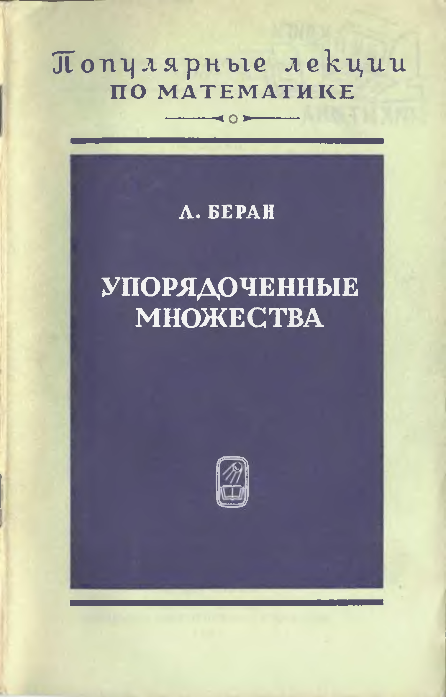
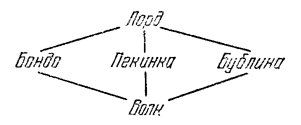
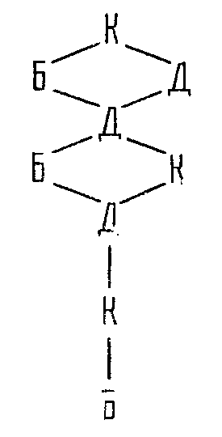

# ВСТУПИТЕЛЬНЫЕ МАТЕРИАЛЫ

## Вступительные материалы

---
**стр. 0**
---

Популярные лекции по математике

Л. БЕРАН

# УПОРЯДОЧЕННЫЕ МНОЖЕСТВА

---
**стр. 1**
---

ПОПУЛЯРНЫЕ ЛЕКЦИИ ПО МАТЕМАТИКЕ  
ВЫПУСК 55

Л. БЕРАН

# УПОРЯДОЧЕННЫЕ МНОЖЕСТВА

Перевод с чешского  
В. Н. САЛИЯ

Под редакцией Л. А. СКОРНЯКОВА

МОСКВА «НАУКА»  
ГЛАВНАЯ РЕДАКЦИЯ  
ФИЗИКО-МАТЕМАТИЧЕСКОЙ ЛИТЕРАТУРЫ  
1981

---
**стр. 2**
---

22.144  
Б 48  
УДК 512

L. Beran

USPOŘÁDANÉ  
MNOŽINY

Nakladatelství  
Mladá fronta  
Praha  
1978

Беран Л.

Б 48 Упорядоченные множества: Пер. с чешск. — М.: Наука, 1981, 64 с. — (Популярные лекции по математике). — 15 коп.

Брошюра содержит популярное изложение важного для современной математики понятия частично упорядоченного множества. Рассмотрены понятия точной верхней и точной нижней граней, введены структуры (решетки), рассмотрены алгебраические свойства операций взятия точных граней, введены дистрибутивные структуры.

Для учащихся старших классов средней школы и студентов младших курсов вузов.

Б $\dfrac{20203—048}{053(02)—81}$ 81—81. 1702030000

ББК 22.144  
512

© Ladislav Beran, 1978  
© Перевод на русский язык. Издательство «Наука». Главная редакция физико-математической литературы, 1981

---
**стр. 3**
---

# Оглавление

ПРЕДИСЛОВИЕ РЕДАКТОРА РУССКОГО ПЕРЕВОДА 4

ПРЕДИСЛОВИЕ 5

ВВЕДЕНИЕ 9

Глава 1. УПОРЯДОЧЕННЫЕ МНОЖЕСТВА 11

Глава 2. РЕШЕТКИ: ОСНОВНЫЕ СВОЙСТВА 18

Глава 3. ПРИМЕРЫ РЕШЕТОК 28

Глава 4. ОСНОВНЫЕ КЛАССЫ РЕШЕТОК 37

РЕШЕНИЯ И ОТВЕТЫ К УПРАЖНЕНИЯМ 50

ПРИЛОЖЕНИЕ 58

ЛИТЕРАТУРА 62

ПРЕДМЕТНЫЙ УКАЗАТЕЛЬ 63

---
**стр. 4**
---

# Предисловие редактора русского перевода

Понятие частично упорядоченного множества является фундаментальным для современной теоретико-множественной математики и встречается во многих прикладных вопросах. В предлагаемой вниманию читателя книге содержится популярное изложение этого понятия, а также связанные с ним понятия точной верхней и точной нижней граней, введены решетки (структуры), рассмотрены алгебраические свойства операций взятия точных граней, введены модулярные и дистрибутивные решетки. Автор не излагает сколько-нибудь глубоких теорем. Однако предлагаемые им примеры, задачи и упражнения позволяют овладеть введенными понятиями. От читателя требуется владение основными понятиями теории множеств в объеме средней школы, с популярным изложением которых можно ознакомиться, например, по книгам [1] (гл. I), [6] (гл. III) и [7]. В книгах [6] и [7] можно найти дальнейшие сведения о решетках (структурах) и булевых алгебрах. Для более глубокого изучения этих понятий можно рекомендовать монографии [2], [3], [4], а также § 7 гл. II учебного пособия [5]. При подготовке русского издания были изъяты все ссылки на чешскую литературу. Так что вся библиография, за исключением работ [9] и [10], составлена редактором русского перевода. В оригинале имелись ссылки на доказательства, содержащиеся в книге [9]. В русском переводе они содержатся в «Приложении», написанном редактором.

*Л. А. Скорняков*

---
**стр. 5**
---

# Предисловие

Теория упорядоченных множеств, наиболее разработанная в рамках теории решеток, относится к числу современных математических дисциплин. Книжка, которую вы, дорогие читатели, сейчас открыли, познакомит вас с основными понятиями и методами этого раздела математики. Решая собранные в ней задачи и упражнения, вы сможете усвоить важные конкретные примеры. При этом от вас не потребуется почти никаких навыков в численных расчетах. Но эта математика «без таблицы умножения» тоже имеет свои правила, свой круг проблем, свое очарование. Книжка позволит вам несколько иначе взглянуть и на некоторые понятия школьной программы.

В ходе долгого исторического развития люди постоянно встречались с различными частными случаями упорядочения. Сначала это было упорядочение привычных вещей и повседневных явлений. Позднее — по мере того, как совершенствовались трудовые навыки и мастерство — обнаруживалось упорядочение отдельных этапов в той или иной деятельности, и оно как приобретенный опыт передавалось из поколения в поколение. Так уже с первых робких шагов, с самых первых изготовленных предметов люди обнаруживали все новые виды упорядочения окружающих вещей, своей деятельности.

С некоторых из этих упорядочений мы свыклись настолько, что часто их просто не осознаем, как, например, грамматический порядок слов в предложении. Мы постоянно упорядочиваем предметы и явления по тому, насколько они нам нравятся. Так, если нам придется сравнивать голоса певчих птиц, то, конечно, результат будет определяться нашей собственной оценкой их пения. После некоторых размышлений мы согласимся, что имеем дело с упорядочениями и в следующем примере.

---
**стр. 6**
---

Предположим, нужно выстроить каким-то образом наших четвероногих друзей — собак с кличками Бондо, Пекинка, Лорд, Волк, Бублина. Как это можно сделать? Кто-то, очевидно, предложит алфавитный порядок: Бондо — Бублина — Волк — Лорд — Пекинка. Другой расположит лохматых псов в зависимости от того, как они ему нравятся, скажем, так: Лорд — Бондо — Пекинка — Бублина — Волк. Третий же, подумав, расставит их с меньшей определенностью: конечно, больше всех ему нравится Лорд, но вот Бондо, Пекинка и Бублина кажутся ему одинаково милыми, диковатый же Волк не вызывает большой симпатии. И тогда получится такое расположение:

Еще пример. Малыши наблюдают за цветом проезжающих мимо машин. Каждый играющий стремится насчитать как можно больше машин «своего» цвета. Предположим, играют двое. Первому нужно, чтобы проехало как можно больше машин белого цвета (мы их будем обозначать буквой Б), но при этом он внимательно следит и за красными машинами (их мы обозначаем далее буквой К), которые приносят очки его противнику. Машины других цветов (в обозначении Д) игроки отмечают лишь краем глаза.

По схеме

---
**стр. 7**
---

(время у нас идет снизу вверх) мы установим не только то, что к данному моменту игра имеет ничейный результат, но и то, что первой проехала белая машина, потом красная, а за ней как-то иначе окрашенная. Рассуждая далее, видим, что оба наблюдателя отметили одновременное появление белой и красной машин, а спустя некоторое время — белой и машины, которая не была ни красной, ни белой.

Обратимся теперь к несколько иным ситуациям. Наверное, многие из вас в свободное время любят мастерить. Сначала перед вами просто набор различных материалов, а результат — красивая модель парусника, собранный своими руками транзисторный приемник, макет современного здания или велотрека и т. п. Вы хорошо знаете, что для того чтобы добиться успеха в этой своей работе, нужно действовать систематически, другими словами, нужно определенным образом упорядочить свою деятельность. Того же требует от вас и изучение иностранных языков. То же самое происходит и на более высоком уровне — при организации любой производственной деятельности. Здесь большую помощь оказывают человеку различные вычислительные машины — от карманных калькуляторов до огромных автоматических устройств, управляющих целыми предприятиями. Не все знают, что принцип действия этих машин опирается на так называемый булевский тип упорядочения.

Но оказывается, что и в обычных житейских ситуациях вы встречаетесь с подобным способом упорядочения своих рассуждений. Например, ваши планы на сегодняшний день могут зависеть от того, пойдет или не пойдет Иржи в кино, а Ота поедет или не поедет к дяде. Опыт подсказывает вам, что могут представиться следующие четыре варианта:

1) Иржи пойдет, Ота поедет;  
2) Иржи пойдет, Ота не поедет;  
3) Иржи не пойдет, Ота поедет;  
4) Иржи не пойдет, Ота не поедет.

Если вы в своих рассуждениях будете рассматривать эти четыре случая, то это значит, что вы использовали при оценке возможных ситуаций так называемую классическую булевскую логику.

Однако при изучении закономерностей квантовой механики оказалось целесообразным обобщить этот тип

---
**стр. 8**
---

упорядочения — это привело к так называемому ортомодулярному упорядочению. И здесь, таким образом, человек опирается на опыт, приобретенный тысячелетним наблюдением различных упорядочений, и стремится использовать накопленную информацию для углубления своих знаний в области микромира.

Вопросы, затрагиваемые в этой книжке, относятся к сравнительно узкой области теории упорядоченных множеств, они связаны в основном с программой средней школы. Но хочется верить, что, ознакомившись с ними, внимательный читатель осознает полезность понятия упорядочения в элементарной математике и что он по достоинству оценит тот длинный путь познания, который человечество прошло от достаточно неопределенного понятия упорядочения, используемого в разговорном языке, к математическому уточнению этого понятия и к современному уровню его исследования.

---
**стр. 9**
---

# ВВЕДЕНИЕ

В школе вы уже усвоили, вероятно, смысл выражения «число $a$ меньше числа $b$» или значение слов «множество $A$ является подмножеством множества $B$». Общим у таких высказываний является то, что они ставят один объект в определенное отношение к другому. В дальнейшем мы и будем изучать подобные отношения. Но сначала уточним само понятие отношения так, чтобы оно могло стать предметом математического исследования.

Чтобы прийти к этому понятию, мы для большей наглядности рассмотрим пример, где участвует конечное число элементов. Вы помните, что о двух числах $m$, $n$ говорят, что $m$ делит $n$ и пишут $m\mid n$, если существует целое число $k$ такое, что $km=n$*).

Найдем все числа $a$, $b$ из множества $N_4=\{0,1,2,3,4\}$ такие, что $a\mid b$. Очевидно, мы получим следующие случаи:

$$
\tag{1}
\begin{cases}
0\mid0;\\
1\mid0,\ 1\mid1,\ 1\mid2,\ 1\mid3,\ 1\mid4;\\
2\mid0,\ 2\mid2,\ 2\mid4;\\
3\mid0,\ 3\mid3;\\
4\mid0,\ 4\mid4.
\end{cases}
$$

Будем теперь писать $a\delta b$ тогда и только тогда, когда $a,b\in N_4$ и при этом $a$ делит $b$. Это еще один пример связи между элементами, которую мы хотим включить в общее понятие отношения. Прежде всего договоримся читать запись $a\delta b$ словами «$a$ находится в отношении $\delta$

\*) Обратите внимание, что согласно этому определению 0 делит 0. — *Прим. ред.*

---
**стр. 10**
---

с $b$», и тогда естественным образом приходим к тому, чтобы рассматриваемое отношение назвать отношением $\delta$. Так что же это такое — отношение $\delta$? В соответствии с таблицей (1) $a\delta b$ истинно тогда и только тогда, когда $(a,b)$ является одной из упорядоченных пар*) следующего списка:

$$
\tag{2}
\begin{cases}
(0,0);\\
(1,0),\ (1,1),\ (1,2),\ (1,3),\ (1,4);\\
(2,0),\ (2,2),\ (2,4);\\
(3,0),\ (3,3);\\
(4,0),\ (4,4).
\end{cases}
$$

Это приводит нас к мысли о том, что было бы целесообразно определить отношение $\delta$ как множество, элементами которого являются упорядоченные пары из таблицы (2) и только они. При этом условимся рассматривать запись $a\delta b$ как выражение того факта, что пара $(a,b)$ является элементом множества $\delta$, т. е. что $(a,b)\in\delta$.

Теперь перейдем к общему случаю. Пусть $A$ — некоторое непустое множество. *Декартовым квадратом* множества $A$ назовем множество $A^2$ (обозначаемое также $A\times A$), элементами которого являются всевозможные упорядоченные пары $(a,b)$, где $a,b$ пробегают множество $A$. Если $\rho$ — подмножество множества $A^2$, то будем говорить, что $\rho$ является *отношением* на множестве $A$. Выражение $(a,b)\in\rho$ считается эквивалентным записи $a\rho b$.

**Пример 1.** Найти декартов квадрат множества $N_4$.

**Решение.** Множество $N_4^2$ состоит из элементов, которые для наглядности расположим в виде следующей таблицы:

$$
\begin{aligned}
&(0,0),\ (0,1),\ (0,2),\ (0,3),\ (0,4),\\
&(1,0),\ (1,1),\ (1,2),\ (1,3),\ (1,4),\\
&(2,0),\ (2,1),\ (2,2),\ (2,3),\ (2,4),\\
&(3,0),\ (3,1),\ (3,2),\ (3,3),\ (3,4),\\
&(4,0),\ (4,1),\ (4,2),\ (4,3),\ (4,4).
\end{aligned}
$$

\*) Слова «упорядоченная пара» означают, что пары $(a,b)$ и $(b,a)$ считаются различными. — *Прим. ред.*

---
**стр. 11**
---

Заканчивая введение, вспомним, что если действительное число $p$ меньше или равно $q$, мы пишем $p\leqslant q$, и что для любых действительных чисел $p$, $q$, $r$ справедливы следующие утверждения: (i) $p\leqslant p$; (ii) если $p\leqslant q$ и $q\leqslant p$, то $p=q$; (iii) если $p\leqslant q$ и $q\leqslant r$, то $p\leqslant r$. Отношение $\leqslant$ на множестве $R$ всех действительных чисел в соответствии с ранее сказанным мы можем рассматривать как множество, элементами которого являются упорядоченные пары $(p,q)$ действительных чисел такие, для которых разность $q-p$ неотрицательна.
