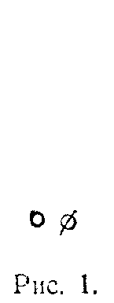
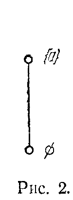
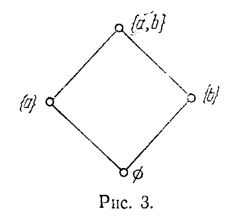
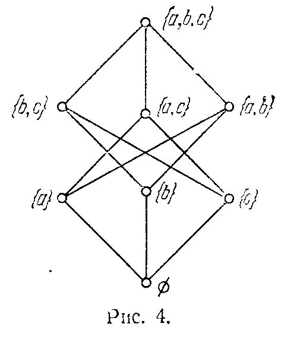

## 1.1. Упорядоченные множества

---
**стр. 11, продолжение**
---

# Глава 1

## УПОРЯДОЧЕННЫЕ МНОЖЕСТВА

Заметим, что отношение $\delta$ на множестве $N_4$, определенное на стр. 9, имеет некоторые общие свойства с отношением $\leqslant$ на $R$, именно,

| $m\delta m$ | $m\mid m$ |
|---|---|
| для любого $m\in N_4$; если $m\delta n$ и $n\delta m$, то $m=n$; если $m\delta n$ и $n\delta k$, то $m\delta k$. | для любого $m\in N_4$; если $m\mid n$ и $n\mid m$, то $m=n$; если $m\mid n$ и $n\mid k$, то $m\mid k$. |

Напомним названия основных свойств отношений. Пусть $\rho$ — отношение на множестве $A$, т. е. $\rho\subset A^2$.

Отношение $\rho$ называется *рефлексивным*, если

| $(a,a)\in\rho$ | $a\rho a$ |
|---|---|
| для любого $a\in A$. | для любого $a\in A$. |

(Для удобства читателей мы приводим определения в обеих принятых нами записях.)

Отношение $\rho$ по определению *антисимметрично* тогда и только тогда, когда оно обладает следующим свойством:

| если $(a,b)\in\rho$ и $(b,a)\in\rho$, то $a=b$. | если $a\rho b$ и $b\rho a$, то $a=b$. |
|---|---|

Отношение $\rho$ называется *транзитивным* тогда и только тогда, когда выполняется условие:

| если $(a,b)\in\rho$ и $(b,c)\in\rho$, то $(a,c)\in\rho$. | если $a\rho b$ и $b\rho c$, то $a\rho c$. |
|---|---|

---
**стр. 12**
---

Наконец, отношение $\rho$ называется *симметричным* тогда и только тогда, когда для него выполняется условие:

если $(a,b)\in\rho$, то $(b,a)\in\rho$, $\|$ если $a\rho b$, то $b\rho a$.

**Пример 2.** Для двух действительных чисел $a,b$ будем писать $a\sigma b$ тогда и только тогда, когда $a:(a^2+1)\leqslant b:(b^2+1)$. Нужно исследовать свойства так определенного на множестве $R$ всех действительных чисел отношения.

*Решение*. Отношение $\sigma$ рефлексивно, поскольку для любого действительного числа $a$ частное $a:(a^2+1)$ определено и, конечно, $a:(a^2+1)\leqslant a:(a^2+1)$. Это отношение не является антисимметричным, так как $1/2\,\sigma\,2$ и одновременно $2\,\sigma\,1/2$, но $1/2\ne2$. Однако оно принадлежит к числу транзитивных отношений, поскольку из неравенств

$$
a:(a^2+1)\leqslant b:(b^2+1)
\quad\text{и}\quad
b:(b^2+1)\leqslant c:(c^2+1)
$$

вытекает, что

$$
a:(a^2+1)\leqslant c:(c^2+1).
$$

Наконец, из того, что $0\sigma1$, но пара $(1,0)$ не принадлежит отношению $\sigma$, заключаем, что рассматриваемое отношение симметричным не будет.

Для *непустого* множества $P$, на котором определено отношение $\rho$, являющееся рефлексивным, антисимметричным и транзитивным, введем специальное название. Точная формулировка выглядит следующим образом. Если $\mathcal P$ обозначает упорядоченную пару $(P,\rho)$, где $P$ — непустое множество, а $\rho$ — отношение, которое обладает указанными тремя свойствами, то будем говорить, что $\mathcal P$ является *упорядоченным множеством*\*). Иногда будем употреблять сокращенную запись: $\mathcal P$ есть у. м. Множество $P$ называется *носителем* у. м. $\mathcal P$, а отношение $\rho$ — *упорядочением* множества $P$; элементы множества $P$ считаются *элементами упорядоченного множества* $\mathcal P$. Для обозначения упорядочения на произвольном множестве иногда употребляют символ $\ll$ (запись $a\ll b$ читается «$a$ предшествует $b$» или «$b$ следует за $a$») или используют (если нет опасности непонимания) знак $\leqslant$ (запись $a\leqslant b$ читается «$a$ меньше или равно $b$» или

\*) В научной литературе в этом случае чаще говорят о *частично упорядоченном множестве*, ибо некоторые элементы $a$ и $b$ могут оказаться не сравнимыми, т. е. такими, что ни $(a,b)$, ни $(b,a)$ не лежит в $\rho$. В примере на с. 9 такими будут, скажем, числа 2 и 3. — *Прим. ред.*

---
**стр. 13**
---

так же, как запись $a\ll b$). Выражение $a\geqslant b$ считается равносильным выражению $b\leqslant a$.

**Пример 3.** Возьмем в качестве множества $P$ открытый интервал $(1,\infty)$ и для двух действительных чисел $p,q$ будем писать $p\ll q$ тогда и только тогда, когда $p\sigma q$, имея в виду $\sigma$, определенное в примере 2. Доказать, что отношение $\ll$ является упорядочением множества $(1,\infty)$.

*Решение*. Вследствие рассуждений, проведенных в примере 2, достаточно установить антисимметричность отношения $\ll$. Пусть $a,b$ — два числа из интервала $(1,\infty)$ такие, что $a\ll b$ и одновременно $b\ll a$. Тогда из $a:(a^2+1)\leqslant b:(b^2+1)\leqslant a:(a^2+1)$, конечно, следует, что $a:(a^2+1)=b:(b^2+1)$. Отсюда вытекает сначала равенство

$$
ab^2+a=ba^2+b,
$$

а затем

$$
ab^2-ba^2=b-a,
$$

что эквивалентно условию

$$
ab(b-a)=b-a.
$$

Читатель, имевший дело с равенствами, содержащими параметр, хорошо знает, что без дополнительных рассуждений в подобных ситуациях нельзя поддаваться желанию сократить равенство на число $b-a$. Как же тогда поступить? Наш опыт подсказывает, что нужно рассмотреть две возможности: $b-a\ne0$ или $b-a=0$. Если $b-a\ne0$, то обе части равенства можно разделить на ненулевое число $b-a$, и тогда получается $ab=1$, что для наших чисел $a,b$, очевидно, невозможно (ведь $a>1$ и $b>1$). Тогда единственной возможностью остается случай $b-a=0$. Значит, $a=b$, и мы доказали, что $\ll$ является на $(1,\infty)$ антисимметричным отношением.

**Пример 4.** Для двух действительных чисел $a,b>1$ будем писать $a\tau b$ тогда и только тогда, когда оба числа $\pi a:(a^2+1)$, $\pi b:(b^2+1)$ принадлежат области определения функции $y=\operatorname{tg}x$ и при этом имеет место неравенство

$$
\operatorname{tg}\frac{\pi a}{a^2+1}\leqslant
\operatorname{tg}\frac{\pi b}{b^2+1}.
$$

---
**стр. 14**
---

Требуется найти такие подмножества $M$ множества $(1,\infty)$, на которых так определенное отношение является упорядоченностью.

*Решение*. Прежде всего, $M$ должно быть непустым подмножеством множества $(1,\infty)$. Отношение $\tau$, очевидно, при любом допустимом выборе $M$ является рефлексивным и транзитивным. Теперь на время отвлечемся от исследования отношения $\tau$. Для дальнейших рассуждений нам понадобится следующее вспомогательное предложение:

*(3) Для любого действительного числа $x$ выполняются неравенства*

$$
-\frac12\leqslant\frac{x}{x^2+1}\leqslant\frac12,
$$

*причем левое неравенство обращается в равенство тогда и только тогда, когда $x=-1$, а правое — тогда и только тогда, когда $x=1$.*

*Доказательство*. Поскольку $0\leqslant(x-1)^2$ для любого $x\in R$ (и равенство здесь имеет место тогда и только тогда, когда $x=1$), то $2x\leqslant x^2+1$, откуда $x:(x^2+1)\leqslant1/2$ (и равенство имеет место только при $x=1$). Положив $x=-z$, мы получим из доказанного, что для любого $z\in R$ справедливо

$$
-\frac{z}{z^2+1}\leqslant\frac12,
$$

причем равенство возможно лишь в случае $x=-z=1$, так что для любого $z\in R$ будет

$$
\frac{z}{z^2+1}\geqslant-\frac12,
$$

и равенство достигается лишь при $z=-1$. Этим завершается доказательство истинности левого неравенства. Читателю в качестве упражнения предлагается вывести это неравенство непосредственно из неравенства $0\leqslant(x+1)^2$.

Вернемся к исследованию отношения $\tau$. Из (3) видно, что

$$
-\frac{\pi}{2}\leqslant\frac{\pi a}{a^2+1}\leqslant\frac{\pi}{2},
$$

т. е. что $\pi a:(a^2+1)$ принадлежит области определения функции $y=\operatorname{tg}x$ тогда и только тогда, когда $a\ne\pm1$.

Теперь легко установить, что отношение $\tau$ на каждом подмножестве $M$ множества $(1,\infty)$ необходимо анти-

---
**стр. 15**
---

симметрично. Действительно, если $a\sigma b$ и одновременно $b\sigma a$, то

$$
\operatorname{tg}\frac{\pi a}{a^2+1}=\operatorname{tg}\frac{\pi b}{b^2+1},
$$

а так как вследствие (3) и выбора $M$ числа $\pi a:(a^2+1)$ и $\pi b:(b^2+1)$ принадлежат интервалу $(-\pi/2,\ \pi/2)$, мы получаем $\pi a:(a^2+1)=\pi b:(b^2+1)$, что, как было показано в решении примера 3, влечет равенство $a=b$.

Условию, поставленному в примере 4, таким образом, удовлетворяет любое непустое подмножество множества $(1,\infty)$.

**Задача 1.** На множестве $N_0$ всех неотрицательных целых чисел определим отношение $\sigma_1$ так, что $(a,b)\in\sigma_1$ тогда и только тогда, когда $a\mid b$. Докажите, что отношение $\sigma_1$ является упорядочением множества $N_0$.

**Задача 2.** Пусть $E$ — некоторое произвольное множество. Положим $(M,N)\in\sigma_2$ тогда и только тогда, когда $M\subset N$ и $N\subset E$. Докажите, что отношение $\sigma_2$ является упорядочением множества всех подмножеств множества $E$.

**Задача 3.** Отношение $\sigma_3$ на множестве $R$ всех действительных чисел определим так, что $(a,b)\in\sigma_3$ для двух действительных чисел $a,b$ тогда и только тогда, когда $a\leqslant1$ или $b\geqslant-1$. Будет ли $\sigma_3$ отношением:

a) рефлексивным, b) антисимметричным, c) транзитивным, d) симметричным?

[a) да, b)—d) нет.]

**Задача 4.** Исследуйте, будет ли отношение $\sigma$, введенное для действительных чисел в примере 2, определять упорядочение на множестве:

a) $[1,\infty)$; b) $(-1,1)$; c) $[-1,1]$; d) $(-\infty,-1]$; e) $(-\infty,0)$.

[a)—d) да, e) нет.]

**Задача 5.** Докажите, что выражение $a\sigma b$ в случаях b), c) из задачи 4 эквивалентно неравенству $a\leqslant b$, а в случаях a), d) — неравенству $a\geqslant b$.

**Пример 5.** Для двух действительных чисел $a,b$ пусть $a\sigma_4b$ означает, что

$$
\lg\left[(a-b)+\sqrt{(a-b)^2+1}\right]\geqslant0.
$$

Нужно доказать, что $a\sigma_4b$ имеет место тогда и только тогда, когда $a\geqslant b$.

---
**стр. 16**
---

**Решение.** Поскольку для каждого действительного числа $x$ будет $\sqrt{x^2+1}>\sqrt{x^2}=|x|$, то $x+\sqrt{x^2+1}>x+|x|\geqslant0$, и поэтому выражение $\lg(x+\sqrt{x^2+1})$ определено для любого действительного числа $x$. Если $x>0$, то $x+\sqrt{x^2+1}>x+1>1$, откуда $\lg(x+\sqrt{x^2+1})>\lg1=0$. Если $x<0$, положим $x=-z$. Из уже показанного следует, что
$0<\lg(z+\sqrt{z^2+1})=\lg(-x+\sqrt{x^2+1})$. Но ведь

$$
\lg(-x+\sqrt{x^2+1})+\lg(x+\sqrt{x^2+1})
=\lg[(-x+\sqrt{x^2+1})(x+\sqrt{x^2+1})]=\lg1=0,
$$

и поэтому

$$
0<\lg(-x+\sqrt{x^2+1})=-\lg(x+\sqrt{x^2+1}).
$$

Отсюда (при исходном предположении $x<0$) будет $0>\lg(x+\sqrt{x^2+1})$. Таким образом, мы доказали (случай $x=0$ тривиален):

(i) Если $x>0$, то $\lg(x+\sqrt{x^2+1})>0$;

(ii) Если $x<0$, то $\lg(x+\sqrt{x^2+1})<0$;

(iii) Если $x=0$, то $\lg(x+\sqrt{x^2+1})=0$.

Предположим теперь, что число $t$ таково, что $\lg(t+\sqrt{t^2+1})>0$. Из (ii) видно, что не может быть $t<0$, а из (iii) заключаем, что невозможно и $t=0$. Остается единственная возможность $t>0$. Отсюда (и из аналогичных рассуждений в случаях (ii) и (iii)) вытекают следующие усиления предложений (i)—(iii):

(i′) $\lg(x+\sqrt{x^2+1})>0$ тогда и только тогда, когда $x>0$;

(ii′) $\lg(x+\sqrt{x^2+1})<0$ тогда и только тогда, когда $x<0$;

(iii′) $\lg(x+\sqrt{x^2+1})=0$ тогда и только тогда, когда $x=0$.

Теперь ясно, что

$$
\lg\left[(a-b)+\sqrt{(a-b)^2+1}\right]\geqslant0
$$

тогда и только тогда, когда $a-b\geqslant0$, т. е. в том и только том случае, если $a\geqslant b$.

Решив задачу 2, мы увидим, что отношение включения является упорядочением множества $P(E)$ всех подмножеств множества $E$ или, другими словами, что упорядоченная пара $(P(E),\subset)$ представляет собой упорядоченное множество. Попробуем наглядно представить подобные упорядоченные множества, по крайней мере

---
**стр. 17**
---

в простейших случаях, при помощи подходящих диаграмм. Для этого заключим следующее соглашение. Если $\mathcal P=(P,\leqslant)$ — упорядоченное множество, которое имеет конечное число элементов, и если для двух его элементов $a,b$ имеет место соотношение $a\leqslant b$, изобразим оба элемента кружками, причем $a$ расположим под $b$ и соединим их отрезком. Чтобы упростить диаграмму, это соединение будем производить лишь в том случае, когда $a\ne b$ и между $a$ и $b$ нет ни одного другого элемента упорядоченного множества, т. е. когда $a\ne b$ и когда из того, что $z\in P$ и $a\leqslant z\leqslant b$, следует, что $a=z$ или $z=b$. В этом случае говорят, что $b$ *покрывает* $a$.

Для $E=\varnothing$ диаграмма изображена на рис. 1, для $E=\{a\}$ см. рис. 2, для $E=\{a,b\}$ см. рис. 3, диаграмма для случая $E=\{a,b,c\}$ представлена на рис. 4.

**Задача 6.** Пусть $\pi$ — некоторая плоскость, $V$ — произвольно выбранная точка на ней. Для двух точек $A,B$ на $\pi$ будем писать $(A,B)\in\sigma_5$ в том и только том случае, когда отрезки $VA$, $VB$ имеют одинаковую длину. Получаем отношение $\sigma_5$ на множестве всех точек плоскости $\pi$. Исследуйте его.

[Отношение $\sigma_5$ рефлексивно, симметрично и транзитивно, но оно не антисимметрично.]

**Задача 7.** Исследуйте отношение $\mid$ («делит») на множестве $Z$ всех целых чисел.

[Оно рефлексивно, транзитивно, но не является ни симметричным, ни антисимметричным.]

---
**стр. 18**
---

Отношения $\sigma_5$ и $\mid$ оба рефлексивны и транзитивны. Отношение $\rho$ на непустом множестве $M$, являющееся рефлексивным и транзитивным, называется *квазиупорядочением* множества $M$. Отношение $\rho$ на непустом множестве $M$, являющееся рефлексивным, симметричным и транзитивным, называется *эквивалентностью* на множестве $M$.

### Упражнения

1. Найдите все отношения на двухэлементном множестве $\{a,b\}$.
2. Среди отношений из упр. 1 укажите:
   а) все рефлексивные;  
   б) все симметричные;  
   в) все антисимметричные;  
   г) все транзитивные.
3. Постройте пример отношения, которое было бы симметричным и транзитивным, но не рефлексивным.
4. Среди отношений из упр. 1 выделите:
   а) все квазиупорядочения;  
   б) все упорядочения;  
   в) все эквивалентности.
5. Найдите все эквивалентности:
   а) на трехэлементном множестве $\{a,b,c\}$;  
   б) на четырехэлементном множестве $\{a,b,c,d\}$.
