# Беран, гл. 1, задача 3: как из σ₃ получить упорядочение (полный разбор)

Авторская заметка, **не расшифровка книги**. Продолжает [[beran_uporyadochennye_g01_s01_zzz_resheniya_zadach_1_3|решения задач 1–3]]: там проверено, что $\sigma_3$ рефлексивно, но не антисимметрично, не транзитивно и не симметрично (ответ книги «a) да, b)–d) нет»). Здесь разобран следующий вопрос, которого в книге нет: **как из $\sigma_3$ всё-таки получить упорядочение**. Вопрос распадается на две разные задачи, и обе решены до конца.

Заметка записывает и **ход понимания**: какие представления появлялись по пути, почему они не подходили и что их заменило (раздел 2). Решения целиком — в разделах 3 и 4, сравнение — в разделе 5.

Две интерактивные страницы, с которыми шёл разбор, сохранены рядом (раздел 6):

- [sigma3_interaktivnyy_chertezh.html](assets/beran_uporyadochennye_g01_s01_zzz_sigma3_razbor/sigma3_interaktivnyy_chertezh.html) — чертёж с подвижными точками, проверка трёх свойств в любом сочетании, конструктор отношения;
- [sigma3_poryadki_obyasnenie.html](assets/beran_uporyadochennye_g01_s01_zzz_sigma3_razbor/sigma3_poryadki_obyasnenie.html) — объяснение со схемами: обе задачи и их сравнение.

---

## 1. Исходная картинка

$$a\,\sigma_3\,b\iff a\le1\ \text{или}\ b\ge-1.$$

Пара $(a,b)$ — точка плоскости: $a$ по горизонтали, $b$ по вертикали. «Точка закрашена» значит «$a\,\sigma_3\,b$», то есть «$a$ стоит перед $b$». «Или» ложно, только когда ложны обе части, поэтому вне отношения лежит ровно один угол:

$$\text{не } a\,\sigma_3\,b\iff a>1\ \text{и}\ b<-1.$$

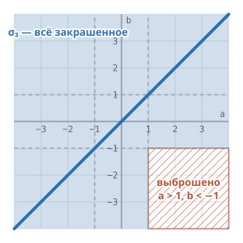

Прямые $a=\pm1$, $b=\pm1$ делят числа на три зоны: **маленькие** ($<-1$), **средние** ($[-1,1]$), **большие** ($>1$). Плоскость делится на 9 клеток, и выброшена из них ровно одна:

| | $a<-1$ | $-1\le a\le1$ | $a>1$ |
|---|---|---|---|
| $b>1$ | ✓ | ✓ | ✓ |
| $-1\le b\le1$ | ✓ | ✓ | ✓ |
| $b<-1$ | ✓ | ✓ | **✗ угол** |

Словами: **$\sigma_3$ запрещает ровно одно — ставить большое число перед маленьким.** Весь разбор держится на этой фразе.

---

## 2. Ход понимания

Сводка: что думалось на каждом шаге и что оказалось на самом деле. Подробности — в подразделах.

| № | Представление | Что оказалось |
|---|---|---|
| 2.1 | Упорядоченная часть $\sigma_3$ — это прямая $b=a$ | Диагональ — это рефлексивность. Она есть в любом рефлексивном отношении и про $\sigma_3$ ничего не говорит |
| 2.2 | Тогда полоса вокруг диагонали, не задевающая угол | Полоса симметрична относительно диагонали, а значит, нарушает антисимметричность |
| 2.3 | «Квадрат $M\times M$» — откуда $M$? | $M$ — искомое множество чисел. Его не было в условии, оно возникло из вопроса |
| 2.4 | Рефлексивность: при чём тут $(1,0)$? | Ни при чём. Рефлексивность требует только всю диагональ |
| 2.5 | Антисимметричность разрешает только диагональ | Нет. Она запрещает лишь **пару** «точка + её зеркало». Это импликация, и при ложной посылке она истинна |
| 2.6 | После двух свойств остаётся «диагональ + левый верхний угол»? | Это лишь минимальный вариант. Варианты 0, 1, 2, … предложены самостоятельно, все верны |
| 2.7 | Транзитивность — «правило уголка» непонятно без картинки | Путь $(a,b)\to(b,b)\to(b,c)$ и «прямой путь» $(a,c)$. Понятно стало на интерактивном чертеже |
| 2.8 | Вердикт «вариант 0 транзитивен» показался ошибкой | Вердикт верный: двух точек угла, составляющих путь, не бывает |
| 2.9 | Как описать **все** упорядочения внутри $\sigma_3$ | Первый ответ («ни одно $r\in R$ не стоит перед $l\in L$») был непонятен: в нём не было свойств. Понятно стало после вывода через три свойства по шагам, «пила» понравилась |
| 2.10 | Вторая задача («какие числа оставить») не прояснилась | Решена с условия, по шагам, со схемами |
| 2.11 | **Итог:** вторая задача — та же первая, только на дискретных точках | Да. Плюс одно ограничение: точку нельзя стереть по одной, только вместе со всем числом (строкой и столбцом) |

### 2.1. «Это линия $b=a$?»

Прямая $b=a$ — это пары $(a,a)$, диагональ. Она целиком лежит в $\sigma_3$ (угол её не касается: нельзя одновременно $a>1$ и $a<-1$). Но так же она лежит в **любом** рефлексивном отношении, так что на вопрос «где в $\sigma_3$ порядок» не отвечает. Сама по себе диагональ — тоже упорядочение (равенство: каждый сравним только с собой), но это тривиальный случай.

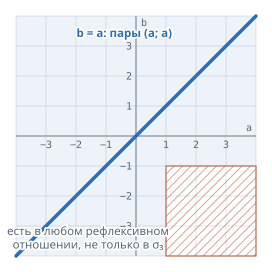

### 2.2. «Тогда полоса вокруг диагонали?»

Полоса $|b-a|\le\varepsilon$ симметрична относительно диагонали. Вместе с каждой точкой $(a,b)$ в ней лежит зеркальная $(b,a)$, например $(0;\,0{,}6)$ и $(0{,}6;\,0)$. Это и есть нарушение антисимметричности.

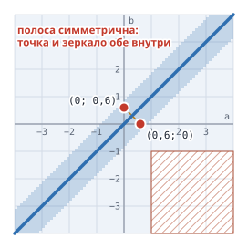

Вывод, сделанный тогда: **график порядка не может быть симметричным вокруг диагонали**, вне диагонали он лежит «по одну сторону» от каждой зеркальной пары. У $\le$, например, это полуплоскость над диагональю.

### 2.3. Откуда взялось $M$ и почему «квадрат»

Первый ответ звучал так: «ищем множества чисел $M$, на которых $\sigma_3$ — упорядочение, на плоскости это квадрат $M\times M$». Было непонятно, что такое $M$: в условии его нет.

$M$ — **искомое подмножество чисел**. Вопрос «где $\sigma_3$ станет порядком» можно понять так: какие числа оставить, чтобы $\sigma_3$ на них было упорядочением. Буква взята из примера 4 Берана, где такой же вопрос ставится для другого отношения.

«Смотреть $\sigma_3$ только на $M$» значит брать пары, у которых **обе** координаты из $M$. Множество таких точек — $M\times M$. Для отрезка $M=[2,3]$ это буквально квадрат, для $M=\{-3,2\}$ — четыре точки.

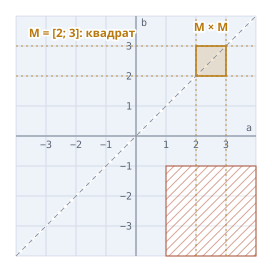 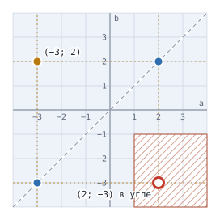

Главное здесь: при таком подходе **форму области мы не выбираем**. Выбираем только числа, а точки появляются сами. Это вторая задача (раздел 4). Попытки 2.1 и 2.2 по сути рисовали область произвольной формы, то есть решали первую задачу (раздел 3), но без проверки свойств.

После этого решено идти геометрически, по одному свойству, не строя $M$ сразу.

### 2.4. Рефлексивность

Вопрос: если для рефлексивности нужна диагональ, как ей может отвечать точка вроде $(1,0)$?

Никак: рефлексивность про точки вне диагонали **ничего не говорит**. Она требует одного: вся диагональ закрашена. Остальные точки могут быть или не быть, это решают другие свойства. У $\le$, например, кроме диагонали есть вся полуплоскость над ней, и $\le$ рефлексивно.

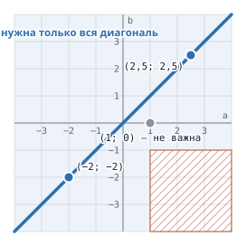

Рефлексивность — это вопрос «вся ли диагональ закрашена?». У $\sigma_3$ ответ «да».

### 2.5. Антисимметричность: «тогда только диагональ?»

Рассуждение было такое: $(1,0)$ и $(0,1)$ обе в $\sigma_3$, но $0\ne1$, значит, подходит только диагональ.

Первая половина верна: эта пара действительно нарушает антисимметричность. Вывод «только диагональ» неверен. Путаница в слове «**и**» в определении:

$$a\rho b\ \text{и}\ b\rho a\ \Rightarrow\ a=b.$$

Условие срабатывает, только когда в отношении **обе** точки: $(a,b)$ и её зеркало $(b,a)$. Если в отношении лишь одна из них, посылка ложна и определение про эту точку ничего не требует. А «только диагональ» получилось бы из другого правила: «$a\rho b\Rightarrow a=b$».

То же другими словами: **при $a\ne b$ точки $(a,b)$ и $(b,a)$ не могут быть в отношении обе сразу.** Одна может.

Это стандартная таблица истинности импликации («если A, то B» ложна только при A истинно, B ложно), где A — «$(a,b)$ и $(b,a)$ обе в отношении», B — «$a=b$»:

| A | B | A ⇒ B | на картинке |
|---|---|---|---|
| да | да | истинна | точка на диагонали |
| да | нет | **ложна** | точка вне диагонали вместе с зеркалом — **нарушение** |
| нет | да | истинна | не бывает: на диагонали зеркало совпадает с точкой |
| нет | нет | истинна | точка вне диагонали без зеркала, например $(0,1)$ в $\le$ |

Путаница была в последней строке.

На картинке $\sigma_3$ зеркальные пары бывают двух видов:

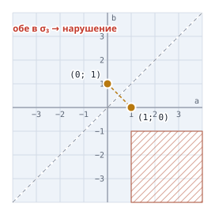 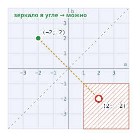

- **обе точки в $\sigma_3$** (почти вся плоскость): из такой пары можно оставить не больше одной;
- **зеркало в угле**: это точки левого верхнего квадрата $a<-1$, $b>1$, отражение угла. Их можно оставлять смело.

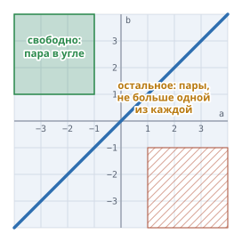

### 2.6. Что остаётся после двух свойств

Вопрос: если применить только рефлексивность и антисимметричность, $\sigma_3$ сузится до «диагональ + левый верхний угол»?

Свойства — это проверка, а не инструмент вырезания. Если же мысленно стирать точки, пока оба свойства не выполнятся, то обязательно остаются диагональ и (по желанию) зелёный квадрат. А из каждой жёлтой пары нужно выкинуть **одну** точку, и какую — решаем сами. «Диагональ + угол» получается, если выкинуть обе: это минимальный вариант.

Дальше варианты были перечислены самостоятельно, и все они верны:

- **0.** Диагональ + левый верхний угол (минимум).
- **1.** Всё не ниже диагонали, $b\ge a$. Это обычный $\le$, угол в него уже входит.
- **2.** Левый верхний угол + полоса $a-1\le b\le a$ под диагональю. Полоса не задевает выброшенный угол (там $a-b>2$, в полосе $a-b\le1$). Зеркала точек полосы лежат над диагональю у самой прямой, а там у варианта ничего нет.
- **3.** Бесконечно много других: из каждой жёлтой пары берём не больше одной точки.

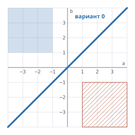 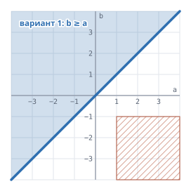 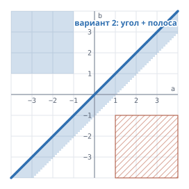

### 2.7. Транзитивность и «прямой путь»

$$a\rho b\ \text{и}\ b\rho c\ \Rightarrow\ a\rho c.$$

Короче: если есть путь $a\to b\to c$, должен быть и прямой путь $a\to c$. На плоскости точки $(a,b)$ и $(b,c)$ связаны общим числом $b$:

1. от $(a,b)$ идём по горизонтали до диагонали, в $(b,b)$;
2. от $(b,b)$ по вертикали до $(b,c)$;
3. точка $(a,c)$ стоит в одном столбце с $(a,b)$ и в одной строке с $(b,c)$.

Её сначала назвали «ярлыком» (как ярлык на рабочем столе: короткий путь). Слово оказалось непонятным, и точку переименовали в **«прямой путь $(a;c)$»**. Общепринятого названия у неё нет.

Транзитивность нарушена, если обе точки пути закрашены, а прямой путь — нет. У $\sigma_3$ это $(2,0)$ и $(0,-2)$: обе в $\sigma_3$, а прямой путь $(2,-2)$ лежит в угле.

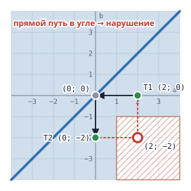

Проверка вариантов из 2.6:

- **вариант 1 ($\le$)** — держится: $a\le b\le c\Rightarrow a\le c$;
- **вариант 2 (полоса)** — ломается: $(2;\,1{,}2)$ и $(1{,}2;\,0{,}4)$ в полосе (шаг вниз меньше 1), а прямой путь $(2;\,0{,}4)$ спускается на $1{,}6$ и из полосы вылетает;
- **вариант 0** — держится, см. 2.8.

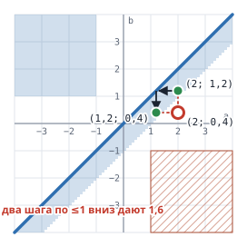

Словесное «правило уголка» без картинки понятно не было. Выбирали между HTML-страницей, GeoGebra и Manim и остановились на интерактивной странице: двигаешь точки, путь и прямой путь строятся сами. После неё стало понятно. Дальше страница выросла: включение любых сочетаний свойств на одном чертеже, проверка по сетке, конструктор (раздел 6).

### 2.8. «Вариант 0 транзитивен — разве это правильно?»

Правильно. Правило срабатывает, только когда обе точки пути в отношении. Возможные случаи:

1. обе на диагонали: $a=b=c$, прямой путь тоже на диагонали;
2. одна на диагонали: шаг по ней «стоит на месте», и прямой путь совпадает с другой точкой. Например, $(-2,2)$ и $(2,2)$ дают $(-2,2)$;
3. обе в угле **невозможно**: у первой $b>1$, у второй первая координата $b<-1$.

Нарушить нечем.

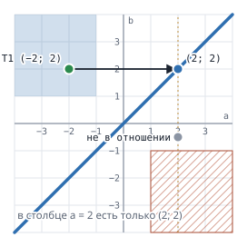

### 2.9. ≤ помещается в σ₃, а ≥ — нет

В конструкторе обнаружилось: $\ge$, обрезанное по $\sigma_3$, не упорядочение, хотя $\le$ целиком лежит внутри $\sigma_3$. Причина — транзитивность: в $\ge$ есть $2\to0$ и $0\to-2$, значит, должно быть и $2\to-2$, а это угол.

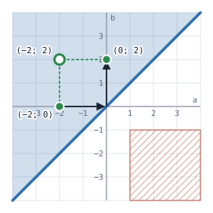 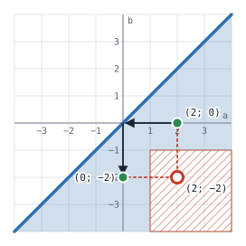

Отсюда общий урок, который вошёл в решение первой задачи: **запрещена не только прямая стрелка «большое → маленькое», но и цепочка через средние числа.**

### 2.10. Две задачи

После разбора свойств вопрос был поставлен так: как описать **все** подмножества $\sigma_3$, которые являются упорядочениями. Первый ответ дал сразу итог (9 клеток, «ни одно число из $R$ не стоит перед числом из $L$»), и он был непонятен: ожидался вывод через свойства. Второй ответ, со схемами, сделал понятнее само решение, но не сравнение с задачей про $M$. Помогла страница-объяснение: вывод по шагам через три свойства, каталог примеров, «пила».

Вторая задача («какие числа оставить») прояснилась, только когда её решили отдельно, начиная с условия, и лишь потом сравнили.

### 2.11. Итог понимания

> По сути вторая задача ничем не отличается от первой. Просто работаем с дискретными точками.

Это верно, с одним уточнением. Картинка та же, только вместо сплошной плоскости сетка точек. Но в первой задаче точки стираются **по одной** («пинцетом»), а во второй точку можно убрать только вместе с её числом, то есть со всей строкой и столбцом. Поэтому в первой задаче решений бесконечно много, а во второй их почти нет.

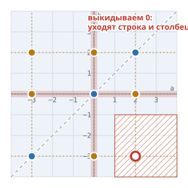

---

## 3. Задача A: упорядочения внутри σ₃ («стираем точки»)

**Условие.** Найти все упорядочения $\rho$ множества $\mathbf R$, лежащие внутри $\sigma_3$: $\rho\subset\sigma_3$, то есть картинка $\rho$ не заходит в угол. Все числа остаются, с картинки $\sigma_3$ можно стирать любые точки.

### Решение по свойствам

**Шаг 1. Рефлексивность.** Вся диагональ остаётся. Угол её не касается, так что конфликта с $\sigma_3$ нет.

**Шаг 2. Антисимметричность.** Из каждой зеркальной пары, где обе точки в $\sigma_3$, оставляем не больше одной. Точки зелёного квадрата ($a<-1$, $b>1$) можно оставлять свободно: их зеркала в угле.

**Шаг 3. Транзитивность.** Если в $\rho$ есть цепочка $r\to\dots\to l$ от большого числа $r>1$ к маленькому $l<-1$, транзитивность требует пару $(r,l)$, а она в угле. Значит, таких цепочек быть не должно. Так как $\rho$ транзитивно, цепочка $r\to\dots\to l$ уже означает $r\,\rho\,l$, поэтому достаточно требовать, чтобы не было прямых пар $(r,l)$.

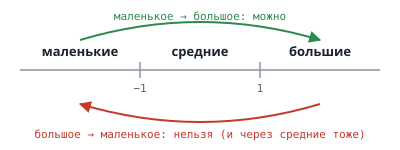

### Ответ

$$\rho\subset\sigma_3\ \text{— упорядочение}\iff \rho\ \text{— упорядочение}\ \mathbf R\ \text{и нет}\ r>1,\ l<-1\ \text{с}\ r\,\rho\,l.$$

Словами: **любое упорядочение, в котором ни одно число больше 1 не стоит перед числом меньше −1** (ни напрямую, ни через цепочку). Других условий нет.

### Каталог примеров

| Отношение | Подходит? | Почему |
|---|---|---|
| только диагональ (равенство) | да | никто ни перед кем не стоит |
| диагональ + левый верхний угол | да | маленькие перед большими, и только |
| $\le$ | да | маленькие перед большими, не наоборот |
| «пила»: зоны по порядку, внутри зон $\ge$ | да | внутри каждой зоны обратный порядок ($-2$ перед $-3$), но маленькие целиком перед средними, средние перед большими |
| $\ge$ без угла | нет | $2\to0\to-2$, прямой путь $(2,-2)$ в угле |
| $\sigma_3$ целиком | нет | $(0,1)$ и $(1,0)$ обе на месте |

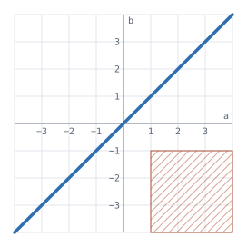 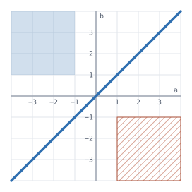 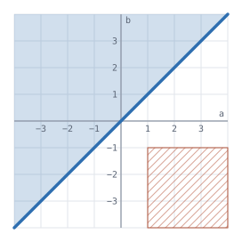

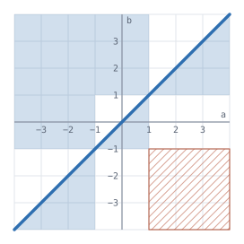 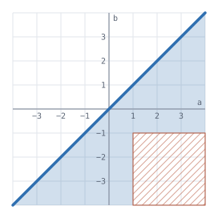 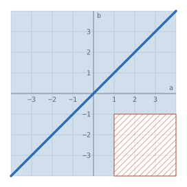

(Слева направо, сверху вниз — в порядке таблицы.)

### Решений бесконечно много: рецепт «пилы»

1. Разрезать числовую прямую на куски (промежутки) в любых местах.
2. Поставить куски по возрастанию: каждый элемент левого куска стоит перед каждым элементом правого.
3. Внутри каждого куска выбрать направление: $\le$ или $\ge$.

**Оговорка.** Кусок с направлением $\ge$ не должен выходить за отрезок $[-1,1]$ **сразу с обеих сторон**. Иначе в нём окажутся, например, $2$ и $-2$, и $\ge$ поставит $2$ перед $-2$. Крайний случай — ни одного разреза и $\ge$ на всей прямой, то есть само $\ge$.

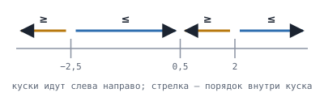

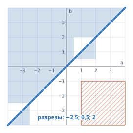 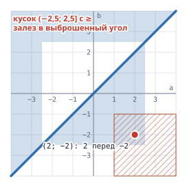

Слева — разрезы $-2{,}5;\ 0{,}5;\ 2$, направления $\ge,\le,\ge,\le$: подходит. Справа — средний кусок $(-2{,}5;\,2{,}5]$ с $\ge$ нарушает оговорку и залезает в угол.

**Почему это упорядочение внутри $\sigma_3$.** Это лексикографический порядок «сначала номер куска, потом порядок внутри куска».
- Рефлексивность: $x$ в своём куске, $x\le x$ и $x\ge x$.
- Антисимметричность: из разных кусков стрелка идёт только в одну сторону, а внутри куска работает антисимметричность $\le$ или $\ge$.
- Транзитивность: если $x\to y\to z$ и хоть один шаг переходит в правый кусок, то кусок $z$ правее куска $x$, и $x\to z$. Если все три в одном куске, работает транзитивность $\le$ или $\ge$.
- Внутри $\sigma_3$: пусть $r>1$, $l<-1$ и $r\to l$. Из разных кусков это невозможно, потому что кусок $r$ правее куска $l$. В одном куске это значит, что кусок содержит $l<-1$ и $r>1$ и в нём выбрано $\ge$, а это запрещено оговоркой.

Мест для разреза бесконечно много, значит и решений бесконечно много. И «пилами» решения не исчерпываются: только диагональ или «диагональ + угол» — частичные порядки, а не «пилы».

---

## 4. Задача B: какие числа оставить («выбираем числа»)

**Условие.** Правило $\sigma_3$ не меняем. Выбираем непустое множество чисел $M\subset\mathbf R$ и смотрим на $\sigma_3$ только между числами из $M$, то есть на $\sigma_3\cap(M\times M)$. При каких $M$ это упорядочение $M$?

### Шаг 1. Что значит «оставить числа» на картинке

Через каждое число из $M$ проводим вертикальную и горизонтальную прямую. На пересечениях стоят все пары. Точка есть, если она в $\sigma_3$, и её нет, если она в угле. **Точки появляются сами, выбирать их по одной нельзя.**

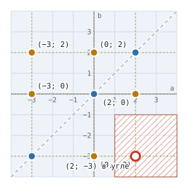

$M=\{-3;0;2\}$: из 9 пар нет только $(2,-3)$ (угол).

### Шаг 2. Рефлексивность

Пары $(x,x)$ на диагонали, угол её не касается. Выполнена при любом $M$.

### Шаг 3. Антисимметричность решает всё

Для двух разных $x,y\in M$ обе точки $(x,y)$ и $(y,x)$ появятся, если обе в $\sigma_3$, и это нарушение. Спасти может только угол: одна из двух точек должна в него попасть. Значит:

> **любые два разных числа из $M$ — одно больше 1, другое меньше −1.**

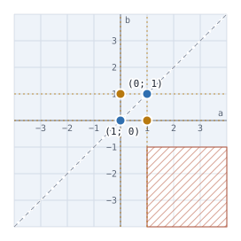 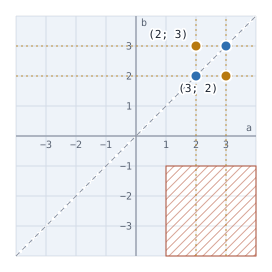 

$\{0;1\}$ — оба средние, нарушение. $\{2;3\}$ — оба большие, нарушение. $\{-3;2\}$ — одно маленькое, одно большое: $(2,-3)$ в угле, остаётся только $(-3,2)$.

Следствия:
- среднее число ($-1\le x\le1$) ни с кем в пару не годится, поэтому если $|M|\ge2$, средних в $M$ нет;
- двух больших быть не может, двух маленьких тоже;
- значит, $|M|\le2$.

### Шаг 4. Транзитивность

$M=\{x\}$: одна точка $(x,x)$. $M=\{q,p\}$, $q<-1<1<p$: точки $(q,q)$, $(p,p)$, $(q,p)$. Единственный шаг «$q$ перед $p$» продолжить нечем. Выполнена.

### Ответ

$$M=\{x\}\ \ (x\in\mathbf R)\qquad\text{или}\qquad M=\{q,p\},\ \ q<-1,\ p>1.$$

Во втором случае $q$ предшествует $p$: цепь из двух элементов. Например, $\{-5;3\}$ подходит, $\{-5;0\}$ — нет ($0$ средний), $\{2;3\}$ — нет (оба большие).

---

## 5. Сравнение задач

| | A: стираем точки | B: выбираем числа |
|---|---|---|
| Что меняем | числа все, стираем любые точки по одной | правило не трогаем, оставляем часть чисел |
| Что на картинке | ровно выбранные точки | все точки $\sigma_3$ с обеими координатами из $M$ |
| Пара $(0,1)$ и $(1,0)$ | стираем одну точку | только выкинуть $0$ или $1$ целиком |
| Ответ | любое упорядочение без «большое → маленькое», их бесконечно много | одно число или $\{q<-1,\ p>1\}$ |

Это **одна и та же картинка и те же три свойства**. В задаче A свойства проверяются на сплошной плоскости, в задаче B — на сетке $M\times M$. Разница в инструменте: в A точки стираются «пинцетом», по одной, а в B каждое лишнее число приносит с собой целую строку и столбец точек, в том числе зеркальные пары. Убрать лишнюю точку можно только вместе с числом. Поэтому в B ответ такой бедный.

Связь между задачами: если $M$ — решение B, то $\sigma_3\cap(M\times M)$ — упорядочение $M$, лежащее в $\sigma_3$, то есть решение A, только на меньшем множестве. Обратное неверно: $\le$ решает A на всём $\mathbf R$, но $\sigma_3\cap(\mathbf R\times\mathbf R)=\sigma_3$ — не порядок.

---

## 6. Интерактивные страницы

Обе открываются в браузере, без интернета (кроме шрифтов) и без установки. Опубликованные версии — артефакты claude.ai (приватные).

### Чертёж свойств

[sigma3_interaktivnyy_chertezh.html](assets/beran_uporyadochennye_g01_s01_zzz_sigma3_razbor/sigma3_interaktivnyy_chertezh.html) · артефакт: https://claude.ai/artifact/5TqSMdBTVwZAjiodeu3Mee

- **Три переключателя свойств** в любом сочетании. У каждого включённого свойства на чертеже свои подвижные точки: Р (рефлексивность) ходит по диагонали; А и её отражение А′ (антисимметричность); Т1, Т2 и прямой путь (транзитивность). Зелёная точка — в отношении, красная — нарушение, серая — не в отношении и не мешает.
- **Карточки свойств:** правило, состояние точек сейчас, импликация «если A, то B», проверка по всему отношению сеткой 0,1 и кнопка «поставить сюда», которая переносит точки на найденный контрпример.
- **Общий итог:** «упорядочение», «квазиупорядочение» (рефлексивно и транзитивно, как у Берана на стр. 18) или что нарушено.
- **Готовые примеры с пояснениями**: $\sigma_3$, варианты 0, 1, 2 и т. д.
- **Конструктор «собрать своё из кусков»:** $\sigma_3$, диагональ, над диагональю, под диагональю, левый верхний угол, полоса ширины $w$. У каждого куска кнопки «нет», «добавить», «вырезать», плюс «обрезать по $\sigma_3$». Шесть наглядных примеров сборки, в том числе пара «$\ge$ без обрезки / с обрезкой», которая показывает 2.9.

Точки двигаются мышью, пальцем или стрелками (Shift — шаг 1).

### Объяснение двух задач

[sigma3_poryadki_obyasnenie.html](assets/beran_uporyadochennye_g01_s01_zzz_sigma3_razbor/sigma3_poryadki_obyasnenie.html) · артефакт: https://claude.ai/artifact/94VjWW3DfZsGPRW6RZWeWc

Статичные схемы по шагам: 0 — картинка, 1–3 — свойства, 4 — итог задачи A, каталог и рецепт «пилы», 5 — задача B с условия, 6 — сравнение. Схемы этой заметки сделаны тем же движком; скрипт-генератор — [gen_figures.js](assets/beran_uporyadochennye_g01_s01_zzz_sigma3_razbor/gen_figures.js) (`node gen_figures.js <папка>`).

---

## 7. Словарик разбора

- **Угол** — выброшенная клетка $a>1$, $b<-1$: «большое перед маленьким».
- **Зеркальная пара** — точки $(a,b)$ и $(b,a)$, отражение относительно диагонали.
- **Зелёный квадрат** — $a<-1$, $b>1$, отражение угла: точки, которые антисимметричности не мешают.
- **Прямой путь** (сначала «ярлык») — точка $(a,c)$ для пути $(a,b)\to(b,b)\to(b,c)$.
- **Зоны** — маленькие $(<-1)$, средние $[-1,1]$, большие $(>1)$.
- **Пила** — порядок «куски по возрастанию, внутри куска $\le$ или $\ge$».
- **Пинцет** — стирание точек по одной (задача A), в отличие от выбрасывания числа целиком (задача B).
