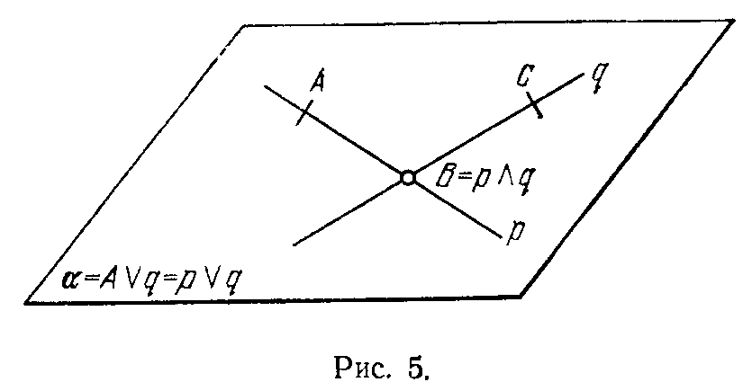
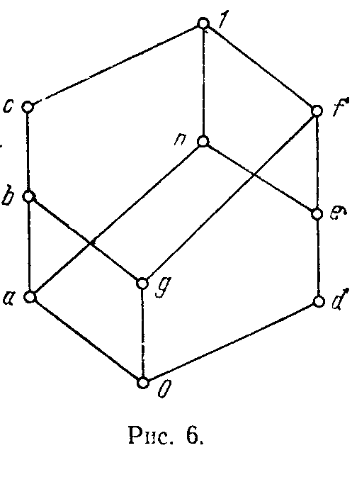
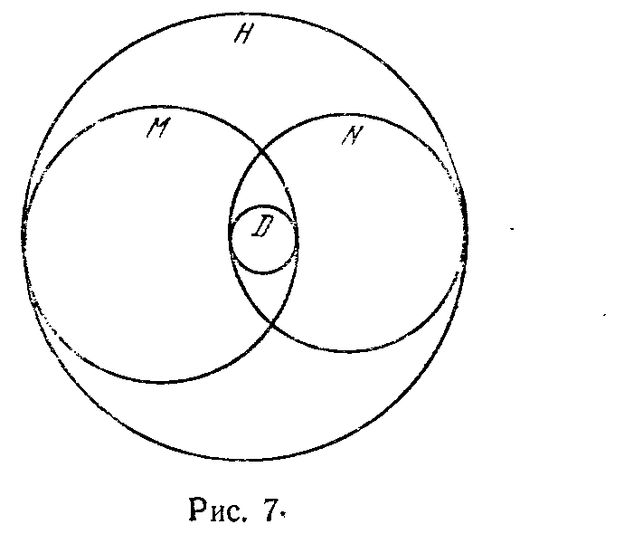
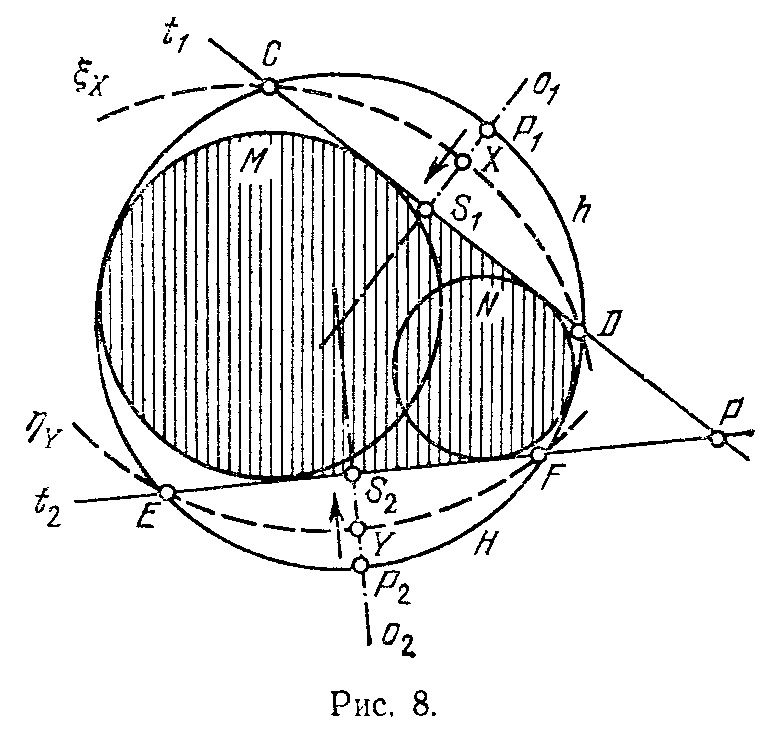
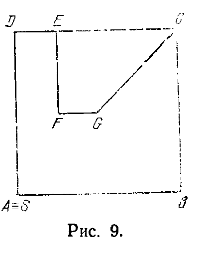

## 3.1. Примеры решеток

---
**стр. 28, продолжение**
---

# Глава 3

## ПРИМЕРЫ РЕШЕТОК

В этой главе мы пополним основные сведения о решетках и рассмотрим некоторые примеры, которые можно отнести к школьной математике.

В предыдущей главе мы определили решетку как упорядоченное множество $\mathcal P=(P,\leqslant)$, в котором для любых двух элементов $a,b\in P$ существуют $\sup_{\mathcal P}\{a,b\}$ и $\inf_{\mathcal P}\{a,b\}$. Обе эти записи достаточно ясно выражают, какие элементы соответствуют паре $a,b$, но они неудобны своей громоздкостью. Поэтому в теории решеток принято соглашение вместо $\sup_{\mathcal P}\{a,b\}$ писать $a\vee b$, а вместо $\inf_{\mathcal P}\{a,b\}$ писать $a\wedge b$. В том случае, когда $a=b$, эти определения расширяют, полагая $a\vee a=a\wedge a=a$. Запись $c=a\vee b$ (соответственно $d=a\wedge b$) читаем: «$c$ равно объединению $a$ и $b$» (соответственно «$d$ равно пересечению $a$ и $b$»). Элемент $c$ называется *объединением* элементов $a$ и $b$, элемент $d$ называется их *пересечением*.

**Пример 12.** Пусть $E$ обозначает трехмерное пространство, $L(E)$ — множество, элементами которого являются $E$, $\varnothing$ и всевозможные плоскости, прямые и точки пространства $E$. При этом прямые, плоскости и пространство понимаются как множества точек, а точка как одноэлементное множество точек. Нужно доказать, что $(L(E),\subseteq)$ является полной решеткой.

**Решение.** Снова используем теорему 2. Очевидно, что $E$ является наибольшим элементом рассматривае-

---
**стр. 29**
---

мого у. м. Если $M$ — некоторое множество геометрических объектов из $E$, то обозначим через $\Delta$ множество всех точек, которые принадлежат всем множествам из $M$. Мы хотим доказать, что $\Delta\in L(E)$. Это очевидно, если $\Delta=\varnothing$ или $\Delta$ содержит единственную точку. Если $\Delta$

содержит две различные точки $A$ и $B$, то эти точки содержатся в каждом из геометрических объектов, принадлежащих $M$, а поэтому каждый такой объект содержит и прямую $p$, определяемую ими. Далее, если $\Delta$ содержит еще одну точку $C$, не лежащую на $p$, то $\Delta$ содержит, как можно увидеть, рассуждая аналогично, и все точки плоскости $\alpha$, определяемой точкой $C$ и прямой $p$. Если же в $\Delta$ содержится точка $D$, которая не лежит на плоскости $\alpha$, то $\Delta$ содержит и все точки пространства $E$. В каждом из этих случаев $\Delta\in L(E)$, и легко заметить, что $\Delta=\inf_{(L(E),\,\subseteq)}M$. Согласно теореме 2 $(L(E),\subseteq)$ будет полной решеткой.

В только что рассмотренном примере обратим внимание на то, что объединение $A\vee B$ точек $A$ и $B$ (см. рис. 5) есть прямая $p$, пересечение прямых $p$ и $q$ совпадает с точкой $B$ и т. д. Этот пример иллюстрирует геометрическое истолкование используемых терминов.

В решетке, диаграмма которой изображена на рис. 6, выполняются, например, соотношения $c\wedge f=g$,

---
**стр. 30**
---

$b\vee h=1$. Вообще пересечения и объединения в этой решетке задаются следующими таблицами:

| $\vee$ | $0$ | $a$ | $b$ | $c$ | $d$ | $e$ | $f$ | $g$ | $h$ | $1$ |
|---|---|---|---|---|---|---|---|---|---|---|
| $0$ | $0$ | $a$ | $b$ | $c$ | $d$ | $e$ | $f$ | $g$ | $h$ | $1$ |
| $a$ | $a$ | $a$ | $b$ | $c$ | $h$ | $h$ | $1$ | $b$ | $h$ | $1$ |
| $b$ | $b$ | $b$ | $b$ | $c$ | $1$ | $1$ | $1$ | $b$ | $1$ | $1$ |
| $c$ | $c$ | $c$ | $c$ | $c$ | $1$ | $1$ | $1$ | $c$ | $1$ | $1$ |
| $d$ | $d$ | $h$ | $1$ | $1$ | $d$ | $e$ | $f$ | $f$ | $h$ | $1$ |
| $e$ | $e$ | $h$ | $1$ | $1$ | $e$ | $e$ | $f$ | $f$ | $h$ | $1$ |
| $f$ | $f$ | $1$ | $1$ | $1$ | $f$ | $f$ | $f$ | $f$ | $1$ | $1$ |
| $g$ | $g$ | $b$ | $b$ | $c$ | $f$ | $f$ | $f$ | $g$ | $1$ | $1$ |
| $h$ | $h$ | $h$ | $1$ | $1$ | $h$ | $h$ | $1$ | $1$ | $h$ | $1$ |
| $1$ | $1$ | $1$ | $1$ | $1$ | $1$ | $1$ | $1$ | $1$ | $1$ | $1$ |

| $\wedge$ | $0$ | $a$ | $b$ | $c$ | $d$ | $e$ | $f$ | $g$ | $h$ | $1$ |
|---|---|---|---|---|---|---|---|---|---|---|
| $0$ | $0$ | $0$ | $0$ | $0$ | $0$ | $0$ | $0$ | $0$ | $0$ | $0$ |
| $a$ | $0$ | $a$ | $a$ | $a$ | $0$ | $0$ | $0$ | $0$ | $a$ | $a$ |
| $b$ | $0$ | $a$ | $b$ | $b$ | $0$ | $0$ | $g$ | $g$ | $a$ | $b$ |
| $c$ | $0$ | $a$ | $b$ | $c$ | $0$ | $0$ | $g$ | $g$ | $a$ | $c$ |
| $d$ | $0$ | $0$ | $0$ | $0$ | $d$ | $d$ | $d$ | $0$ | $d$ | $d$ |
| $e$ | $0$ | $0$ | $0$ | $0$ | $d$ | $e$ | $e$ | $0$ | $e$ | $e$ |
| $f$ | $0$ | $0$ | $g$ | $g$ | $d$ | $e$ | $f$ | $g$ | $e$ | $f$ |
| $g$ | $0$ | $0$ | $g$ | $g$ | $0$ | $0$ | $g$ | $g$ | $0$ | $g$ |
| $h$ | $0$ | $a$ | $a$ | $a$ | $d$ | $e$ | $e$ | $0$ | $h$ | $h$ |
| $1$ | $0$ | $a$ | $b$ | $c$ | $d$ | $e$ | $f$ | $g$ | $h$ | $1$ |

**Задача 12.** В каждой решетке $\mathcal P=(P,\leqslant)$ для всех $a,b,c\in P$ истинны следующие соотношения:

a) $a\vee b=b\vee a$, $a\wedge b=b\wedge a$;

b) $(a\vee b)\vee c=a\vee(b\vee c)$, $(a\wedge b)\wedge c=a\wedge(b\wedge c)$ *);

c) если $a\leqslant b$, то $a\wedge b=a$ и $b=a\vee b$;

d) $a\wedge b\leqslant a$, $a\leqslant a\vee b$;

e) $a\vee(a\wedge b)=a$, $a\wedge(a\vee b)=a$;

f) если $a\wedge b=a\vee b$, то $a=b$.

[Указание. В доказательстве e) используйте d) и c), а свойство f) выведите с помощью d).]

**Пример 13.** Пусть $C(\rho)$ будет множество всех открытых кругов на плоскости $\rho$. При этом пустое множество также будем считать открытым кругом. Нужно выяснить, будет ли у. м. $(C(\rho),\subseteq)$ решеткой.

**Решение.** Собственно решению предпошлем сначала следующие рассуждения. Пусть $M,N$ будут два круга (см. рис. 7) и пусть $H,D$ — круги, ограниченные окружностями, касающимися одновременно окружностей обоих кругов $M$ и $N$. Очевидно, что $N\subseteq H$ и $M\subseteq H$; аналогично $D\subseteq M$ и $D\subseteq N$. Отсюда следует, что $H$ является верхней гранью множества $\{M,N\}$, а $D$ — нижней гранью этого множества. Рассмотренный рисунок на первый взгляд настолько убедителен, что можно было бы подумать, будто $H$ является наименьшей верхней гранью

---

*) Доказательство см. в «Приложении», предложение 1.

---
**стр. 31**
---

множества $\{M,N\}$, а $D$ — его наибольшей нижней гранью, т. е. можно было бы подумать, что у. м. $(C(\rho),\subseteq)$ является решеткой. Поучительно, что рассмотрение этого рисунка ввело в заблуждение даже известного популяризатора современной математики профессора Папи ([10], стр. 130, упр. 5).

Заметим, что на самом деле для упомянутых кругов $M,N$ точная верхняя грань множества $\{M,N\}$ в у. м. $(C(\rho),\subseteq)$ не существует.

Если бы некоторый круг $S$ был точной верхней гранью множества $\{M,N\}$, то каждая его точка должна была бы лежать внутри острого угла, определяемого касательными $t_1$ и $t_2$ (рис. 8). Чтобы это доказать, обозначим

---
**стр. 32**
---

через $C$ и $D$ точки пересечения касательной $t_1$ с окружностью $h$ круга $H$, а через $E$ и $F$ точки пересечения касательной $t_2$ с той же окружностью. Пусть $o_1$ (соответственно $o_2$) обозначает перпендикуляр, восставленный из середины отрезка $CD$ (соответственно $EF$), $P_1$ (соответственно $P_2$) — точку пересечения окружности $h$ с прямой $o_1$ (соответственно $o_2$), $S_1$ (соответственно $S_2$) — середину отрезка $CD$ (соответственно $EF$). Возьмем точку $X$ (соответственно $Y$) на отрезке $P_1S_1$ (соответственно $P_2S_2$). Окружность $\xi_X$, определяемая точками $C,X,D$ (соответственно окружность $\eta_Y$, определяемая точками $E,Y,F$), ограничивает круг $K_X$ (соответственно $L_Y$), который содержит круги $M$ и $N$ и потому должен содержать круг $S$. Таким образом, круг $S$ должен принадлежать кругам $K_X$ и $L_Y$ при любом выборе точки $X$ на отрезке $P_1S_1$ и точки $Y$ на отрезке $P_2S_2$, а значит, и пересечению всех таких кругов. Нетрудно доказать (докажите!), что для всякой точки $Z$, не лежащей внутри острого угла $CPE$, можно подобрать точки $X$ и $Y$ так, чтобы точка $Z$ не попала в пересечение кругов $K_X$ и $L_Y$. Следовательно, пересечение всех таких кругов, а значит, и лежащий в этом пересечении круг $S$, лежит внутри острого угла $CPE$. Это, однако, не совместимо с тем, что круг $S$ должен содержать круги $M$ и $N$.

**Задача 13.** Опишите множество точек, которые принадлежат всем кругам, содержащим оба круга $M,N$, на рис. 8.

[Это будут в точности те точки, которые лежат в заштрихованной области.]

**Пример 14.** Пусть снова $\rho$ — некоторая плоскость, которую мы будем рассматривать как множество точек. Подмножество $M$ плоскости $\rho$ называется *выпуклым* тогда и только тогда, когда для любой пары точек $X,Y$ из $M$ весь отрезок $XY$ лежит в $M$ *). Обозначим через $K(\rho)$ множество всех выпуклых подмножеств плоскости $\rho$. Нужно доказать, что $(K(\rho),\subseteq)$ является полной решеткой.

**Решение.** Проверим, что выполняются условия теоремы 2. Наибольшим элементом у. м. $(K(\rho),\subseteq)$ является, очевидно, вся плоскость $\rho$. Если $\mathcal M$ — некоторое непустое множество выпуклых подмножеств $A,B,\ldots$, то их пересечение состоит из тех точек плоскости $\rho$, которые принадлежат всем подмножествам $A,B,\ldots$. Так как эти подмножества все являются выпуклыми, то из

---

*) Детальное изучение понятия выпуклого множества читатель найдет в интересной книжке И. М. Яглома и В. Г. Болтянского [8].

---
**стр. 33**
---

принадлежности точек $X$, $Y$ их пересечению следует, что отрезок $XY$ принадлежит всем полумножествам $A$, $B$, ..., а значит, и их пересечению. Отсюда уже легко получается, что упомянутое пересечение является точной нижней гранью множества $M$.

**Пример 15.** Доказать, что у. м. $(N_0,\ \sigma_1)$ из задачи 1 является полной решеткой.

*Решение*. Используем теорему 2. При упорядочении $\sigma_1$ число 0 является наибольшим элементом у. м. $(N_0,\ \sigma_1)$. Пусть $M$ — некоторое непустое подмножество множества $N_0$, а $C$ обозначает множество всех тех чисел из $N_0$, которые делят все числа из $M$. Конечно, $C\ne\varnothing$, поскольку $1\in C$. Если $M=\{0\}$, обозначим число 0 буквой $d$. Если $M$ — подмножество, которое содержит по крайней мере одно натуральное число, скажем, $a$, то буквой $d$ обозначим наибольшее из чисел, принадлежащих $C$ (наибольшее в смысле обычного упорядочения $\leqslant$); $d$ существует, поскольку мы должны делать выбор из делителей числа $a$, а их конечное число. Мы утверждаем, что $d$ является точной нижней гранью множества $M$ при упорядочении $\sigma_1$. Прежде всего, по определению $d$, имеем $d\sigma_1m$, каким бы ни было $m\in M$. Если для некоторого $d_1$ также имеем $d_1\sigma_1m$ при любом $m\in M$, то каждое $m\in M$ будет кратным наименьшего общего кратного $k$ чисел $d$ и $d_1$. Поэтому $d\leqslant k$, а так как мы только что видели, что $k\in C$, то согласно выбору $d$ имеем $d=k$. Поскольку всегда $d_1\sigma_1k$, мы получаем, что $d_1\sigma_1d$, а потому имеет место (3i), чем и завершается доказательство существования в $(N_0,\ \sigma_1)$ точной нижней грани множества $M$.

Теперь рассмотрим два способа, которые позволяют превратить данную плоскость в упорядоченное множество. Будем предполагать, что на этой плоскости задана прямоугольная система координат. Каждой точке плоскости она сопоставляет упорядоченную пару $(r_1,\ r_2)$, составленную из координат $r_1$, $r_2$ этой точки.

**Пример 16.** Для двух пар $(r_1,\ r_2)$, $(s_1,\ s_2)$ действительных чисел пишем $(r_1,\ r_2)\ll(s_1,\ s_2)$ тогда и только тогда, когда имеет место одна из следующих ситуаций:

(i) $(r_1,\ r_2)=(s_1,\ s_2)$*);

(ii) $r_1<s_1$;

(iii) $r_1=s_1$ и $r_2<s_2$.

---

*) Это равенство означает, что $r_1=s_1$ и одновременно $r_2=s_2$.

---
**стр. 34**
---

Исследовать так определенное отношение $\ll$.

*Решение*. Согласно (i) отношение $\ll$ рефлексивно. Это отношение и антисимметрично. Действительно, если $(r_1,\ r_2)\ll(s_1,\ s_2)$ и одновременно $(s_1,\ s_2)\ll(r_1,\ r_2)$, то какие бы из ситуаций (i)—(iii) ни имели места — всегда $r_1\leqslant s_1$ и $s_1\leqslant r_1$, откуда $s_1=r_1$. При этом случай (iii) не может одновременно появиться в обоих рассматриваемых неравенствах, поскольку тогда было бы $r_2<s_2$ и $s_2<r_2$, что невозможно. Значит, представляется единственная возможность — случай (i). Отношение $\ll$ транзитивно. В самом деле, если $(r_1,\ r_2)\ll(s_1,\ s_2)$ и $(s_1,\ s_2)\ll(t_1,\ t_2)$, то при $(r_1,\ r_2)=(s_1,\ s_2)$ или при $(s_1,\ s_2)=(t_1,\ t_2)$ будет $(r_1,\ r_2)\ll(t_1,\ t_2)$. Если же $(r_1,\ r_2)\ne(s_1,\ s_2)$ и $(s_1,\ s_2)\ne(t_1,\ t_2)$, то либо, по крайней мере, одно из чисел $t_1-s_1$, $s_1-r_1$ положительно, и тогда
$$
t_1-r_1=(t_1-s_1)+(s_1-r_1)>0,
$$
что вследствие (ii) дает $(r_1,\ r_2)\ll(t_1,\ t_2)$, либо оба эти числа равны нулю, откуда $t_1=r_1$, но
$$
t_2-r_2=(t_2-s_2)+(s_2-r_2)
$$
будет суммой двух положительных чисел, т. е. $t_2>r_2$, и потому $(r_1,\ r_2)\ll(t_1,\ t_2)$. Так как вследствие (i)—(iii) при любом выборе $(r_1,\ r_2)$, $(s_1,\ s_2)$ всегда будет $(r_1,\ r_2)\ll(s_1,\ s_2)$ или $(s_1,\ s_2)\ll(r_1,\ r_2)$, то получается цепь, которая по теореме 1 является решеткой.

Упорядочение $\ll$ называется *лексикографическим*.

**Задача 14.** Пусть $\ll$ обозначает лексикографическое упорядочение точек плоскости и пусть $A=(a,\ b)$ есть некоторая точка этой плоскости. Найдите множество всех таких точек $X=(x,\ y)$, которые удовлетворяют неравенству $A\ll X$.

[Это те точки $X$, для которых $a<x$, и точки луча $x=a$, $b\leqslant y$.]

**Задача 15.** Опишите множество точек $X$, которые одновременно удовлетворяют неравенствам $A\ll X$ и $X\ll B$, где $A=(a,\ b)$, $B=(c,\ d)$ суть две произвольно выбранные точки.

[*Указание*. Выделите случаи $a=c$, $a<c$.]

**Задача 16.** Пусть $A=(a,\ b)$ — данная точка плоскости $\rho$. Определите все прямые $p$ плоскости $\rho$, которые обладают тем свойством, что для любой их точки $B$ выполняется $B\ll A$.

[Это будут в точности все прямые, параллельные оси $y$ и имеющие уравнение $x=e$, где $e<a$.]

**Задача 17.** Для двух пар $(r_1,\ r_2)$, $(s_1,\ s_2)$ действительных чисел определим $(r_1,\ r_2)\leqslant(s_1,\ s_2)$ тогда и только

---
**стр. 35**
---

тогда, когда $r_1\leqslant s_1$ и одновременно $r_2\leqslant s_2$. Докажите, что отношение $\leqslant$ задает на множестве всех пар $(r_1,\ r_2)$ упорядочение и что получающееся у. м. является решеткой, в которой
$$
(r_1,\ r_2)\vee(s_1,\ s_2)=(\max(r_1,s_1),\ \max(r_2,s_2)),
$$
$$
(r_1,\ r_2)\wedge(s_1,\ s_2)=(\min(r_1,s_1),\ \min(r_2,s_2)).
$$

**Пример 17.** Обозначим через $Q$ множество всех квадратных трехчленов $x^2+px+q$ с действительными коэффициентами, для которых дискриминант $\Delta=p^2-4q$ неотрицателен. Для двух квадратных трехчленов $x^2+p_ix+q_i$, $i=1,\ 2$, принадлежащих $Q$, будем писать
$$
x^2+p_2x+q_2\ll x^2+p_1x+q_1
$$
тогда и только тогда, когда
$$
p_1-p_2\geqslant\left|\sqrt{\Delta_1}-\sqrt{\Delta_2}\right|,
$$
где $\Delta_i=p_i^2-4q_i$. Исследуем отношение $\ll$.

*Решение*. Сначала покажем, что отношение $\ll$ является упорядоченностью множества $Q$. Сразу отметим, что это отношение очевидным образом рефлексивно. Оно также симметрично, поскольку если
$$
p_1-p_2\geqslant\left|\sqrt{\Delta_1}-\sqrt{\Delta_2}\right|
$$
и
$$
p_2-p_1\geqslant\left|\sqrt{\Delta_2}-\sqrt{\Delta_1}\right|,
$$
то $p_1-p_2\geqslant0$ и $p_2-p_1\geqslant0$, т. е. $p_1=p_2$, и потому $\sqrt{\Delta_1}-\sqrt{\Delta_2}=0$, откуда следует, что $q_1=q_2$. Отношение $\ll$ транзитивно, так как из
$$
p_1-p_2\geqslant\left|\sqrt{\Delta_1}-\sqrt{\Delta_2}\right|
$$
и
$$
p_2-p_3\geqslant\left|\sqrt{\Delta_2}-\sqrt{\Delta_3}\right|
$$
получается, что
$$
p_1-p_3=(p_1-p_2)+(p_2-p_3)\geqslant
\left|\sqrt{\Delta_1}-\sqrt{\Delta_2}\right|
+\left|\sqrt{\Delta_2}-\sqrt{\Delta_3}\right|
\geqslant\left|\sqrt{\Delta_1}-\sqrt{\Delta_3}\right|;
$$
на последнем шаге применяется неравенство треугольника.

Получим еще следующую наглядную характеристику отношения $\ll$: неравенство
$$
x^2+p_2x+q_2\ll x^2+p_1x+q_1
$$
выполняется тогда и только тогда, когда для корней $\alpha_1\leqslant\beta_1$ многочлена $x^2+p_1x+q_1$ и корней $\alpha_2\leqslant\beta_2$ многочлена $x^2+p_2x+q_2$ имеют место неравенства $\alpha_2\geqslant\alpha_1$ и $\beta_2\geqslant\beta_1$. Чтобы доказать это, заметим, что соотношение
$$
p_1-p_2\geqslant\left|\sqrt{\Delta_1}-\sqrt{\Delta_2}\right|
$$
равносильно одновременной выполнимости неравенств
$$
p_1-p_2\geqslant\sqrt{\Delta_2}-\sqrt{\Delta_1}
\quad\text{и}\quad
p_1-p_2\geqslant\sqrt{\Delta_1}-\sqrt{\Delta_2},
$$

---
**стр. 36**
---

т. е. равносильно одновременной выполнимости соотношений

$$
\alpha_1=\frac{-p_1-\sqrt{\Delta_1}}2\leqslant
\frac{-p_2-\sqrt{\Delta_2}}2=\alpha_2
$$

и

$$
\beta_1=\frac{-p_1+\sqrt{\Delta_1}}2\leqslant
\frac{-p_2+\sqrt{\Delta_2}}2=\beta_2.
$$

Используя результат задачи 17, получаем, что и здесь упорядоченное множество является решеткой. В ней для трехчленов $x^2+p_3x+q_3$, $x^2+p_4x+q_4$ с корнями $\alpha_3\leqslant\beta_3$ и $\alpha_4\leqslant\beta_4$ объединение

$$
x^2+p_3x+q_3\vee x^2+p_4x+q_4
$$

(соответственно пересечение $x^2+p_3x+q_3\wedge x^2+p_4x+q_4$) будет совпадать с трехчленом $x^2+p_5x+q_5$ (соответственно $x^2+p_6x+q_6$), имеющим корни

$$
\alpha_5=\max(\alpha_3,\alpha_4)\leqslant
\beta_5=\max(\beta_3,\beta_4)
$$

(соответственно имеющим корни

$$
\alpha_6=\min(\alpha_3,\alpha_4)\leqslant
\beta_6=\min(\beta_3,\beta_4)).
$$

Значит,

$$
p_5=-\left[
\max\left(\frac{-p_3-\sqrt{\Delta_3}}2,
          \frac{-p_4-\sqrt{\Delta_4}}2\right)
+
\max\left(\frac{-p_3+\sqrt{\Delta_3}}2,
          \frac{-p_4+\sqrt{\Delta_4}}2\right)
\right],
$$

$$
q_5=
\max\left(\frac{-p_3-\sqrt{\Delta_3}}2,
          \frac{-p_4-\sqrt{\Delta_4}}2\right)
\mathbin{\times}
\max\left(\frac{-p_3+\sqrt{\Delta_3}}2,
          \frac{-p_4+\sqrt{\Delta_4}}2\right),
$$

а заменяя в этих формулах символ $\max$ символом $\min$, получим формулы для $p_6$, $q_6$.

### Упражнения

1. Для кругов $M$, $N$ на рис. 7 в у. м. $(C(\rho),\supseteq)$ точная нижняя грань множества $\{M,N\}$ не существует. Докажите.

2. Докажите, что если $K_1$, $K_2$ — два круга в смысле примера 13, причем $K_1\ne\varnothing$ и $K_2\ne\varnothing$, то существует в точности один круг $K$, который содержит $K_1$ и $K_2$ и имеет наименьший радиус.

3. Докажите: если $K_1$, $K_2$ — два круга из примера 13, пересечение которых не пусто, то существует в точности один круг $K$, который содержится в $K_1$ и $K_2$ и который имеет наибольший радиус.

---
**стр. 37**
---

4. Выяснить, образует ли решетку (соответственно полную решетку) множество $C(\rho,\rho)$ всех кругов, центры которых лежат на данной прямой $\rho$ (включая пустое множество), упорядоченное включением (ср. с примером 13).

5. Подмножество $M$ некоторой плоскости назовем *звездчатым* тогда и только тогда, когда оно удовлетворяет следующему условию (см. рис. 9): в $M$ существует по крайней мере одна точка $S$ такая, что вместе с каждой точкой $X$ из $M$ в $M$ лежит и весь отрезок $SX$. Например, фигура $ABCGFED$ представляет собой звездчатое множество. Обозначим через $H(\rho)$ множество всех звездчатых множеств плоскости $\rho$. Установите, будет ли $(H(\rho),\subset)$: а) упорядоченным множеством, б) решеткой, с) полной решеткой.

6. Обозначим через $F(R)$ множество, элементами которого являются всевозможные последовательности $\alpha_1,\alpha_2,\ldots,\alpha_n,\ldots$ действительных чисел (краткая запись последовательности $\{\alpha_i\}$). Для двух последовательностей $a=\{a_i\}$, $b=\{b_i\}$ будем писать $a\ll b$ тогда и только тогда, когда $a_i\leqslant b_i$ для любого $i\in N$. Выясните, будет ли $(F(R),\ll)$: а) упорядоченным множеством, б) решеткой, с) полной решеткой.

7. Докажите, что в каждой решетке $\mathscr P=(P,\leqslant)$:

   а) если $k\leqslant h$ и $n\leqslant m$, то $k\vee n\leqslant h\vee m$;

   b) если $d_1\leqslant h$ и $d_2\leqslant h$, то $d_1\vee d_2\leqslant h$;

   c) если $c\leqslant d$, то для любого $g\in P$ будет $c\vee g\leqslant d\vee g$;

   d) если $k\leqslant h$ и $n\leqslant m$, то $k\wedge n\leqslant h\wedge m$;

   e) если $d\leqslant h_1$ и $d\leqslant h_2$, то $d\leqslant h_1\wedge h_2$;

   f) если $c\leqslant d$, то для любого $g\in P$ будет $c\wedge g\leqslant d\wedge g$.

8. Докажите, что в каждой решетке $\mathscr P$ для любых элементов $a,b,c\in P$:

   а) $a\vee(b\wedge c)\leqslant(a\vee b)\wedge(a\vee c)$;

   b) $a\wedge(b\vee c)\geqslant(a\wedge b)\vee(a\wedge c)$;

   c) если $a\leqslant c$, то $a\vee(b\wedge c)\leqslant(a\vee b)\wedge c$.
