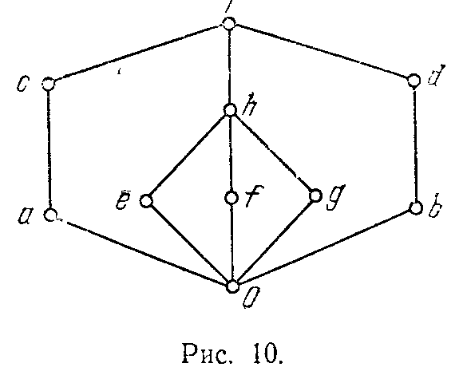
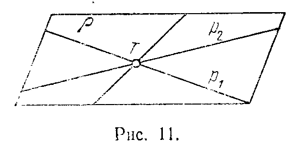
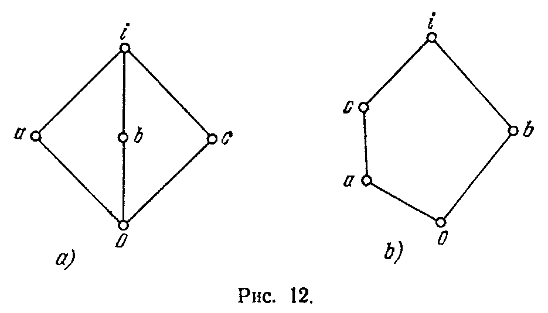
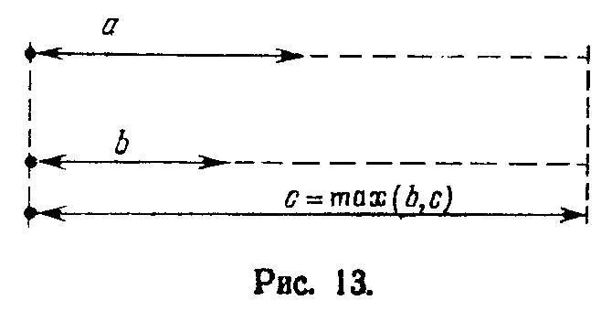
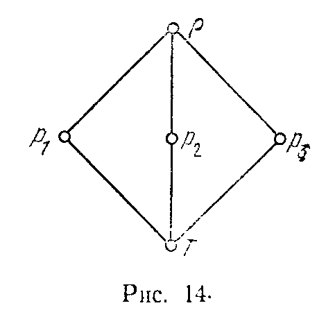
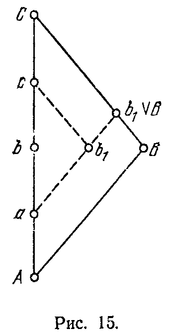
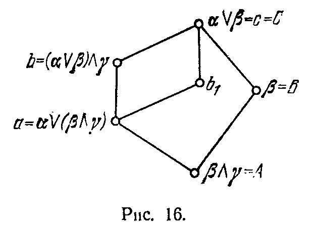
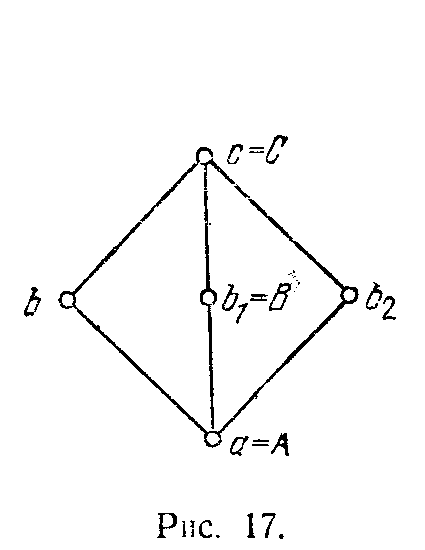
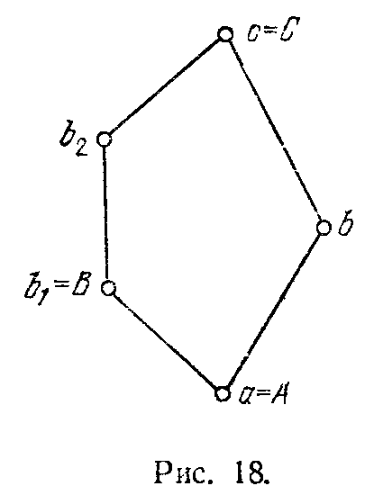

## 4.1. Основные классы решеток

---
**стр. 37, продолжение**
---

# Глава 4

## ОСНОВНЫЕ КЛАССЫ РЕШЕТОК

В задаче 12 мы установили, что в каждой решетке $\mathscr P=(P,\leqslant)$ для любых $a,b,c$ из $P$ выполняются условия

$$
\begin{aligned}
(\mathrm{S1})&\qquad a\vee b=b\vee a;\\
(\mathrm{S2})&\qquad (a\vee b)\vee c=a\vee(b\vee c);\\
(\mathrm{S3})&\qquad a\vee(a\wedge b)=a;\\
(\mathrm{P1})&\qquad a\wedge b=b\wedge a;\\
(\mathrm{P2})&\qquad (a\wedge b)\wedge c=a\wedge(b\wedge c);\\
(\mathrm{P3})&\qquad a\wedge(a\vee b)=a.
\end{aligned}
$$

---
**стр. 38**
---

Можно доказать\*) и обратное: если на некотором непустом множестве $P$ определены две операции $\wedge$, $\vee$ так, что выполняются условия (S1)—(S3) и (P1)—(P3), и если ввести отношение $\leqslant$, полагая $a\leqslant b$ тогда и только тогда, когда $a\wedge b=a$, то это отношение $\leqslant$ упорядочивает множество $P$ и $(P,\leqslant)$ оказывается решеткой. Учитывая это, часто о решетке $\mathscr P=(P,\leqslant)$ говорят как о решетке $\mathscr P=(P,\vee,\wedge)$. Например, в решетке $\mathscr P=(P(E),\subset)$ операциями являются $\cup$, $\cap$ (объединение и пересечение), и ее записывают так же как тройку

$$
\mathscr P(E)=(P(E),\cup,\cap).
$$

Если возьмем в решетке $\mathscr P(E)=(P(E),\cup,\cap)$ три множества $A,B,C$, принадлежащие $P(E)$, то

$$
A\cap(B\cup C)=(A\cap B)\cup(A\cap C)
$$

и

$$
A\cup(B\cap C)=(A\cup B)\cap(A\cup C)
$$

(приведем краткое доказательство первого соотношения: элемент $x$ принадлежит множеству $A\cap(B\cup C)$ тогда и только тогда, когда он принадлежит $A$ и одновременно принадлежит $B$ или $C$, т. е. когда он принадлежит $A\cap B$ или $A\cap C$. Впоследствии мы увидим, что второе соотношение является следствием первого и того факта, что $\mathscr P(E)$ является решеткой).

Решетка $\mathscr P=(P,\vee,\wedge)$ называется *дистрибутивной* тогда и только тогда, когда в $\mathscr P$ для любых $a,b,c\in P$

$$
\tag{4}
a\wedge(b\vee c)=(a\wedge b)\vee(a\wedge c)
$$

и

$$
\tag{5}
a\vee(b\wedge c)=(a\vee b)\wedge(a\vee c).
$$

Согласно этому определению $\mathscr P(E)=(P(E),\cup,\cap)$ является дистрибутивной решеткой.

Будем говорить, что непустое подмножество $M$ носителя $P$ решетки $\mathscr P$ *замкнуто* относительно операций $\vee$ и $\wedge$ тогда и только тогда, когда для любых $m,n$, принадлежащих $M$, этому подмножеству принадлежат также $m\vee n$ и $m\wedge n$. Упорядоченная тройка $(M,\vee,\wedge)$ в этом случае называется *подрешеткой* решетки $(P,\vee,\wedge)$ (или решетки $(P,\leqslant)$). Множество $M$ называется *носителем* этой подрешетки. Поскольку для любых трех элементов $a,b,c$ из $M$ выполняются условия (S1)—(S3) и

---

\*) См. «Приложение», предложение 2.

---
**стр. 39**
---

(P1)—(P3), каждая подрешетка является и решеткой.

**Пример 18.** Пусть $E$ обозначает некоторое непустое множество. Обозначим через $F(E)$ множество всех тех подмножеств множества $E$, которые имеют конечное число элементов. Нужно доказать, что $(F(E),\cup,\cap)$ является подрешеткой решетки $\mathcal P(E)$.

**Решение.** Очевидно, $\varnothing\in F(E)$, и потому $F(E)$ не пусто. Если $F_1$, $F_2$ — два множества, принадлежащие $F(E)$, то множества $F_1\cup F_2$, $F_1\cap F_2$ имеют конечное число элементов, т. е. принадлежат $F(E)$.

**Задача 18.** Пусть $\mathcal P$ есть решетка с диаграммой, изображенной на рис. 10. Установите, будет ли множество

a) $M_1=\{0,e,f,g,h\}$;

b) $M_2=\{0,a,b,c,d,1\}$;

c) $M_3=\{0,e,f,1\}$

носителем какой-либо подрешетки решетки $\mathcal P$.

[a), b) да, c) нет, поскольку $h=e\vee f\notin M_3$.]

**Пример 19.** Пусть $\rho$ — некоторая плоскость трехмерного пространства $E$ (см. пример 12) и пусть $R(\rho;T)$ обозначает множество, элементами которого являются,

в том же смысле как и в примере 12, плоскость $\rho$, любая заданная точка $T$ плоскости $\rho$ и все те прямые $p$ плоскости $\rho$, которые проходят через точку $T$ (рис. 11). Нужно

---
**стр. 40**
---

доказать, что $R(\rho;T)$ является носителем подрешетки решетки $(L(E),\subseteq)$.

**Решение.** Пересечение и объединение элементов непустого множества $R(\rho;T)$ снова будет элементом этого множества.

**Пример 20.** Доказать, что если в решетке $\mathcal P$ тождество (4) выполняется для всех $a,b,c\in P$, то в $\mathcal P$ выполняется и (5).

**Решение.** В самом деле,

$$
\begin{aligned}
(a\vee b)\wedge(a\vee c)
 &= [(a\vee b)\wedge a]\vee[(a\vee b)\wedge c] &&\text{(согласно (4))}\\
 &= a\vee[(a\vee b)\wedge c] &&\text{(согласно (P3) и (P1))}\\
 &= a\vee[(a\wedge c)\vee(b\wedge c)] &&\text{(согласно (4))}\\
 &= [a\vee(a\wedge c)]\vee(b\wedge c) &&\text{(согласно (S2))}\\
 &= a\vee(b\wedge c). &&\text{(согласно (S3))}
\end{aligned}
$$

**Замечание.** Если мы в списке условий (S1)—(S3) и (P1)—(P3) заменим символ $\vee$ на $\wedge$ и обратно, то получится снова тот же список. Отсюда следует, что если мы произведем такую замену в некотором утверждении, истинном во всех решетках, то получим снова истинное утверждение. Эта замена называется *дуализацией* исходного утверждения. Например, дуальным для утверждения из примера 20 будет утверждение о том, что в любой решетке тождество (4) является следствием тождества (5).

**Пример 21.** Нужно доказать, что если решетка $\mathcal P$ содержит подрешетку с диаграммой, подобной одной из

двух диаграмм, изображенных на рис. 12, $a$ и 12, $b$, то $\mathcal P$ не дистрибутивна.

**Решение.** Действительно, $a\vee(b\wedge c)=a\vee0=a$, но $(a\vee b)\wedge(a\vee c)=i\wedge(a\vee c)=a\vee c\ne a$.

---
**стр. 41**
---

**Замечание.** Можно доказать\*), что если решетка $\mathcal P$ не дистрибутивна, то она содержит подрешетку с диаграммой, подобной одной из двух диаграмм на рис. 12, $a$, $b$.

**Пример 22.** Доказать, что каждая цепь является дистрибутивной решеткой.

**Решение.** По теореме 1 цепь является решеткой. Вследствие примера 20 достаточно установить, что
$$
a\wedge(b\vee c)=(a\wedge b)\vee(a\wedge c)
$$
для любых трех элементов $a,b,c$ цепи. Пример 9 сводит это к доказательству того, что элемент
$$
l=\min(a,\max(b,c))
$$
равен элементу
$$
p=\max(\min(a,b),\min(a,c)).
$$
При этом из определения минимума и максимума, очевидно, что $l$ есть один из элементов $a,b,c$. Если $l=a$, то $a\leqslant\max(b,c)$ (см. рис. 13), а тогда будет $a\leqslant b$ или $a\leqslant c$. Но в обоих случаях по крайней мере один из элементов $\min(a,b)$, $\min(a,c)$ равен $a$, а другой меньше или равен $a$, т. е. $p=a$.

Если $l=b$, то будет $b=a$ и $p=\max(b,\min(b,c))$, либо $b=\max(b,c)$ и одновременно $b\leqslant a$. Но это означает, что $c\leqslant b\leqslant a$, и тогда $p=\max(b,c)=b$. Подобным образом поступаем и в случае $l=c$.

**Задача 19.** Два элемента $a,b$ решетки $\mathcal P=(P,\leqslant)$ называются *сравнимыми* тогда и только тогда, когда $a\leqslant b$ или $b\leqslant a$. Не используя примера 22, докажите, что если один из трех элементов $a,b,c$ решетки $\mathcal P$ сравним с каждым из двух остальных элементов, то
$$
a\wedge(b\vee c)=(a\wedge b)\vee(a\wedge c)
$$
и
$$
a\vee(b\wedge c)=(a\vee b)\wedge(a\vee c).
$$

[**Указание.** Докажите, что наименьшая подрешетка решетки $\mathcal P$, которая содержит элементы $a,b,c$, должна иметь такую же диаграмму, как решетка $\mathcal P(\{a,b\})=(P(\{a,b\}),\subseteq)$, либо должна быть цепью и

---

\*) См. «Приложение», предложение 6.

---
**стр. 42**
---

иметь диаграмму такую же, как подрешетка решетки $\mathcal P(\{a,b\})$ с носителем $\{0,\{a\},\{a,b\}\}$. Подрешетка дистрибутивной решетки дистрибутивна.

**Задача 20.** Используя результат задачи 19, дайте другое доказательство утверждения примера 22.

**Пример 23.** Выяснить, будет ли решетка $(N_0,\sigma_1)$ из задачи 1 дистрибутивной.

**Решение.** В примере 7 мы доказали, что точная верхняя (соответственно точная нижняя грань) двухэлементного множества $a,b$ чисел из $N$ совпадает с их наименьшим общим кратным (соответственно с их наибольшим общим делителем). Для доказательства дистрибутивности согласно примеру 20 достаточно проверить истинность (4). К тому же можем предположить, что каждое из чисел $a,b,c$ отлично от нуля. [Число 0 является наибольшим элементом у. м. $(N_0,\sigma_1)$, и поэтому сравнимо с любым элементом из $N_0$, так что, ввиду задачи 19, (4) выполняется, если одно из чисел $a,b,c$ равно 0.] Обозначим
$l=a\mathbin{\wedge}(b\mathbin{\vee}c)$, $p=(a\mathbin{\wedge}b)\mathbin{\vee}(a\mathbin{\wedge}c)$ и запишем

$$
\begin{aligned}
a&=p_1^{\alpha_1}p_2^{\alpha_2}\ldots p_k^{\alpha_k},
&\text{где } \alpha_1,\alpha_2,\ldots,\alpha_k\in N_0;\\
b&=p_1^{\beta_1}p_2^{\beta_2}\ldots p_k^{\beta_k},
&\text{где } \beta_1,\beta_2,\ldots,\beta_k\in N_0;\\
c&=p_1^{\gamma_1}p_2^{\gamma_2}\ldots p_k^{\gamma_k},
&\text{где } \gamma_1,\gamma_2,\ldots,\gamma_k\in N_0.
\end{aligned}
$$

(Во всех этих выражениях можем писать одни и те же простые числа $p_1,p_2,\ldots,p_k$, поскольку мы допускаем и степени с показателем 0.) Как известно, наибольший общий делитель $a\mathbin{\wedge}b$ чисел $a,b$ есть число
$p_1^{\delta_1}p_2^{\delta_2}\ldots p_k^{\delta_k}$, где $\delta_i=\min(\alpha_i,\beta_i)$ для $i=1,2,\ldots,k$ и, аналогично, наименьшее общее кратное $a\mathbin{\vee}b$ чисел $a,b$ есть число $p_1^{\nu_1}p_2^{\nu_2}\ldots p_k^{\nu_k}$, где $\nu_i=\max(\alpha_i,\beta_i)$. Тогда $l$ равно числу $p_1^{\lambda_1}p_2^{\lambda_2}\ldots p_k^{\lambda_k}$, где $\lambda_i=\min(\alpha_i,\max(\beta_i,\gamma_i))$, а $p$ — числу $p_1^{\pi_1}p_2^{\pi_2}\ldots p_k^{\pi_k}$, где показатели
$\pi_i=\max(\min(\alpha_i,\beta_i),\min(\alpha_i,\gamma_i))$. Но теперь примем во внимание, что показатели $\alpha_i,\beta_i,\gamma_i$ являются элементами цепи $(N_0,\leqslant)$. Отсюда и из решения примера 22 вытекает, что $\lambda_i=\pi_i$ для любого $i=1,2,\ldots,k$, т. е. что $l=p$.

---
**стр. 43**
---

**Пример 24.** Нужно доказать, что решетка $(R(\rho;T),\subseteq)$ из примера 19:

а) не дистрибутивна;

б) удовлетворяет для любых $a,b,c\in R(\rho;T)$ следующему условию: если $a\leqslant c$, то
$a\mathbin{\vee}(b\mathbin{\wedge}c)=(a\mathbin{\vee}b)\mathbin{\wedge}c$*).

**Решение.** а) Если $p_1,p_2,p_3$ — три разные прямые из $R(\rho;T)$, то множество $\{T,p_1,p_2,p_3,\rho\}$ является носителем подрешетки с диаграммой на рис. 14. Согласно примеру 12 решетка $(R(\rho;T),\subseteq)$ не дистрибутивна.

б) Для доказательства указанного соотношения прежде всего заметим, что оно выполняется каждый раз, когда можно применить тождество (5), поскольку
$a\mathbin{\vee}(b\mathbin{\wedge}c)=(a\mathbin{\vee}b)\mathbin{\wedge}(a\mathbin{\vee}c)=(a\mathbin{\vee}b)\mathbin{\wedge}c$,
если учесть, что $a\mathbin{\vee}c=c$ при $a\leqslant c$. Если $a=c$, то
$a\mathbin{\vee}(b\mathbin{\wedge}c)=a\mathbin{\vee}(b\mathbin{\wedge}a)=a$
вследствие (P1) и (S3). С другой стороны,
$(a\mathbin{\vee}b)\mathbin{\wedge}c=(a\mathbin{\vee}b)\mathbin{\wedge}a=a$
вследствие (P3) и (P1). Для дальнейшего можем предположить, что $a<c$. Это означает, что (i) $a$ есть точка $T$, а $c$ — некоторая прямая из $R(\rho;T)$, либо (ii) $a$ есть прямая из $R(\rho;T)$, а $c$ совпадает с $\rho$. В обоих случаях один из трех элементов будет наименьшим или наибольшим из элементов у. м. $R(\rho;T)$, а потому сравним с любым элементом из $R(\rho;T)$. Учитывая вводное замечание и задачу 19, заключаем, что и в этих случаях доказываемое соотношение истинно.

Решетка $\mathcal P=(P,\mathbin{\vee},\mathbin{\wedge})$, в которой при любых $a,b,c\in P$ из $a\leqslant c$ следует, что
$a\mathbin{\vee}(b\mathbin{\wedge}c)=(a\mathbin{\vee}b)\mathbin{\wedge}c$,
называется *модулярной*.

**Задача 21.** Каждая дистрибутивная решетка модулярна.

**Пример 25.** Нужно доказать, что если решетка
$\mathcal P=(P,\mathbin{\vee},\mathbin{\wedge})$ содержит подрешетку с диаграммой, подобной диаграмме на рис. 12, $b$, то эта решетка не модулярна.

**Решение.** С одной стороны, $a\mathbin{\vee}(b\mathbin{\wedge}c)=a$, а с другой — $(a\mathbin{\vee}b)\mathbin{\wedge}c=c\ne a$.

---

*) Другими словами, условие (5) выполняется, если $a\leqslant c$. — *Прим. ред.*

---
**стр. 44**
---

**Замечание.** Можно доказать*), что если решетка не модулярна, то она содержит подрешетку с диаграммой, подобной диаграмме рис. 12, $b$.

В дальнейшем мы выведем в качестве типичного образца методов, применяемых в теории решеток, характеризацию дистрибутивных и модулярных решеток. Но сначала введем еще некоторые новые понятия.

Если $a\leqslant c$ — два элемента некоторого у. м. $\mathcal P$, то множество тех элементов $x$ из $P$, для которых одновременно $a\leqslant x$ и $x\leqslant c$, обозначается $[a,c]$ и называется *интервалом* решетки $\mathcal P$. Под *относительным дополнением* элемента $b\in[a,c]$ в интервале $[a,c]$ понимаем каждый элемент $b_1$ такой, что $b\mathbin{\wedge}b_1=a$ и вместе с тем $b\mathbin{\vee}b_1=c$. Если решетка $\mathcal P$ имеет наибольший элемент 1 и наименьший элемент 0, то относительное дополнение элемента $a$ в интервале $[0,1]$ называется *дополнением* элемента $a$.

**Пример 26.** В решетке с диаграммой рис. 10 найдите интервал $[0,h]$ и определите все дополнения элемента $a$, а также все относительные дополнения элемента $e$ в интервале $[0,h]$.

**Решение.** $[0,h]=\{0,e,f,g,h\}$. Элементами $e,f,g,h,b,d$ исчерпываются все дополнения элемента $a$. Искомыми относительными дополнениями элемента $e$ служат $f$ и $g$.

**Задача 22.** Если $b_1$ — относительное дополнение элемента $b\in[a,c]$ в интервале $[a,c]$ такое, что $b_1=c$, то $a=b$. Докажите.

**Задача 23.** Докажите, что если $[a,c]$ — интервал дистрибутивной решетки $\mathcal P$ и если $b\in[a,c]$, то для элемента $b$ существует не более одного относительного дополнения в интервале $[a,c]$.

[**Указание.** Если $b_1$ и $b_2$ — относительные дополнения элемента $b$ и если $i\ne j$ — числа 1 и 2, то
$b_i=b_i\mathbin{\wedge}(b\mathbin{\vee}b_j)=b_i\mathbin{\wedge}b_j\leqslant b_j$.]

**Задача 24.** Пусть $\mathcal P$ — модулярная решетка. а) Проверьте, что (см. рис. 15)

(6) если элементы $a,b,c,A,B,C$ таковы, что

$$
A\leqslant a\leqslant b\leqslant c\leqslant C,
$$

$$
A\leqslant B\leqslant C
$$

и

$$
b\mathbin{\vee}B=C,\qquad b\mathbin{\wedge}B=A,
$$

---

*) См. «Приложение», предложение 4.

---
**стр. 45**
---

то существует относительное дополнение $b_1$ элемента $b$ в интервале $[a,c]$, для которого $c\wedge(b_1\vee B)=b_1$;

b) если $c=C$, то $b_1\geqslant B$.

[Указание. а) Положите $b_1=(a\vee B)\wedge c$ и докажите, что $b_1=a\vee(B\wedge c)$. b) Используйте задачу 22.]

**Теорема 3.** *Решетка $\mathcal P$ модулярна тогда и только тогда, когда в ней выполняется условие (6).*

**Доказательство.** 1) Из результата задачи 24 следует, что в модулярной решетке условие (6) выполняется. 2) Пусть $\mathcal P$ — решетка, в которой имеет место (6). Покажем, что она необходимо модулярна. С этой целью возьмем элементы $\alpha,\beta,\gamma\in P$, причем так, чтобы

$\alpha\leqslant\gamma$. Согласно упражнению 8, с) из третьей главы, имеет место соотношение
$$
\alpha\vee(\beta\wedge\gamma)\leqslant(\alpha\vee\beta)\wedge\gamma.
$$
Обозначим левую и правую части этого неравенства соответственно через $a$ и $b$ (см. рис. 16).

---
**стр. 46**
---

Обозначим, далее, $\beta\wedge\gamma=A$, $\beta=B$, $\alpha\vee\beta=C=c$ и проверим, что элементы $a,b,c,A,B,C$ удовлетворяют условию (6). Прежде всего, очевидно, что $A\leqslant a\leqslant b\leqslant C$, и потому
$$
\begin{aligned}
\beta\wedge\gamma=A=A\wedge\beta
&\leqslant a\wedge\beta\leqslant b\wedge\beta=\\
&=[(\alpha\vee\beta)\wedge\gamma]\wedge\beta
=\beta\wedge\gamma.
\end{aligned}
$$

Аналогично
$$
\alpha\vee\beta=[\alpha\vee(\beta\wedge\gamma)]\vee\beta
=a\vee\beta\leqslant b\vee\beta\leqslant C\vee\beta
=\alpha\vee\beta.
$$

Отсюда получаем, что $a\vee B=b\vee B=C$ и $b\wedge B=A$. По предположению условие (6) выполнено, и поэтому существует относительное дополнение $b_1$ элемента $b$ в интервале $[a,C]$. Согласно задаче 24, b), $b_1\geqslant B$ и, значит, $b_1\geqslant a\vee B=C$, откуда $b_1=C$. Из результата задачи 22 вытекает, что в таком случае $a=b$, т. е. $\alpha\vee(\beta\wedge\gamma)=(\alpha\vee\beta)\wedge\gamma$, и решетка $\mathcal P$, действительно, модулярна.

**Задача 25.** Пусть $\mathcal P$ — дистрибутивная решетка. Тогда в ней выполняется следующее условие:

(7) если элементы $a,b,c,A,B,C$ таковы, что
$$
A\leqslant a\leqslant b\leqslant c\leqslant C,\qquad A\leqslant B\leqslant C
$$
и
$$
b\vee B=C,\qquad b\wedge B=A,
$$
то существует в точности одно относительное дополнение $b_1$ элемента $b$ в интервале $[a,C]$.

[Указание. Используйте результаты задач 21, 23 и 24.]

**Теорема 4.** *Решетка $\mathcal P$ дистрибутивна тогда и только тогда, когда в ней выполняется условие (7).*

**Доказательство.** 1) Согласно результату задачи 25, в любой дистрибутивной решетке имеет место (7).

2) Предположим, что $\mathcal P$ — решетка, в которой выполняется условие (7). Поскольку прямое доказательство слишком длинно (см. упр. 8—12 этой главы), используем результат замечания к примеру 21. Если $\mathcal P$ содержит подрешетку с диаграммой, изображенной на рис. 12, а или 12, b, то обозначим элементы этих решеток в соответствии с обозначениями из (7) (рис. 17, 18).

---
**стр. 47**
---

Для элемента $b$ в обоих случаях существует два разных относительных дополнения ($b_1$ и $b_2$) в интервале $[a,c]$. Это несовместимо с предположением об истинности (7), и полученное противоречие доказывает, что решетка $\mathcal P$ дистрибутивна.

Решетка $\mathcal P$ с наименьшим элементом 0 и наибольшим элементом 1, в которой для любого элемента существует

хотя бы одно дополнение, называется *решеткой с дополнениями*. Дистрибутивная решетка с дополнениями называется *булевой решеткой*.

**Задача 26.** Докажите, что в любой булевой решетке для каждого элемента $b\in[a,c]$ существует единственное относительное дополнение в интервале $[a,c]$.

[Указание. Используйте результат задачи 25.]

**Теорема 5.** *Решетка $\mathcal P$ с наименьшим и наибольшим элементами тогда и только тогда является булевой решеткой, когда для любых ее элементов $a,b,c$ таких, что $a\leqslant b\leqslant c$, существует в точности одно относительное дополнение элемента $b$ в интервале $[a,c]$.*

**Доказательство.** Ввиду результата задачи 26 достаточно доказать, что решетка $\mathcal P$ с указанным свойством дистрибутивна, а это вытекает из теоремы 4, и что она является решеткой с дополнениями, что непосредственно следует из условия, если выбрать в качестве $a$ наименьший, а в качестве $c$ наибольший элемент решетки $\mathcal P$.

**Задача 27.** Докажите, что решетка $\mathcal P(E)$ всех подмножеств множества $E$, упорядоченная включением, является булевой решеткой.

---
**стр. 48**
---

[Указание. Для $M\subset E$ дополнением будет множество $E\setminus M$, элементами которого являются те и только те элементы из $E$, которые не принадлежат $M$.]

Из задачи 26 следует, что для любого элемента булевой решетки $\mathcal P=(P,\vee,\wedge)$ существует в точности одно дополнение, как правило, обозначаемое $a'$. Это позволяет определить на $P$ еще и операцию «взятия дополнения», которая каждому элементу $a$ сопоставляет его дополнение. Упорядоченная четверка $(P,\vee,\wedge,{}')$ называется *булевой алгеброй*.

### Упражнения

1. Укажите все множества, которые в решетке из упражнения 6, а) второй главы являются носителями подрешеток.

2. Докажите, что носители всех подрешеток данной решетки $\mathcal P$ вместе с пустым множеством образуют при упорядочении включением полную решетку, и изобразите диаграмму этой решетки для решетки $M_5$ из упражнения 6, а) второй главы. Будет ли это диаграмма модулярной решетки?

3. Решетка $(F(R),\leqslant)$ из упражнения 6 третьей главы дистрибутивна. Докажите.

4. Докажите, что решетка $\mathcal P$ модулярна тогда и только тогда, когда для любых $a,b,c\in\mathcal P$

$$
(a\wedge c)\vee[b\wedge(a\vee c)]=[(a\wedge c)\vee b]\wedge(a\vee c).
$$

5. Установите, будет ли решетка $(C(\rho;p),\subseteq)$ из упражнения 4 третьей главы а) дистрибутивной, b) модулярной.

6. Будет ли решетка $(K(\rho),\subseteq)$ из примера 14 а) дистрибутивной, b) модулярной?

7. Пусть в некоторой решетке $\mathcal P$ имеют место неравенства
$A\leqslant a\leqslant b\leqslant c\leqslant C$. Пусть, далее, $b_1$ будет относительным дополнением элемента $b$ в интервале $[a,c]$, $c^+$ — относительным дополнением элемента $c$ в интервале $[b_1,C]$, а $a^+$ — относительным дополнением элемента $a$ в интервале $[A,c^+]$. Тогда $a^+$ является относительным дополнением элемента $b$ в интервале $[A,C]$.

8. Если в решетке $\mathcal P$ выполняется условие (7) и элементы $A\leqslant a\leqslant b\leqslant c\leqslant C$, $B$, $b_1$ обладают свойствами одноименных элементов из (7), то а) $c\wedge(b_1\vee B)=b_1$, b) $\mathcal P$ — модулярная решетка. Докажите.

9. Докажите, что для любых трех элементов $a,b,c$ дистрибутивной решетки $\mathcal P$ справедливо равенство

$$
\tag{8}
[b\wedge(a\vee c)]\vee(a\wedge c)=[c\vee(a\wedge b)]\wedge(a\vee b).
$$

10. Решетка $\mathcal P$ дистрибутивна тогда и только тогда, когда для любых $a,b,c\in P$ выполняется равенство (8). Докажите.

---
**стр. 49**
---

11. а) Пусть $\mathcal P$ — модулярная решетка. Для $a,b,c\in P$ обозначим
$d=a\wedge(b\vee c)$,
$\beta=[b\vee(a\wedge c)]\wedge(a\vee c)$,
$\gamma=[c\vee(a\wedge b)]\wedge(a\vee b)$. Тогда

$$
d\wedge\beta=d\wedge\gamma=(a\wedge b)\vee(a\wedge c);
$$

$$
d\vee\beta=d\vee\gamma=(a\vee b)\wedge(a\vee c)\wedge(b\vee c);
$$

$$
\beta=[b\wedge(a\vee c)]\vee(a\wedge c).
$$

b) Если $\mathcal P$ — модулярная решетка, в которой выполняется условие (7), то в обозначениях из а) будет $\beta=\gamma$.

12. Не используя замечания, следующего за примером 21, докажите, что решетка, в которой выполняется условие (7), дистрибутивна.

13. а) Докажите, что в решетке $(N_0,\sigma_1)$ из задачи 1 для трех чисел $a,b,c$ из $N_0$ таких, что $a\sigma_1b$, $b\sigma_1c$, не существует относительного дополнения элемента $b$ в интервале $[a,c]$.

b) Докажите, что решетка $(R(\rho;T),\subseteq)$ из примера 19 является решеткой с дополнениями, но не является булевой решеткой.
