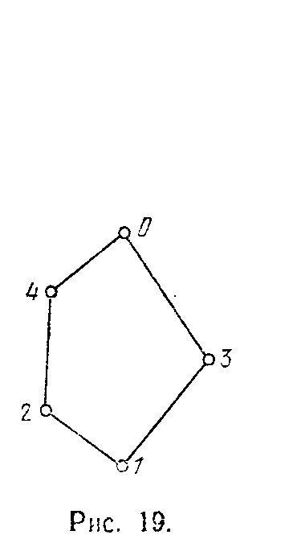
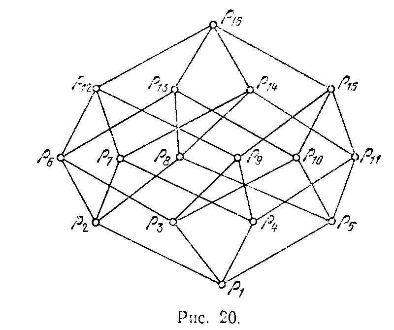
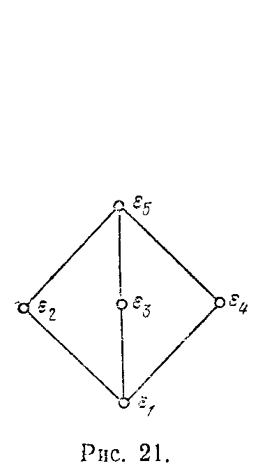
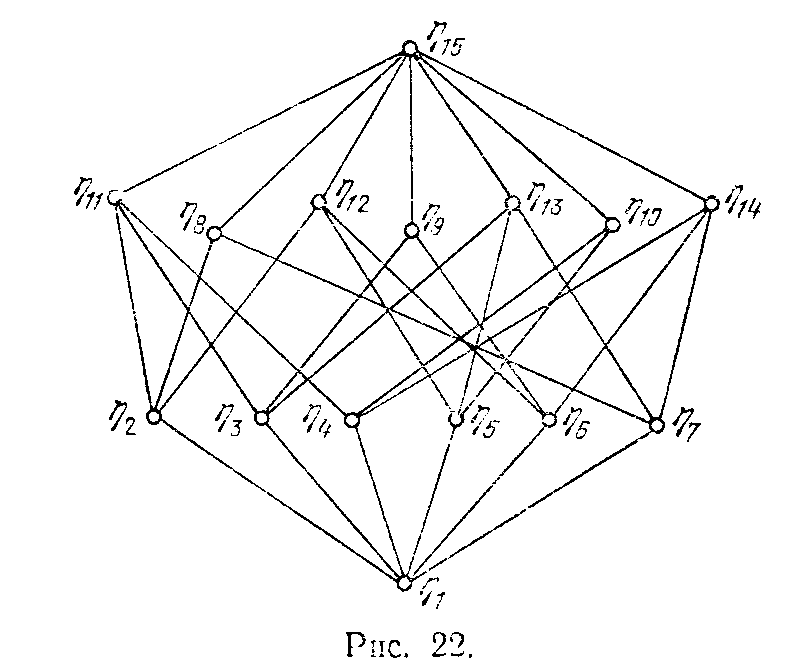
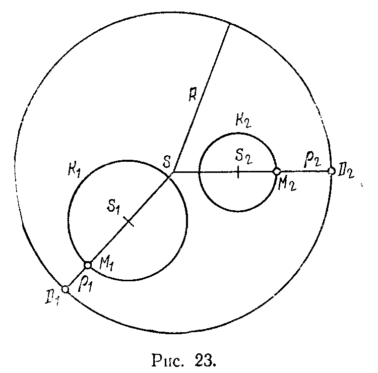
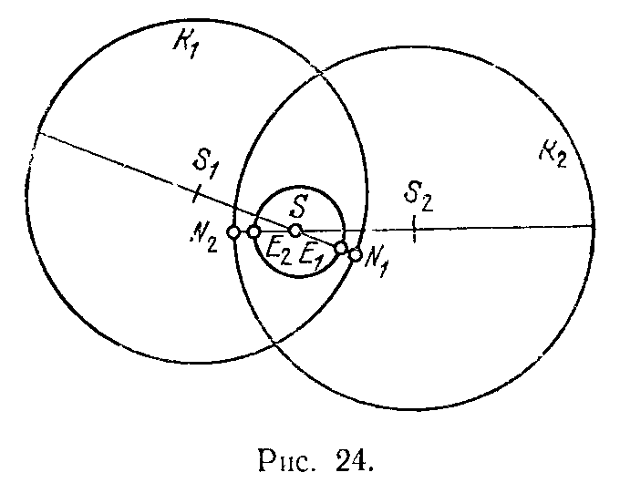
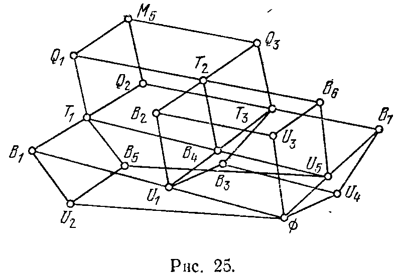
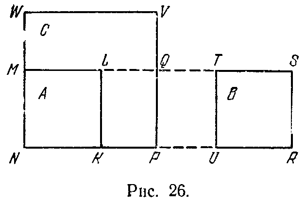
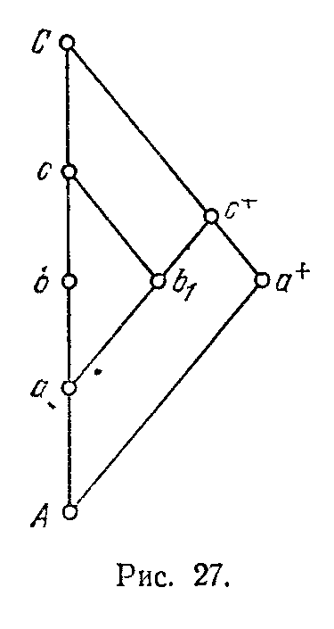

## 4.2. Решения и ответы к упражнениям

---
**стр. 50**
---

# РЕШЕНИЯ И ОТВЕТЫ К УПРАЖНЕНИЯМ

## Глава 1

1. Речь идет о всевозможных подмножествах декартова произведения $\{a,b\}\times\{a,b\}$, и мы получаем следующие отношения:

$\rho_1=\varnothing$,

$\rho_2=\{(a,a)\}$,

$\rho_3=\{(a,b)\}$,

$\rho_4=\{(b,a)\}$,

$\rho_5=\{(b,b)\}$,

$\rho_6=\{(a,a),(a,b)\}$,

$\rho_7=\{(a,a),(b,a)\}$,

$\rho_8=\{(a,a),(b,b)\}$,

$\rho_9=\{(a,b),(b,a)\}$,

$\rho_{10}=\{(a,b),(b,b)\}$,

$\rho_{11}=\{(b,a),(b,b)\}$,

$\rho_{12}=\{(a,a),(a,b),(b,a)\}$,

$\rho_{13}=\{(a,a),(a,b),(b,b)\}$,

$\rho_{14}=\{(a,a),(b,a),(b,b)\}$,

$\rho_{15}=\{(a,b),(b,a),(b,b)\}$,

$\rho_{16}=\{(a,a),(a,b),(b,a),(b,b)\}$.

2. а) $\rho_8$, $\rho_{13}$, $\rho_{14}$, $\rho_{16}$; b) $\rho_1$, $\rho_2$, $\rho_5$, $\rho_8$, $\rho_9$, $\rho_{12}$, $\rho_{15}$, $\rho_{16}$; c) $\rho_1$, $\rho_2$, $\rho_3$, $\rho_4$, $\rho_5$, $\rho_6$, $\rho_7$, $\rho_8$, $\rho_{10}$, $\rho_{11}$, $\rho_{13}$, $\rho_{14}$; d) $\rho_1$, $\rho_2$, $\rho_3$, $\rho_4$, $\rho_5$, $\rho_6$, $\rho_7$, $\rho_8$, $\rho_{10}$, $\rho_{11}$, $\rho_{13}$, $\rho_{14}$, $\rho_{16}$.

3. Например, $\rho_1$, $\rho_2$, $\rho_5$.

4. а) $\rho_8$, $\rho_{13}$, $\rho_{14}$, $\rho_{16}$; b) $\rho_8$, $\rho_{13}$, $\rho_{14}$; c) $\rho_8$, $\rho_{16}$.

5. а)

$\varepsilon_1=\{(a,a),(b,b),(c,c)\}$,

$\varepsilon_2=\{(a,a),(b,b),(b,c),(c,b),(c,c)\}$,

$\varepsilon_3=\{(a,a),(a,c),(b,b),(c,a),(c,c)\}$,

$\varepsilon_4=\{(a,a),(a,b),(b,a),(b,b),(c,c)\}$,

$\varepsilon_5=\{(a,a),(a,b),(a,c),(b,a),(b,b),(b,c),(c,a),(c,b),(c,c)\}=\{a,b,c\}\times\{a,b,c\}$;

b)

$\eta_1=\{(a,a),(b,b),(c,c),(d,d)\}$,

$\eta_2=\{(a,a),(b,b),(c,c),(c,d),(d,c),(d,d)\}$,

$\eta_3=\{(a,a),(b,b),(b,d),(c,c),(d,b),(d,d)\}$,

$\eta_4=\{(a,a),(b,b),(b,c),(c,b),(c,c),(d,d)\}$,

$\eta_5=\{(a,a),(a,d),(b,b),(c,c),(d,a),(d,d)\}$,

$\eta_6=\{(a,a),(a,c),(b,b),(c,a),(c,c),(d,d)\}$,

$\eta_7=\{(a,a),(a,b),(b,a),(b,b),(c,c),(d,d)\}$,

$\eta_8=\{(a,a),(a,b),(b,a),(b,b),(c,c),(c,d),(d,c),(d,d)\}$,

$\eta_9=\{(a,a),(a,c),(b,b),(b,d),(c,a),(c,c),(d,b),(d,d)\}$,

$\eta_{10}=\{(a,a),(a,d),(b,b),(b,c),(c,b),(c,c),(d,a),(d,d)\}$,

$\eta_{11}=\{(a,a),(b,b),(b,c),(b,d),(c,b),(c,c),(c,d),(d,b),(d,c),(d,d)\}$,

$\eta_{12}=\{(a,a),(a,c),(a,d),(b,b),(c,a),(c,c),(c,d),(d,a),(d,c),(d,d)\}$,

$\eta_{13}=\{(a,a),(a,b),(a,d),(b,a),(b,b),(b,d),(c,c),(d,a),(d,b),(d,d)\}$,

$\eta_{14}=\{(a,a),(a,b),(a,c),(b,a),(b,b),(b,c),(c,a),(c,b),(c,c),(d,d)\}$,

$\eta_{15}=\{a,b,c,d\}\times\{a,b,c,d\}$.

## Глава 2

1. См. диаграмму на рис. 19.

2. См. диаграмму на рис. 20 — при обозначениях, принятых в решении упражнения 1 главы 1.

3. Здесь речь идет о у. м. $(P(M\times M),\subseteq)$, которое согласно примеру 10 является полной решеткой.

---
**стр. 51**
---

**4.** Из теоремы 2 вытекает положительный ответ в случаях а), b), d). Из результата упражнения 2 этой главы и упражнения 2, c) первой главы следует, что не существует точной верхней грани множества $\{\rho_6,\rho_7\}$ в у. м. всех антисимметричных отношений на $\{a,b\}$, так что такие отношения при упорядочении включением в общем случае не образуют решетки.

**5.** a) С помощью теоремы 2 получаем положительный ответ.

b) Из упражнения 4, b) первой главы вытекает, что не существует точной верхней грани множества $\{\rho_{13},\rho_{14}\}$ в упорядоченном включением множестве всех упорядочений на двухэлементном множестве $\{a,b\}$, так что здесь вообще не будет решетки.

**6.** a) При обозначениях, принятых в решении упражнения 5, a) первой главы, получаем диаграмму решетки $\mathcal M_5$ (рис. 21). b) При обозначениях, принятых в решении упражнения 5, b) первой главы, получаем диаграмму, изображенную на рис. 22.

---
**стр. 52**
---

**7.** Обозначим $D_0=D\cap I$ (см. пример 8). Если бы существовал $\inf_{(I,\leqslant)}D_0$, то существовал бы и $\inf_{(Q,\leqslant)}D$, что — как мы уже знаем — не имеет места.

# Глава 3

**1.** Любой круг, который является нижней гранью для $\{M,N\}$, должен содержаться в пересечении кругов $M$ и $N$. Если бы среди этих нижних граней существовала наибольшая, она должна была бы содержать всякий круг, который содержится в пересечении обоих кругов $M$, $N$, а потому эта наибольшая нижняя грань содержала бы каждую внутреннюю точку пересечения и в то же время сама, как было сказано в начале, содержалась бы в пересечении. Это невозможно ни для какого круга.

**2.** Обозначим через $R$ радиус, а через $S$ центр некоторого круга, который содержит оба круга $K_1$, $K_2$, ограниченные окружностями
$$
k_1=(S_1,r_1),\qquad k_2=(S_2,r_2).
$$
Обозначим через $M_i$ (соответственно $D_i$) точку пересечения луча $SS_i$ с окружностью $k_i$ (соответственно с окружностью $(S;R)$) (рис. 23). Положим $M_iD_i=\rho_i$. Конечно, $\rho_i\geqslant0$. Тогда для $i=1,2$ будет
$$
R=\rho_i+r_i+SS_i,
$$
откуда
$$
R=\frac{r_1+r_2}{2}+\frac{SS_1+SS_2}{2}+\frac{\rho_1+\rho_2}{2}.
$$

Выражение, стоящее в правой части, не меньше, чем
$$
R_0=\frac{r_1+r_2}{2}+\frac{S_1S_2}{2}.
$$
(Это следует из того, что $\rho_1+\rho_2\geqslant0$, а согласно неравенству треугольника $SS_1+SS_2\geqslant S_1S_2$.) При этом $R=R_0$ тогда и только тогда, когда $\rho_1=\rho_2=0$ и одновременно $S$ лежит на отрезке, соединяющем $S_1$ и $S_2$. Но это означает, что в данном случае речь идет об окружности, внешне касающейся обеих окружностей $k_1$ и $k_2$.

---
**стр. 53**
---

**3.** Обозначим через $r$ радиус, а через $S$ центр некоторого круга, который содержится в кругах $K_1$, $K_2$, ограниченных окружностями $k_i=(S_i,r_i)$. Обозначим через $N_i$ (соответственно через $E_i$) точку пересечения луча $S_iS$ с окружностью $k_i$ (соответственно с окружностью $(S;r)$) (рис. 24). Пусть $\rho_i$ обозначает длину отрезка $E_iN_i$. Тогда
$$
r_i=\rho_i+r+SS_i,
$$
откуда
$$
r=\frac{r_1+r_2}{2}-\frac{\rho_1+\rho_2}{2}-\frac{SS_1+SS_2}{2}.
$$

Рассуждениями, аналогичными тем, которые были проведены в предыдущем примере, получаем, что
$$
r\leqslant r_0=\frac{r_1+r_2}{2}-\frac{S_1S_2}{2}
$$
и что равенство $r=r_0$ имеет место тогда и только тогда, когда $\rho_1=\rho_2=0$ и одновременно $S$ лежит на отрезке, соединяющем $S_1$ и $S_2$. Это означает, что речь идет о круге, ограниченном окружностью, касающейся изнутри обеих окружностей $k_1$, $k_2$.

**4.** Поскольку $\varnothing$ является наименьшим элементом у. м. $C(\rho;p)$, то существование как верхней, так и нижней точной грани любого двухэлементного множества $\{K_1,K_2\}$ очевидно в случае, когда хотя бы один элемент равен пустому множеству. Точно так же очевидно, что $\varnothing$ является точной нижней гранью множества $\{K_1,K_2\}$ в случае, когда $K_1\cap K_2=\varnothing$. Если же $K_1$, $K_2$ — такие круги, что их пересечение $K_1\cap K_2$ не пусто, возьмем круг $K$, ограниченный окружностью, касающейся изнутри окружностей $k_1$ и $k_2$. Любой другой круг $K_3$, который содержится как в $K_1$, так и в $K_2$ и центр которого лежит на прямой $p$, определяет на $p$ точки пересечения $C_1$, $C_2$ такие, что отрезок $C_1C_2$ является частью отрезка, определяемого точками касания граничных окружностей кругов $K_1$, $K_2$, $K$. Но тогда и весь круг $K_3$ содержится в круге $K$. Аналогично можно использовать упражнение 2, чтобы доказать существование точной верхней грани множества $\{K_1,K_2\}$, где $K_1,K_2\in C(\rho;p)$ — непустые круги. Поэтому $C(\rho;p)$ является решеткой. Но это не полная решетка, поскольку;

---
**стр. 54**
---

например, множество всех кругов из $C(\rho;\rho)$ не имеет в этом у. м. точной верхней грани.

**5.** Проверкой рефлексивности, транзитивности и антисимметричности установим, что $(H(\rho),\subseteq)$ является у. м. Но это не полурешетка, а тем более не полная решетка, поскольку фигура $ABCGFED$ и фигура $EFGC$ являются звездчатыми множествами, а их пересечение состоит из отрезков $EF$, $FG$ и $GC$ и не является звездчатым множеством. Отсюда видно, что для множества, состоящего из двух упомянутых фигур, в $(H(\rho),\subseteq)$ нижними гранями будут как $EFG$, так и $FGC$, но наибольшей нижней грани (принадлежащей $H(\rho)$) это множество не имеет. Так что для двухэлементного множества $\{ABCGFED,EFGC\}$ в $(H(\rho),\subseteq)$ точной нижней грани не существует.

**6.** Речь идет об у. м., являющемся даже решеткой. В ней
$\{a_i\}\vee\{b_i\}=\{c_i\}$, где $c_i=\max(a_i,b_i)$, и
$\{a_i\}\wedge\{b_i\}=\{d_i\}$, где $d_i=\min(a_i,b_i)$.
Но это не полная решетка, поскольку если мы возьмем за $M$ множество всех последовательностей вида $n,n,n,\ldots$ (для $n=1,2,\ldots$), то увидим, что в решетке $(F(R),\ll)$ не существует верхней грани множества $M$.

**7.** а) Поскольку $k\preccurlyeq h$ и $n\preccurlyeq m$ и поскольку $h\vee m$ является верхней гранью множества $\{h,m\}$, то $h\preccurlyeq h\vee m$ и аналогично $m\preccurlyeq h\vee m$. Вследствие транзитивности отношения $\preccurlyeq$ также будет $k\preccurlyeq h\vee m$ и $n\preccurlyeq h\vee m$, так что $h\vee m$ является верхней гранью множества $\{k,n\}$; ввиду (3s) тогда $k\vee n\preccurlyeq h\vee m$.  
б) В а) положите $k=d_1$, $m=h$, $n=d_2$ и примите во внимание, что $h\vee h=h$.  
в) В а) положите $h=d$, $k=c$ и $m=n=g$.  
г)—е) выводятся аналогично.

**8.** а) Всегда $a\preccurlyeq a\vee b$ и $a\preccurlyeq a\vee c$. Поэтому ввиду упражнения 7, е) будет
$a\preccurlyeq(a\vee b)\wedge(a\vee c)$.
Далее, $b\wedge c\preccurlyeq b\preccurlyeq a\vee b$ и аналогично
$b\wedge c\preccurlyeq c\preccurlyeq a\vee c$. То же упражнение дает нам
$b\wedge c\preccurlyeq(a\vee b)\wedge(a\vee c)$.
Из упражнения 7, b) вытекает, что
$a\vee(b\wedge c)\preccurlyeq(a\vee b)\wedge(a\vee c)$.  
б) Будем исходить из соотношений $a\succcurlyeq a\wedge b$, $a\succcurlyeq a\wedge c$ и действовать, как в случае а).  
в) Если $a\preccurlyeq c$, то $a\vee c=c$ и утверждение в в) является следствием а).

# Глава 4

**1.** Любое одноэлементное множество $U_i=\{\varepsilon_i\}$ является носителем подрешетки. Из двухэлементных множеств образуют подрешетки в точности следующие (см. рис. 21):

$$
B_1=\{\varepsilon_1,\varepsilon_2\},\quad
B_2=\{\varepsilon_1,\varepsilon_3\},\quad
B_3=\{\varepsilon_1,\varepsilon_4\},\quad
B_4=\{\varepsilon_1,\varepsilon_5\},
$$

$$
B_5=\{\varepsilon_2,\varepsilon_5\},\quad
B_6=\{\varepsilon_3,\varepsilon_5\},\quad
B_7=\{\varepsilon_4,\varepsilon_5\}.
$$

Трехэлементные:
$T_1=\{\varepsilon_1,\varepsilon_2,\varepsilon_5\}$,
$T_2=\{\varepsilon_1,\varepsilon_3,\varepsilon_5\}$,
$T_3=\{\varepsilon_1,\varepsilon_4,\varepsilon_5\}$.

Четырехэлементные:

$$
Q_1=\{\varepsilon_1,\varepsilon_2,\varepsilon_3,\varepsilon_5\},\quad
Q_2=\{\varepsilon_1,\varepsilon_2,\varepsilon_4,\varepsilon_5\},\quad
Q_3=\{\varepsilon_1,\varepsilon_3,\varepsilon_4,\varepsilon_5\}.
$$

И само множество
$M_5=\{\varepsilon_1,\varepsilon_2,\varepsilon_3,\varepsilon_4,\varepsilon_5\}$,
конечно, является носителем подрешетки.

---
**стр. 55**
---

**2.** Используем теорему 2: $P$ есть наибольший элемент этого у. м. и если $M$ — некоторое непустое множество носителей подрешетки решетки $\mathscr P$, то их пересечение будет либо пустым множеством, либо носителем подрешетки.

Диаграмма этой решетки для решетки $M_5$ представлена на рис. 25.

Эта диаграмма согласно примеру 25 не модулярна (т. е. не является диаграммой модулярной решетки), поскольку $\{\varnothing,U_4,B_7,B_1,Q_2\}$ является носителем подрешетки с диаграммой, подобной диаграмме на рис. 12, b.

**3.** Используем описание пересечения и объединения двух элементов решетки $(F(R),\ll)$, данное в упражнении 6 третьей главы, и из решения примера 22 получаем истинность тождества (4), что вследствие примера 20 означает истинность и (5), т. е. дистрибутивность рассматриваемой решетки.

**4.** 1) Если $a\preccurlyeq c$ и если выполняется указанное условие, то прежде всего $a\wedge c=a$ и $a\vee c=c$. Отсюда видно, что если переписать условие упражнения 4, то получится модулярный закон.

2) Если, с другой стороны, $\mathscr P$ — модулярная решетка, то достаточно вспомнить, что в каждой решетке
$a\wedge c\preccurlyeq c\preccurlyeq a\vee c$
и, значит, $a\wedge c\preccurlyeq a\vee c$. Используя определение модулярной решетки, получаем рассматриваемое в упражнении условие.

**5.** Эта решетка не модулярна и тем более, ввиду задачи 21, не дистрибутивна. Чтобы убедиться, что эта решетка не модулярна, возьмем на плоскости $\rho$ прямоугольную систему координат и за прямую $p$ примем ось $x$. Если $A$ обозначает открытый круг, ограниченный окружностью с центром в точке $(0{,}75;0)$ и радиусом $0{,}25$, $C$ — круг с окружностью, имеющей центр в точке $(0{,}5;0)$ и радиус $0{,}5$, а $B$ — круг, ограниченный окружностью с центром в точке $(-0{,}5;0)$ и радиусом $0{,}5$, то
$B\vee C=B\vee A=I$, где $I$ обозначает круг, ограниченный окружностью с центром в начале координат и радиусом, равным 1, а
$B\wedge C=B\wedge A=\varnothing$.
Поэтому $A\subset C$ и $A,B,C,I,\varnothing$ определяют носитель подрешетки с диаграммой на рис. 12, b, а тогда согласно примеру 25 рассматриваемая решетка не модулярна.

**6.** Эта решетка не дистрибутивна, поскольку она даже не модулярна. Чтобы убедиться в этом, рассмотрим прилагаемый рису-

---
**стр. 56**
---

нок 26. В качестве выпуклых множеств $A$, $B$, $C$ возьмем соответственно квадраты $KLMN$, $RSTU$, $PVWN$. Очевидно, $A\subset C$. В решетке $(K(\rho),\subseteq)$ наименьшим выпуклым множеством, содержащим как $A$, так и $B$, является $A\vee B$. Очевидно, это будет прямоугольник $NRSM$. Если $K_1$, $K_2$ — два выпуклых подмножества плоскости $\rho$,

то, как следует из замечания к примеру 14,
$K_1\wedge K_2=K_1\cap K_2$.
Тогда $(A\vee B)\wedge C$ равно пересечению прямоугольника $NRSM$ с квадратом $NPVW$, т. е. совпадает с прямоугольником $MNPQ$. Рассмотрим теперь выражение $A\vee(B\wedge C)$. Здесь $B\wedge C=B\cap C=\varnothing$, а наименьшее выпуклое множество, содержащее как $A$, так и пустое множество, есть множество $A$. Это означает, что
$A\vee(B\wedge C)=A$.

**7.** Так как
$b\wedge a^+\preccurlyeq c\wedge c^+=b_1$
(см. рис. 27), то
$b\wedge a^+\preccurlyeq b\wedge b_1=a$.
Отсюда
$b\wedge a^+\preccurlyeq a\wedge a^+=A$
и, так как $A\preccurlyeq b$ и $A\preccurlyeq a^+$, то
$A\preccurlyeq b\wedge a^+$, — и $A=b\wedge a^+$.
Далее,
$b\vee a^+\succcurlyeq a\vee a^+=c^+\succcurlyeq b_1$,
и потому
$b\vee a^+\succcurlyeq b\vee b_1=c$.
Аналогично
$b\vee a^+\succcurlyeq c\vee c^+=C$.
Поскольку $b\preccurlyeq C$ и $a^+\preccurlyeq c^+\preccurlyeq C$, будет
$b\vee a^+\preccurlyeq C$, и отсюда необходимо
$b\vee a^+=C$.

**8.** а) Если применить (7) к
$A_3=a_3=B\wedge c$, $b_3=B$, $c_3=C_3=C$,
$B'_3=c\succcurlyeq B''_3=b\vee(B\wedge c)$
и к
$A_4=a_4=A$, $b_4=B\wedge c$,
$c_4=C_4=a\vee(B\wedge c)$,
$B'_4=b\wedge[a\vee(B\wedge c)]\succcurlyeq B''_4=a$,
то получается
$b_1=a\vee(B\wedge c)$
и аналогично
$b_1=c\wedge(B\vee a)$.
Поэтому

$$
c\wedge(b_1\vee B)
=c\wedge\{[a\vee(B\wedge c)]\vee B\}
=c\wedge(a\vee B)=b_1.
$$

б) Ввиду а) выполняется условие (6), и теперь достаточно применить теорему 3.

**9.** Используя дистрибутивность, получаем

$$
[b\wedge(a\vee c)]\vee(a\wedge c)
=[(a\wedge b)\vee(b\wedge c)]\vee(a\wedge c);
$$

$$
[c\vee(a\wedge b)]\wedge(a\vee b)
=[c\wedge(a\vee b)]\vee[(a\wedge b)\wedge(a\vee b)]
=[(a\wedge b)\vee(b\wedge c)]\vee(a\wedge c).
$$

**10.** Предположим, что в (8) $b\preccurlyeq c$; тогда получаем

$$
[b\wedge(a\vee c)]\vee(a\wedge c)=b\vee(a\wedge c),
$$

$$
[c\vee(a\wedge b)]\wedge(a\vee b)=c\wedge(a\vee b).
$$

---
**стр. 57**
---

и потому решетка $\mathscr P$ модулярна. Вследствие модулярности

$$
V=(a\wedge b)\vee(a\wedge c)=a\wedge[b\vee(a\wedge c)]=a\wedge(a\vee c)\wedge
[b\vee(a\wedge c)].
$$

Из модулярности же

$$
[b\wedge(a\vee c)]\vee(a\wedge c)=[b\vee(a\wedge c)]\wedge(a\vee c)
$$

и тогда ввиду (8)

$$
[b\vee(a\wedge c)]\wedge(a\vee c)=[c\vee(a\wedge b)]\wedge(a\vee b).
$$

Если заменим здесь $a$ на $c$, $c$ на $a$, а $b$ оставим без изменения, то

$$
[b\vee(a\wedge c)]\wedge(a\vee c)=[a\vee(c\wedge b)]\wedge(c\vee b),
$$

и потому

$$
V=a\wedge[a\vee(c\wedge b)]\wedge(c\vee b)=a\wedge(c\vee b).
$$

**11. а)** Используя модулярность и тот факт, что $b\vee c\geqslant b\vee(a\wedge c)$, получаем

$$
\begin{aligned}
d\wedge\beta
&=a\wedge(b\vee c)\wedge[b\vee(a\wedge c)]\wedge(a\vee c)=\\
&=a\wedge(a\vee c)\wedge[b\vee(a\wedge c)]
=a\wedge[b\vee(a\wedge c)]=\\
&=(a\wedge b)\vee(a\wedge c),
\end{aligned}
$$

$$
\begin{aligned}
d\vee\beta
&=[a\wedge(b\vee c)]\vee\{[b\vee(a\wedge c)]\wedge(a\vee c)\}=\\
&=[a\wedge(b\vee c)]\vee[b\wedge(a\vee c)]\vee[(a\wedge c)\wedge(a\vee c)].
\end{aligned}
$$

Поскольку $a\wedge(b\vee c)\geqslant a\wedge c=(a\wedge c)\wedge(a\vee c)$, имеем

$$
\begin{aligned}
d\vee\beta
&=[a\wedge(b\vee c)]\vee[b\wedge(a\vee c)]=\\
&=\{[a\wedge(b\vee c)]\vee b\}\wedge(a\vee c)
=(a\vee b)\wedge(b\vee c)\wedge(a\vee c).
\end{aligned}
$$

Подобные соотношения для $\gamma$ получаются заменой $c$ на $b$, $b$ на $c$ с сохранением $a$. Что касается выражения для $\beta$, то мы уже получили его в решении примера 10. b) Вследствие а), $\beta$ и $\gamma$ оба являются относительными дополнениями (в одном и том же интервале) элемента $d$, а потому ввиду (7) $\beta=\gamma$.

**12.** Согласно упражнению 8, b) $\mathscr P$ является модулярной решеткой, а из упражнений 11, b) и 10 следует, что она дистрибутивна.

**13. а)** Достаточно, например, выбрать $a=3$, $b=6$, $c=12$.

b) В примере 24, а) мы показали, что эта решетка не дистрибутивна, так что тем более она не является булевой решеткой. Однако это решетка с дополнениями: дополнением точки $T$ является плоскость $\rho$ и обратно; дополнением данной прямой $p$, проходящей через точку $T$, будет любая прямая $p_1$, проходящая через точку $T$ и отличная от $p$.
