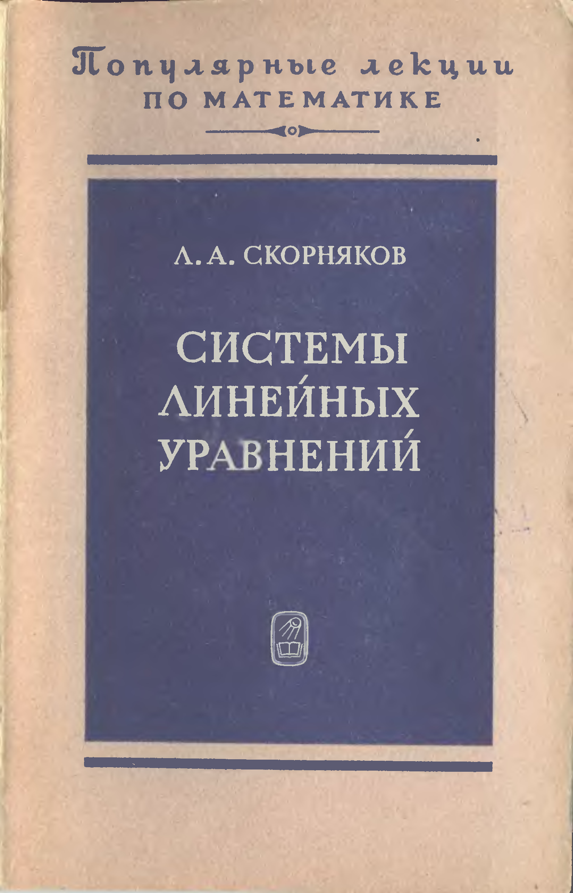

# ВСТУПИТЕЛЬНЫЕ МАТЕРИАЛЫ

## Вступительные материалы

---
**стр. 0**
---

Популярные лекции по математике

Л. А. СКОРНЯКОВ

СИСТЕМЫ ЛИНЕЙНЫХ УРАВНЕНИЙ

---
**стр. 1**
---

ПОПУЛЯРНЫЕ ЛЕКЦИИ
ПО МАТЕМАТИКЕ
ВЫПУСК 59

Л. А. СКОРНЯКОВ

СИСТЕМЫ ЛИНЕЙНЫХ УРАВНЕНИЙ

МОСКВА «НАУКА»
ГЛАВНАЯ РЕДАКЦИЯ
ФИЗИКО-МАТЕМАТИЧЕСКОЙ ЛИТЕРАТУРЫ
1986

---
**стр. 2**
---

ББК 22.143
С44
УДК 512(023)

Скорняков Л. А.

С44 Системы линейных уравнений. — М.: Наука. Гл. ред. физ.-мат. лит., 1986. — 64 с. — (Попул. лекции по мат.)

10 коп. 100 000 экз.

В брошюре содержится исчерпывающее изложение учения о системах линейных уравнений, опирающееся лишь на элементарные преобразования матриц.

Для широкого круга читателей, включая школьников старших классов, интересующихся математнкой. <!-- опечатка оригинала: «математнкой» (вместо «математикой»), сверено со сканом, перенесено как напечатано -->

С 1702030000—027 / 053(02)-86 043-86 ББК 22.143

Рецензент
кандидат физико-математических наук Д. В. Беклемишев

© Издательство «Наука». Главная редакция физико-математической литературы, 1986

<!-- номер страницы в колонтитуле на этих разворотах не виден; маркеры стр. 0, 1, 2 получены по формуле file_page_offset=1 (печатная = номер файла − 1) и могут не совпадать с реальной нумерацией, если она нестандартна -->

---
**стр. 3**
---

**СОДЕРЖАНИЕ**

Предисловие 4
§ 1. Системы линейных уравнений и их решения 5
§ 2. Матрицы и их элементарные преобразования 9
§ 3. Метод решения систем линейных уравнений 20
§ 4. Ранг матрицы 28
§ 5. Теорема о главных неизвестных 36
§ 6. Фундаментальные системы решений 44
Ответы 53
Решения 57
Предметный указатель 62

<!-- на скане страницы не видно печатного номера; номер 3 получен по формуле file_page_offset (стр. 4 файла − 1) -->
<!-- в оглавлении не полностью разобраны: номер страницы у «§ 2» (читается как 9) и у «§ 3» (первая цифра частично закрыта, читается как 20) -->

---
**стр. 4**
---

**ПРЕДИСЛОВИЕ**

Содержание настоящей книги достаточно четко охарактеризовано в аннотации. Добавим еще, что формально в ней не используется метод полной математической индукции. Однако в некоторых случаях он скрывается под словами «и т. д.». Читатель, знакомый с этим методом, без труда доведет изложение до современного уровня строгости. Основная цель приводимых упражнений — дать читателю возможность проверить уровень усвоения изучаемого им материала. Для более глубокого знакомства с предметом годится любой курс линейной алгебры. Автору, разумеется, кажется наилучшим его учебное пособие «Элементы алгебры» (М.: Наука, 1980), но это, конечно, субъективно.

Идея, положенная в основу предлагаемой книги, использовалась при преподавании на отделении структурной лингвистики филологического факультета Московского университета. Автор глубоко благодарен Ю. А. Бахтурину, обратившему его внимание на эту идею. Ю. А. Бахтурин, Д. В. Беклемишев, Д. П. Егорова и А. П. Мишина высказали ряд полезных замечаний по тексту рукописи. Автор с удовольствием пользуется случаем, чтобы поблагодарить этих математиков. С благодарностью он отмечает большую помощь, оказанную Т. А. Гуровой при подготовке рукописи.
