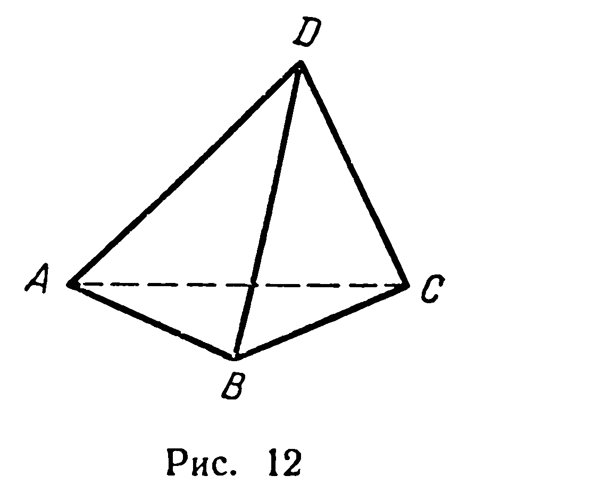
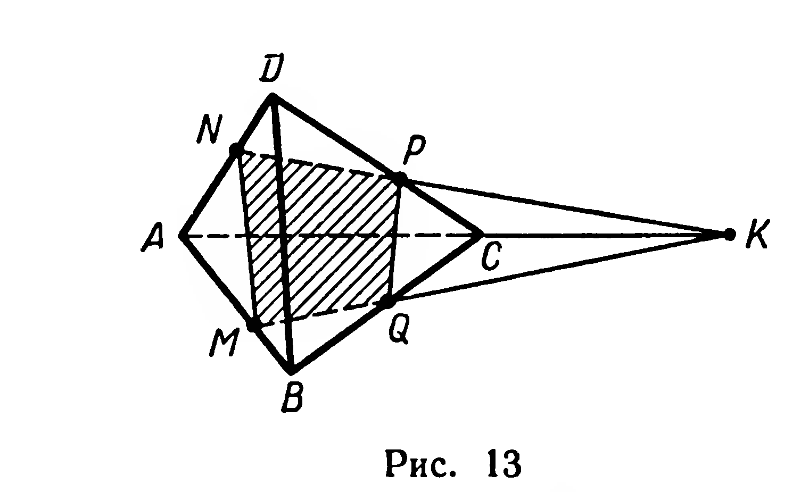

## 1.5. Решение задачи на построение сечения многогранника

---
**стр. 12, продолжение**
---

### § 5. Решение задачи на построение сечения многогранника^1^

Простейшим многогранником служит треугольная пирамида (рис. 12). Она имеет всего четыре грани. Поэтому мы будем ее кратко именовать *тетраэдром* (четырехгранником). Если пересечением многогранника и плоскости является многоугольник, то этот многоугольник называют *сечением многогранника* данной плоскостью.

**Задача.** На ребрах $AB$, $AD$, $CD$ тетраэдра $ABCD$ выбраны соответственно точки $M$, $N$, $P$ так, что прямые $NP$ и $AC$ не параллельны (рис. 13). Построить сечение тетраэдра плоскостью, проходящей через данные точки.

**Решение.** Плоскость, проходящую через точки $M$, $N$, $P$, обозначим $\alpha$. Плоскость $\alpha$ имеет с плоскостью $DAC$ общие точки $N$ и $P$, поэтому пересечение плоскостей $DAC$ и $\alpha$ есть прямая $NP$ (аксиома 5). Отрезок $NP$ — пересечение грани $DAC$ и плоскости $\alpha$. Аналогично построим отрезок $NM$.

Точка $M$ принадлежит плоскости $\alpha$ и плоскости $ABC$; для построения линии пересечения этих плоскостей достаточно найти еще одну их общую точку. Такой точкой является точка $K$ пе-

---
^1^ Понятия «многогранник», «пирамида», «параллелепипед» и т. п. будут определены в X классе. Сейчас мы основываемся на сведениях из восьмилетней школы.

