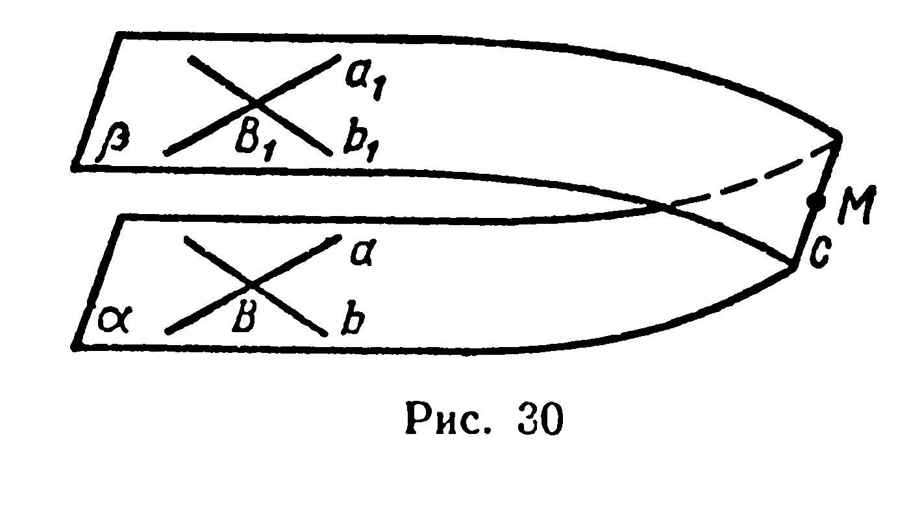
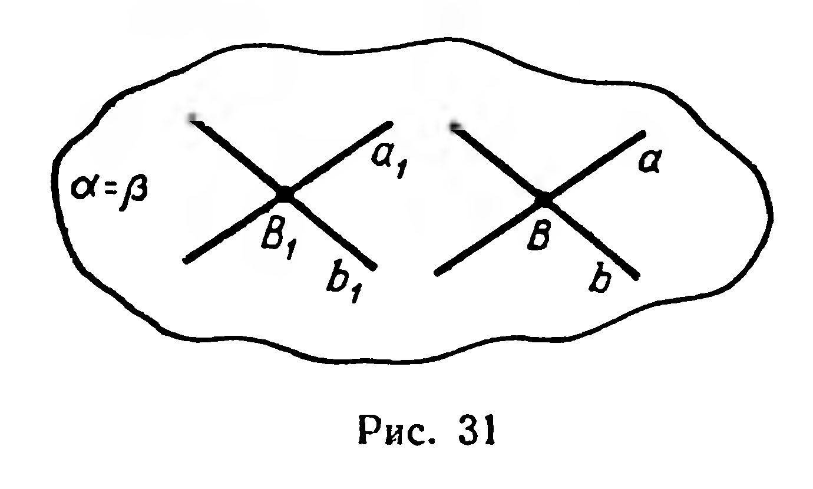
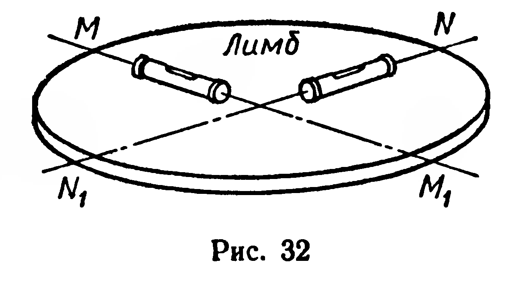

## 1.10. Взаимное расположение двух плоскостей. Признак параллельности плоскостей

---
**стр. 21, продолжение**
---

**§ 10. ВЗАИМНОЕ РАСПОЛОЖЕНИЕ ДВУХ ПЛОСКОСТЕЙ. ПРИЗНАК ПАРАЛЛЕЛЬНОСТИ ПЛОСКОСТЕЙ**

Два случая взаимного расположения двух плоскостей нам уже известны. Две плоскости: 1) совпадают, если они имеют три общие точки, не принадлежащие прямой (аксиома 4); 2) пересекаются, если они различны и имеют общую точку (аксиома 5).

Докажем, что возможен третий случай взаимного расположения двух плоскостей: две плоскости не имеют общей точки.

---
**стр. 22**
---

В плоскости $\alpha$ проведём две пересекающиеся прямые $a$ и $b$ (рис. 30). Через точку $B_1$, не принадлежащую $\alpha$, проведём прямые $a_1 \parallel a$ и $b_1 \parallel b$; через $a_1$ и $b_1$ проведём плоскость $\beta$ (§ 3, следствие 2).

Докажем (от противного), что $\alpha$ и $\beta$ не имеют общей точки. Предположим, что $M$ — общая точка плоскостей $\alpha$ и $\beta$. Из аксиомы 5 следует, что их пересечением служит некоторая прямая $c$. Но плоскость $\alpha$ проходит через $a$, плоскость $\beta$ — через $a_1$, причём $a \parallel a_1$. Тогда $c \parallel a$ (§ 8, теорема 4).

Таким же образом доказываем, что $c \parallel b$. Получили противоречие с аксиомой параллельных: в плоскости $\alpha$ через точку $B$ проходят две пересекающиеся прямые $a$ и $b$, параллельные прямой $c$. Следовательно, плоскости $\alpha$ и $\beta$ не имеют ни одной общей точки. $\blacksquare$

Итак, для двух плоскостей $\alpha$ и $\beta$ возможны только три случая: 1) $\alpha = \beta$; 2) $\alpha \cap \beta = a$; 3) $\alpha \cap \beta = \varnothing$.

Первый и третий случаи мы снова объединим.

**Определение.** Две плоскости называются параллельными, если они не имеют общей точки или совпадают.

Обозначение параллельности плоскостей $\alpha$ и $\beta$: $\alpha \parallel \beta$.

**6. Теорема** (признак параллельности двух плоскостей). *Если две пересекающиеся прямые одной плоскости соответственно параллельны двум прямым другой плоскости, то эти плоскости параллельны.*

Истинность признака для случая, когда данные плоскости различны, следует из рассуждения, проведённого выше. Запишем символически это доказательство (рис. 30).

Дано: $a \subset \alpha$, $b \subset \alpha$, $a \cap b = B$; $a_1 \subset \beta$, $b_1 \subset \beta$; $a_1 \parallel a$, $b_1 \parallel b$.

Доказать: $\alpha \parallel \beta$.

Доказательство (от противного).

Пусть $\alpha \cap \beta = c$. Имеем:

$(a \parallel a_1,\; a \subset \alpha,\; a_1 \subset \beta) \Rightarrow c \parallel a$ (теорема 4).

$(b \parallel b_1,\; b \subset \alpha,\; b_1 \subset \beta) \Rightarrow c \parallel b$.

Мы получили противоречие с аксиомой параллельных прямых. Следовательно, $\alpha \parallel \beta$.

Плоскости $\alpha$ и $\beta$, удовлетворяющие условию теоремы, могут совпадать (рис. 31). И в этом случае признак остаётся верным, так как совпадающие плоскости параллельны. $\blacksquare$

---
**стр. 23**
---

**Задачи.**

**77°.** Каким может быть взаимное расположение плоскостей $\alpha$ и $\beta$, если известно, что: 1) некоторая прямая $a$, лежащая в плоскости $\alpha$, не лежит в плоскости $\beta$; 2) ни одна из прямых, лежащих в плоскости $\alpha$, не лежит в плоскости $\beta$.

**78°.** Верно ли утверждение, что плоскости параллельны, если: 1) прямая, лежащая в одной плоскости, параллельна прямой другой плоскости; 2) две прямые, лежащие в одной плоскости, соответственно параллельны двум прямым другой плоскости?

**79°.** Укажите модели параллельных плоскостей на предметах классной обстановки.

**80°.** Докажите параллельность плоскостей, в которых расположены противолежащие грани параллелепипеда (рис. 27).

**81.** Диагональ и сторона многоугольника параллельны плоскости $\alpha$. Верно ли утверждение, что плоскость многоугольника параллельна плоскости $\alpha$, если многоугольник имеет: 1) четыре стороны; 2) пять сторон; 3) $n$ сторон ($n > 5$)?

**82.** Дан тетраэдр $ABCD$; точки $M$, $N$, $P$ являются серединами рёбер $DA$, $DB$, $DC$. Докажите, что $(MNP) \parallel (ABC)$.

**83.** Прямые $a$, $b$, $c$, не лежащие в одной плоскости, имеют общую точку $O$. На каждой из этих прямых взяты по разные стороны от точки $O$ соответственно пары точек: $A_1$ и $A_2$, $B_1$ и $B_2$, $C_1$ и $C_2$. Докажите, что плоскости $A_1B_1C_1$ и $A_2B_2C_2$ параллельны, если $|OA_1| = |OA_2|$, $|OB_1| = |OB_2|$, $|OC_1| = |OC_2|$.

**84.** 1) Докажите, что если каждая из двух пересекающихся прямых плоскости $\alpha$ параллельна плоскости $\beta$, то эти плоскости параллельны.

2°) Для проверки горизонтальности установки лимба угломерных инструментов пользуются двумя уровнями, расположенными на одной плоскости (рис. 32). Почему уровни располагают на пересекающихся прямых?

