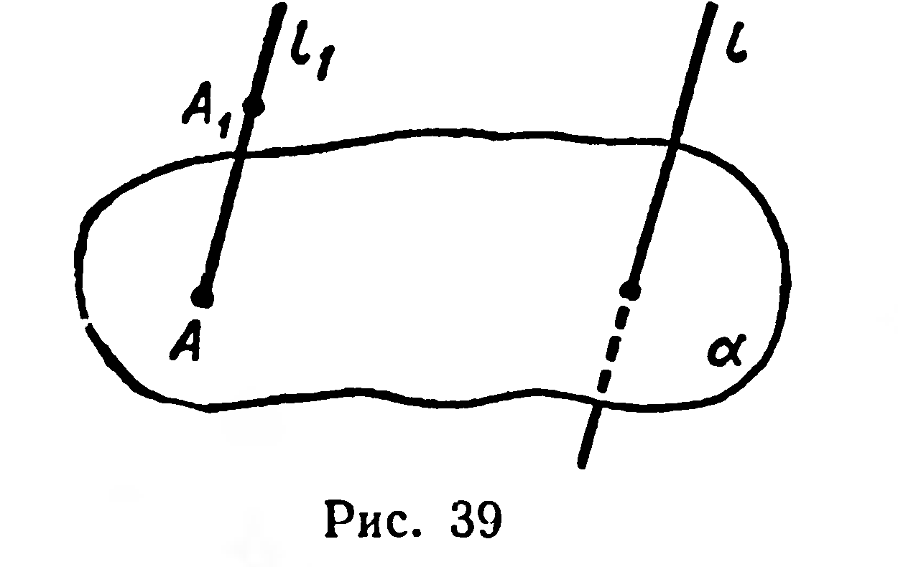
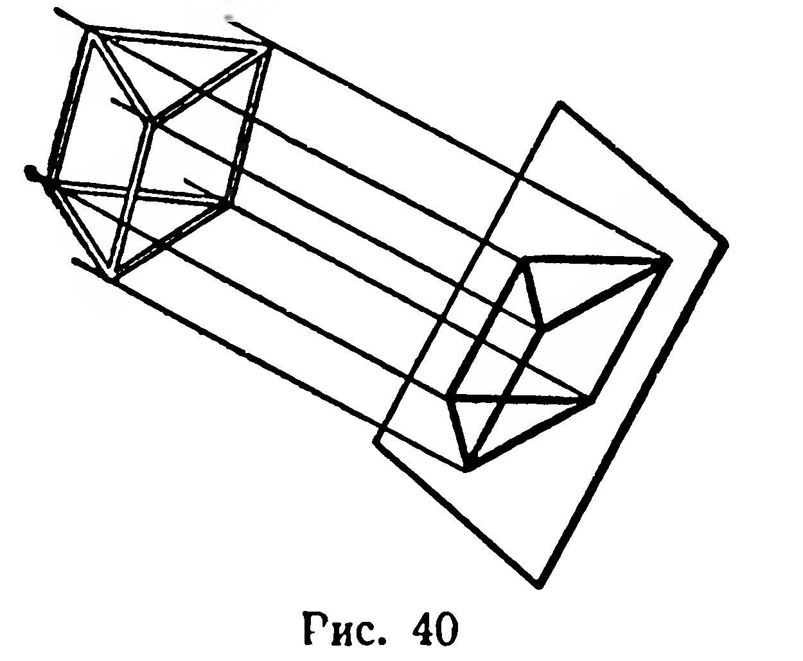
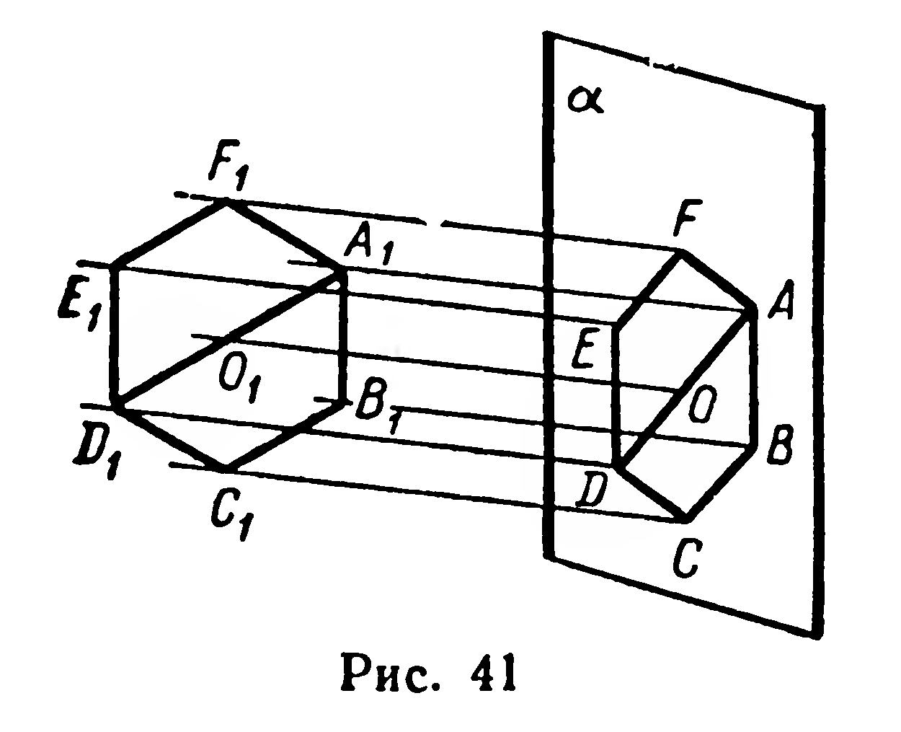

## 1.12. Параллельная проекция фигуры. Свойства параллельной проекции

---
**стр. 26, продолжение**
---

## § 12. Параллельная проекция фигуры. Свойства параллельной проекции

В этом и следующем параграфах будут сформулированы правила, которыми пользуются в стереометрии при изображении фигур. Прежде всего введем несколько новых понятий.

Пусть дана плоскость $\alpha$ и прямая $l$, пересекающая $\alpha$ (рис. 39). Возьмем произвольную точку $A_1$; через нее проведем прямую $l_1$, параллельную прямой $l$. Прямая $l_1$ пересечет $\alpha$ в некоторой точке $A$ (рис. 39). Полученную таким способом точку $A$ назовем проекцией точки $A_1$ на плоскость $\alpha$ при проектировании параллельно прямой $l$ (короче, точка $A$ — параллельная проекция точки $A_1$). **Параллельной проекцией фигуры** $\Phi_1$ назовем множество $\Phi$ параллельных проекций всех точек данной фигуры.

Представление о параллельной проекции фигуры получим, рассматривая тень, которую отбрасывает на стену в солнечный день картонная или проволочная модель этой фигуры (рис. 40 и 41). Солнечные лучи можно приближенно считать параллельными вследствие большой удаленности Солнца от Земли.

Модель правильного шестиугольника $A_1B_1C_1D_1E_1F_1$ (рис. 41) отбрасывает на стену тень в виде многоугольника $ABCDEF$. Рассматривая эту тень (при различ-

---
**стр. 27**
---

ных положениях плоскости шестиугольника относительно плоскости стены), можно высказать несколько гипотез о свойствах параллельного проектирования. Формулируя эти свойства, будем полагать, что проектирование производится параллельно прямой $l$, не параллельной проектируемым прямым или отрезкам.

**Свойство 1.** *Проекция прямой есть прямая.*

**Свойство 2.** *Проекции параллельных прямых параллельны.*

**Свойство 3.** *Отношение длин проекций двух параллельных отрезков равно отношению длин проектируемых отрезков.*

Доказательства этих свойств опускаем.

## Задачи

**97.** Даны три различные точки. Сколько точек может получиться на плоскости проекций при проектировании данных точек?

**98°.** Какой фигурой является проекция проектирующей прямой?

**99°.** Какой фигурой может быть проекция: 1) плоскости; 2) полуплоскости; 3) угла, отличного от развернутого?

**100°.** В каком случае: 1) проекция точки совпадает с этой точкой; 2) проекция прямой совпадает с этой прямой?

**101°.** В каком случае неверно утверждение: «Проекции параллельных прямых параллельны»?

**102.** Известно, что отрезок и его проекция имеют равные длины. Как может быть расположен данный отрезок по отношению к плоскости проекций?

**103.** 1) Какие фигуры можно получить, проектируя на плоскость объединение двух пересекающихся прямых?

2) Какие фигуры можно получить, проектируя на плоскость объединение двух скрещивающихся прямых?

**104.** 1°) Если проекции двух прямых параллельны, то верно ли утверждение, что параллельны и проектируемые прямые?

2) Даны скрещивающиеся прямые $a$, $b$ и плоскость проекций $\alpha$. Проведите прямую $l$ так, чтобы при проектировании параллельно $l$ проекции прямых $a$ и $b$ были параллельны.

**105.** Из одной точки выходят три луча, не лежащие в одной плоскости. Какой фигурой может быть проекция объединения этих лучей?

**106.** Отрезок $AB$ пересекает плоскость проекций в точке $M$. Его проекцией служит отрезок $A_1B_1$. Известно: $|AB| = m$, $|A_1M| : |MB_1| = p : q$. Найдите $|AM|$ и $|MB|$.
