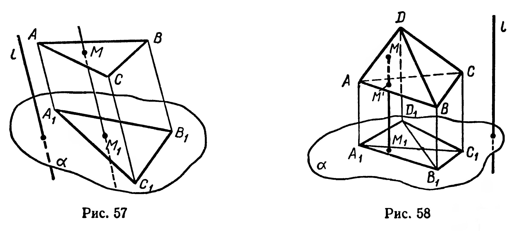
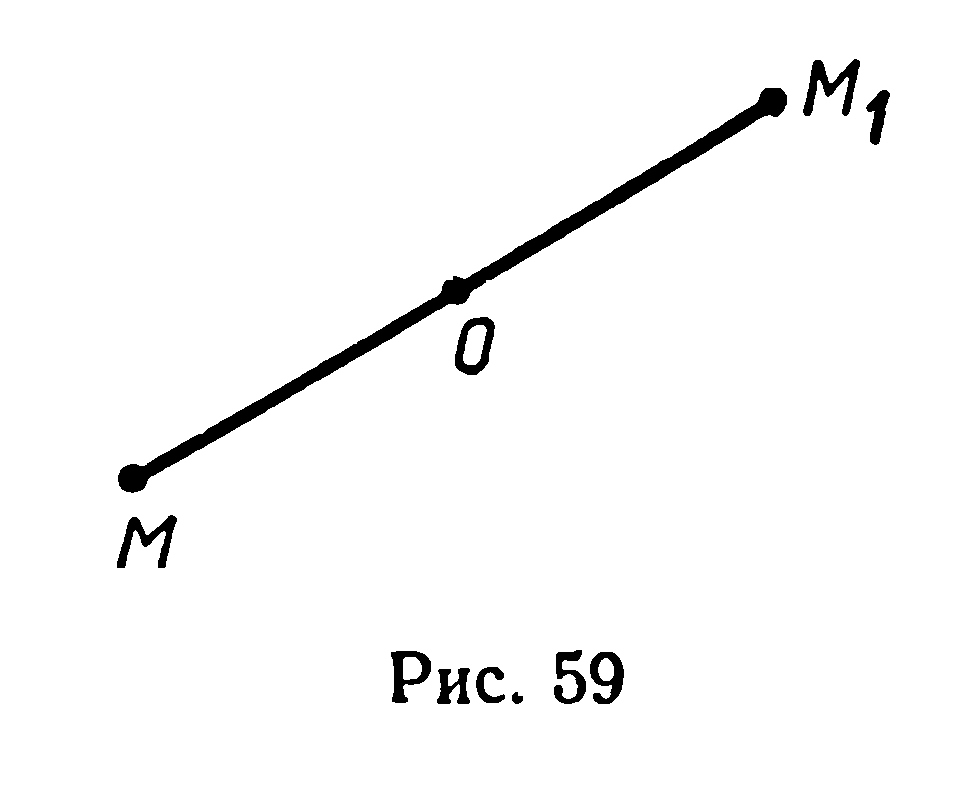

## 2.1. Отображение фигуры. Преобразование пространства

---
**стр. 36**
---

# Глава II. Преобразования пространства. Векторы

## § 14. Отображение фигуры. Преобразование пространства

В стереометрии важную роль играет понятие отображения одной фигуры на другую. Смысл этого понятия такой же, как и в планиметрии.

В качестве примера отображения рассмотрим проектирование треугольника $ABC$ на плоскость $\alpha$ параллельно прямой $l$ (рис. 57). Этим отображением каждой точке $M$ треугольника $ABC$ ставится в соответствие единственная точка $M_1$, принадлежащая плоскости $\alpha$.

Если каждой точке $M$ фигуры $\Phi$ ставится в соответствие единственная точка $M_1$ фигуры $F$, то такое соответствие называют **отображением фигуры** $\Phi$ **в фигуру** $F$. Точку $M_1$ при этом называют **образом точки** $M$.

В приведенном примере $\Phi = \triangle ABC$, $F = \alpha$. Проекцией треугольника $ABC$ служит треугольник $A_1B_1C_1$, лежащий в плоскости $\alpha$ (предполагаем, что плоскость $ABC$ не параллельна прямой $l$).

Множество $\Phi_1$ образов всех точек фигуры $\Phi$ называется **образом фигуры** $\Phi$. Из определения отображения следует, что $\Phi_1 \subset F$. Если же $\Phi_1 = F$, то говорят: фигура $\Phi$ отображается на фигуру $\Phi_1$ (вместо предлога «в» употребляют предлог «на»). Например, при проектировании на плоскость $\alpha$ параллельно прямой $l$ образом тетраэдра $ABCD$ служит четырехугольник $A_1B_1C_1D_1$ (рис. 58).

---
**стр. 37**
---

Поэтому говорят также, что тетраэдр $ABCD$ отображается на четырёхугольник $A_1B_1C_1D_1$.

Рассмотренные два примера отображений существенно отличаются друг от друга. В первом из них образы любых двух различных точек треугольника $ABC$ различны. Для второго отображения характерно то, что существуют различные точки $M$ и $M'$ тетраэдра $ABCD$, которые имеют один и тот же образ $M_1$ (рис. 58).

Приведём ещё один пример.

Точки $M$ и $M_1$ называются *симметричными относительно центра $O$*, если точка $O$ является серединой отрезка $MM_1$ (рис. 59). Центр $O$ считается симметричным самому себе.

Каждой точке $M$ пространства поставим в соответствие симметричную ей точку $M_1$ относительно данного центра $O$. Получим отображение пространства на себя, называемое **центральной симметрией**. Каждые две различные точки центральная симметрия отображает на различные точки.

**Определение.** Отображение пространства на себя, при котором любые две различные точки имеют различные образы, называется **преобразованием пространства**.

Центральная симметрия является одним из видов преобразований пространства. Центральную симметрию с центром $O$ будем обозначать символом $Z_O$.

Некоторые другие виды преобразований пространства будут рассмотрены в дальнейшем.

Произвольное преобразование пространства обозначим буквой $f$. Если $f$ отображает точку $M$ на точку $M_1$, то пишут: $f(M) = M_1$. Запись $f(\Phi) = \Phi_1$ означает, что $f$ отображает фигуру $\Phi$ на фигуру $\Phi_1$.

Преобразование $f$ можно рассматривать как множество всех упорядоченных пар точек $(M, M_1)$, где $M_1 = f(M)$. Множество всех упорядоченных пар точек $(M_1, M)$ определяет другое преобразование, отображающее $M_1$ на $M$. Такое преобразование называется **обратным преобразованием** к $f$ и обозначается $f^{-1}$. Если $f(M) = M_1$, то $f^{-1}(M_1) = M$.

В результате последовательного выполнения преобразований $f_1$ и $f_2$ появляется новое преобразование: $f(M) = f_2(f_1(M))$. Если $f_1(M) = M_1$ и $f_2(M_1) = M_2$, то $f(M) = M_2$. Преобразование $f$ называют **композицией преобразований** $f_1$ и $f_2$.

Обозначение композиции $f$ преобразований $f_1$ и $f_2$:

$$f_2 \circ f_1 = f.$$

Преобразование пространства, отображающее каждую точку на себя, называется **тождественным преобразованием**. Его обозна-

---
**стр. 38**
---

чают буквой $E$. Согласно определению, для любой точки $M$ пространства имеем: $E(M) = M$. Преобразование $E$ можно рассматривать как множество всех пар совпадающих точек.

**Задачи**

**153°.** Какая фигура может служить при параллельном проектировании образом: 1) треугольника; 2) трапеции; 3) тетраэдра; 4) параллелепипеда?

**154°.** Все точки пространства проектируются на плоскость. Можно ли сказать, что это отображение является преобразованием пространства?

**155°.** Постройте образы вершин тетраэдра $ABCD$ при симметрии с центром $A$.

**156°.** Существуют ли точки, прямые и плоскости, которые центральной симметрией отображаются на себя?

**157°.** 1) Какое преобразование является обратным для центральной симметрии?
2) Каким преобразованием является композиция двух центральных симметрий, имеющих один и тот же центр?

**158°.** Найдите композиции: 1) $E \circ f$; 2) $f^{-1} \circ f$.
