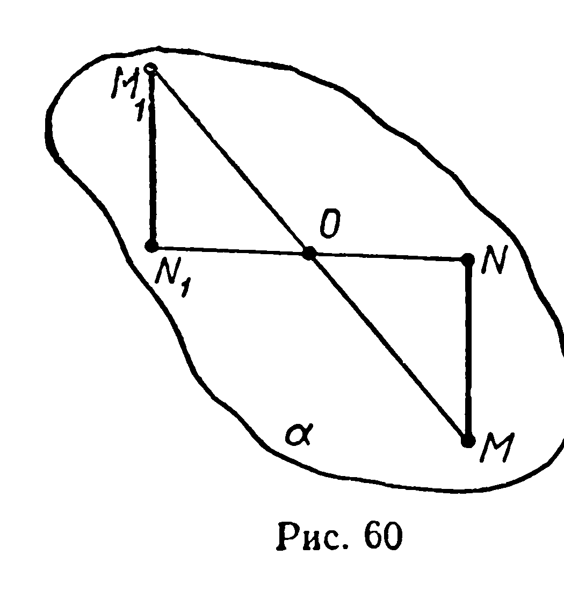
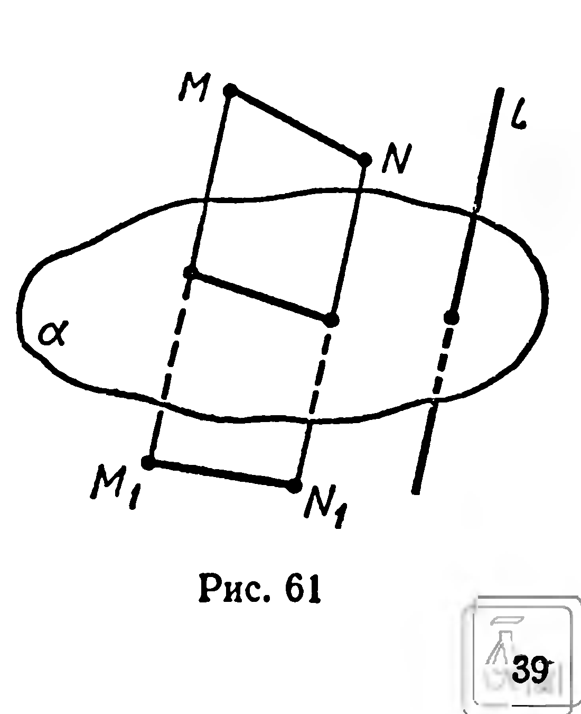

## 2.2. Перемещения пространства. Конгруэнтность фигур

---
**стр. 38**
---

чают буквой $E$. Согласно определению, для любой точки $M$ пространства имеем: $E(M) = M$. Преобразование $E$ можно рассматривать как множество всех пар совпадающих точек.

**Задачи**

**153°.** Какая фигура может служить при параллельном проектировании образом: 1) треугольника; 2) трапеции; 3) тетраэдра; 4) параллелепипеда?

**154°.** Все точки пространства проектируются на плоскость. Можно ли сказать, что это отображение является преобразованием пространства?

**155°.** Постройте образы вершин тетраэдра $ABCD$ при симметрии с центром $A$.

**156°.** Существуют ли точки, прямые и плоскости, которые центральной симметрией отображаются на себя?

**157°.** 1) Какое преобразование является обратным для центральной симметрии?
2) Каким преобразованием является композиция двух центральных симметрий, имеющих один и тот же центр?

**158°.** Найдите композиции: 1) $E \circ f$; 2) $f^{-1} \circ f$.

**§ 15. ПЕРЕМЕЩЕНИЯ ПРОСТРАНСТВА. КОНГРУЭНТНОСТЬ ФИГУР**

Из множества всех преобразований выделим множество преобразований, при которых расстояние между любыми двумя точками равно расстоянию между их образами. О таких преобразованиях говорят, что они *сохраняют расстояния*. Примером преобразования, сохраняющего расстояния, является центральная симметрия. Докажем это.

Пусть центральная симметрия $Z_0$ отображает две произвольные точки $M$ и $N$ пространства соответственно на точки $M_1$ и $N_1$ (рис. 60). Точки $O$, $M$, $N$, $M_1$, $N_1$ принадлежат одной плоскости. Обозначим её через $\alpha$. При симметрии $Z_0$ плоскость $\alpha$ отображается на себя, причём это отображение можно рассматривать как центральную симметрию плоскости $\alpha$ относительно центра $O$.

Но центральная симметрия плоскости сохраняет расстояния, поэтому $|M_1N_1| = |MN|$.

**Определение 1.** Преобразование пространства, сохраняющее расстояния, называется **перемещением**.

Из определения перемещения вытекает:

а) *тождественное преобразование есть перемещение*;

б) *преобразование, обратное перемещению, есть перемещение*;

---
**стр. 39**
---

в) *композиция двух перемещений есть перемещение.*

В дальнейшем будем пользоваться и другими свойствами перемещений: любое перемещение отображает прямую на прямую, плоскость — на плоскость.

Можно доказать также, что перемещение $F$ отображает отрезок $AB$ на отрезок $F(A)\,F(B)$; полуплоскость с границей $p$ — на полуплоскость с границей $F(p)$; полупространство с границей $\alpha$ — на полупространство с границей $F(\alpha)$; тетраэдр $ABCD$ — на тетраэдр $F(A)\,F(B)\,F(C)\,F(D)$ и т. д.

Наконец, одним из важных свойств перемещений является сохранение величины угла при перемещениях.

**Определение 2.** Фигура $\Phi_1$ называется *конгруэнтной* фигуре $\Phi$, если существует перемещение, отображающее $\Phi$ на $\Phi_1$.

Обозначение: $\Phi_1 \cong \Phi$.

Из свойств а) — в) перемещений следует, что конгруэнтность фигур обладает свойствами рефлексивности ($\Phi \cong \Phi$), симметричности (если $\Phi_1 \cong \Phi$, то $\Phi \cong \Phi_1$), транзитивности (если $\Phi_1 \cong \Phi$ и $\Phi_2 \cong \Phi_1$, то $\Phi_2 \cong \Phi$).

**Задачи**

**159°.** Верно ли утверждение, что всякое отображение пространства на себя, сохраняющее расстояния, является преобразованием пространства?

**160.** Дана плоскость $\alpha$ и прямая $l$, пересекающая $\alpha$. Каждой точке $M \notin \alpha$ ставится в соответствие такая точка $M_1$, что $(MM_1) \parallel l$ и $\alpha$ делит отрезок $MM_1$ пополам (рис. 61). Любой точке плоскости $\alpha$ ставится в соответствие эта же точка. Является ли заданное отображение пространства на себя: 1) преобразованием пространства; 2) перемещением?

**161.** Сохраняет ли перемещение: 1) параллельность двух прямых; 2) параллельность прямой и плоскости; 3) параллельность двух плоскостей?

**162.** Докажите, что центральная симметрия отображает: 1) прямую на параллельную ей прямую; 2) плоскость на параллельную ей плоскость.

**163.** Точка $O$ называется *центром симметрии фигуры*, если при симметрии относительно $O$ эта фигура отображается на себя.

Сколько центров симметрии имеют следующие фигуры: 1) отрезок; 2) прямая; 3) плоскость; 4) объединение двух параллельных плоскостей; 5) объединение двух пересекающихся плоскостей; 6) объединение пересекающихся прямой и плоскости; 7) объединение параллельных прямой и плоскости?
