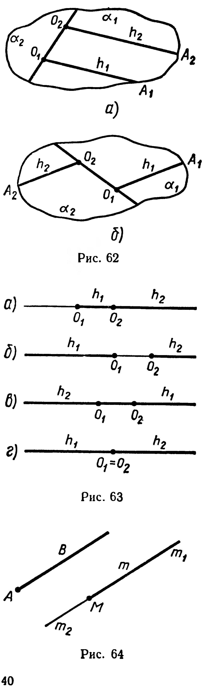

## 2.3. Направление в пространстве

---
**стр. 40**
---

## § 16. НАПРАВЛЕНИЕ В ПРОСТРАНСТВЕ

Словом «направление» часто пользуются в обыденной речи. Например, говорят о направлении полета воздушного лайнера или направлении движения межпланетной станции. В курсе восьмилетней школы вы ознакомились с понятием направления на плоскости. Выясним смысл этого понятия для пространства.

**1.** Пусть лучи $h_1 = [O_1A_1)$ и $h_2 = [O_2A_2)$ лежат на различных параллельных прямых. Тогда эти прямые лежат в некоторой плоскости $\alpha$ (§ 3). Рассмотрим две ее полуплоскости $\alpha_1$ и $\alpha_2$ с границей $(O_1O_2)$. Если оба данных луча лежат в одной из этих полуплоскостей (рис. 62, $a$), то такие лучи называются **сонаправленными**; если же $h_1$ и $h_2$ лежат в различных полуплоскостях (рис. 62, б), то эти лучи называются **противоположно направленными**.

**2.** Пусть лучи $h_1$ и $h_2$ лежат на одной прямой. Эти лучи называются сонаправленными, если их пересечением служит луч (рис. 63, $a$), и противоположно направленными, если $h_1 \cap h_2$ не является лучом (рис. 63, б, в, г).

Сонаправленность лучей $h_1$ и $h_2$ обозначим так: $h_1 \uparrow\uparrow h_2$. Если лучи $h_1$ и $h_2$ противоположно направлены, то будем писать: $h_1 \uparrow\downarrow h_2$.

Пусть заданы луч $AB$ и точка $M$ (рис. 64). Через точку $M$ проведем прямую $m$, параллельную $(AB)$ (§ 4, задача). Такая прямая единственна. Рассмотрим на прямой $m$ лучи $m_1$ и $m_2$ с общим началом $M$. Один из них ($m_1$ на рис. 64) сонаправлен с лучом $AB$. Другой луч и $[AB)$ противоположно направлены.

Итак, каждая точка пространства служит началом только одного луча, сонаправленного с данным лучом, и единственного
