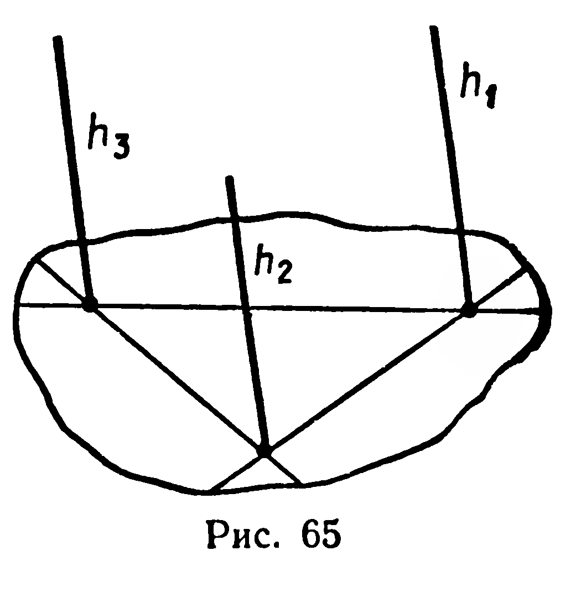
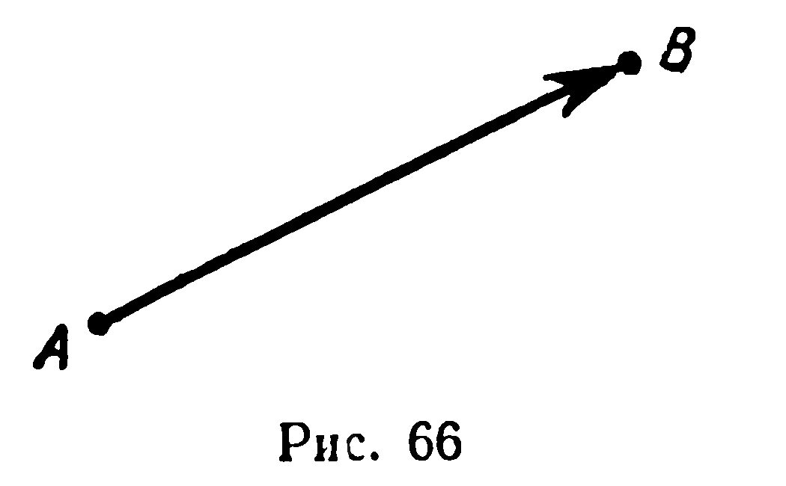
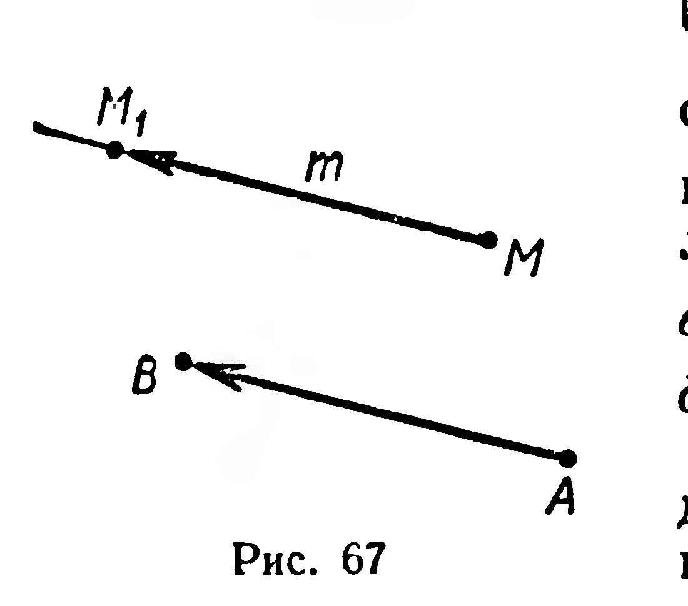
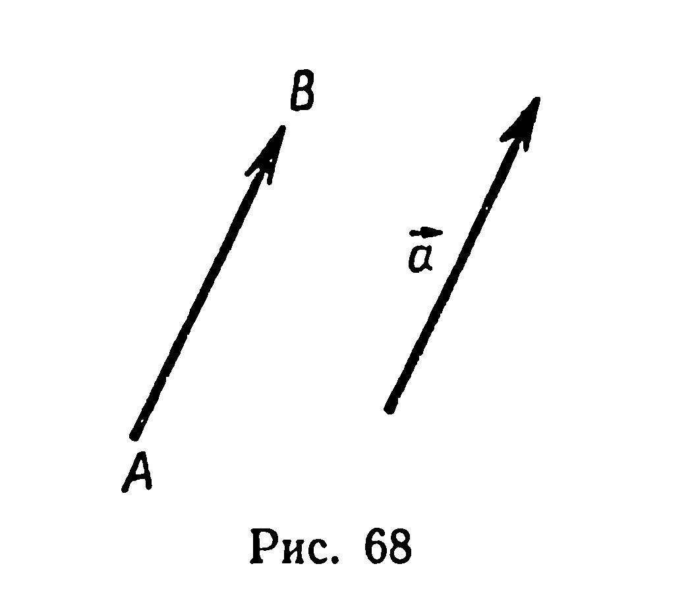
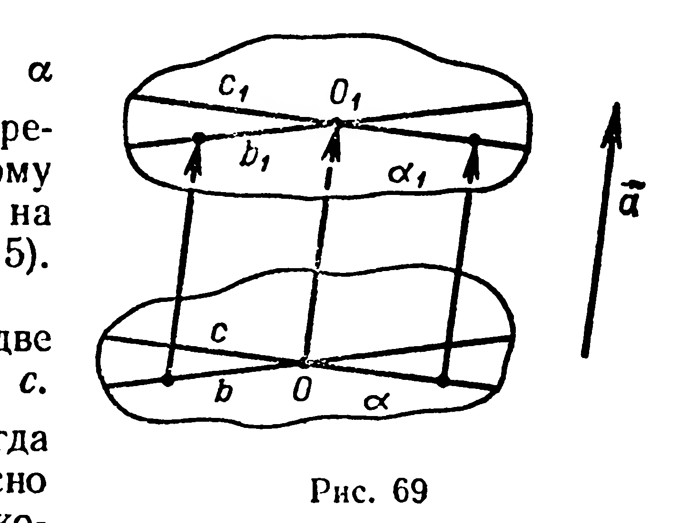
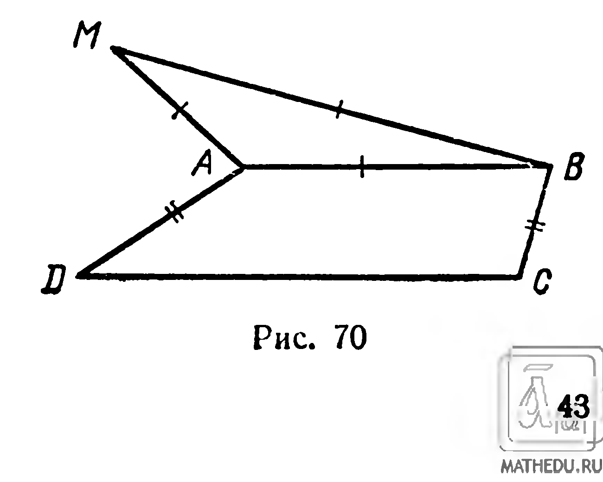

## 2.4. Вектор

---
**стр. 41**
---

луча, противоположно направленного
с ним.

Заметим, что центральная симметрия отображает каждый луч на противоположно направленный луч. Чтобы в этом убедиться, достаточно через луч и центр симметрии провести плоскость и воспользоваться аксиомой 9.

В пространстве, как и на плоскости, сонаправленность лучей обладает свойствами рефлексивности: $h \uparrow\uparrow h$, симметричности: если $h_1 \uparrow\uparrow h_2$, то $h_2 \uparrow\uparrow h_1$, и транзитивности: если $h_1 \uparrow\uparrow h_2$ и $h_2 \uparrow\uparrow h_3$, то $h_1 \uparrow\uparrow h_3$ (рис. 65).

Множество всех лучей, каждый из которых сонаправлен с одним и тем же лучом, называется **направлением** в пространстве.

Любой луч вполне определяет все множество сонаправленных с ним лучей. Поэтому в дальнейшем направление в пространстве будем задавать с помощью одного луча.

**Задачи**

**164°.** Дан тетраэдр $ABCD$. Имеются ли среди лучей $AB$, $AC$, $AD$, $CD$: 1) сонаправленные; 2) противоположно направленные?

**165°.** Дан параллелепипед $ABCDA_1B_1C_1D_1$. Назовите среди лучей $AB$, $AD$, $AA_1$, $BC$, $C_1D$, $BB_1$, $C_1C$, $A_1D_1$: 1) сонаправленные; 2) противоположно направленные.

**166.** 1°) Обладает ли противоположная направленность лучей свойством транзитивности?

2) Докажите, что два луча сонаправлены, если они противоположно направлены с третьим лучом.

**167.** Дано: $[AB) \uparrow\uparrow [MN)$, $[CD) \uparrow\downarrow [MN)$. Каково взаимное расположение лучей $AB$ и $CD$?

**§ 17. ВЕКТОР**

Понятие вектора в стереометрии вводится так же, как и в планиметрии.

Рассмотрим упорядоченную пару $(A, B)$ несовпадающих точек. Она определяет направленный отрезок с началом $A$ и концом $B$ (рис. 66). С помощью пары $(A, B)$ зададим преобразование пространства. Каждой точке $M$ поставим в соответствие точку $M_1$, которая получится в результате следующего построения.

Приняв точку $M$ за начало, проводим луч $m$, сонаправленный с лучом $AB$ (рис. 67). На луче $m$ имеется единственная точка $M_1$, удаленная от $M$ на расстояние $|AB|$. Это построение задает преобразование пространства, отображающее точку $M$ на точку $M_1$.

---
**стр. 42**
---

**Определение.** Вектором (параллельным переносом), определяемым парой $(A, B)$ несовпадающих точек, называется преобразование пространства, при котором каждая точка $M$ отображается на такую точку $M_1$, что луч $MM_1$ сонаправлен с лучом $AB$ и расстояние $|MM_1|$ равно расстоянию $|AB|$.

Вектор, заданный парой $(A, B)$ несовпадающих точек, обозначается символом $\overrightarrow{AB}$. Направление, определяемое лучом $AB$, называется *направлением вектора* $\overrightarrow{AB}$, а расстояние $|AB|$ — *длиной вектора* $\overrightarrow{AB}$.

Условимся, что любая пара совпадающих точек задает тождественное преобразование, которое мы будем называть теперь *нулевым вектором*. Длина нулевого вектора равна нулю, понятие направления для него не вводится. Нулевой вектор, заданный парой $(A, A)$, обозначают символом $\overrightarrow{AA}$.

Применяются и иные обозначения: $\vec a$, $\vec b$, $\vec c...$ — векторы; $|\vec a|$ или $a$ — длина вектора $\vec a$; $\vec 0$ — нулевой вектор.

Каждый вектор, отличный от нулевого, вполне характеризуется своим направлением и длиной. Поэтому, если ненулевые векторы $\vec a$ и $\vec b$ сонаправлены и имеют равные длины, то эти векторы равны (совпадают): $\vec a = \vec b$.

Пусть даны вектор $\vec a$ и точка $A$. Можно построить единственную точку $B$ такую, что $\overrightarrow{AB} = \vec a$ (рис. 68). Это построение называют *откладыванием вектора* $\vec a$ от точки $A$.

Если вектор $\vec a$ отображает точку $M$ на точку $M_1$, то записывают: $\vec a(M) = M_1$ или $\vec a = \overrightarrow{MM_1}$.

Вектор пространства обладает следующими свойствами:

1. Вектор *есть перемещение*.
2. Вектор *отображает луч на сонаправленный с ним луч, прямую — на параллельную ей прямую*.
3. Вектор *отображает плоскость на параллельную ей плоскость*.

Первые два из этих свойств доказываются так же, как и в планиметрии. Поэтому остановимся на доказательстве только третьего свойства. Пусть

---
**стр. 43**
---

даны вектор $\vec{a}$ и плоскость $\alpha$ (рис. 69).

Вектор $\vec{a}$ является перемещением (свойство 1), поэтому он отображает плоскость $\alpha$ на некоторую плоскость $\alpha_1$ (§ 15). Докажем, что $\alpha_1 \parallel \alpha$.

На плоскости $\alpha$ проведем две пересекающиеся прямые $b$ и $c$. Пусть $\vec{a}(b) = b_1$ и $\vec{a}(c) = c_1$. Тогда $b_1 \parallel b$ и $c_1 \parallel c$ (свойство 2). Согласно признаку параллельности плоскостей, $\alpha_1 \parallel \alpha$. ■

**Задачи**

**168.** Сколько векторов задают всевозможные упорядоченные пары точек, составленные из вершин: 1) треугольника; 2) параллелограмма; 3) тетраэдра; 4) параллелепипеда?

**169°.** На рисунке 70 изображены равнобедренная трапеция $ABCD$ и правильный треугольник $ABM$. Из точек $A$, $B$, $C$, $D$, $M$ составьте две различные упорядоченные пары, задающие: 1) векторы равной длины; 2) сонаправленные векторы; 3) противоположно направленные векторы. Есть ли среди всех этих векторов равные?

**170.** Дан тетраэдр $ABCD$. 1) От точки $A$ отложите вектор $\overrightarrow{CB}$; 2) от точки $B$ отложите вектор $\overrightarrow{AC}$; 3) от точки $D$ отложите вектор $\overrightarrow{AB}$.

**171.** Дан параллелепипед $ABCDA_1B_1C_1D_1$. 1) От точки $B$ отложите вектор $\overrightarrow{CD}$; 2) от точки $A_1$ отложите вектор $\overrightarrow{AC}$; 3) от точки $B$ отложите вектор $\overrightarrow{CC_1}$.

**172.** Даны треугольник $ABC$ и точки $M$, $N$. Постройте образ треугольника при перемещении $\overrightarrow{MN}$.

**173.** Постройте образ тетраэдра $ABCD$ при перемещении $\overrightarrow{AC}$.

**174°.** Каким известным вам перемещением можно отобразить один из двух данных лучей на другой, если эти лучи: 1) сонаправлены; 2) противоположно направлены?

**175°.** Существует ли вектор, отображающий одну из двух данных плоскостей на другую, если эти плоскости: 1) параллельны; 2) пересекаются?

**176.** Докажите, что противолежащие грани параллелепипеда конгруэнтны.
