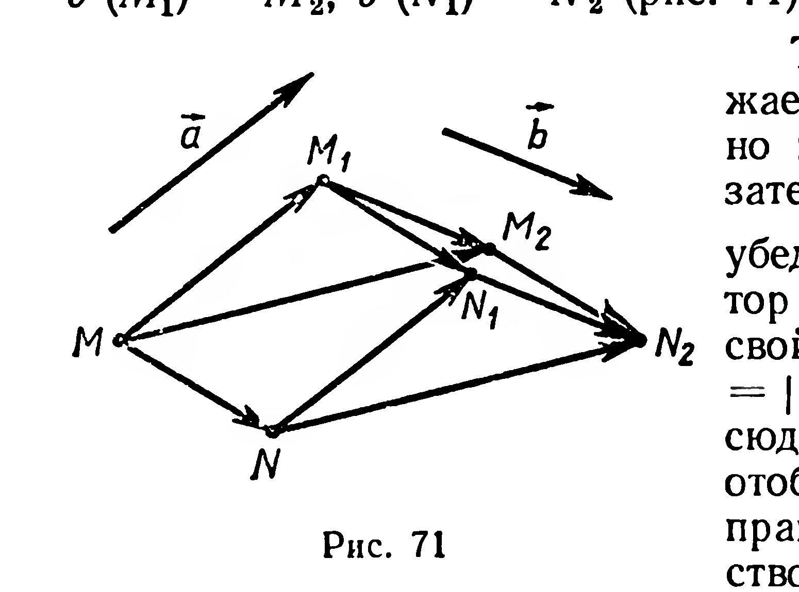
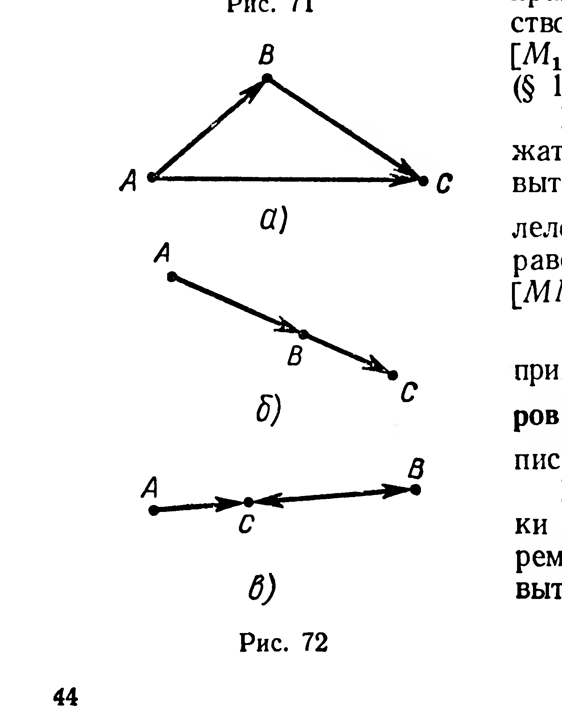
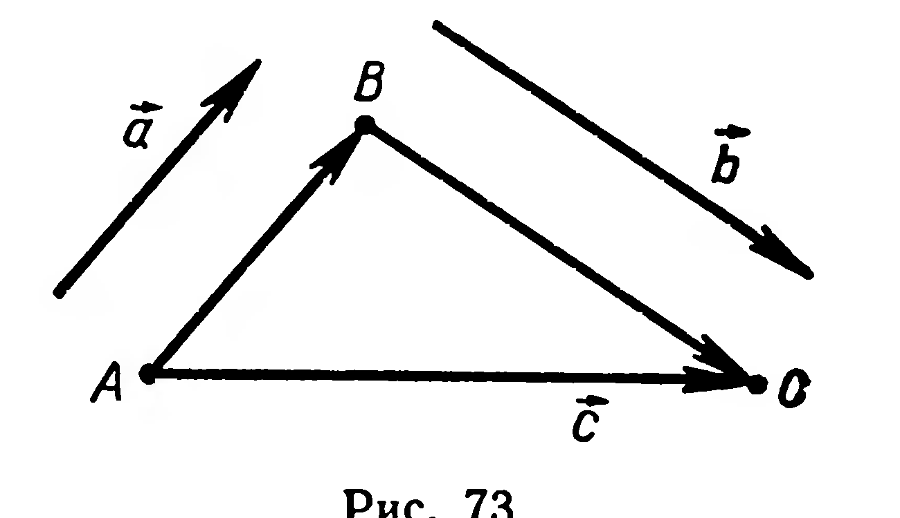
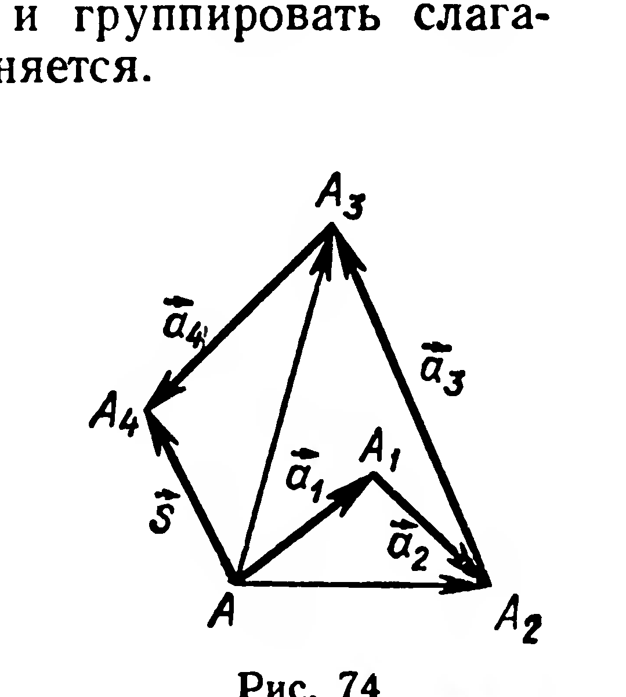

## 2.5. Сложение векторов

---
**стр. 44**
---

**177.** Докажите, что треугольник и его проекция на плоскость конгруэнтны, если плоскость треугольника параллельна плоскости проекций.

**178.** Дан параллелепипед $ABCDA_1B_1C_1D_1$. Докажите, что следующие пары углов конгруэнтны: 1) $\angle BC_1C$ и $\angle AD_1D$; 2) $\angle CBD_1$ и $\angle A_1D_1B$; 3) $\angle ADC$ и $\angle A_1B_1C_1$.

**§ 18. СЛОЖЕНИЕ ВЕКТОРОВ**

Начнем с рассмотрения теоремы, на основе которой вводится понятие суммы двух векторов.

**9. Теорема.** *Композиция двух векторов есть вектор.*

Доказательство. Пусть даны два вектора $\vec{a}$ и $\vec{b}$. Докажем, что их композиция есть некоторый вектор. Рассмотрим две произвольные различные точки $M$ и $N$. Имеем: $\vec{a}(M) = M_1$, $\vec{a}(N) = N_1$, $\vec{b}(M_1) = M_2$, $\vec{b}(N_1) = N_2$ (рис. 71).

Тогда композиция $\vec{b} \circ \vec{a}$ отображает точки $M$ и $N$ соответственно на точки $M_2$ и $N_2$. Для доказательства теоремы достаточно убедиться, что $\overrightarrow{MM_2} = \overrightarrow{NN_2}$. Вектор является перемещением (§ 17, свойство 1). Поэтому $|MN| = |M_1N_1|$ и $|M_1N_1| = |M_2N_2|$. Отсюда $|MN| = |M_2N_2|$ (1). Вектор отображает каждый луч на сонаправленный с ним луч (§ 17, свойство 2), тогда $[MN) \uparrow\uparrow [M_1N_1)$ и $[M_1N_1) \uparrow\uparrow [M_2N_2)$. Отсюда следует (§ 16), что $[MN) \uparrow\uparrow [M_2N_2)$. (2)

Если лучи $MN$ и $M_2N_2$ не лежат на прямой, то из (2) и (1) вытекает, что $MNN_2M_2$ — параллелограмм. Тогда $\overrightarrow{MM_2} = \overrightarrow{NN_2}$. Это равенство верно и в случае, когда $[MN)$ и $[M_2N_2)$ лежат на прямой. ■

Композицию векторов $\vec{a}$ и $\vec{b}$ принято называть суммой векторов $\vec{a}$ и $\vec{b}$. При этом вместо записи $\vec{b} \circ \vec{a} = \vec{c}$ пишут: $\vec{a} + \vec{b} = \vec{c}$.

Рассмотрим произвольные точки $A$, $B$, $C$ (рис. 72, а).

Из теоремы о композиции двух векторов вытекает равенство:

$$\overrightarrow{AB} + \overrightarrow{BC} = \overrightarrow{AC}. \quad (3)$$

---
**стр. 45**
---

Действительно, вектор $\overrightarrow{AB}$ отображает $A$ на $B$, вектор $\overrightarrow{BC}$ отображает $B$ на $C$, тогда композиция этих векторов есть вектор, отображающий $A$ на $C$ (теорема 9). Следовательно,
$$\overrightarrow{AB} + \overrightarrow{BC} = \overrightarrow{AC}.$$

Равенство (3) называют правилом треугольника. Оно применимо и в том случае, когда точки $A$, $B$, $C$ принадлежат одной прямой (рис. 72, б, в), причем две из данных точек или даже все три могут совпадать.

Нахождение суммы $\vec{c}$ векторов $\vec{a}$ и $\vec{b}$ основано на правиле треугольника (рис. 73). Выбираем произвольную точку $A$, откладываем от нее вектор $\overrightarrow{AB} = \vec{a}$, затем от $B$ откладываем $\overrightarrow{BC} = \vec{b}$. Вектор $\overrightarrow{AC}$ является искомой суммой $\vec{c}$. Действительно,
$$\vec{a} + \vec{b} = \overrightarrow{AB} + \overrightarrow{BC} = \overrightarrow{AC} = \vec{c}.$$

Сложение векторов обладает следующими свойствами:

1. $\vec{a} + \vec{0} = \vec{a}$ (закон поглощения нулевого вектора);
2. $\vec{a} + \vec{b} = \vec{b} + \vec{a}$ (переместительный закон);
3. $(\vec{a} + \vec{b}) + \vec{c} = \vec{a} + (\vec{b} + \vec{c})$ (сочетательный закон).

Эти свойства доказываются так же, как и в планиметрии.

Введем понятие суммы трех и большего числа векторов. Согласно сочетательному закону сложения векторов суммы $(\vec{a} + \vec{b}) + \vec{c}$ и $\vec{a} + (\vec{b} + \vec{c})$ равны. Любую из этих сумм называют суммой трех векторов $\vec{a}$, $\vec{b}$, $\vec{c}$ и записывают без скобок: $\vec{a} + \vec{b} + \vec{c}$. Сумма четырех (и более) векторов определяется аналогично:
$$\vec{a} + \vec{b} + \vec{c} + \vec{d} = (\vec{a} + \vec{b} + \vec{c}) + \vec{d}.$$

Переместительный и сочетательный законы сложения векторов позволяют как угодно переставлять и группировать слагаемые, при этом сумма векторов не изменяется.

Сумму трех или более векторов можно найти, пользуясь правилом многоугольника. Пусть надо найти сумму $\vec{s} = \vec{a}_1 + \vec{a}_2 + \vec{a}_3 + \vec{a}_4$. Выбрав произвольно точку $A$ (рис. 74), откладываем последовательно векторы $\overrightarrow{AA_1} = \vec{a}_1$, $\overrightarrow{A_1A_2} = \vec{a}_2$, $\overrightarrow{A_2A_3} = \vec{a}_3$, $\overrightarrow{A_3A_4} = \vec{a}_4$. Вектор $\overrightarrow{AA_4}$ равен искомой сумме $\vec{s}$. Убедитесь в этом самостоятельно, применяя последовательно правило треугольника (рис. 74).

