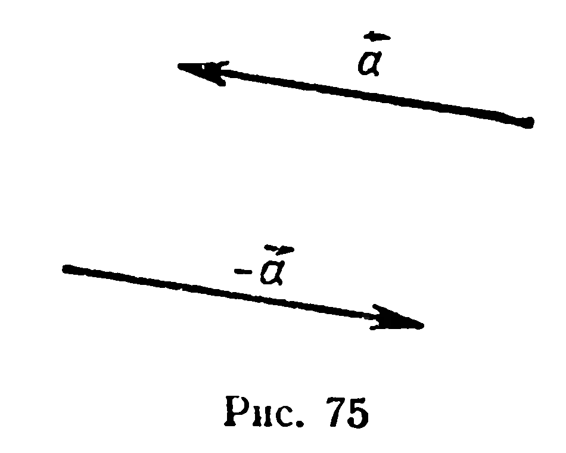
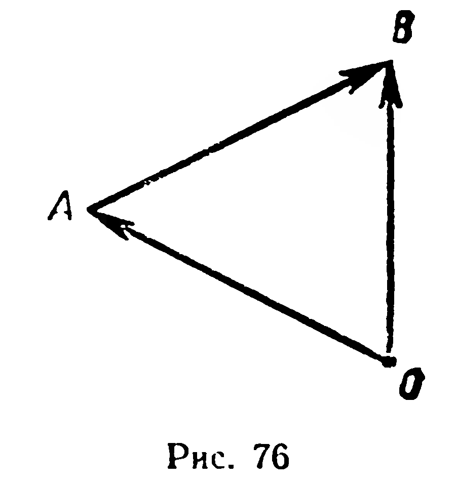

## 2.6. Противоположные векторы. Вычитание векторов

---
**стр. 46, продолжение**
---

## § 19. ПРОТИВОПОЛОЖНЫЕ ВЕКТОРЫ. ВЫЧИТАНИЕ ВЕКТОРОВ

1. Применяя правило треугольника, найдем сумму векторов $\overrightarrow{AB}$ и $\overrightarrow{BA}$:

$$\overrightarrow{AB} + \overrightarrow{BA} = \overrightarrow{AA} = \vec{0}.$$

Два вектора называются противоположными, если их сумма равна нулевому вектору. Вектор, противоположный вектору $\vec{a}$, обозначают через $-\vec{a}$. По определению имеем:

$$\vec{a} + (-\vec{a}) = \vec{0}. \qquad (1)$$

Ненулевые противоположные векторы (рис. 75), очевидно, имеют равные длины и противоположные направления. Отметим также, что $\overrightarrow{BA} = -\overrightarrow{AB}$.

2. Докажем, что если $\vec{c} = \vec{a} + (-\vec{b})$, то $\vec{c} + \vec{b} = \vec{a}$.

Действительно,

$$\vec{c} + \vec{b} = (\vec{a} + (-\vec{b})) + \vec{b} = \vec{a} + ((-\vec{b}) + \vec{b}) = \vec{a} + \vec{0} = \vec{a}.$$

(Какие законы сложения векторов здесь применялись?)

---
**стр. 47**
---

Вектор $\vec{c}$ называется **разностью векторов** $\vec{a}$ и $\vec{b}$, если

$$\vec{c} + \vec{b} = \vec{a}.$$

Обозначение разности $\vec{c}$ векторов $\vec{a}$ и $\vec{b}$: $\vec{a} - \vec{b} = \vec{c}$. Из рассуждения, приведенного в начале пункта 2, вытекает:

$$\vec{a} - \vec{b} = \vec{a} + (-\vec{b}). \qquad (2)$$

Таким образом, вычитание векторов сведено к сложению: *чтобы найти разность векторов $\vec{a}$ и $\vec{b}$, достаточно найти сумму вектора $\vec{a}$ и вектора, противоположного вектору $\vec{b}$.*

3. Для любых трех точек $A$, $B$, $O$ пространства имеет место следующая важная формула вычитания векторов:

$$\overrightarrow{OB} - \overrightarrow{OA} = \overrightarrow{AB}. \qquad (3)$$

Действительно, по правилу треугольника (рис. 76) $\overrightarrow{OA} +$
$+ \overrightarrow{AB} = \overrightarrow{OB}$, отсюда по определению разности векторов $\overrightarrow{AB} =$
$= \overrightarrow{OB} - \overrightarrow{OA}$.

Для точек $M$, $P$, $Q$ по формуле (3) (не пользуясь чертежом) можно, например, записать:

$$\overrightarrow{PQ} = \overrightarrow{MQ} - \overrightarrow{MP}, \quad \overrightarrow{PQ} - \overrightarrow{PM} = \overrightarrow{MQ}.$$

**Задачи**

186. Дан тетраэдр $ABCD$. От точки $A$ отложите вектор, противоположный вектору: 1) $\overrightarrow{DB}$; 2) $\overrightarrow{CD}$; 3) $\overrightarrow{BC}$.

187. Докажите, что если точки $O$, $A$, $B$ не принадлежат одной прямой и $\overrightarrow{OC} = \overrightarrow{OA} - \overrightarrow{OB}$, то четырехугольник $OBAC$ — параллелограмм.

188. Вне плоскости треугольника $ABC$ взята точка $O$. Отложите от $O$ векторы: 1) $\overrightarrow{OA} - \overrightarrow{OB}$; 2) $-\overrightarrow{OA} - \overrightarrow{OC}$; 3) $\overrightarrow{OA} + \overrightarrow{OB} - \overrightarrow{OC}$.

189. Докажите, что если в треугольнике $ABC$ угол $ACB$ прямой, то $|\overrightarrow{CA} + \overrightarrow{CB}| = |\overrightarrow{CA} - \overrightarrow{CB}|$. Верно ли обратное утверждение?

190. Дан параллелограмм $ABCD$. Докажите, что $\overrightarrow{OA} + \overrightarrow{OC} =$
$= \overrightarrow{OB} + \overrightarrow{OD}$, где $O$ — произвольная точка пространства.

191. 1) $ABCD$ — тетраэдр. Докажите, что $\overrightarrow{AD} + \overrightarrow{BC} = \overrightarrow{BD} + \overrightarrow{AC}$.
2) Верно ли это утверждение для четырех произвольных точек?
