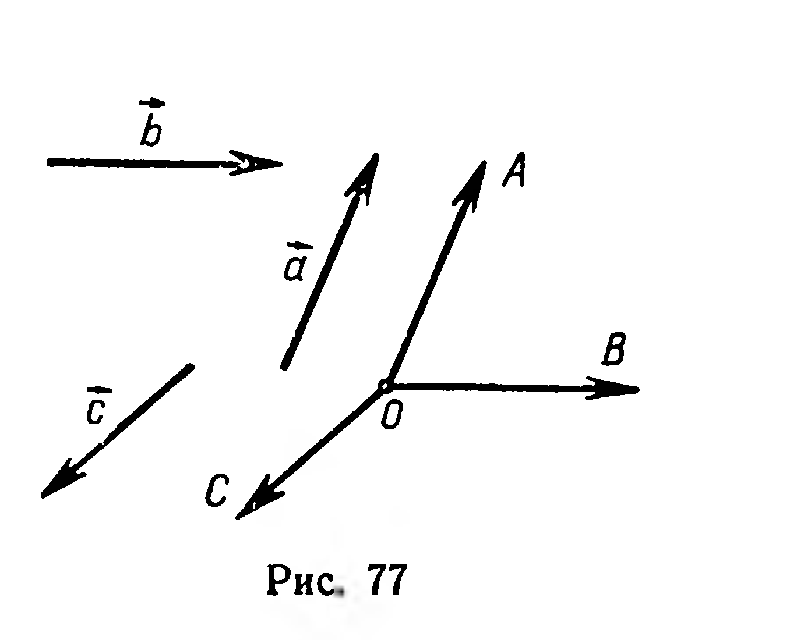
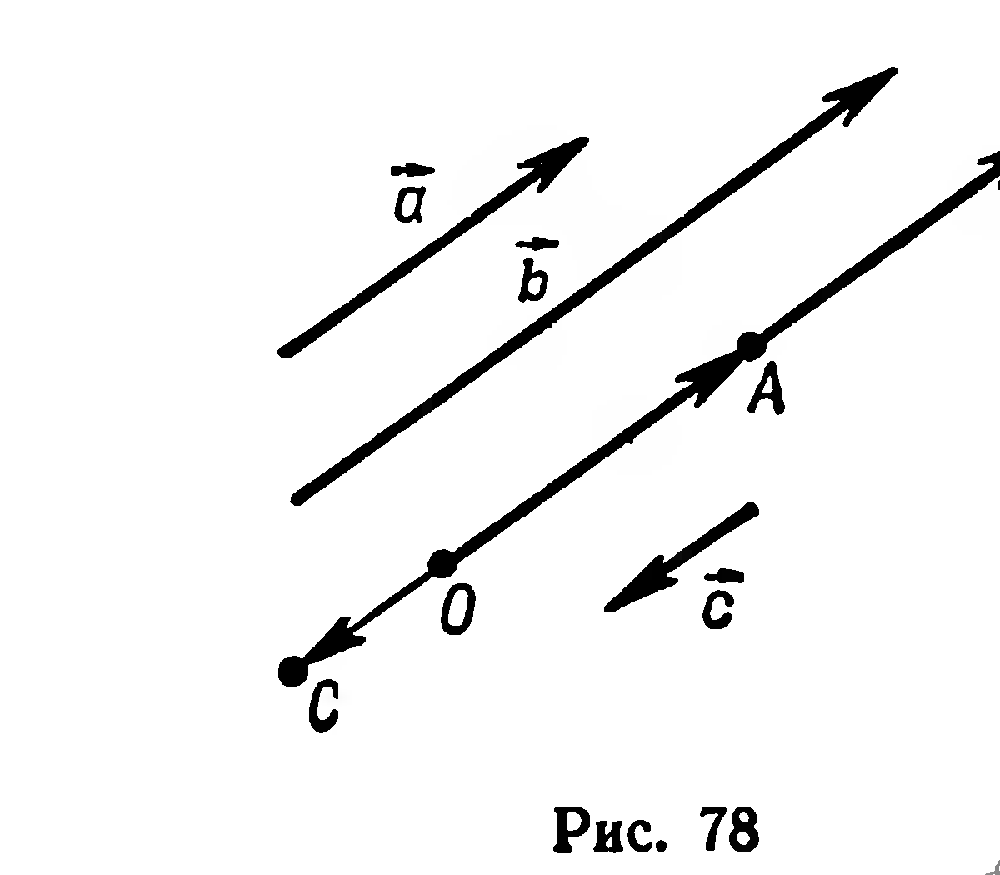
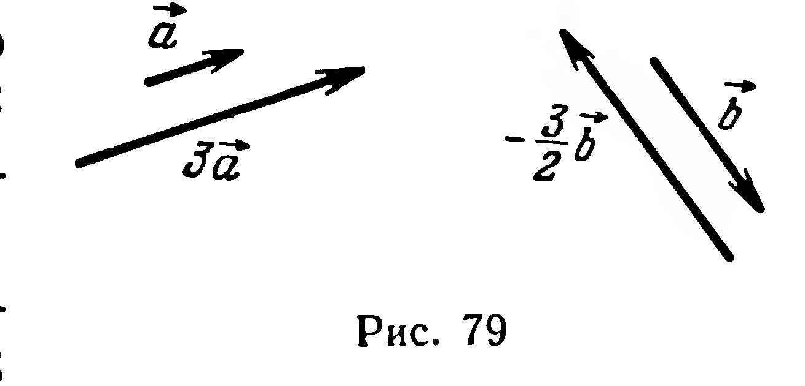

## 2.7. Коллинеарные векторы. Умножение вектора на число

---
**стр. 48**
---

§ 20. КОЛЛИНЕАРНЫЕ ВЕКТОРЫ. УМНОЖЕНИЕ ВЕКТОРА НА ЧИСЛО

1. Два ненулевых вектора называются **коллинеарными**, если их направления совпадают или противоположны. Если среди двух векторов имеется хотя бы один нулевой вектор, то такие векторы также будем считать коллинеарными.

Иногда бывает удобно данные векторы отложить от одной и той же точки. На рисунке 77 изображены векторы $\vec{a}$, $\vec{b}$, $\vec{c}$, отложенные от точки $O$:

$$\vec{a} = \overrightarrow{OA}, \quad \vec{b} = \overrightarrow{OB}, \quad \vec{c} = \overrightarrow{OC}.$$

Если векторы $\vec{a}$, $\vec{b}$, $\vec{c}$ коллинеарны (рис. 78), то точки $O$, $A$, $B$, $C$ принадлежат одной прямой.

2. Определение. Произведением ненулевого вектора $\vec{a}$ на число $x$ называется вектор, имеющий направление вектора $\vec{a}$, если $x$ положительно, и противоположное направление, если $x$ отрицательно. Длина этого вектора равна произведению длины вектора $\vec{a}$ на модуль числа $x$.

Произведение вектора $\vec{a}$ на число $x$ обозначается через $x\vec{a}$.

На рисунке 79 изображены векторы $\vec{a}$ и $3\vec{a}$, $\vec{b}$ и $-\frac{3}{2}\vec{b}$.

В приведенном выше определении не рассмотрены случаи, когда $\vec{a} = \vec{0}$ или $x = 0$. Для этих случаев примем дополнительные определения:

$$x\vec{0} = \vec{0} \text{ для любого } x;$$

$$0\vec{a} = \vec{0} \text{ для любого } \vec{a}.$$

Заметим, что при любых $x$ и $\vec{a}$ векторы $x\vec{a}$ и $\vec{a}$ коллинеарны и $|x\vec{a}| = |x| \cdot |\vec{a}|$.

---
**стр. 49**
---

Умножение вектора на число обладает следующими свойствами:

1. $x\,(y\vec a)=(xy)\,\vec a$ (сочетательный закон);

2. $x\vec a+y\vec a=(x+y)\,\vec a$ (первый распределительный закон);

3. $x\vec a+x\vec b=x\,(\vec a+\vec b)$ (второй распределительный закон).

Доказательства этих свойств известны из планиметрии.

Условие коллинеарности двух векторов можно выразить с помощью векторного равенства.

**10. Теорема** (признак коллинеарности). *Необходимым и достаточным условием коллинеарности ненулевого вектора $\vec a$ и вектора $\vec b$ является существование такого числа $x$, которое удовлетворяет равенству $\vec b=x\vec a$.*

*Доказательство.* 1) *Достаточность.* Пусть при некотором $x$ выполняется равенство: $\vec b=x\vec a$. Тогда векторы $\vec b$ и $\vec a$ коллинеарны согласно определению умножения вектора на число.

2) *Необходимость.* Пусть векторы $\vec a$ и $\vec b$ коллинеарны, причём $\vec b\ne\vec 0$. Найдём такое число $x$, что выполняется равенство $\vec b=x\vec a$ (1). Для этого рассмотрим отношение $|\vec b|:|\vec a|=k$. Отсюда $|\vec b|=k\,|\vec a|$. Если $\vec b\uparrow\uparrow\vec a$, то (1) выполняется при $x=k$. В случае $\vec b\uparrow\downarrow\vec a$ нужно взять $x=-k$.

Если же $\vec b=\vec 0$, то $x=0$. ■

**Задачи**

**192.** Дан ненулевой вектор $\overrightarrow{OA}$. Отложите от точки $O$ векторы:
1) $\frac12\overrightarrow{OA}$; 2) $-2\overrightarrow{OA}$; 3) $-\frac23\overrightarrow{OA}$; 4) $\sqrt2\,\overrightarrow{OA}$; 5) $-\sqrt3\,\overrightarrow{OA}$.

**193°.** При каких значениях $k$ длина вектора $k\vec a$ ($\vec a\ne\vec 0$):
1) равна длине вектора $\vec a$; 2) больше $|\vec a|$; 3) меньше $|\vec a|$?

**194°.** $O$ — точка пересечения диагоналей параллелограмма $ABCD$. Найдите $x$, если:
1) $\overrightarrow{AB}=x\overrightarrow{CD}$; 2) $\overrightarrow{AC}=x\overrightarrow{AO}$; 3) $\overrightarrow{OB}=x\overrightarrow{BD}$; 4) $\overrightarrow{OC}=x\overrightarrow{CD}$.

**195.** На какое число нужно умножить ненулевой вектор $\vec a$, чтобы получить вектор $\vec m$, удовлетворяющий следующим условиям:
1) $\vec m\uparrow\uparrow\vec a$ и $|\vec m|=1$; 2) $\vec m\uparrow\downarrow\vec a$ и $|\vec m|=5$; 3) $\vec m\uparrow\downarrow\vec a$ и $|\vec m|=b$; 4) $\vec m=\vec 0$?

**196°.** В треугольнике $ABC$ медианы $AA_1$, $BB_1$, $CC_1$ пересекаются в точке $M$. Найдите множитель $k$, если:
1) $\overrightarrow{A_1C}=k\overrightarrow{BC}$;
