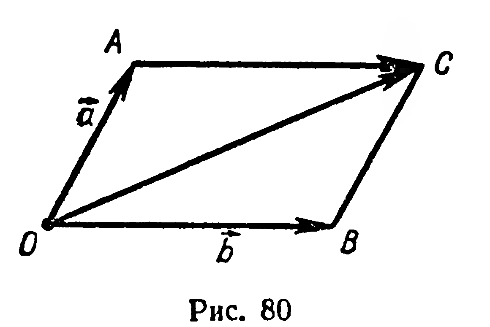
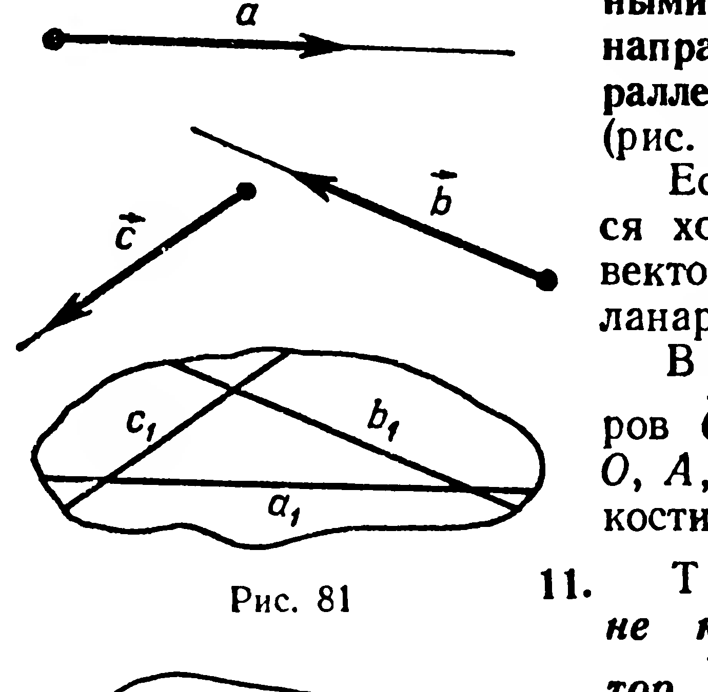
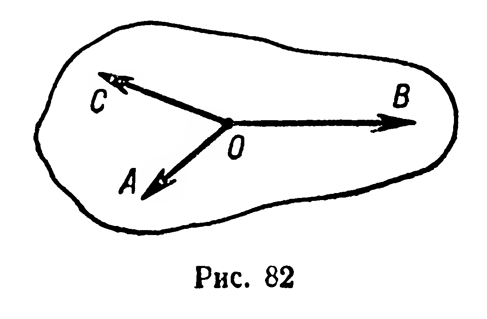
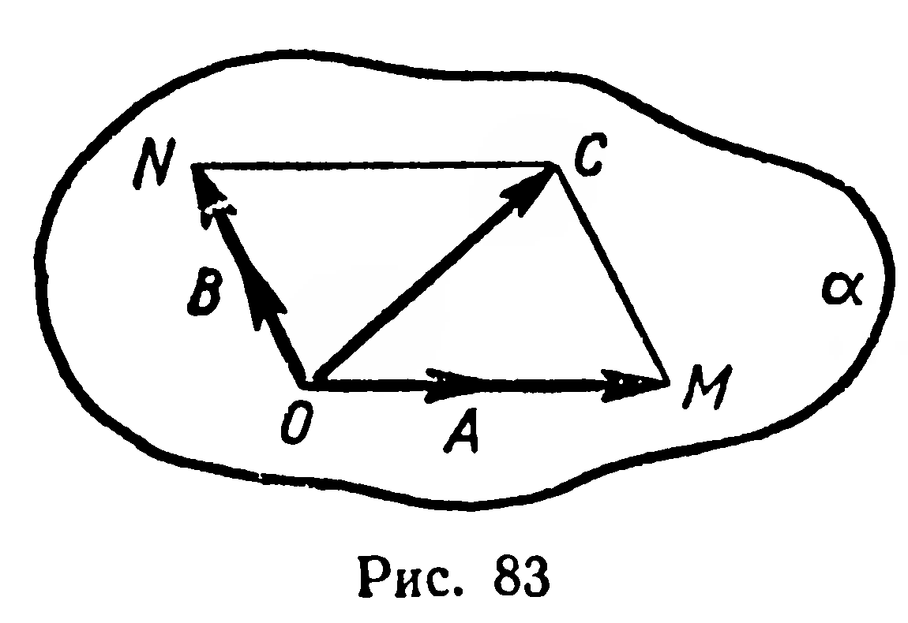
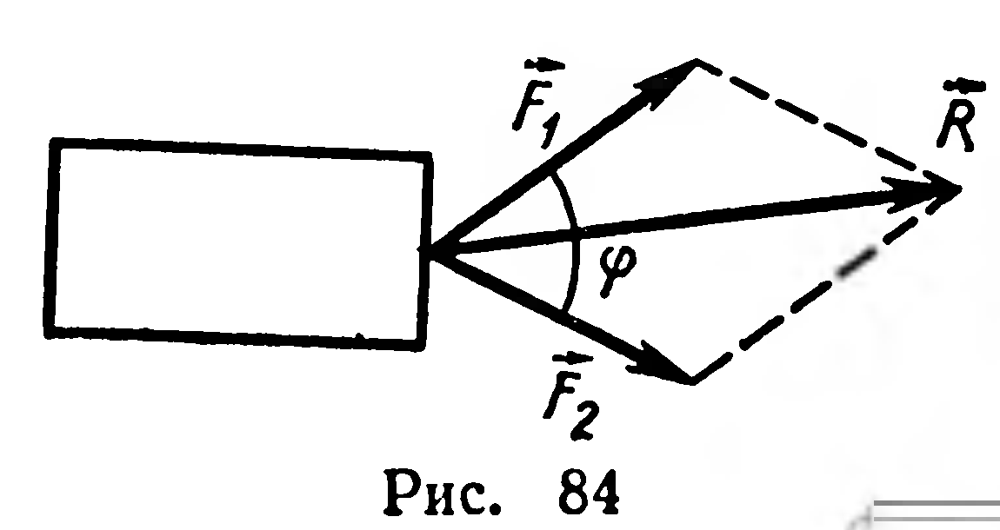

## 2.8. Компланарные векторы

---
**стр. 50, продолжение**
---

## § 21. Компланарные векторы

Для сложения двух неколлинеарных векторов иногда бывает удобно пользоваться **правилом параллелограмма**, известным из планиметрии. Напомним это правило.

Пусть надо найти сумму неколлинеарных векторов $\vec a$ и $\vec b$. Отложим от произвольной точки $O$ векторы $\overrightarrow{OA}=\vec a$ и $\overrightarrow{OB}=\vec b$ (рис. 80). Построим параллелограмм $AOBC$. Вектор $\overrightarrow{OC}$, где $[OC]$ — диагональ параллелограмма, является искомой суммой. Действительно, по правилу треугольника

$$\overrightarrow{OA}+\overrightarrow{OB}=\overrightarrow{OA}+\overrightarrow{AC}=\overrightarrow{OC}.$$

**Определение.** Три ненулевых вектора называются **компланарными**, если лучи, задающие их направления, лежат на прямых, параллельных некоторой плоскости (рис. 81).

Если среди трёх векторов имеется хотя бы один нулевой, то такие векторы также будем считать компланарными.

В случае компланарности векторов $\overrightarrow{OA}$, $\overrightarrow{OB}$, $\overrightarrow{OC}$ (рис. 82) точки $O$, $A$, $B$, $C$ принадлежат одной плоскости.

**11. Теорема.** *Если векторы $\vec a$ и $\vec b$ не коллинеарны, то любой вектор $\vec c$, компланарный с векторами $\vec a$ и $\vec b$, можно представить единственным образом в виде:*

$$\vec c=x\vec a+y\vec b.$$

*Доказательство.* Пусть векторы $\vec a$, $\vec b$, $\vec c$ компланарны,

---
**стр. 51**
---

причем $\vec a$ и $\vec b$ не коллинеарны. Найдем числа $x$ и $y$, удовлетворяющие равенству $\vec c = x\vec a + y\vec b$. От точки $O$ отложим векторы $\overrightarrow{OA} = \vec a$, $\overrightarrow{OB} = \vec b$, $\overrightarrow{OC} = \vec c$. Из условия теоремы следует, что точки $O$, $A$, $B$, $C$ принадлежат некоторой плоскости $\alpha$. Рассмотрим случай, когда $C \notin (OA)$ и $C \notin (OB)$ (рис. 83). В плоскости $\alpha$ через точку $C$ проведем прямые, параллельные прямым $OA$ и $OB$. Получим параллелограмм $MONC$. По правилу параллелограмма можно записать: $\overrightarrow{OC} = \overrightarrow{OM} + \overrightarrow{ON}$. Но $\overrightarrow{OM} = x\overrightarrow{OA}$ и $\overrightarrow{ON} = y\overrightarrow{OB}$ (§ 20), тогда $\overrightarrow{OC} = x\overrightarrow{OA} + y\overrightarrow{OB}$, или $\vec c = x\vec a + y\vec b$.

Если же $C \in (OA)$ или $C \in (OB)$, то в последнем равенстве соответственно $y = 0$ или $x = 0$.

Можно доказать, что числа $x$ и $y$ определяются однозначно, т. е. если $\vec c = x\vec a + y\vec b$ и $\vec c = x_1\vec a + y_1\vec b$, то $x = x_1$ и $y = y_1$. ■

Если даны неколлинеарные векторы $\vec a$ и $\vec b$, то представление вектора $\vec c$, компланарного с $\vec a$ и $\vec b$, в виде суммы $x\vec a + y\vec b$ называется **разложением вектора $\vec c$ по векторам $\vec a$ и $\vec b$**.

**Задачи**

**198.** К одной точке тела приложены силы $\vec F_1$ и $\vec F_2$ (рис. 84). Найдите величину равнодействующей силы, если угол между данными силами равен $\varphi$.

**199.** От центра $O$ правильного шестиугольника $A_1A_2A_3A_4A_5A_6$ отложите векторы: 1) $\overrightarrow{OA_1} + \overrightarrow{OA_3}$; 2) $\overrightarrow{OA_2} + \overrightarrow{OA_4} + \overrightarrow{OA_6}$; 3) $\overrightarrow{OA_1} + \overrightarrow{OA_2} + \overrightarrow{OA_3} + \overrightarrow{OA_4} + \overrightarrow{OA_5} + \overrightarrow{OA_6}$.

**200.** Докажите, что если $O$ — точка пересечения медиан треугольника $ABC$, то $\overrightarrow{OA} + \overrightarrow{OB} + \overrightarrow{OC} = \vec 0$.

**201.** Даны неколлинеарные векторы $\overrightarrow{OA}$ и $\overrightarrow{OB}$. От точки $O$ отложите векторы: 1) $2\overrightarrow{OA} + \overrightarrow{OB}$; 2) $\overrightarrow{OA} - \frac{1}{3}\overrightarrow{OB}$; 3) $\frac{3}{2}\overrightarrow{OA} - \frac{4}{3}\overrightarrow{OB}$.

**202.** Из вершин тетраэдра $ABCD$ составьте: 1) две упорядоченные пары точек, задающие коллинеарные векторы; 2) три упорядоченные пары, задающие компланарные векторы; 3) три упорядоченные пары, задающие некомпланарные векторы.

**203.** Дан параллелепипед $ABCDA_1B_1C_1D_1$. Какие из следующих троек векторов компланарны:

---
**стр. 52**
---

1) $\overrightarrow{AA_1}$, $\overrightarrow{CC_1}$, $\overrightarrow{B_1B}$; 2) $\overrightarrow{AB}$, $\overrightarrow{AD}$, $\overrightarrow{AA_1}$; 3) $\overrightarrow{B_1B}$, $\overrightarrow{AC}$, $\overrightarrow{DD_1}$; 4) $\overrightarrow{AD}$, $\overrightarrow{A_1B_1}$, $\overrightarrow{CC_1}$?

**204.** Дан параллелограмм $ABCD$. Разложите по векторам $\vec p = \overrightarrow{AB}$ и $\vec q = \overrightarrow{AD}$ векторы: 1) $\overrightarrow{AB}$; 2) $\overrightarrow{AD}$; 3) $\overrightarrow{AC}$; 4) $\overrightarrow{AO}$, где $O = (AC) \cap (BD)$; 5) $\overrightarrow{AM}$, где $M$ — середина отрезка $BC$.

**205.** Дан треугольник $ABC$. Разложите по векторам $\vec a = \overrightarrow{CA}$ и $\vec b = \overrightarrow{CB}$ векторы: 1) $\overrightarrow{CB_1}$, где $B_1$ — середина $[AC]$; 2) $\overrightarrow{CC_1}$, где $C_1$ — середина $[AB]$; 3) $\overrightarrow{CO}$, где $O$ — точка пересечения медиан треугольника; 4) $\overrightarrow{CK}$, где $K \in [AB]$ и $|AK| : |KB| = 3 : 10$.
