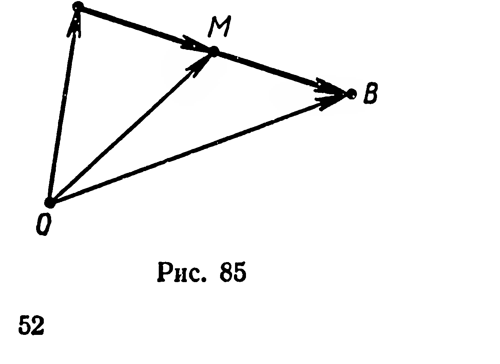
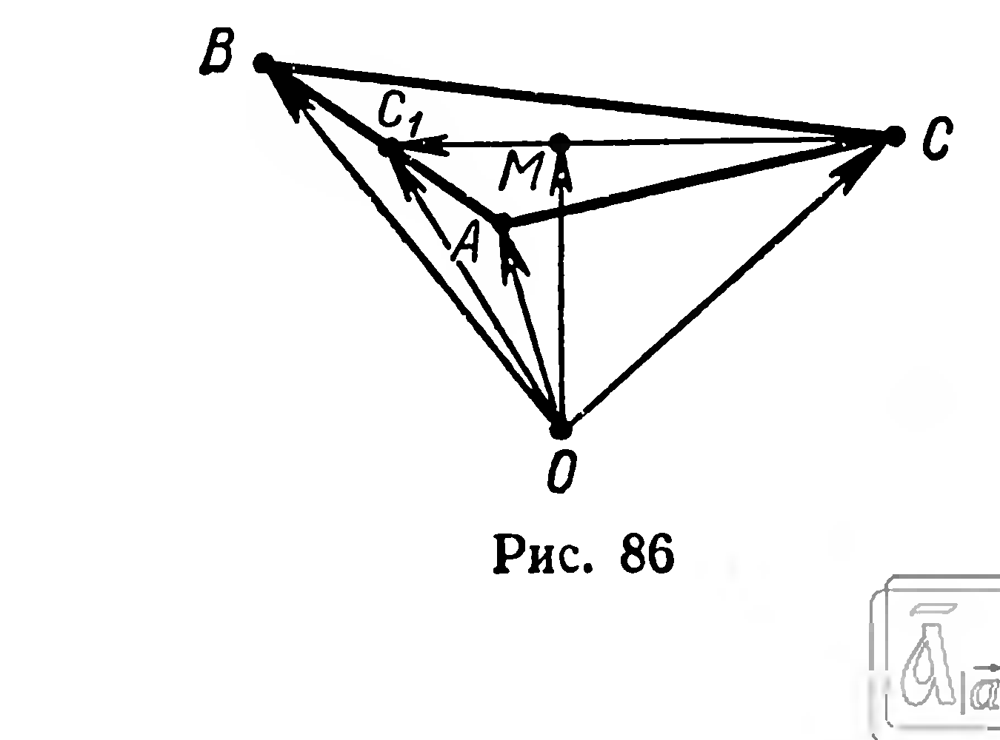

## 2.9. Применение векторов к решению задач

---
**стр. 52**
---

щих троек векторов компланарны:

1) $\overrightarrow{AA_1}$, $\overrightarrow{CC_1}$, $\overrightarrow{B_1B}$; 2) $\overrightarrow{AB}$, $\overrightarrow{AD}$, $\overrightarrow{AA_1}$; 3) $\overrightarrow{B_1B}$, $\overrightarrow{AC}$, $\overrightarrow{DD_1}$; 4) $\overrightarrow{AD}$, $\overrightarrow{A_1B_1}$, $\overrightarrow{CC_1}$?

**204.** Дан параллелограмм $ABCD$. Разложите по векторам $\vec p = \overrightarrow{AB}$ и $\vec q = \overrightarrow{AD}$ векторы: 1) $\overrightarrow{AB}$; 2) $\overrightarrow{AD}$; 3) $\overrightarrow{AC}$; 4) $\overrightarrow{AO}$, где $O = (AC) \cap (BD)$; 5) $\overrightarrow{AM}$, где $M$ — середина отрезка $BC$.

**205.** Дан треугольник $ABC$. Разложите по векторам $\vec a = \overrightarrow{CA}$ и $\vec b = \overrightarrow{CB}$ векторы: 1) $\overrightarrow{CB_1}$, где $B_1$ — середина $[AC]$; 2) $\overrightarrow{CC_1}$, где $C_1$ — середина $[AB]$; 3) $\overrightarrow{CO}$, где $O$ — точка пересечения медиан треугольника; 4) $\overrightarrow{CK}$, где $K \in [AB]$ и $|AK| : |KB| = 3 : 10$.

**§ 22. ПРИМЕНЕНИЕ ВЕКТОРОВ К РЕШЕНИЮ ЗАДАЧ**

**Задача 1.** Доказать, что если $M$ — середина отрезка $AB$ и $O$ — произвольная точка пространства, то выполняется равенство:

$$\overrightarrow{OM} = \frac{1}{2}(\overrightarrow{OA} + \overrightarrow{OB}).$$

**Решение.** Согласно условию задачи имеем: $\overrightarrow{AM} = \overrightarrow{MB}$ (рис. 85). Но $\overrightarrow{AM} = \overrightarrow{OM} - \overrightarrow{OA}$ и $\overrightarrow{MB} = \overrightarrow{OB} - \overrightarrow{OM}$ (§ 19). Тогда $\overrightarrow{OM} - \overrightarrow{OA} = \overrightarrow{OB} - \overrightarrow{OM}$, отсюда $\overrightarrow{OM} = \frac{1}{2}(\overrightarrow{OA} + \overrightarrow{OB})$ ■

**Задача 2.** Доказать, что если $M$ — точка пересечения медиан треугольника $ABC$ и $O$ — произвольная точка пространства, то выполняется равенство:

$$\overrightarrow{OM} = \frac{1}{3}(\overrightarrow{OA} + \overrightarrow{OB} + \overrightarrow{OC}).$$

**Решение.** Пусть $[CC_1]$ — медиана треугольника $ABC$ (рис. 86). По свойству медиан треугольника $\overrightarrow{MC_1} = \frac{1}{3}\overrightarrow{CC_1}$. Применяя к векторам $\overrightarrow{MC_1}$ и $\overrightarrow{CC_1}$ формулу вычитания векторов (§ 19), получим: $\overrightarrow{OC_1} - \overrightarrow{OM} = \frac{1}{3}(\overrightarrow{OC_1} - \overrightarrow{OC})$, отсюда $\overrightarrow{OM} = \frac{1}{3}\overrightarrow{OC} +$

