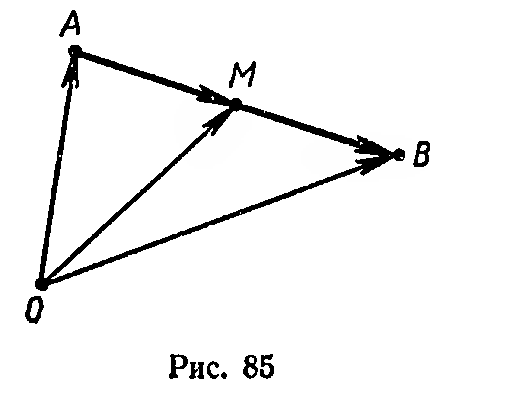
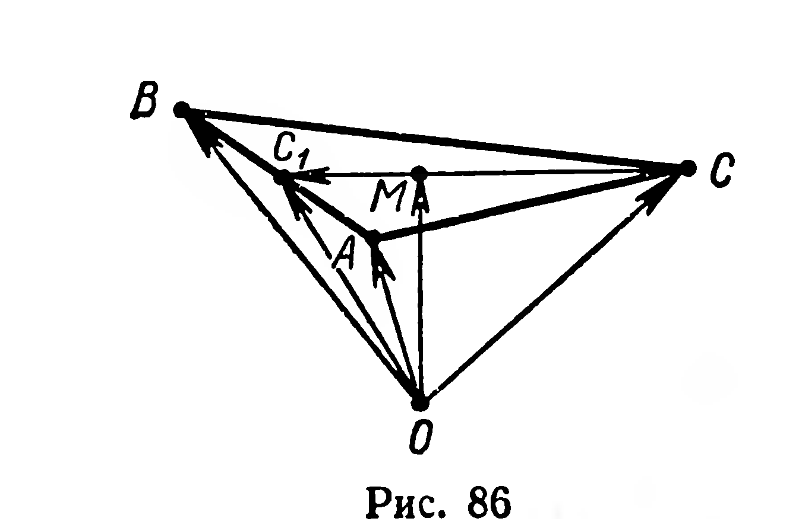

## 2.9. Применение векторов к решению задач

---
**стр. 52, продолжение**
---

**§ 22. ПРИМЕНЕНИЕ ВЕКТОРОВ К РЕШЕНИЮ ЗАДАЧ**

**Задача 1.** Доказать, что если $M$ — середина отрезка $AB$ и $O$ — произвольная точка пространства, то выполняется равенство:

$$\overrightarrow{OM} = \frac{1}{2}(\overrightarrow{OA} + \overrightarrow{OB}).$$

**Решение.** Согласно условию задачи имеем: $\overrightarrow{AM} = \overrightarrow{MB}$ (рис. 85). Но $\overrightarrow{AM} = \overrightarrow{OM} - \overrightarrow{OA}$ и $\overrightarrow{MB} = \overrightarrow{OB} - \overrightarrow{OM}$ (§ 19). Тогда $\overrightarrow{OM} - \overrightarrow{OA} = \overrightarrow{OB} - \overrightarrow{OM}$, отсюда $\overrightarrow{OM} = \frac{1}{2}(\overrightarrow{OA} + \overrightarrow{OB})$ ■

**Задача 2.** Доказать, что если $M$ — точка пересечения медиан треугольника $ABC$ и $O$ — произвольная точка пространства, то выполняется равенство:

$$\overrightarrow{OM} = \frac{1}{3}(\overrightarrow{OA} + \overrightarrow{OB} + \overrightarrow{OC}).$$

**Решение.** Пусть $[CC_1]$ — медиана треугольника $ABC$ (рис. 86). По свойству медиан треугольника $\overrightarrow{MC_1} = \frac{1}{3}\overrightarrow{CC_1}$. Применяя к векторам $\overrightarrow{MC_1}$ и $\overrightarrow{CC_1}$ формулу вычитания векторов (§ 19), получим: $\overrightarrow{OC_1} - \overrightarrow{OM} = \frac{1}{3}(\overrightarrow{OC_1} - \overrightarrow{OC})$, отсюда $\overrightarrow{OM} = \frac{1}{3}\overrightarrow{OC} +$

---
**стр. 53**
---

$+ \frac{2}{3}\overrightarrow{OC_1}$. Но $\overrightarrow{OC_1} = \frac{1}{2}(\overrightarrow{OA} + \overrightarrow{OB})$ (задача 1), тогда

$$\overrightarrow{OM} = \frac{1}{3}\overrightarrow{OC} + \frac{2}{3} \cdot \frac{1}{2}(\overrightarrow{OB} + \overrightarrow{OA}) = \frac{1}{3}(\overrightarrow{OA} + \overrightarrow{OB} + \overrightarrow{OC}). \blacksquare$$

**Задачи**

**206.** Точки $M_1$ и $M_2$ — середины отрезков $A_1B_1$ и $A_2B_2$ соответственно. Докажите, что $\overrightarrow{M_1M_2} = \frac{1}{2}(\overrightarrow{A_1A_2} + \overrightarrow{B_1B_2})$.

**207.** Докажите, что середины оснований трапеции и точка пересечения продолжений ее боковых сторон принадлежат одной прямой.

**208.** 1) $M_1$ и $M_2$ — точки пересечения медиан треугольников $A_1B_1C_1$ и $A_2B_2C_2$. Докажите, что $\overrightarrow{M_1M_2} = \frac{1}{3}(\overrightarrow{A_1A_2} + \overrightarrow{B_1B_2} + \overrightarrow{C_1C_2})$.

2) В треугольнике $ABC$ точки $A_1$, $B_1$, $C_1$ являются серединами сторон $BC$, $AC$, $AB$. Докажите, что при любом выборе точки $O$ выполняется равенство:

$$\overrightarrow{OA_1} + \overrightarrow{OB_1} + \overrightarrow{OC_1} = \overrightarrow{OA} + \overrightarrow{OB} + \overrightarrow{OC}.$$

**209.** В тетраэдре $ABCD$ точки $M_1$ и $M_2$ являются соответственно точками пересечения медиан граней $ADB$ и $BDC$. Докажите, что векторы $\overrightarrow{M_1M_2}$ и $\overrightarrow{AC}$ коллинеарны. Найдите отношение длин этих векторов.

**210.** Треугольник $ABC$ является параллельной проекцией треугольника $A_1B_1C_1$ на плоскость. Известно: $|AA_1| = a$, $|BB_1| = b$, $|CC_1| = c$. Найдите расстояние между точками пересечения медиан этих треугольников.
