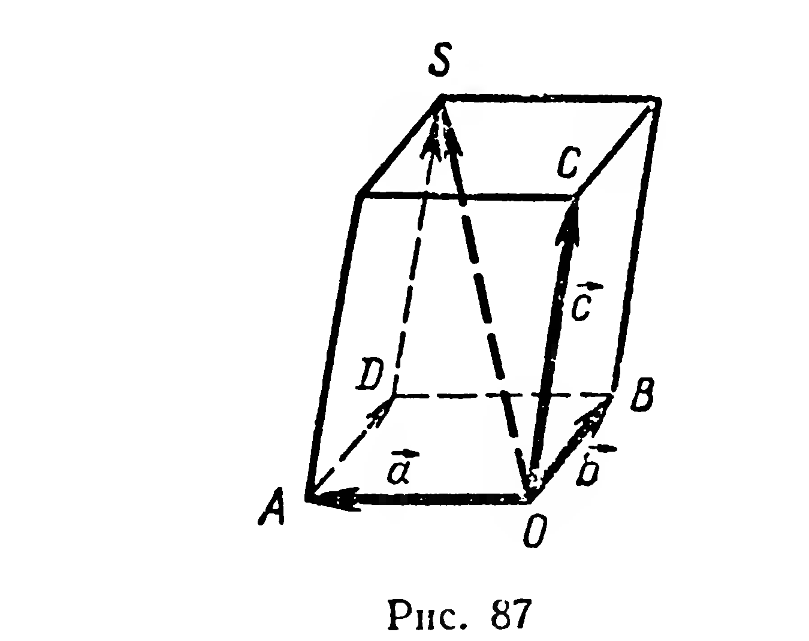
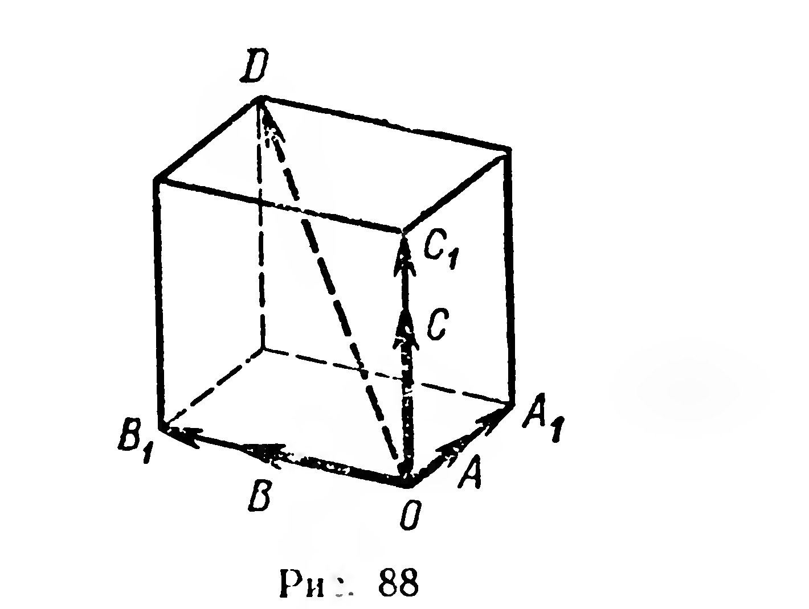
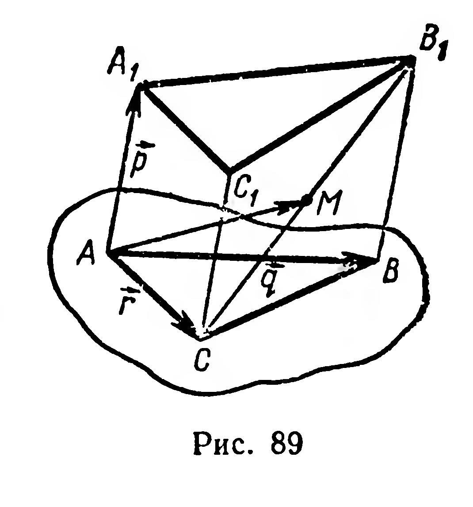

## 2.10. Правило параллелепипеда. Разложение вектора по трем некомпланарным векторам

---
**стр. 53, продолжение**
---

## § 23. Правило параллелепипеда. Разложение вектора по трем некомпланарным векторам

**1.** Для сложения трех некомпланарных векторов иногда бывает удобно пользоваться правилом параллелепипеда. Пусть надо найти сумму некомпланарных векторов $\vec{a}$, $\vec{b}$, $\vec{c}$ (рис. 87). Отложим от произвольной точки $O$ векторы $\overrightarrow{OA} = \vec{a}$, $\overrightarrow{OB} = \vec{b}$, $\overrightarrow{OC} = \vec{c}$. Построим параллелепипед так, чтобы отрезки $OA$, $OB$, $OC$ были его ребрами. Вектор $\overrightarrow{OS}$, где $[OS]$ — диагональ параллелепипеда, является искомой суммой.

Действительно, $\overrightarrow{OA} + \overrightarrow{OB} + \overrightarrow{OC} = \overrightarrow{OA} + \overrightarrow{AD} + \overrightarrow{DS} = \overrightarrow{OS}$ (§ 18).

**2.** Пусть даны некомпланарные векторы $\vec{a}$, $\vec{b}$, $\vec{c}$. Выясним, можно ли произвольный вектор $\vec{d}$ представить в виде:

$$\vec{d} = x\vec{a} + y\vec{b} + z\vec{c}. \tag{1}$$

---
**стр. 54**
---

От точки $O$ отложим векторы: $\overrightarrow{OA} = \vec{a}$, $\overrightarrow{OB} = \vec{b}$, $\overrightarrow{OC} = \vec{c}$, $\overrightarrow{OD} = \vec{d}$ (рис. 88). Плоскости $AOB$, $BOC$, $COA$ различны. Рассмотрим случай, когда точка $D$ не принадлежит ни одной из указанных плоскостей. Через $D$ проведем плоскости, соответственно параллельные плоскостям $AOB$, $BOC$, $COA$. В полученном параллелепипеде отрезок $OD$ — диагональ. Концы ребер, выходящих из вершины $O$, обозначим $A_1$, $B_1$, $C_1$. По правилу параллелепипеда $\overrightarrow{OD} = \overrightarrow{OA_1} + \overrightarrow{OB_1} + \overrightarrow{OC_1}$. Но векторы $\overrightarrow{OA_1}$ и $\overrightarrow{OA}$ коллинеарны, поэтому $\overrightarrow{OA_1} = x\overrightarrow{OA}$. Аналогично, $\overrightarrow{OB_1} = y\overrightarrow{OB}$, $\overrightarrow{OC_1} = z\overrightarrow{OC}$. Следовательно, $\overrightarrow{OD} = x\overrightarrow{OA} + y\overrightarrow{OB} + z\overrightarrow{OC}$, или

$$\vec{d} = x\vec{a} + y\vec{b} + z\vec{c}.$$

Если точка $D$ принадлежит плоскости $AOB$, то векторы $\overrightarrow{OA}$, $\overrightarrow{OB}$, $\overrightarrow{OD}$ компланарны и, следовательно, $\vec{d} = x\vec{a} + y\vec{b}$ (§ 21). Тогда в равенстве (1) полагаем $z = 0$. Аналогично рассматриваются случаи, когда точка $D$ принадлежит $(BOC)$ или $(COA)$.

Если заданы некомпланарные векторы $\vec{a}$, $\vec{b}$, $\vec{c}$, то представление вектора $\vec{d}$ в виде суммы $x\vec{a} + y\vec{b} + z\vec{c}$ называется **разложением вектора $\vec{d}$ по векторам $\vec{a}$, $\vec{b}$, $\vec{c}$**.

Можно доказать, что полученное разложение является единственным, т. е. из равенств $\vec{d} = x\vec{a} + y\vec{b} + z\vec{c}$ и $\vec{d} = x_1\vec{a} + y_1\vec{b} + z_1\vec{c}$ следует: $x = x_1$, $y = y_1$, $z = z_1$. $\blacksquare$

Итак, имеет место следующая теорема:

**12. Теорема.** *Для каждого вектора пространства существует единственное разложение по трем данным некомпланарным векторам.*

**Задачи**

**211.** Дан параллелепипед $ABCDA_1B_1C_1D_1$. Разложите по векторам $\vec{p} = \overrightarrow{AB}$, $\vec{q} = \overrightarrow{AD}$, $\vec{r} = \overrightarrow{AA_1}$ векторы: 1) $\overrightarrow{AB_1}$; 2) $\overrightarrow{AC_1}$;

---
**стр. 55**
---

3) $\overrightarrow{AM}$, где $M$ — середина $[DD_1]$; 4) $\overrightarrow{AN}$, где $N$ — середина $[CC_1]$; 5) $\overrightarrow{AP}$, где $P$ — середина $[BC_1]$; 6) $\overrightarrow{AQ}$, где $Q \in [D_1C_1]$ и $|D_1Q| : |D_1C_1| = 5 : 11$.

**212.** Треугольник $ABC$ является параллельной проекцией треугольника $A_1B_1C_1$ на непересекающую его плоскость (рис. 89). Известно: $|AA_1| = a$, $|BB_1| = b$, $M$ — середина $[B_1C]$. Разложить вектор $\overrightarrow{AM}$ по векторам $\overrightarrow{AA_1} = \vec{p}$, $\overrightarrow{AB} = \vec{q}$, $\overrightarrow{AC} = \vec{r}$.

**Решение.** Имеем: $\overrightarrow{AM} = \frac{1}{2}(\overrightarrow{AC} + \overrightarrow{AB_1}) = \frac{1}{2}(\vec{r} + \overrightarrow{AB_1})$ (§ 22, задача 1). По правилу треугольника $\overrightarrow{AB_1} = \overrightarrow{AB} + \overrightarrow{BB_1} = \vec{q} + \overrightarrow{BB_1}$. Но $\overrightarrow{BB_1} = x\vec{p}$, так как $\overrightarrow{BB_1} \uparrow\uparrow \vec{p}$, отсюда $|\overrightarrow{BB_1}| = x|\vec{p}|$, или $b = xa$, $x = \frac{b}{a}$. Тогда $\overrightarrow{AM} = \frac{1}{2}\left(\vec{r} + \vec{q} + \frac{b}{a}\vec{p}\right) = \frac{b}{2a}\vec{p} + \frac{1}{2}\vec{q} + \frac{1}{2}\vec{r}$.

**213.** Медианы грани $ABC$ тетраэдра $OABC$ пересекаются в точке $M$. Разложите вектор $\overrightarrow{OA}$ по векторам $\overrightarrow{OB}$, $\overrightarrow{OC}$, $\overrightarrow{OM}$.

**214.** Вне плоскости параллелограмма $ABCD$ взята точка $O$. Разложите по векторам $\vec{a} = \overrightarrow{OA}$, $\vec{b} = \overrightarrow{OB}$, $\vec{c} = \overrightarrow{OC}$ векторы: 1) $\overrightarrow{OM}$, где $M = (AC) \cap (BD)$; 2) $\overrightarrow{OD}$; 3) $\overrightarrow{OK}$, где $K$ — середина $[AD]$.

**215.** В тетраэдре $ABCD$ медиана $AA_1$ грани $ABC$ делится точкой $M$ в отношении $|AM| : |MA_1| = 3 : 7$. Разложите вектор $\overrightarrow{DM}$ по векторам $\overrightarrow{DA}$, $\overrightarrow{DB}$, $\overrightarrow{DC}$.

**216.** Рассматривается треугольник, вершинами которого являются концы трёх рёбер параллелепипеда, выходящих из одной его вершины. Докажите, что точка пересечения медиан треугольника принадлежит диагонали параллелепипеда, выходящей из той же вершины, и делит эту диагональ в отношении $1 : 2$.
