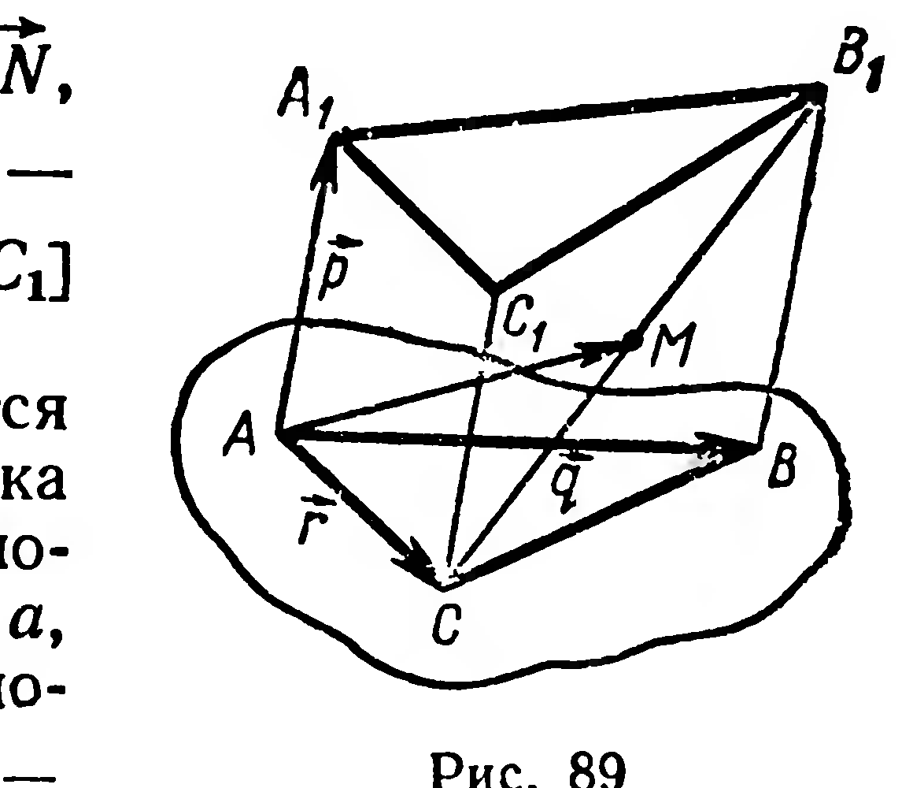
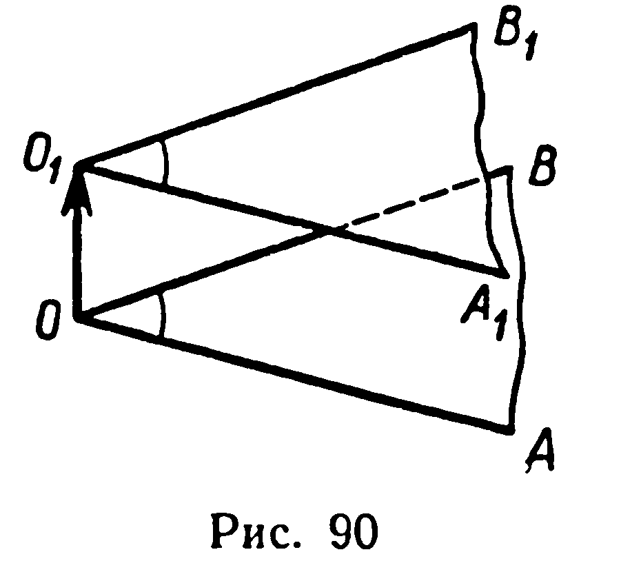
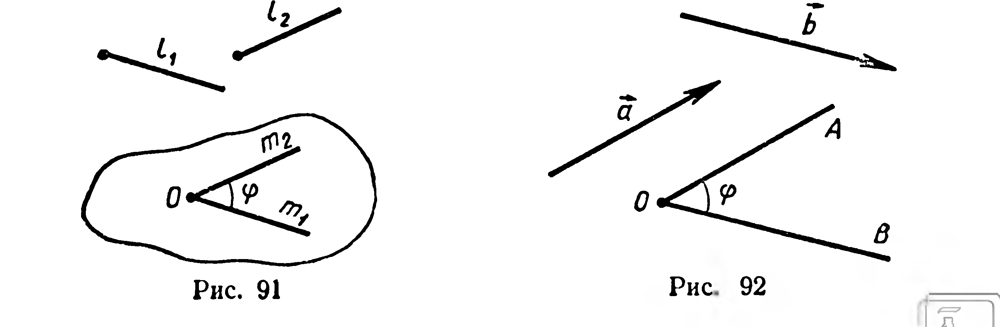

## 2.11. Угол между двумя векторами

---
**стр. 55**
---

3) $\overrightarrow{AM}$, где $M$ — середина $[DD_1]$; 4) $\overrightarrow{AN}$, где $N$ — середина $[CC_1]$; 5) $\overrightarrow{AP}$, где $P$ — середина $[BC_1]$; 6) $\overrightarrow{AQ}$, где $Q \in [D_1C_1]$ и $|D_1Q| : |D_1C_1| = 5 : 11$.

**212.** Треугольник $ABC$ является параллельной проекцией треугольника $A_1B_1C_1$ на непересекающую его плоскость (рис. 89). Известно: $|AA_1| = a$, $|BB_1| = b$, $M$ — середина $[B_1C]$. Разложить вектор $\overrightarrow{AM}$ по векторам $\overrightarrow{AA_1} = \vec{p}$, $\overrightarrow{AB} = \vec{q}$, $\overrightarrow{AC} = \vec{r}$.

**Решение.** Имеем: $\overrightarrow{AM} = \frac{1}{2}(\overrightarrow{AC} + \overrightarrow{AB_1}) = \frac{1}{2}(\vec{r} + \overrightarrow{AB_1})$ (§ 22, задача 1). По правилу треугольника $\overrightarrow{AB_1} = \overrightarrow{AB} + \overrightarrow{BB_1} = \vec{q} + \overrightarrow{BB_1}$. Но $\overrightarrow{BB_1} = x\vec{p}$, так как $\overrightarrow{BB_1} \uparrow\uparrow \vec{p}$, отсюда $|\overrightarrow{BB_1}| = x|\vec{p}|$, или $b = xa$, $x = \frac{b}{a}$. Тогда $\overrightarrow{AM} = \frac{1}{2}\left(\vec{r} + \vec{q} + \frac{b}{a}\vec{p}\right) = \frac{b}{2a}\vec{p} + \frac{1}{2}\vec{q} + \frac{1}{2}\vec{r}$.

**213.** Медианы грани $ABC$ тетраэдра $OABC$ пересекаются в точке $M$. Разложите вектор $\overrightarrow{OA}$ по векторам $\overrightarrow{OB}$, $\overrightarrow{OC}$, $\overrightarrow{OM}$.

**214.** Вне плоскости параллелограмма $ABCD$ взята точка $O$. Разложите по векторам $\vec{a} = \overrightarrow{OA}$, $\vec{b} = \overrightarrow{OB}$, $\vec{c} = \overrightarrow{OC}$ векторы: 1) $\overrightarrow{OM}$, где $M = (AC) \cap (BD)$; 2) $\overrightarrow{OD}$; 3) $\overrightarrow{OK}$, где $K$ — середина $[AD]$.

**215.** В тетраэдре $ABCD$ медиана $AA_1$ грани $ABC$ делится точкой $M$ в отношении $|AM| : |MA_1| = 3 : 7$. Разложите вектор $\overrightarrow{DM}$ по векторам $\overrightarrow{DA}$, $\overrightarrow{DB}$, $\overrightarrow{DC}$.

**216.** Рассматривается треугольник, вершинами которого являются концы трёх рёбер параллелепипеда, выходящих из одной его вершины. Докажите, что точка пересечения медиан треугольника принадлежит диагонали параллелепипеда, выходящей из той же вершины, и делит эту диагональ в отношении $1 : 2$.

**§ 24. УГОЛ МЕЖДУ ДВУМЯ ВЕКТОРАМИ**

Предварительно введём понятие угла между двумя направлениями в пространстве.

**13. Теорема.** Если стороны двух выпуклых углов[^1] соответственно сонаправлены, то эти углы конгруэнтны.

**Доказательство.** Пусть стороны углов $AOB$ и $A_1O_1B_1$ сонаправлены: $[O_1A_1) \uparrow\uparrow [OA)$, $[O_1B_1) \uparrow\uparrow [OB)$ (рис. 90). Докажем, что $\angle A_1O_1B_1 \cong \angle AOB$. Вектор $\overrightarrow{OO_1}$ отображает луч $OA$ на сона-

[^1]: Выпуклый угол — угол, удовлетворяющий определению выпуклой фигуры (см. с. 10).

---
**стр. 56**
---

правленный с ним луч (§ 17, свойство 2). Но по условию $[O_1A_1) \uparrow\uparrow [OA)$, причём из точки $O_1$ выходит единственный луч, сонаправленный с лучом $OA$. Следовательно, образ луча $OA$ совпадает с лучом $O_1A_1$. Аналогично доказывается, что луч $OB$ отображается этим же вектором на луч $O_1B_1$.

Вектор $\overrightarrow{OO_1}$ есть перемещение. А всякое перемещение сохраняет величину угла (§ 15). Следовательно, вектор $\overrightarrow{OO_1}$ отображает выпуклый угол $AOB$ на выпуклый угол $A_1O_1B_1$, т. е. $\angle A_1O_1B_1 \cong \angle AOB$. ■

Пусть два направления заданы лучами $l_1$ и $l_2$. Из каждой точки $O$ выходит единственный луч $m_1$ первого направления (§ 16) и единственный луч $m_2$ второго направления (рис. 91). Величина угла между лучами $m_1$ и $m_2$ не зависит от выбора точки $O$. Действительно, любые два выпуклых угла, стороны которых соответственно сонаправлены с $l_1$ и $l_2$, конгруэнтны (теорема 13) и, следовательно, имеют равные величины.

**Углом между двумя направлениями называют величину угла между любыми двумя лучами этих направлений, имеющими общее начало.**

Обозначение угла между двумя направлениями, определяемыми лучами $l_1$ и $l_2$: $(\widehat{l_1, l_2}) = \varphi$, где $\varphi \in [0^\circ, 180^\circ]$.

**Определение. Углом между двумя ненулевыми векторами называется угол между направлениями этих векторов.**

Обозначение угла между векторами $\vec{a}$ и $\vec{b}$: $(\widehat{\vec{a}, \vec{b}}) = \varphi$ (рис. 92).

Если угол между векторами равен $90^\circ$, то векторы называют перпендикулярными и записывают: $\vec{a} \perp \vec{b}$.

Выделим ещё два частных случая:

1) если $\vec{a} \uparrow\uparrow \vec{b}$, то $(\widehat{\vec{a}, \vec{b}}) = 0^\circ$; 2) если $\vec{a} \uparrow\downarrow \vec{b}$, то $(\widehat{\vec{a}, \vec{b}}) = 180^\circ$.

**Углом между двумя пересекающимися прямыми называют величину меньшего из углов, определяемых этими прямыми.**

**Углом между двумя скрещивающимися прямыми называют угол между двумя пересекающимися прямыми, соответственно**

