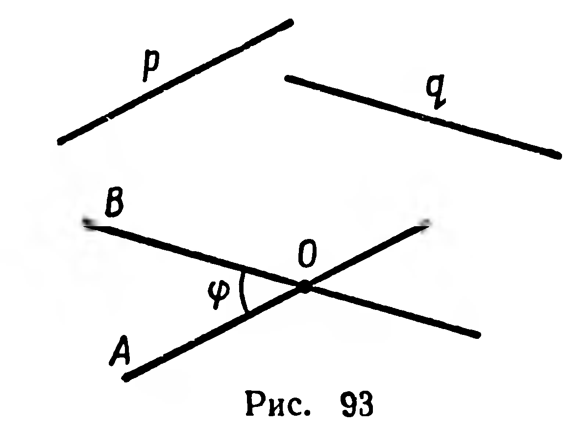
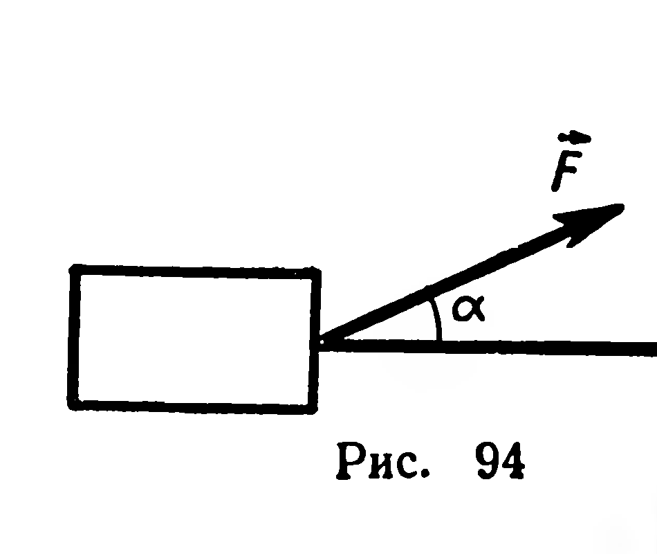

## 2.12. Скалярное умножение двух векторов

---
**стр. 57**
---

параллельными данным скрещивающимся прямым (рис. 93).

Если две прямые параллельны, то угол между ними считается равным $0^\circ$.

Обозначение угла между прямыми $p$ и $q$:

$$(\widehat{p,\ q}) = \varphi, \quad \text{где } 0^\circ \leqslant \varphi \leqslant 90^\circ.$$

Две прямые называют **взаимно перпендикулярными**, если угол между ними равен $90^\circ$. В этом случае записывают: $p \perp q$.

**Задачи**

**217.** Лучи, задающие направления ненулевых векторов $\vec p$ и $\vec q$, лежат соответственно на прямых $a$ и $b$. 1) Верно ли утверждение: $(\widehat{a,\ b}) = (\widehat{\vec p,\ \vec q})$? 2) При каком условии выполняется равенство: $(\widehat{a,\ b}) = 180^\circ - (\widehat{\vec p,\ \vec q})$?

**218.** Дан куб $ABCDA_1B_1C_1D_1$. Найдите угол между векторами и угол между прямыми, определяемыми теми же парами точек, что и векторы: 1) $\overrightarrow{D_1A_1}$ и $\overrightarrow{CC_1}$; 2) $\overrightarrow{C_1B}$ и $\overrightarrow{DD_1}$; 3) $\overrightarrow{DC_1}$ и $\overrightarrow{A_1B}$; 4) $\overrightarrow{AC}$ и $\overrightarrow{DC_1}$; 5) $\overrightarrow{DA_1}$ и $\overrightarrow{B_1B}$.

§ **25. СКАЛЯРНОЕ УМНОЖЕНИЕ ДВУХ ВЕКТОРОВ**

Для вычисления величины механической работы пользуются формулой $A = F \cdot S \cdot \cos \alpha$, где $\alpha = (\widehat{\vec F,\ \vec S})$ (рис. 94). Работа — скалярная величина, хотя и является результатом некоторой операции над векторными величинами: силой $\vec F$ и механическим перемещением $\vec S$. Определим эту операцию для произвольных векторов $\vec a$ и $\vec b$.

**Определение.** Скалярным произведением двух ненулевых векторов называется произведение числовых значений длин этих векторов на косинус угла между векторами.

Если из двух векторов хотя бы один вектор нулевой, то скалярное произведение этих векторов принимается равным нулю.

Обозначение скалярного произведения векторов $\vec a$ и $\vec b$: $\vec a \cdot \vec b$.

Согласно определению $\vec a \cdot \vec b = ab \cos \varphi$, где $\varphi = (\widehat{\vec a,\ \vec b})$, $\vec a \neq \vec 0$, $\vec b \neq \vec 0$.

Докажем простейшие свойства скалярного произведения двух векторов.

---
**стр. 58**
---

1) *Необходимым и достаточным условием перпендикулярности двух ненулевых векторов является равенство нулю их скалярного произведения.*

*Достаточность.* Пусть $\vec a \cdot \vec b = 0$, отсюда $ab \cos \varphi = 0$. Но по условию $a \neq 0$, $b \neq 0$, поэтому $\cos \varphi = 0$, $\varphi = 90^\circ$, т. е. $\vec a \perp \vec b$.

*Необходимость.* Если $\vec a \perp \vec b$, то $\varphi = 90^\circ$ и по определению $\vec a \cdot \vec b = ab \cos 90^\circ = 0$.

2) *Скалярное произведение вектора на этот же вектор равно квадрату числового значения его длины.*

Действительно, по определению имеем: $\vec a \cdot \vec a = aa \cos 0^\circ = a^2$.

Произведение $\vec a \cdot \vec a$ будем записывать $\vec a^2$ и называть *скалярным квадратом* вектора $\vec a$. Тогда свойство 2 можно сформулировать по-иному: скалярный квадрат вектора равен квадрату его длины, т. е. $\vec a^2 = a^2$. Отсюда следует, что $a = \sqrt{\vec a^2}$.

**Задачи**

**219°.** 1) Какой знак имеет скалярное произведение ненулевых векторов $\vec a$ и $\vec b$, если угол $\varphi$ между ними находится в промежутке: а) $0^\circ \leqslant \varphi < 90^\circ$; б) $90^\circ < \varphi \leqslant 180^\circ$?

2) В каком промежутке находится угол $\varphi$ между векторами $\vec a$ и $\vec b$, если: а) $\vec a \cdot \vec b > 0$; б) $\vec a \cdot \vec b < 0$?

**220°.** Найдите скалярное произведение векторов: 1) $\vec a$ и $-\vec a$; 2) $\vec b$ и $k\vec b$.

**221.** Треугольник $ABC$, у которого $\widehat A = 45^\circ$, $\widehat B = 60^\circ$, вписан в единичную окружность с центром в точке $O$. Вычислите скалярные произведения: 1) $\overrightarrow{OB} \cdot \overrightarrow{OC}$; 2) $\overrightarrow{OC} \cdot \overrightarrow{OA}$; 3) $\overrightarrow{OA} \cdot \overrightarrow{OB}$.

**222.** $ABCDEF$ — правильный шестиугольник с центром $O$ и стороной $a$. Вычислите скалярные произведения: 1) $\overrightarrow{AB} \cdot \overrightarrow{ED}$; 2) $\overrightarrow{AD} \cdot \overrightarrow{CB}$; 3) $\overrightarrow{OA} \cdot \overrightarrow{OB}$; 4) $\overrightarrow{OA} \cdot \overrightarrow{OC}$; 5) $\overrightarrow{OA} \cdot \overrightarrow{OD}$; 6) $\overrightarrow{AB} \cdot \overrightarrow{AD}$; 7) $\overrightarrow{AB} \cdot \overrightarrow{AC}$.

**223.** Длина гипотенузы $AB$ прямоугольного треугольника $ABC$ равна $c$. Вычислите сумму:

$$\overrightarrow{AB} \cdot \overrightarrow{AC} + \overrightarrow{BC} \cdot \overrightarrow{BA} + \overrightarrow{CA} \cdot \overrightarrow{CB}.$$

**224.** Дан треугольник $ABC$: $|BC| = a$, $|CA| = b$, $|AB| = c$. Выразите через $a$, $b$, $c$ скалярные произведения: 1) $\overrightarrow{AB} \cdot \overrightarrow{AC}$; 2) $\overrightarrow{BC} \cdot \overrightarrow{BA}$.

**225.** $\overrightarrow{OA}$ и $\overrightarrow{OB}$ — неколлинеарные единичные векторы. Найдите скалярное произведение $(\overrightarrow{OA} + \overrightarrow{OB}) \cdot (\overrightarrow{OA} - \overrightarrow{OB})$.
