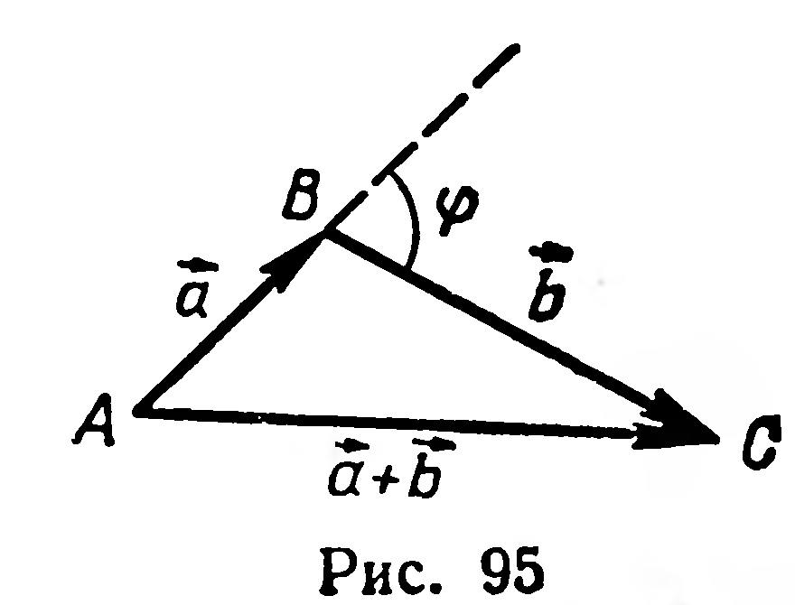

## 2.13. Основные свойства скалярного умножения векторов

---
**стр. 59**
---

226. Длина каждого из рёбер тетраэдра $ABCD$ равна $a$, точки $M$, $N$, $P$ являются серединами рёбер $AB$, $AD$, $DC$. Вычислите скалярные произведения: 1) $\overrightarrow{AC}\cdot\overrightarrow{AB}$; 2) $\overrightarrow{AD}\cdot\overrightarrow{DB}$; 3) $\overrightarrow{PN}\cdot\overrightarrow{AC}$; 4) $\overrightarrow{MN}\cdot\overrightarrow{BC}$; 5) $\overrightarrow{NP}\cdot\overrightarrow{BA}$; 6) $\overrightarrow{PM}\cdot\overrightarrow{PB}$.

### § 26. Основные свойства скалярного умножения векторов

Скалярное умножение векторов обладает свойствами, аналогичными законам операций над числами:

1) $\vec{a}\cdot\vec{b}=\vec{b}\cdot\vec{a}$ (переместительный закон);
2) $(k\vec{a})\cdot\vec{b}=k(\vec{a}\cdot\vec{b})$ (сочетательный закон);
3) $\vec{a}\cdot(\vec{b}+\vec{c})=\vec{a}\cdot\vec{b}+\vec{a}\cdot\vec{c}$ (распределительный закон).

Переместительный и сочетательный законы доказываются на основе определения скалярного произведения.

Доказательство распределительного закона основано на равенстве:

$$(\vec{a}+\vec{b})^2=\vec{a}^2+2\vec{a}\cdot\vec{b}+\vec{b}^2. \qquad (1)$$

Докажем равенство (1). Рассмотрим случай, когда векторы $\vec{a}$ и $\vec{b}$ неколлинеарны. Отложим $\overrightarrow{AB}=\vec{a}$, $\overrightarrow{BC}=\vec{b}$, тогда $\overrightarrow{AC}=\vec{a}+\vec{b}$ (рис. 95). Рассмотрим треугольник $ABC$. По теореме косинусов:

$$|AC|^2=|AB|^2+|BC|^2-2|AB|\cdot|BC|\cos(180^\circ-\varphi)=$$
$$=|AB|^2+|BC|^2+2|AB|\cdot|BC|\cos\varphi, \text{ где } \varphi=(\widehat{\vec{a},\vec{b}}).$$

Но $|AC|^2=(\vec{a}+\vec{b})^2$, $|AB|^2=\vec{a}^2$, $|BC|^2=\vec{b}^2$,
$$|AB|\cdot|BC|\cos\varphi=\vec{a}\cdot\vec{b}.$$

Тогда $(\vec{a}+\vec{b})^2=\vec{a}^2+2\vec{a}\cdot\vec{b}+\vec{b}^2$.

Из только что полученной формулы и сочетательного закона следует:

$$(\vec{a}-\vec{b})^2=(\vec{a}+(-\vec{b}))^2=\vec{a}^2-2\vec{a}\cdot\vec{b}+\vec{b}^2. \qquad (1')$$

Равенства (1) и $(1')$ верны и в том случае, когда векторы $\vec{a}$ и $\vec{b}$ коллинеарны.

Из формул (1) и $(1')$ легко получается следствие:

$$(\vec{a}+\vec{b})^2=2\vec{a}^2+2\vec{b}^2-(\vec{a}-\vec{b})^2. \qquad (2)$$

Докажем распределительный закон скалярного умножения векторов.

Преобразуем выражение $(\vec{a}+\vec{b}+\vec{c})^2$.

Сначала сгруппируем слагаемые так, чтобы можно было выделить скалярное произведение $\vec{a}\cdot(\vec{b}+\vec{c})$. Имеем:
