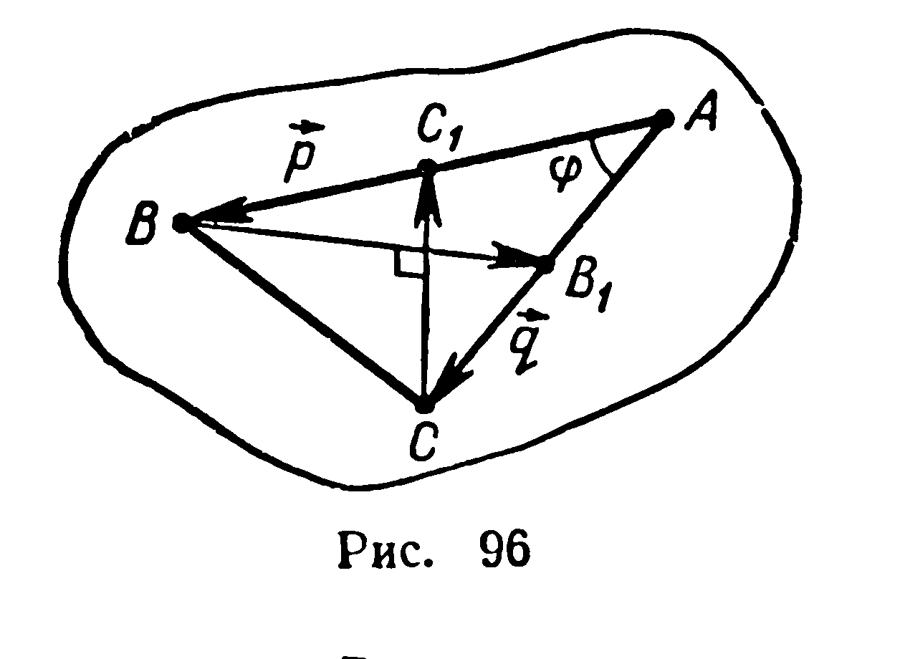
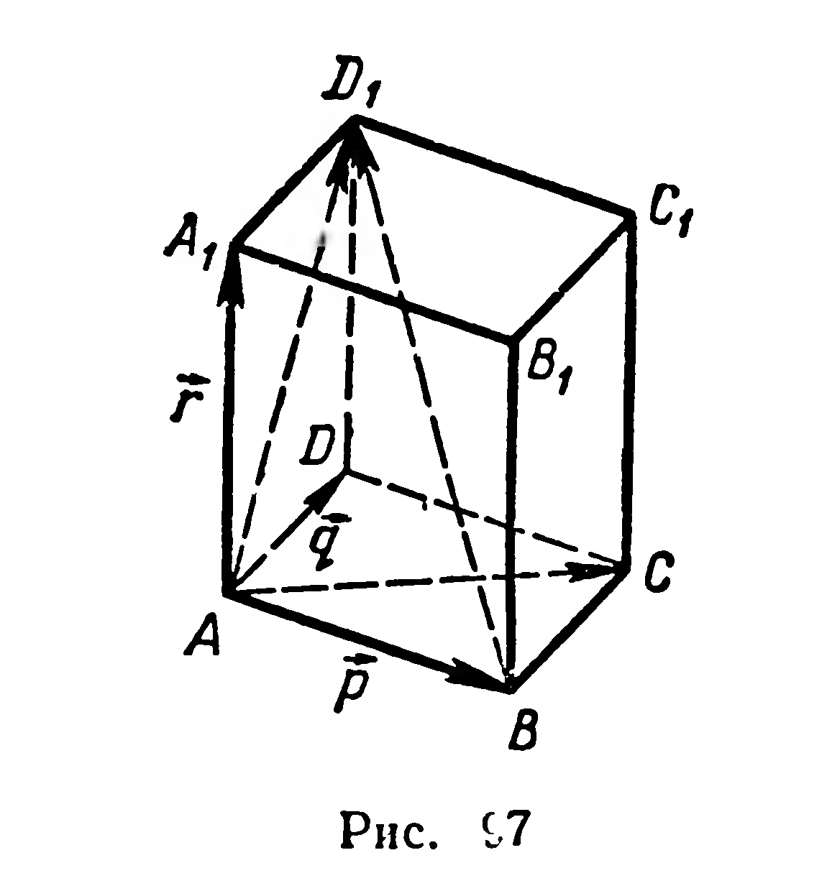
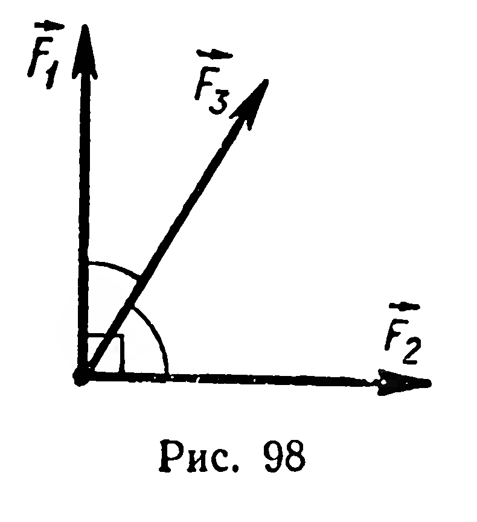
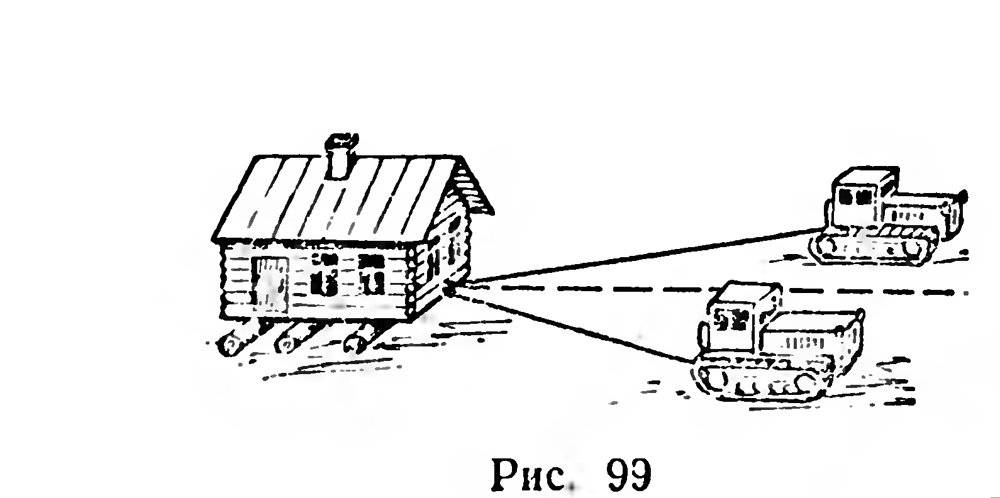

## 2.14. Применение векторов к решению задач

---
**стр. 60, продолжение**
---

### § 27. Применение векторов к решению задач

Векторные операции имеют вполне определённый геометрический смысл, поэтому они находят применение в геометрии. Многие векторные величины (скорость, ускорение, сила и др.) изучаются в физике. Это открывает возможность широкого применения векторов при изучении законов природы.

Скалярное произведение применяется при решении задач на вычисление длин отрезков и величин углов.

**Задача 1.** В равнобедренном треугольнике медианы, проведённые к боковым сторонам, взаимно перпендикулярны. Найти угол между боковыми сторонами этого треугольника.

Решение. Пусть в треугольнике $ABC$ $|AB|=|AC|$. Медианы $BB_1$ и $CC_1$ по условию перпендикулярны (рис. 96), поэтому

$$\overrightarrow{BB_1}\cdot\overrightarrow{CC_1}=0. \qquad (1)$$

---
**стр. 61**
---

Разложим векторы $\overrightarrow{BB_1}$ и $\overrightarrow{CC_1}$ по векторам $\vec p = \overrightarrow{AB}$ и $\vec q = \overrightarrow{AC}$. Имеем:

$$\overrightarrow{BB_1} = \overrightarrow{AB_1} - \overrightarrow{AB} = \frac12\vec q - \vec p,$$
$$\overrightarrow{CC_1} = \overrightarrow{AC_1} - \overrightarrow{AC} = \frac12\vec p - \vec q.$$

Из равенства (1) следует:

$$\left(\frac12\vec q - \vec p\right)\cdot\left(\frac12\vec p - \vec q\right) = 0,$$
$$\frac14\vec q\cdot\vec p - \frac12\vec q^2 - \frac12\vec p^2 + \vec p\cdot\vec q = 0,$$
$$\frac54\vec p\cdot\vec q - \frac12\vec q^2 - \frac12\vec p^2 = 0.$$

Обозначив $|\vec p| = |\vec q| = m$ и $(\vec p, \vec q) = \varphi$, воспользуемся определением скалярного произведения. Тогда получим:

$$\frac54 m^2\cos\varphi - m^2 = 0,$$

отсюда $\cos\varphi = 0{,}8$; $\varphi \approx 37^\circ$.

Задача 2. В параллелепипеде $ABCDA_1B_1C_1D_1$ (рис. 97) грань $ABCD$ — квадрат со стороной $a$; ребро $AA_1$ также равно $a$ и образует с рёбрами $AB$ и $AD$ углы, равные $\alpha$. Найти длину диагонали $BD_1$ и угол между прямыми $BD_1$ и $AC$.

Решение. Найдём длину диагонали $BD_1$. Разложим вектор $\overrightarrow{BD_1}$ по векторам $\vec p = \overrightarrow{AB}$, $\vec q = \overrightarrow{AD}$, $\vec r = \overrightarrow{AA_1}$.

Имеем: $\overrightarrow{BD_1} = \overrightarrow{AD_1} - \overrightarrow{AB} = (\vec r + \vec q) - \vec p = \vec r + \vec q - \vec p$. Тогда

$$|\overrightarrow{BD_1}|^2 = \overrightarrow{BD_1}^2 = (\vec r + \vec q - \vec p)^2 = \vec r^2 + \vec q^2 + \vec p^2 + 2\vec r\cdot\vec q - 2\vec r\cdot\vec p - 2\vec q\cdot\vec p =$$
$$= a^2 + a^2 + a^2 + 2a^2\cos\alpha - 2a^2\cos\alpha - 2a^2\cos 90^\circ = 3a^2; \text{ отсюда}$$

$$|BD_1| = a\sqrt{3}.$$

Угол $\varphi$ между прямыми $BD_1$ и $AC$ найдём, пользуясь определением скалярного произведения двух векторов:

$$\cos\varphi = \frac{|\overrightarrow{BD_1}\cdot\overrightarrow{AC}|}{|\overrightarrow{BD_1}|\cdot|\overrightarrow{AC}|}.$$

Знак модуля в числителе поставлен потому, что $\varphi \le 90^\circ$ (§ 24), и, следовательно, $\cos\varphi \ge 0$. Находим:

$$\overrightarrow{BD_1}\cdot\overrightarrow{AC} = (\vec r + \vec q - \vec p)\cdot(\vec p + \vec q) = \vec r\cdot\vec p + \vec q\cdot\vec p - \vec p^2 +$$
$$+ \vec r\cdot\vec q + \vec q^2 - \vec p\cdot\vec q = 2a^2\cos\alpha.$$

Тогда

$$\cos\varphi = \frac{|2a^2\cos\alpha|}{a\sqrt{3}\,a\sqrt{2}} = \sqrt{\frac{2}{3}}\,|\cos\alpha|.$$

---
**стр. 62**
---

## Задачи

**227.** Докажите, что длина медианы треугольника выражается через длины его сторон формулой:

$$m_a = \frac12\sqrt{2b^2+2c^2-a^2}.$$

**228.** На гипотенузе $AB$ прямоугольного треугольника $ABC$ взята точка $D$, удовлетворяющая условию $|BD|:|DA| = 3:1$. Выразите длину отрезка $CD$ через длины катетов $|CB| = a$ и $|CA| = b$.

**229.** В треугольнике $ABC$ длины сторон связаны соотношением $a^2+b^2 = 5c^2$. Докажите, что медианы, проведённые к сторонам $AC$ и $BC$, взаимно перпендикулярны.

**230*.** Найдите косинус угла между биссектрисой угла треугольника и противолежащей стороной, если отношение длин двух других сторон треугольника равно $3$, а угол между этими сторонами равен $\alpha$.

**231.** Дано: $|\vec a| = 2$, $|\vec b| = 1$, $(\vec a, \vec b) = 60^\circ$. Найдите косинус угла между векторами: 1) $\vec a$ и $\vec a+\vec b$; 2) $\vec b$ и $\vec a-\vec b$; 3) $\vec a+\vec b$ и $\vec a-\vec b$.

**232.** $ABCD$ — тетраэдр, в котором $|AB| = |AC| = a$ и $\widehat{DAB} = \widehat{DAC} = \varphi$. Докажите, что $(AD)\perp(BC)$.

**233.** 1) Три силы, приложенные к одной точке, образуют попарно углы, равные $\varphi$. Найдите величину равнодействующей, если величина каждой из данных сил равна $F$.

2) Найдите равнодействующую трёх сил по $10$ Н каждая, если силы приложены к одной точке и углы между силами $90^\circ$, $60^\circ$, $60^\circ$ (рис. 98).

**234.** Груз равномерно перемещают по горизонтальной плоскости с помощью двух канатов, один из которых образует угол $15^\circ$, а другой — $20^\circ$ с направлением движения (рис. 99). Сила натяжения каждого каната равна $50$ кН. Какую работу нужно затратить для перемещения груза на $100$ м? (Трением пренебрегаем.)

---
**стр. 63**
---

**235.** Докажите, что квадрат длины диагонали прямоугольного параллелепипеда равен сумме квадратов трёх его измерений.

**236.** Найдите углы между диагональю куба и диагоналями какой-либо его грани.

**237.** Все грани тетраэдра — равносторонние треугольники со стороной $a$. 1) Найдите длину отрезка, соединяющего вершину тетраэдра с точкой пересечения медиан противолежащей грани. 2) Найдите расстояние между серединами противолежащих рёбер тетраэдра. 3) Докажите, что прямая, проходящая через середины противолежащих рёбер тетраэдра, перпендикулярна каждому из этих рёбер.

**238.** Докажите, что если два пересекающихся ребра тетраэдра соответственно перпендикулярны противолежащим им рёбрам, то остальные два противолежащих ребра также перпендикулярны.

**239.** Через точку, взятую на прямой, проведены три прямые, каждая из которых перпендикулярна данной прямой. Докажите, что проведённые прямые лежат в одной плоскости.
