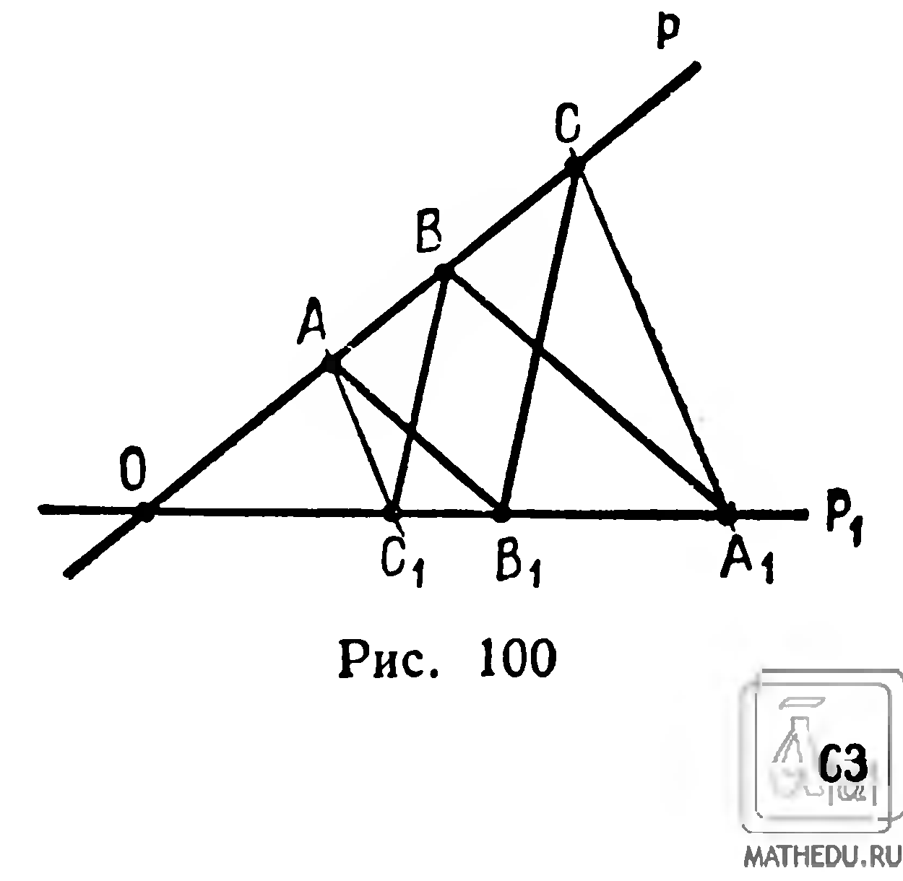
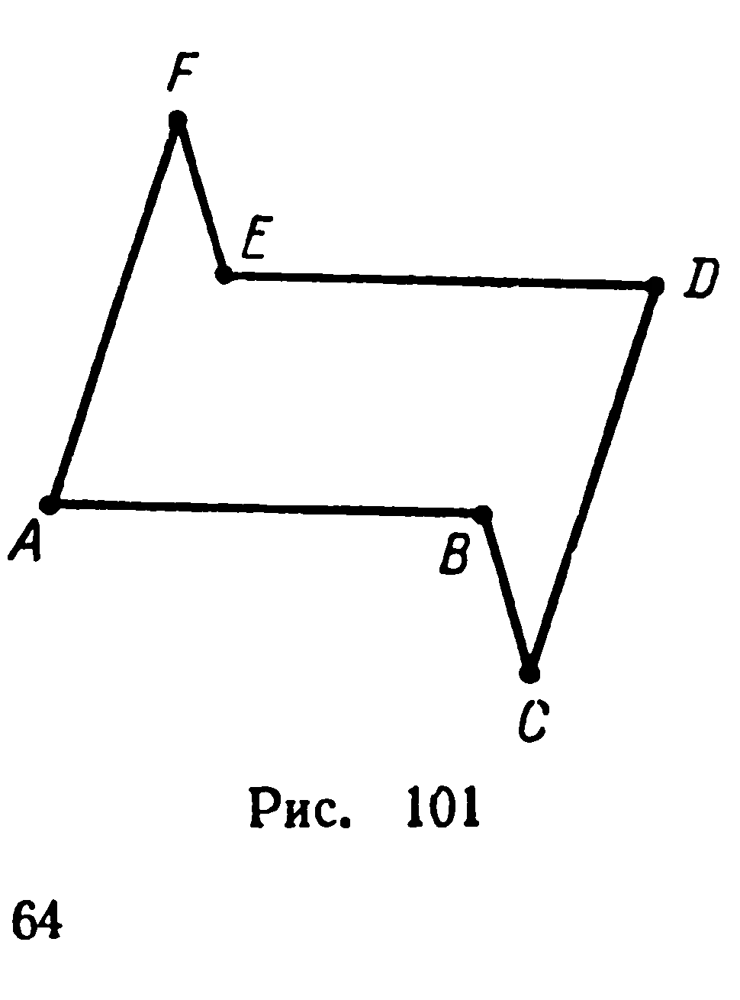
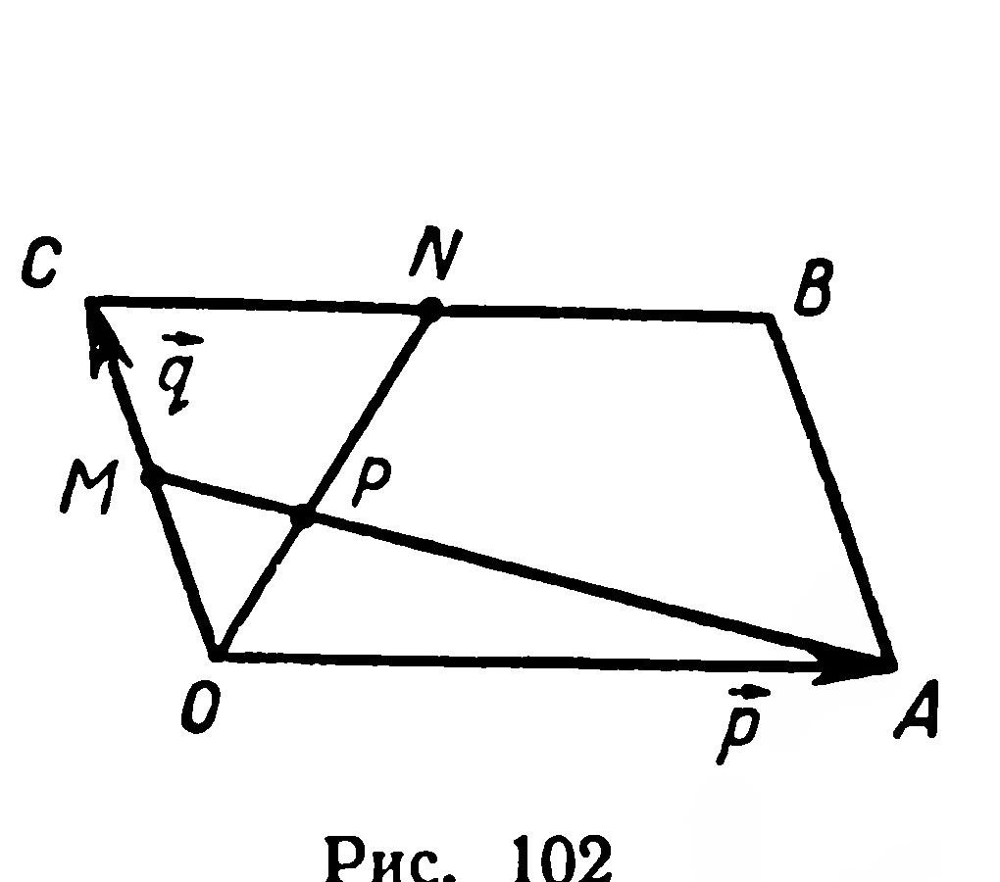

## 2.15. Задачи на повторение к главе II

---
**стр. 63**
---

**235.** Докажите, что квадрат длины диагонали прямоугольного параллелепипеда равен сумме квадратов трёх его измерений.

**236.** Найдите углы между диагональю куба и диагоналями какой-либо его грани.

**237.** Все грани тетраэдра — равносторонние треугольники со стороной $a$. 1) Найдите длину отрезка, соединяющего вершину тетраэдра с точкой пересечения медиан противолежащей грани. 2) Найдите расстояние между серединами противолежащих рёбер тетраэдра. 3) Докажите, что прямая, проходящая через середины противолежащих рёбер тетраэдра, перпендикулярна каждому из этих рёбер.

**238.** Докажите, что если два пересекающихся ребра тетраэдра соответственно перпендикулярны противолежащим им рёбрам, то остальные два противолежащих ребра также перпендикулярны.

**239.** Через точку, взятую на прямой, проведены три прямые, каждая из которых перпендикулярна данной прямой. Докажите, что проведённые прямые лежат в одной плоскости.

## Задачи на повторение к главе II

**240.** Докажите: $||\vec{a}| - |\vec{b}|| \leqslant |\vec{a} + \vec{b}| \leqslant |\vec{a}| + |\vec{b}|$. При каком условии выполняется равенство?

**241.** Докажите, что если $\overrightarrow{OA} + \overrightarrow{OC} = \overrightarrow{OB} + \overrightarrow{OD}$, то отрезки $AB$ и $CD$ симметричны относительно некоторой точки.

**242.** Неколлинеарные векторы $\vec{a}$ и $\vec{b}$ имеют равные длины. Докажите, что векторы $\vec{a} + \vec{b}$ и $\vec{a} - \vec{b}$ взаимно перпендикулярны.

**243.** 1) Сумма трёх попарно неколлинеарных сил, приложенных к одной точке, равна нулю. Докажите, что точка приложения является точкой пересечения медиан треугольника с вершинами в концах направленных отрезков, изображающих данные силы.

2) Может ли равнодействующая сил Лебедя, Рака и Щуки (из басни И. А. Крылова) быть равной нулю?

**244.** У правильного пятиугольника $A_1A_2A_3A_4A_5$ сторона равна $a$. Обозначив буквой $O$ центр этого пятиугольника, найдите длины векторов:

1) $\overrightarrow{OA_1} + \overrightarrow{OA_2}$; 2) $\overrightarrow{OA_1} + \overrightarrow{OA_3}$.

**245.** Прямые $p$ и $p_1$ пересекаются в точке $O$ (рис. 100). На прямой $p$ даны точки $A$, $B$, $C$ и для них построены на прямой $p_1$ точки $A_1$, $B_1$, $C_1$ так, что $(AB_1) \parallel (A_1B)$, $(BC_1) \parallel (B_1C)$. Доказать, что $(AC_1) \parallel (A_1C)$.

Решение. Из условия задачи и теоремы о пропорциональных

---
**стр. 64**
---

отрезках, известной из планиметрии, следует:

$$\overrightarrow{OB} = k\overrightarrow{OA},\quad \overrightarrow{OA_1} = k\overrightarrow{OB_1},\quad \overrightarrow{OC} = l\overrightarrow{OB},\quad \overrightarrow{OB_1} = l\overrightarrow{OC_1}.$$

Исключим векторы $\overrightarrow{OB}$ и $\overrightarrow{OB_1}$: $\overrightarrow{OC} = l(k\overrightarrow{OA}) = lk\overrightarrow{OA}$, $\overrightarrow{OA_1} = k(l\overrightarrow{OC_1}) =$
$= kl\overrightarrow{OC_1}$. Отсюда $(\overrightarrow{OC} - \overrightarrow{OA_1} = kl(\overrightarrow{OA} - \overrightarrow{OC_1})) \Longrightarrow (\overrightarrow{A_1C} = kl\overrightarrow{C_1A}) \Longrightarrow$
$\Longrightarrow ((\overrightarrow{A_1C}) \parallel (\overrightarrow{C_1A}))$. ■

**246.** Докажите, что три вектора компланарны, если два из них коллинеарны.

**247.** Точка $A$ — общая вершина параллелограммов $ABCD$ и $AB_1C_1D_1$. Докажите компланарность векторов $\overrightarrow{BB_1}$, $\overrightarrow{CC_1}$, $\overrightarrow{DD_1}$.

**248.** Точки пересечения медиан треугольников $ABC$ и $A_1B_1C_1$ совпадают. Докажите, что векторы $\overrightarrow{AA_1}$, $\overrightarrow{BB_1}$, $\overrightarrow{CC_1}$ компланарны.

**249.** Точки $A_1$, $A_2$, $A_3$ делят отрезок $A_0A_4$ на четыре отрезка равной длины. Выбрав точку $O$ вне прямой $A_0A_4$, разложите по векторам $\vec{p} = \overrightarrow{OA_1}$ и $\vec{q} = \overrightarrow{OA_4}$ векторы: 1) $\overrightarrow{OA_0}$; 2) $\overrightarrow{OA_2}$; 3) $\overrightarrow{OA_3}$.

**250.** Для точек $A$, $B$, $C$, не принадлежащих прямой, выполняются равенства: $\overrightarrow{OA} - \overrightarrow{OB} = \overrightarrow{OC_1}$, $\overrightarrow{OB} - \overrightarrow{OC} = \overrightarrow{OA_1}$, $\overrightarrow{OC} - \overrightarrow{OA} = \overrightarrow{OB_1}$. Докажите, что медианы треугольника $A_1B_1C_1$ пересекаются в точке $O$.

**251.** Даны два параллелограмма $ABCD$ и $A_1B_1C_1D_1$, у которых $O$ и $O_1$ — точки пересечения диагоналей. Докажите равенство:

$$\overrightarrow{OO_1} = \frac{1}{4}(\overrightarrow{AA_1} + \overrightarrow{BB_1} + \overrightarrow{CC_1} + \overrightarrow{DD_1}).$$

**252\*.** Для данной неплоской замкнутой ломаной, состоящей из шести звеньев, построены два треугольника, вершинами каждого из которых служат середины несмежных звеньев. Докажите, что точки пересечения медиан этих треугольников совпадают.

**253\*.** Дана замкнутая неплоская ломаная с шестью звеньями. Доказать, что если противолежащие звенья ломаной попарно параллельны, то длины их попарно равны.

Решение. Дано: $[AB] \parallel [DE]$, $[BC] \parallel [EF]$, $[CD] \parallel [FA]$ (рис. 101).

Доказать: $|AB| = |DE|$, $|BC| =$
$= |EF|$, $|CD| = |FA|$.

Доказательство. Согласно условию задачи имеем:

$$\overrightarrow{DE} = k\overrightarrow{AB},\quad \overrightarrow{EF} = l\overrightarrow{BC},\quad \overrightarrow{FA} = m\overrightarrow{CD}.$$

По правилу сложения векторов

$$\overrightarrow{AB} + \overrightarrow{BC} + \overrightarrow{CD} + \overrightarrow{DE} + \overrightarrow{EF} + \overrightarrow{FA} = \vec{0}.$$

---
**стр. 65**
---

Отсюда получаем:
$$\overrightarrow{AB} + \overrightarrow{BC} + \overrightarrow{CD} + k\overrightarrow{AB} + l\overrightarrow{BC} + m\overrightarrow{CD} = \vec 0,$$
или
$$(k+1)\overrightarrow{AB} + (l+1)\overrightarrow{BC} + (m+1)\overrightarrow{CD} = \vec 0.$$

Векторы $\overrightarrow{AB}$, $\overrightarrow{BC}$, $\overrightarrow{CD}$ не компланарны (иначе данная ломаная была бы плоской), следовательно, коэффициенты в разложении нулевого вектора по векторам $\overrightarrow{AB}$, $\overrightarrow{BC}$, $\overrightarrow{CD}$ равны нулю:
$$k = -1,\ l = -1,\ m = -1.$$

Отсюда $\overrightarrow{DE} = -\overrightarrow{AB}$, $\overrightarrow{EF} = -\overrightarrow{BC}$, $\overrightarrow{FA} = -\overrightarrow{CD}$ и, следовательно,
$$|DE| = |AB|,\ |EF| = |BC|,\ |FA| = |CD|.$$

**254***. Доказать, что при произвольном выборе точки $O$ равенство
$$\overrightarrow{OC} = k\overrightarrow{OA} + (1-k)\overrightarrow{OB} \qquad (1)$$
является необходимым и достаточным условием принадлежности различных точек $A$, $B$, $C$ одной прямой.

Решение. 1) Достаточность. Пусть выполняется равенство (1). Из него находим, что $\overrightarrow{OC} - \overrightarrow{OB} = k(\overrightarrow{OA} - \overrightarrow{OB})$, отсюда по формуле вычитания векторов $\overrightarrow{BC} = k\overrightarrow{BA}$. Следовательно, векторы $\overrightarrow{BC}$ и $\overrightarrow{BA}$ коллинеарны, а точки $A$, $B$, $C$ принадлежат одной прямой.

2) Необходимость. Если точки $A$, $B$, $C$ принадлежат прямой, то $\overrightarrow{BC}$ и $\overrightarrow{BA}$ коллинеарны, поэтому $\overrightarrow{BC} = k\overrightarrow{BA}$. Применим формулу вычитания векторов: $\overrightarrow{OC} - \overrightarrow{OB} = k(\overrightarrow{OA} - \overrightarrow{OB})$, или $\overrightarrow{OC} = k\overrightarrow{OA} + (1-k)\overrightarrow{OB}$.

**255.** В параллелограмме $OABC$ точки $M$ и $N$ — середины сторон $OC$ и $CB$ (рис. 102). Найти отношение: 1) $x = |OP| : |ON|$, где $P = [ON] \cap [AM]$; 2) $y = |AP| : |AM|$.

Решение. 1) Пусть $\overrightarrow{OA} = \vec p$ и $\overrightarrow{OC} = \vec q$. По условию задачи $\overrightarrow{OP} = x\overrightarrow{ON} = x\left(\vec q + \frac{1}{2}\vec p\right)$. Для точек $P, M, A$ применим условие принадлежности трех точек одной прямой (задача 254). Тогда получим: $\overrightarrow{OP} = k\overrightarrow{OM} + (1-k)\overrightarrow{OA} = \frac{k}{2}\vec q + (1-k)\vec p$. Следовательно,

---
**стр. 66**
---

$$x\left(\vec q + \frac{1}{2}\vec p\right) = \frac{k}{2}\vec q + (1-k)\vec p,$$
или
$$x\vec q + \frac{x}{2}\vec p = \frac{k}{2}\vec q + (1-k)\vec p.$$

Пользуясь однозначностью разложения вектора по двум неколлинеарным векторам, можно записать: $x = \frac{k}{2}$ и $\frac{x}{2} = 1 - k$. Отсюда $x = \frac{2}{5}$.

**256.** На сторонах треугольника заданы точки, которые делят стороны в одном и том же отношении (в каком-либо одном направлении его обхода). Докажите, что точки пересечения медиан данного треугольника и треугольника, имеющего вершинами точки деления, совпадают.

**257.** Стороны параллелограмма разделены по его обходу в равных отношениях. Докажите, что точки деления служат вершинами параллелограмма, а центры симметрии этих параллелограммов совпадают.

**258.** Квадраты $OABC$ и $OA_1B_1C_1$ лежат в одной плоскости и имеют противоположные направления обхода. Докажите, что длина отрезка $CC_1$ равна удвоенной длине медианы треугольника $OAA_1$, проведенной из вершины $O$.

**259.** Дана неплоская замкнутая ломаная $ABCDA$, у которой $|AD| = a$, $|BC| = b$, $(\overrightarrow{AD}, \overrightarrow{BC}) = \varphi$. Найдите расстояние: 1) между серединами звеньев $AB$ и $CD$; 2) между серединами отрезков $AC$ и $BD$.

**260.** Из точки $O$, не принадлежащей прямой $a$, проведен к $a$ перпендикуляр $[OA]$; $M \in a$. Докажите, что скалярное произведение $\overrightarrow{OA} \cdot \overrightarrow{OM}$ не зависит от положения точки $M$ на прямой $a$.

**261.** Даны скрещивающиеся прямые $a$ и $b$. На прямой $a$ взяты точки $A_1$, $A_2$, $A_3$, из этих точек проведены перпендикуляры $[A_1B_1]$, $[A_2B_2]$, $[A_3B_3]$ к прямой $b$. Докажите, что $\frac{|A_1A_2|}{|A_2A_3|} = \frac{|B_1B_2|}{|B_2B_3|}$, если прямые $a$ и $b$ не перпендикулярны.
