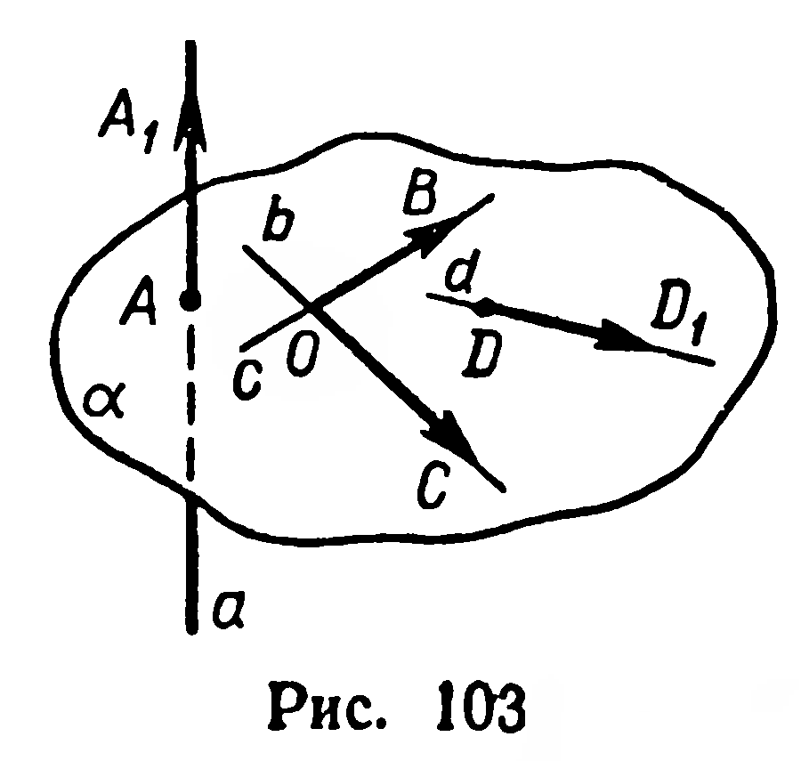
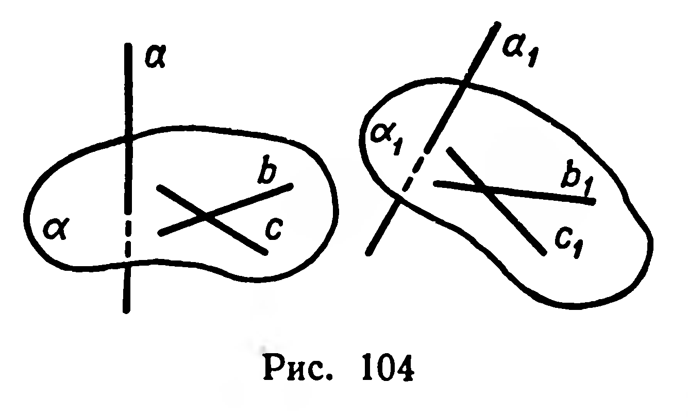
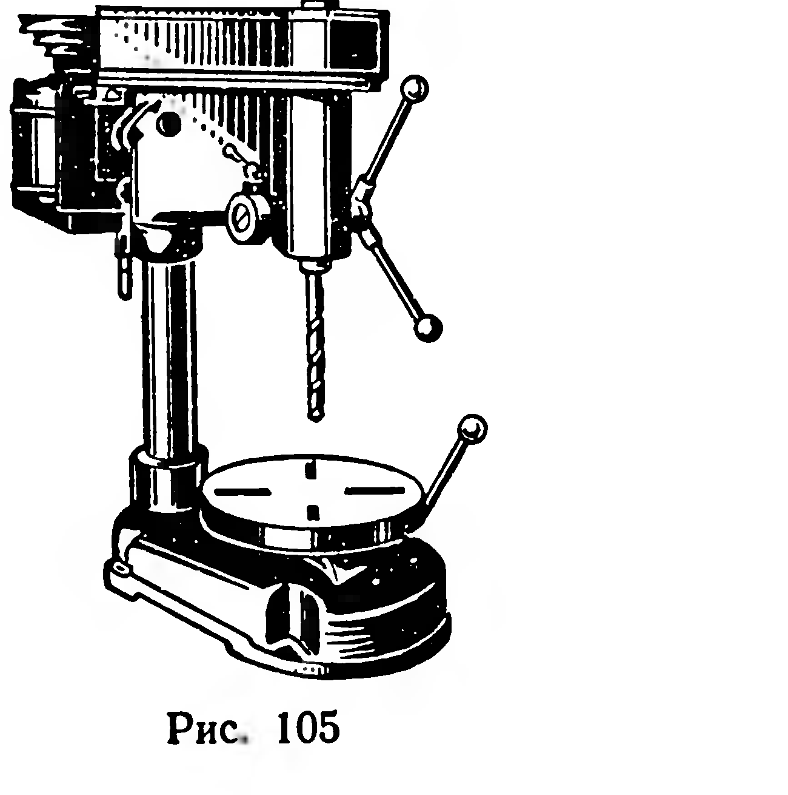
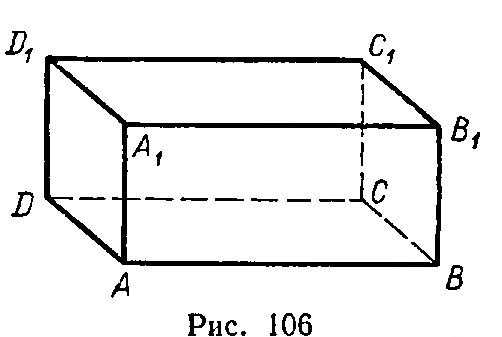

## 3.1. Признак перпендикулярности прямой и плоскости

---
**стр. 67**
---

# Глава III. Перпендикулярность в пространстве. Двугранные и многогранные углы

## § 28. Признак перпендикулярности прямой и плоскости

Перпендикулярность прямых в пространстве была рассмотрена в предыдущей главе (§ 24).

**Определение.** Прямая и плоскость называются взаимно перпендикулярными, если прямая перпендикулярна каждой прямой, лежащей в плоскости.

Обозначение перпендикулярности прямой $a$ и плоскости $\alpha$: $a \perp \alpha$ или $\alpha \perp a$ (рис. 103).

Из определения вытекает, что перпендикулярные прямая и плоскость пересекаются.

**14. Теорема** (признак перпендикулярности прямой и плоскости). *Если прямая перпендикулярна каждой из двух пересекающихся прямых, лежащих в плоскости, то прямая и плоскость взаимно перпендикулярны.*

**Дано:** $a \perp b$, $a \perp c$, $b \cap c = O$, $b \subset \alpha$, $c \subset \alpha$ (рис. 103).

**Доказать:** $a \perp \alpha$.

**Доказательство.** Убедимся, что прямая $a$ перпендикулярна к любой прямой $d$, лежащей в плоскости $\alpha$. На прямых $b$ и $c$ выберем соответственно точки $B$ и $C$, отличные от точки $O$; на прямых $a$ и $d$ выберем пары несовпадающих точек $A$ и $A_1$, $D$ и $D_1$. Разложим вектор $\overrightarrow{DD_1}$ по неколлинеарным векторам $\overrightarrow{OB}$ и $\overrightarrow{OC}$ (§ 21):

$$\overrightarrow{DD_1} = x\overrightarrow{OB} + y\overrightarrow{OC}. \tag{1}$$

Обе части равенства (1) умножим скалярно на вектор $\overrightarrow{AA_1}$. Согласно распределительному закону скалярного умножения (§ 26), получим:

$$\overrightarrow{DD_1} \cdot \overrightarrow{AA_1} = x\overrightarrow{OB} \cdot \overrightarrow{AA_1} + y\overrightarrow{OC} \cdot \overrightarrow{AA_1}.$$

Но $\overrightarrow{OB} \cdot \overrightarrow{AA_1} = \overrightarrow{OC} \cdot \overrightarrow{AA_1} = 0$, так как $\overrightarrow{AA_1} \perp \overrightarrow{OB}$ и $\overrightarrow{AA_1} \perp \overrightarrow{OC}$. Тогда $\overrightarrow{DD_1} \cdot \overrightarrow{AA_1} = 0$, откуда $\overrightarrow{AA_1} \perp \overrightarrow{DD_1}$ и $a \perp d$. По определению перпендикулярности прямой и плоскости $a \perp \alpha$. ■

---
**стр. 68**
---

**Следствие.** *Перемещение пространства сохраняет перпендикулярность прямой и плоскости.*

**Доказательство.** Пусть $a \perp \alpha$, $F(a) = a_1$, $F(\alpha) = \alpha_1$, где $F$ — любое перемещение (рис. 104). Докажем, что $a_1 \perp \alpha_1$. Проведём в плоскости $\alpha$ пересекающиеся прямые $b$ и $c$; их образами служат пересекающиеся прямые $b_1$ и $c_1$. Согласно определению перпендикулярности прямой и плоскости, $a \perp b$, $a \perp c$. Перемещение $F$ сохраняет угол между прямыми (§ 15), поэтому $a_1 \perp b_1$ и $a_1 \perp c_1$. Следовательно, $a_1 \perp \alpha_1$. ■

**Задачи**

**262.** Сторона $AB$ правильного треугольника $ABC$ лежит в плоскости $\alpha$. Может ли быть перпендикулярной к этой плоскости: 1) прямая $BC$; 2) прямая $CD$, где $D$ — середина $[AB]$?

**263°.** 1) На практике вертикальность установки столба проверяют, глядя на столб поочерёдно с двух направлений. Как обосновать правильность такой проверки?

2) При ремонте сверлильного станка (рис. 105) слесарь должен с помощью угольника выверить перпендикулярность оси сверла к плоскости стола, на котором крепится деталь. Как это сделать?

**264°.** На рисунке 106 изображён прямоугольный параллелепипед $ABCDA_1B_1C_1D_1$. Укажите, плоскостям каких граней перпендикулярны прямые: 1) $AA_1$; 2) $AB$; 3) $B_1C_1$.

**265.** 1) Ребро куба равно $a$. Найдите расстояния от точки пересечения диагоналей одной из граней до вершин противолежащей ей грани.

2) Известно, что диагональ $BD_1$ прямоугольного параллелепипеда $ABCDA_1B_1C_1D_1$ равна $a$, диагональ $AD_1$ грани равна $b$. Вычислите $|AB|$. Можно ли вычислить $|BC|$?

---
**стр. 69**
---

266. Прямые $a$, $b$, $c$ лежат в плоскости $\alpha$. Прямая $m$ перпендикулярна $a$ и $b$, но не перпендикулярна $c$. Каково взаимное расположение прямых $a$ и $b$?

267. Дано: $a \perp b$, $a \perp c$, $b \cup c \subset \alpha$. Верно ли утверждение, что $a \perp \alpha$?

268. Верно ли утверждение, что прямая перпендикулярна плоскости, если она перпендикулярна лежащим в этой плоскости: 1) двум сторонам треугольника; 2) двум сторонам трапеции; 3) двум диаметрам круга; 4) двум диагоналям правильного шестиугольника?

269. Является ли условие перпендикулярности прямой и плоскости, указанное в теореме 14, только достаточным или также необходимым?

270. Дано: $a \parallel \alpha$, $b \perp a$. Верно ли утверждение, что $b \perp \alpha$?
