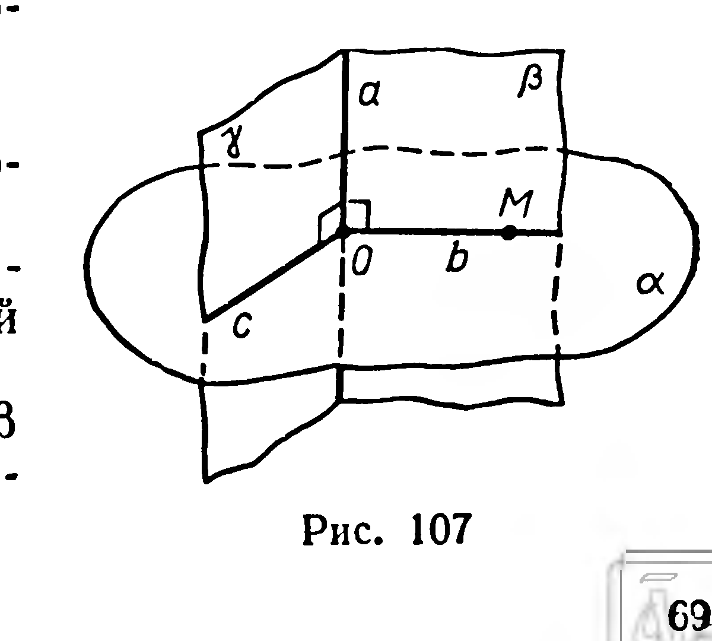
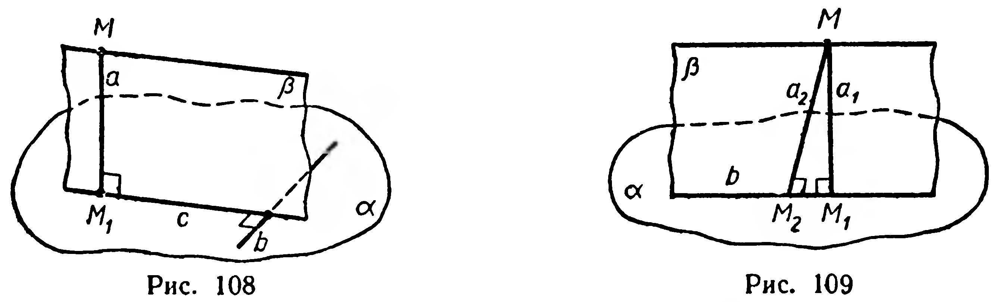
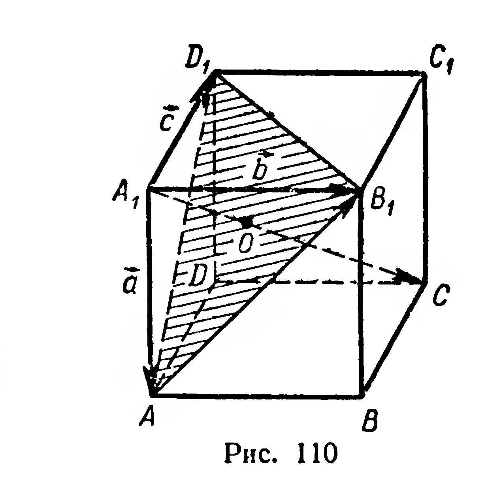
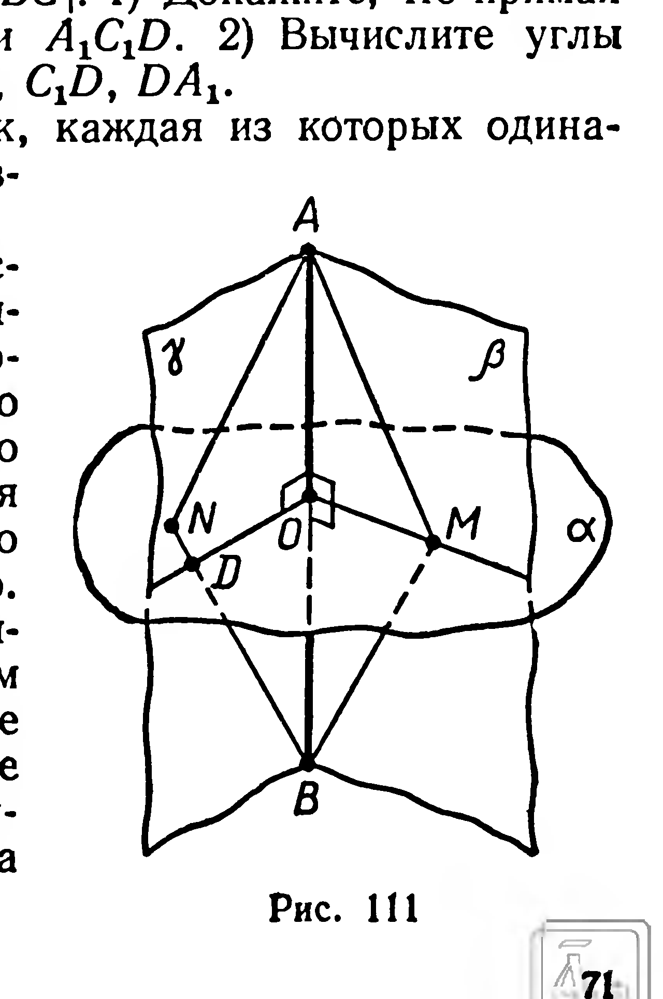

## 3.2. Проведение перпендикуляра к плоскости

---
**стр. 69**
---

266. Прямые $a$, $b$, $c$ лежат в плоскости $\alpha$. Прямая $m$ перпендикулярна $a$ и $b$, но не перпендикулярна $c$. Каково взаимное расположение прямых $a$ и $b$?

267. Дано: $a \perp b$, $a \perp c$, $b \cup c \subset \alpha$. Верно ли утверждение, что $a \perp \alpha$?

268. Верно ли утверждение, что прямая перпендикулярна плоскости, если она перпендикулярна лежащим в этой плоскости: 1) двум сторонам треугольника; 2) двум сторонам трапеции; 3) двум диаметрам круга; 4) двум диагоналям правильного шестиугольника?

269. Является ли условие перпендикулярности прямой и плоскости, указанное в теореме 14, только достаточным или также необходимым?

270. Дано: $a \parallel \alpha$, $b \perp a$. Верно ли утверждение, что $b \perp \alpha$?

**§ 29. Проведение перпендикуляра к плоскости**

**Задача 1.** Через данную точку провести плоскость, перпендикулярную данной прямой.

Решение. 1) Данная точка $M$ не принадлежит данной прямой $a$ (рис. 107).

Через данную прямую $a$ проведем две различные плоскости: плоскость $\beta$, проходящую через данную точку $M$, и произвольную плоскость $\gamma$. В плоскости $\beta$ через точку $M$ проводим прямую $b$, перпендикулярную $a$. Пусть $b \cap a = O$. В плоскости $\gamma$ через точку $O$ проводим $c \perp a$. Через прямые $b$ и $c$ проведем плоскость $\alpha$. Эта плоскость перпендикулярна прямой $a$ согласно признаку перпендикулярности прямой и плоскости.

2) Пусть данная точка принадлежит прямой $a$ (точка $O$ на рисунке 107). В этом случае обе различные вспомогательные плоскости $\beta$ и $\gamma$ проводим произвольно через прямую $a$. Дальнейшее решение выполняется так же, как и в пункте 1.

В обоих случаях задача имеет единственное решение (доказательство можно провести методом от противного).

**Задача 2.** Через данную точку провести прямую, перпендикулярную данной плоскости.

Решение. Пусть даны точка $M$ и плоскость $\alpha$ (рис. 108). Искомую прямую нужно провести так, чтобы она была перпендикулярна двум пересекающимся прямым данной плоскости.

1) Проведем на плоскости $\alpha$ произвольную прямую $b$.

2) Через точку $M$ проведем плоскость $\beta$, перпендикулярную прямой $b$ (задача 1). Пусть $\alpha \cap \beta = c$.

3) Через точку $M$ в плоскости $\beta$ проведем прямую $a$, перпендикулярную прямой $c$.

---
**стр. 70**
---

Прямая $a$ искомая. Действительно, так как $b \perp \beta$, то $b \perp a$; кроме того, $a \perp c$. Следовательно, $a \perp \alpha$ (§ 28, признак).

Докажем единственность решения задачи. Допустим, что через точку $M$ проведены две различные прямые $a_1$ и $a_2$, перпендикулярные плоскости $\alpha$ (рис. 109). Через $a_1$ и $a_2$ проведем плоскость $\beta$, она пересекает $\alpha$ по прямой $b$. Тогда в плоскости $\beta$ проведены две различные прямые $a_1$ и $a_2$, перпендикулярные прямой $b$. Получено противоречие с теоремой, известной из планиметрии. Значит, наше допущение неверно.

Итак, *через данную точку можно провести одну и только одну прямую, перпендикулярную данной плоскости.*

Прямую, перпендикулярную плоскости, будем кратко называть **перпендикуляром** к этой плоскости. Прямую, пересекающую плоскость, но не перпендикулярную к ней, называют **наклонной** к плоскости.

**Задачи**

271. На ребре $AB$ прямоугольного параллелепипеда $ABCDA_1B_1C_1D_1$ дана точка $M$. Постройте сечение параллелепипеда плоскостью, проходящей через $M$ и перпендикулярной прямой $AB$.

272. Даны куб $ABCDA_1B_1C_1D_1$ и точка $M$, принадлежащая отрезку $AC$, причем $|AM| : |MC| = 2 : 1$. Постройте сечение куба плоскостью, проходящей через $M$ и перпендикулярной прямой $AC$.

273. Все ребра тетраэдра $ABCD$ имеют равные длины. 1) Постройте сечение, содержащее данную точку $M$ ребра $AD$ и перпендикулярное этому ребру. 2) Вычислите площадь сечения, если длины ребер равны $a$ и $|AM| : |MD| = 3 : 1$.

274. Три параллельные прямые $a$, $b$, $c$ не лежат в одной плоскости. Через точку $M$, принадлежащую прямой $a$, проведены перпендикуляры к прямым $b$ и $c$, пересекающие их соответственно в точках $P$ и $Q$. Докажите, что прямая $PQ$ перпендикулярна прямым $b$ и $c$.

275. Из точки $O$ пересечения диагоналей параллелограмма $ABCD$ проведен отрезок $OM$ так, что $|MA| = |MC|$ и $|MB| = |MD|$. Докажите, что прямая $OM$ перпендикулярна плоскости параллелограмма.

---
**стр. 71**
---

276. Дан куб $ABCDA_1B_1C_1D_1$. Докажите, что прямая $AC$ перпендикулярна плоскости сечения $BDD_1B_1$.

277. Доказать, что плоскость, проходящая через концы трёх рёбер куба, имеющих общую точку, перпендикулярна диагонали куба, выходящей из этой точки.

Решение. Рассмотрим в кубе $ABCDA_1B_1C_1D_1$ диагональ $A_1C$ и сечение $AB_1D_1$ (рис. 110). Требуется доказать, что $(A_1C)\perp(AB_1D_1)$. Для этого достаточно установить, что $(A_1C)\perp(AB_1)$, $(A_1C)\perp(AD_1)$.

Разложим векторы $\overrightarrow{A_1C}$ и $\overrightarrow{AB_1}$ по векторам $\overrightarrow{A_1A}=\vec a$, $\overrightarrow{A_1B_1}=\vec b$, $\overrightarrow{A_1D_1}=\vec c$:

$$\overrightarrow{A_1C}=\vec a+\vec b+\vec c;\quad \overrightarrow{AB_1}=\overrightarrow{A_1B_1}-\overrightarrow{A_1A}=\vec b-\vec a.$$

Тогда $\overrightarrow{A_1C}\cdot\overrightarrow{AB_1}=(\vec a+\vec b+\vec c)\cdot(\vec b-\vec a)=\vec b^2-\vec a^2+\vec b\cdot\vec c-\vec a\cdot\vec c$.

Так как $\vec b\perp\vec c$ и $\vec a\perp\vec c$, то $\vec b\cdot\vec c=\vec a\cdot\vec c=0$, поэтому $\overrightarrow{A_1C}\cdot\overrightarrow{AB_1}=\vec b^2-\vec a^2=|A_1B_1|^2-|A_1A|^2=0$.

Отсюда $(A_1C)\perp(AB_1)$. Аналогично доказывается, что $(A_1C)\perp(AD_1)$.

Следовательно, $(A_1C)\perp(AB_1D_1)$. ■

278. Дан прямоугольный параллелепипед $ABCDA_1B_1C_1D_1$, у которого $|AB|=2|BC|$, $|AA_1|=|BC|$. 1) Докажите, что прямая $BD_1$ не перпендикулярна плоскости $A_1C_1D$. 2) Вычислите углы между прямой $BD_1$ и прямыми $A_1C_1$, $C_1D$, $DA_1$.

279. Найти множество всех точек, каждая из которых одинаково удалена от двух данных несовпадающих точек $A$ и $B$.

Решение. В планиметрии искомым множеством служит серединный перпендикуляр к отрезку $AB$. Поэтому естественно предположить, что для пространства искомое множество есть плоскость $\alpha$, перпендикулярная отрезку $AB$ и проходящая через его середину $O$ (рис. 111). Докажем это.

1) Произвольную точку $M$, принадлежащую плоскости $\alpha$, соединим с точками $A$, $B$, $O$. Прямоугольные треугольники $AOM$ и $BOM$, лежащие в одной плоскости $(ABM)=\beta$, конгруэнтны (по двум катетам), отсюда $|MA|=|MB|$.

