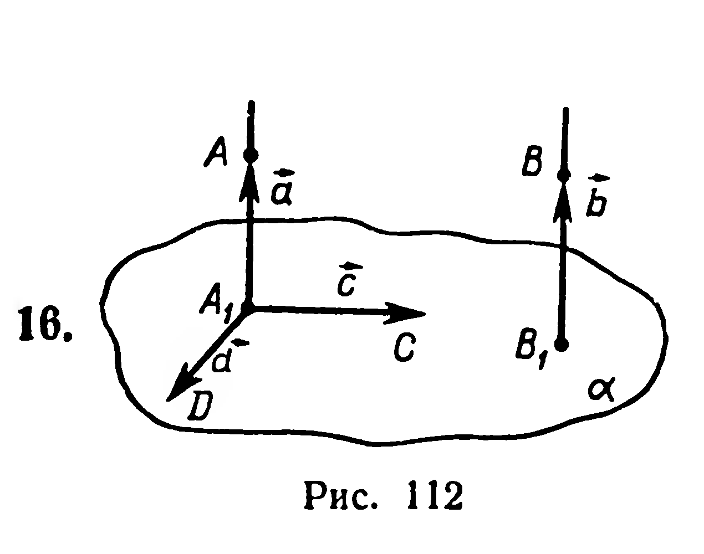
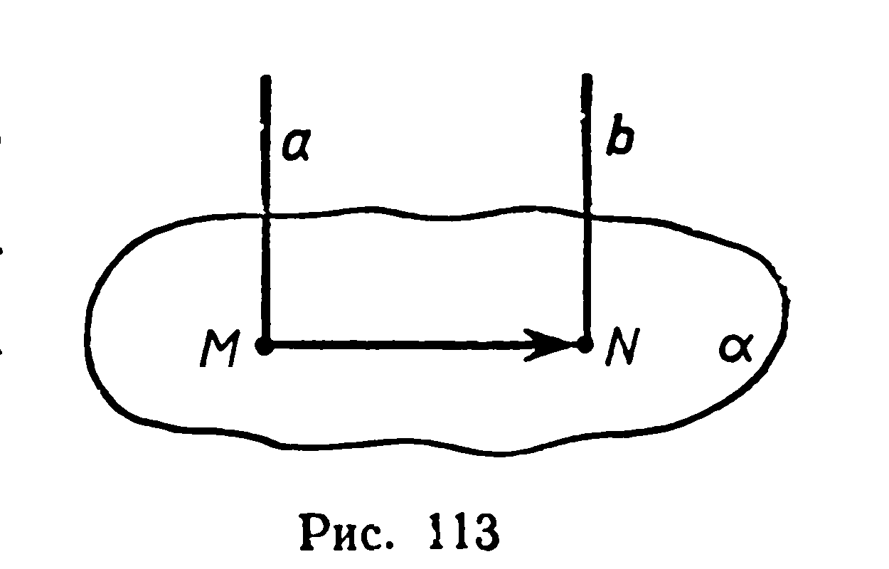
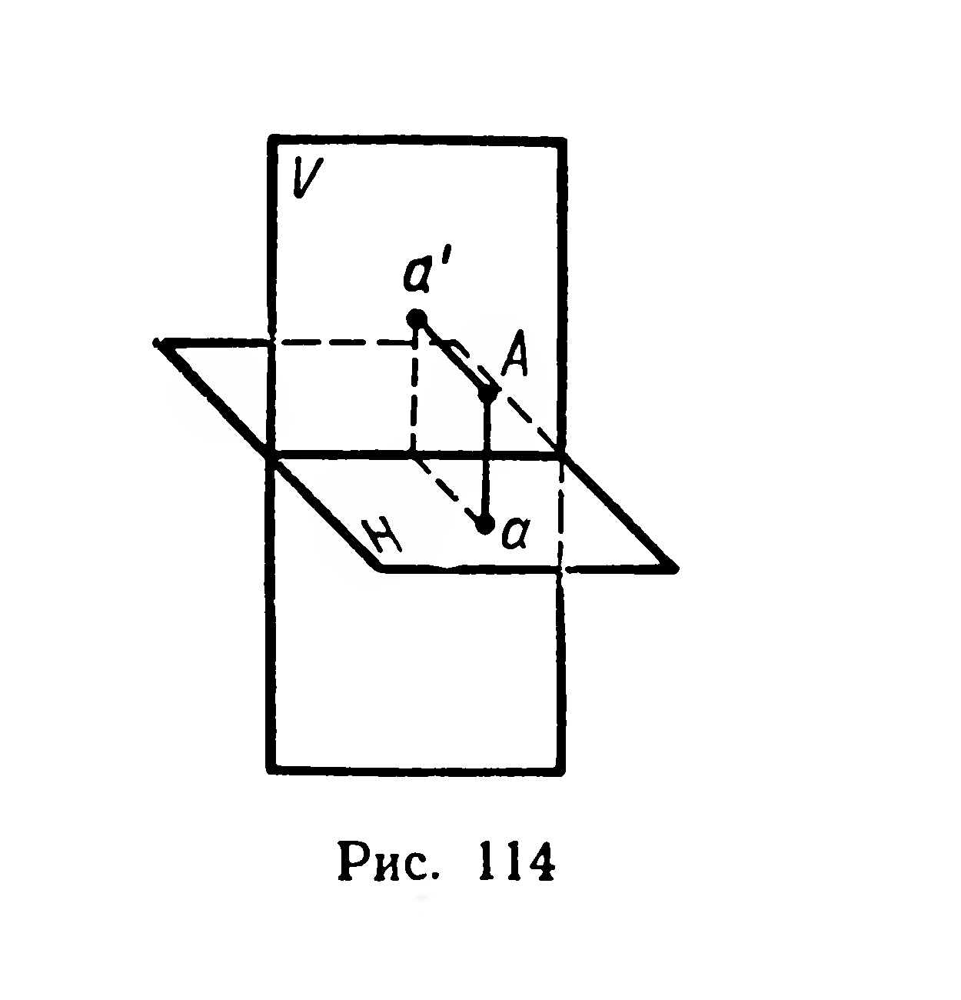
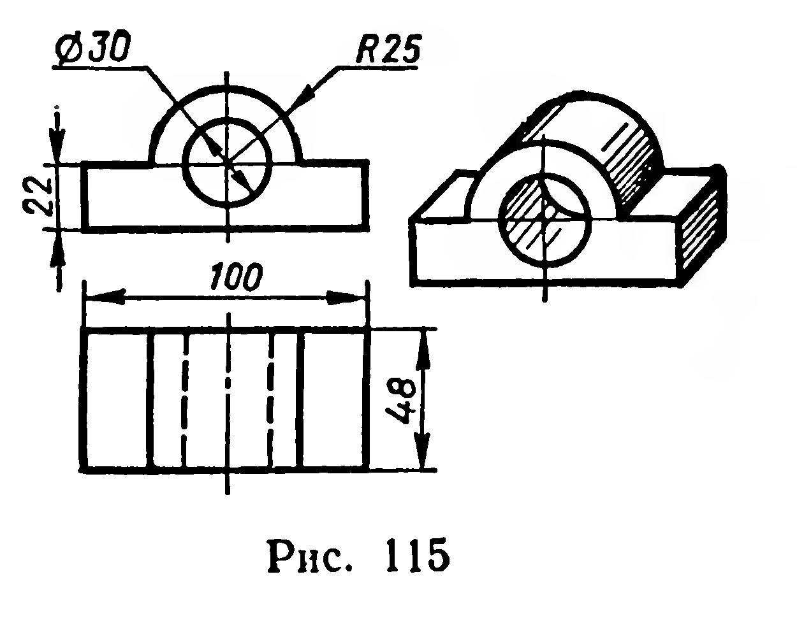

## 3.3. Два перпендикуляра к плоскости. Ортогональное проектирование на плоскость

---
**стр. 72**
---

2) Теперь убедимся, что любая точка $N$, не принадлежащая плоскости $\alpha$, неодинаково удалена от точек $A$ и $B$. Через $(AB)$ и $N$ проведём плоскость $\gamma$. Пусть $(NB)\cap\alpha=D$. Так как точка $N$ лежит вне перпендикуляра $(OD)$ к отрезку $AB$, то $|NA|\neq|NB|$ (известно из планиметрии).

Итак, множество всех точек, каждая из которых одинаково удалена от двух данных различных точек $A$ и $B$, есть плоскость, перпендикулярная отрезку $AB$ и проходящая через его середину.

280. Найдите объединение всех прямых, каждая из которых перпендикулярна данной прямой и проходит через заданную на ней точку.

§ 30. ДВА ПЕРПЕНДИКУЛЯРА К ПЛОСКОСТИ. ОРТОГОНАЛЬНОЕ ПРОЕКТИРОВАНИЕ НА ПЛОСКОСТЬ

15. 1. Рассмотрим две теоремы.

**Теорема.** Два перпендикуляра к плоскости параллельны.

Дано: $(AA_1)\perp\alpha$, $(BB_1)\perp\alpha$.

Доказать: $(AA_1)\parallel(BB_1)$.

Доказательство. Проведём в плоскости $\alpha$ через точку $A_1$ две взаимно перпендикулярные прямые $A_1C$ и $A_1D$ (рис. 112). Вектор $\overrightarrow{B_1B}$ обозначим через $\vec b$ и разложим его по некомпланарным векторам $\overrightarrow{A_1A}=\vec a$, $\overrightarrow{A_1C}=\vec c$, $\overrightarrow{A_1D}=\vec d$ (§ 23):

$$\vec b=x\vec a+y\vec c+z\vec d.\tag{1}$$

Докажем коллинеарность векторов $\vec a$ и $\vec b$. Умножим скалярно обе части равенства (1) на вектор $\vec c$. Учитывая, что вектор $\vec c$ перпендикулярен векторам $\vec b$, $\vec a$, $\vec d$, получим:

$$(0=y\vec c^{\,2})\Rightarrow(y=0).$$

После умножения обеих частей равенства (1) на $\vec d$ получим:

$$(0=z\vec d^{\,2})\Rightarrow(z=0).$$

16.

Итак, $\vec b=x\vec a$. Следовательно, векторы $\vec b$ и $\vec a$ коллинеарны (§ 20), а прямые $BB_1$ и $AA_1$ параллельны. ■

**Теорема (обратная).** Если одна из двух параллельных прямых перпендикулярна плоскости, то и другая перпендикулярна этой плоскости.

---
**стр. 73**
---

Дано: $a \parallel b$, $a \perp \alpha$.
Доказать: $b \perp \alpha$ (рис. 113).

Доказательство.
Пусть $a \cap \alpha = M$, $b \cap \alpha = N$. Вектор $\overrightarrow{MN}$ отображает прямую $a$ на прямую $b$ и плоскость $\alpha$ — на себя (§ 17). Перемещение $\overrightarrow{MN}$ сохраняет перпендикулярность прямой и плоскости (§ 28, следствие), поэтому $b \perp \alpha$. ■

2. Пусть даны плоскость $\alpha$ и прямая $l$, перпендикулярная $\alpha$. При проектировании на плоскость $\alpha$ параллельно прямой $l$ любая проектирующая прямая перпендикулярна плоскости проекций (теорема 16). Такое проектирование называется **ортогональным** (прямоугольным) проектированием на плоскость.

В дальнейшем, говоря о проекции какой-либо фигуры на плоскость, мы будем иметь в виду ортогональную проекцию.

Ортогональной проекцией широко пользуются в техническом черчении. За основу выполнения технических чертежей берется способ ортогонального проектирования фигуры на две плоскости: горизонтальную $H$ и вертикальную $V$ (рис. 114). Чертежи некоторых деталей машин вы выполняли на уроках черчения. Рисунок 115 представляет собой чертеж втулки.

**Задачи**

281°. Могут ли быть перпендикулярны к одной плоскости две стороны: 1) треугольника; 2) трапеции; 3) правильного шестиугольника?

282. Два электрических провода нужно протянуть от столба, на котором они будут укреплены на высоте 7,0 м, к дому, где они крепятся на высоте 4,0 м. Сколько потребуется провода, если расстояние от дома до столба равно 15 м и на провисание и крепление нужно добавить 5% найденной длины?

283°. Какой фигурой является проекция прямой, если прямая служит: 1) наклонной к плоскости проекций; 2) перпендикуляром к этой плоскости?
