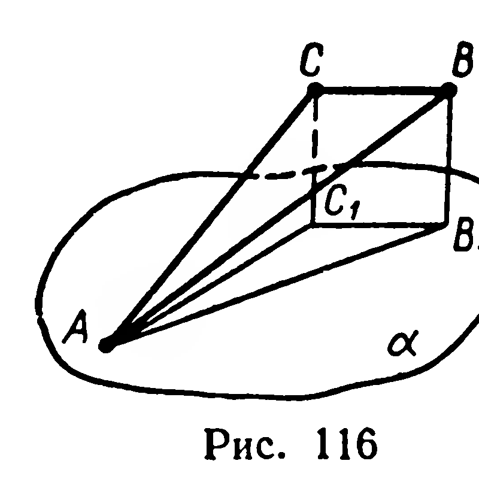
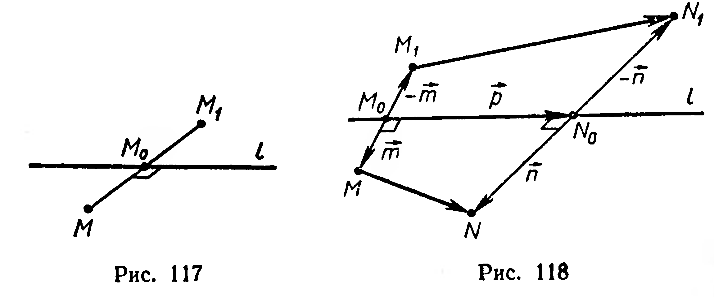

## 3.4. Осевая симметрия пространства

---
**стр. 74**
---

284. Отрезок $MA_1$ длиной 12 см является проекцией отрезка $MA$ на плоскость $\alpha$. Известно, что $|AA_1| = 9$ см, $B \in [MA]$, $|AB| : |BM| = 2 : 3$. Найдите длины отрезка $AB$ и его проекции на плоскость $\alpha$.

285. Точки $A$ и $B$ расположены по разные стороны от плоскости $\alpha$ и не лежат на перпендикуляре к этой плоскости; точки $A_1$ и $B_1$ — их проекции на плоскость $\alpha$. 1) Докажите, что прямые $AB$ и $A_1B_1$ пересекаются. 2) Найдите расстояния от точки их пересечения до точек $A$ и $B_1$, если $|AA_1| = a$, $|BB_1| = b$, $|AB| = c$.

286. Дано: $\{A, B\} \subset \alpha$, $[AA_1] \perp \alpha$, $[BB_1] \perp \alpha$.

1) Найдите $\widehat{BB_1A_1}$, если $\widehat{AA_1B_1} = \varphi$.

2) Найдите $|A_1B_1|$, если $|AA_1| = 10$ см, $|BB_1| = 18$ см, $|A_1B| = 15$ см.

287. Дан прямоугольный треугольник $ABC$, катеты которого $AC$ и $BC$ соответственно равны 20 см и 15 см. Через вершину $A$ проведена плоскость, параллельная прямой $BC$ (рис. 116). Длина проекции одного из катетов на эту плоскость равна 12 см. Найдите длину проекции гипотенузы.

288. Длина стороны ромба с углом в 60° равна $a$. Через одну из сторон проведена плоскость; длина проекции другой стороны на эту плоскость равна $b$. Найдите длины проекций диагоналей.

§ 31. ОСЕВАЯ СИММЕТРИЯ ПРОСТРАНСТВА

Точки $M$ и $M_1$ называются **симметричными относительно прямой** $l$ (рис. 117), если отрезок $MM_1$ перпендикулярен $l$ и делится этой прямой пополам.

Любая точка прямой $l$ считается симметричной самой себе.

**Определение.** Преобразование пространства, при котором каждая точка отображается на симметричную ей точку относительно данной прямой, называется **осевой симметрией**.

Данную прямую называют *осью симметрии*.

---
**стр. 75**
---

Если при осевой симметрии с осью $l$ точка $M_1$ является образом точки $M$, то записывают: $S_l(M) = M_1$. Запись $S_l(\Phi) = \Phi_1$ означает, что при симметрии с осью $l$ фигура $\Phi$ отображается на фигуру $\Phi_1$.

**17. Теорема.** *Осевая симметрия есть перемещение.*

**Доказательство.** Пусть $S_l(M) = M_1$, $S_l(N) = N_1$ (рис. 118). Докажем, что $|MN| = |M_1N_1|$. Введём векторы $\vec m$, $\vec n$, $\vec p$, как показано на рисунке 118. Согласно определению осевой симметрии имеем:

$$\vec m \cdot \vec p = \vec n \cdot \vec p = 0.$$

По правилу многоугольника (§ 18) получим:

$$\overrightarrow{MN} = -\vec m + \vec p + \vec n; \quad \overrightarrow{M_1N_1} = \vec m + \vec p - \vec n.$$

Тогда $|MN|^2 = \vec m^2 + \vec p^2 + \vec n^2 - 2\vec m \cdot \vec n$,

$$|M_1N_1|^2 = \vec m^2 + \vec p^2 + \vec n^2 - 2\vec m \cdot \vec n.$$

Следовательно, $|MN|^2 = |M_1N_1|^2$ и $|MN| = |M_1N_1|$. ■

Из теоремы 17 вытекает, что при осевой симметрии любая фигура отображается на конгруэнтную ей фигуру.

**Примечание.** Пользуясь признаком перпендикулярности прямой и плоскости, а также свойствами осевой симметрии, можно доказать признаки конгруэнтности треугольников, произвольно расположенных в пространстве. Формулировки признаков такие же, как и в планиметрии. (См. «Приложения», с. 221.)

## Задачи

**289.** 1) Какие точки при осевой симметрии отображаются на себя?  
2) Какие прямые при осевой симметрии отображаются на себя?

**290.** Каково взаимное расположение оси симметрии $l$ и образа $\alpha_1$ данной плоскости $\alpha$, если: 1) $l \subset \alpha$; 2) $l \perp \alpha$; 3) $l$ — наклонная к $\alpha$?

**291°.** Каким может быть при осевой симметрии взаимное расположение: 1) прямой и её образа; 2) плоскости и её образа?

**292.** Даны две различные точки $A$ и $B$. Укажите оси симметрий, отображающих $A$ на $B$. Какой фигурой является объединение всех таких осей?

**293°.** Если при симметрии относительно прямой фигура отображается на себя, то эту прямую называют *осью симметрии фигуры*. Укажите оси симметрии следующих фигур: 1) отрезка; 2) луча; 3) прямой; 4) плоскости; 5) параллелограмма; 6) правильного треугольника; 7) квадрата; 8) окружности; 9) объединения двух пересекающихся прямых.

**294.** Докажите, что если плоская фигура имеет центр симметрии, то она имеет и ось симметрии.
