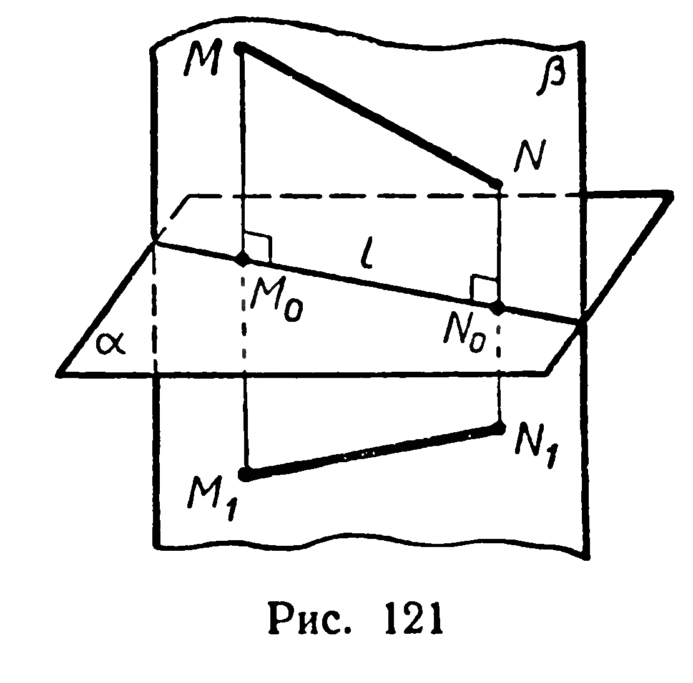
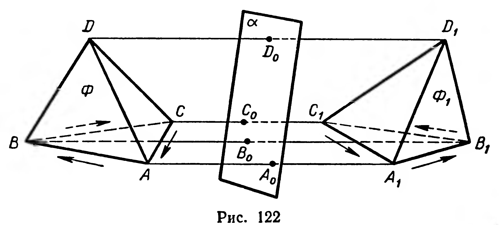

## 3.5. Симметрия относительно плоскости

---
**стр. 76, продолжение**
---

**§ 32. СИММЕТРИЯ ОТНОСИТЕЛЬНО ПЛОСКОСТИ**

Точки $M$ и $M_1$ называются **симметричными относительно плоскости $\alpha$** (рис. 121), если отрезок $MM_1$ перпендикулярен этой плоскости и делится ею пополам. Любая точка плоскости $\alpha$ считается симметричной самой себе.

**Определение.** Преобразование пространства, при котором каждая точка отображается на симметричную ей точку относительно данной плоскости, называется **симметрией относительно этой плоскости**.

---
¹ Здесь и в некоторых других задачах словом «перпендикуляр» кратко именуем отрезок прямой, перпендикулярной плоскости, а не всю прямую.

---
**стр. 77**
---

Симметрию относительно плоскости $\alpha$ обозначают $S_{\alpha}$. Если симметрия $S_{\alpha}$ точку $M$ (фигуру $\Phi$) отображает на точку $M_{1}$ (фигуру $\Phi_{1}$), то записывают:

$$S_{\alpha}(M) = M_{1},\quad S_{\alpha}(\Phi) = \Phi_{1}.$$

**18. Теорема.** *Симметрия относительно плоскости есть перемещение.*

*Доказательство.* Пусть $S_{\alpha}(M)=M_{1}$, $S_{\alpha}(N)=N_{1}$, где $M \notin \alpha$, $N \notin \alpha$ (рис. 121). Докажем, что $|MN| = |M_{1}N_{1}|$. Прямые $MM_{1}$ и $NN_{1}$, перпендикулярные к $\alpha$, параллельны (§ 30, теорема 16), поэтому они принадлежат некоторой плоскости $\beta$. Обозначим $\alpha \cap \beta = l$. Симметрия относительно прямой $l$ отобразит отрезок $MN$ на отрезок $M_{1}N_{1}$, причём согласно теореме 17 (§ 31) $|MN| = |M_{1}N_{1}|$. Это равенство сохранится и в тех случаях, когда одна или обе точки $M$ и $N$ принадлежат плоскости $\alpha$. ■

Из теоремы следует, что если $S_{\alpha}(\Phi) = \Phi_{1}$, то $\Phi_{1} \cong \Phi$ (рис. 122).

Фигуры, симметричные относительно плоскости, можно продемонстрировать с помощью плоского зеркала.

Отметим любопытную особенность неплоских фигур, симметричных относительно плоскости. Пусть дан тетраэдр $ABCD$, не имеющий конгруэнтных плоских углов при какой-либо из вершин. Рассмотрим тетраэдр $A_{1}B_{1}C_{1}D_{1}$, симметричный данному относительно плоскости $\alpha$, тогда $A_{1}B_{1}C_{1}D_{1} \cong ABCD$ (рис. 122).

Опыт показывает, что одну из моделей двух плоских конгруэнтных фигур можно путём непрерывного движения в пространстве переместить так, что она займёт точно такое же положение, какое занимала вторая модель. Иначе говоря, две плоские конгруэнтные фигуры можно совместить. Но попробуйте осуществить такое совмещение для тетраэдров $ABCD$ и $A_{1}B_{1}C_{1}D_{1}$ (см. рис. 122). Ваши попытки окажутся безуспешными. Другой на-

---
**стр. 78**
---

глядный пример несовмещающихся конгруэнтных фигур — кисти правой и левой рук. Несовмещающиеся конгруэнтные фигуры можно получить и с помощью центральной симметрии.

**Задачи**

**299°.** 1) Найдите множество всех точек, каждая из которых при симметрии относительно плоскости $\alpha$ отображается на себя.
2) Какие прямые при симметрии относительно плоскости отображаются на себя?

**300°.** Каким может быть при симметрии относительно плоскости взаимное расположение: 1) прямой и её образа; 2) плоскости и её образа?

**301°.** Если при симметрии относительно плоскости фигура отображается на себя, то эту плоскость называют *плоскостью симметрии данной фигуры*. Укажите плоскости симметрии следующих фигур: 1) отрезка; 2) прямой; 3) луча.

**302°.** Имеются ли в природе и технике предметы, которые можно считать моделями пространственных фигур, имеющих плоскость симметрии? Приведите примеры.

**303\*.** Докажите, что если фигура имеет единственные центр симметрии и плоскость симметрии, то центр симметрии принадлежит плоскости симметрии.

**304\*.** Существует ли тетраэдр, имеющий только одну плоскость симметрии?
