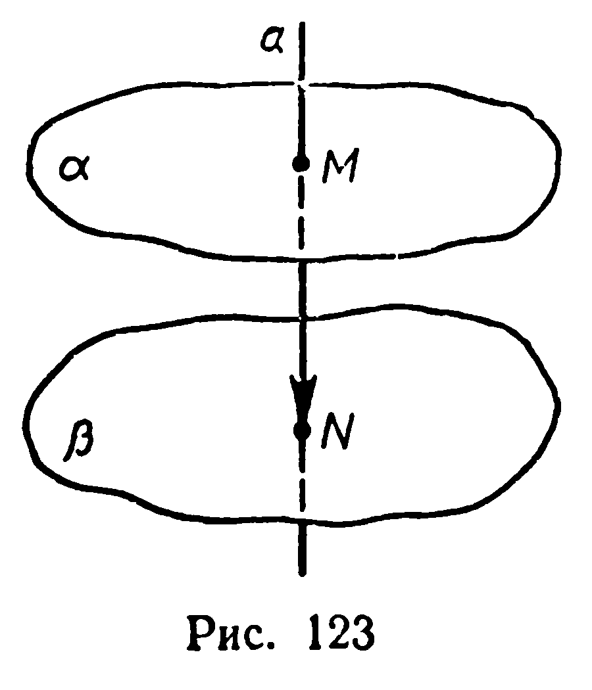
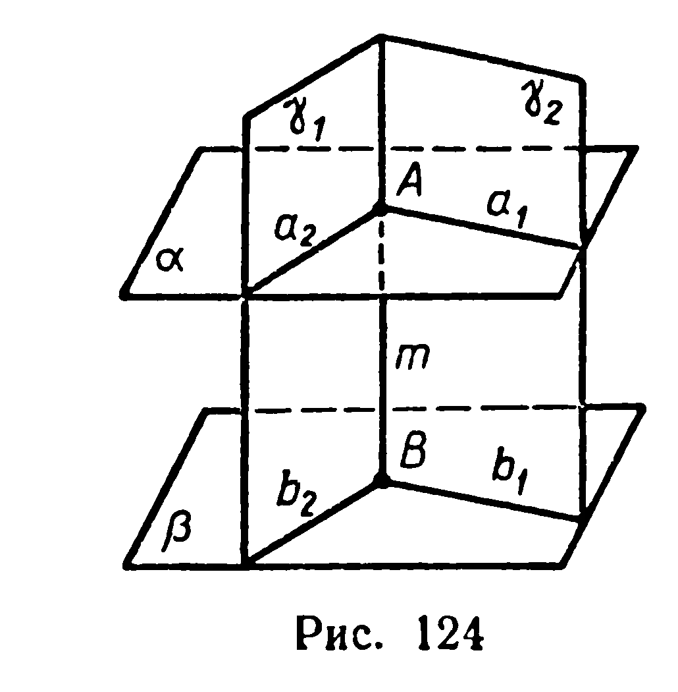

## 3.6. Две плоскости, перпендикулярные прямой

---
**стр. 78**
---

глядный пример несовмещающихся конгруэнтных фигур — кисти правой и левой рук. Несовмещающиеся конгруэнтные фигуры можно получить и с помощью центральной симметрии.

**Задачи**

**299°.** 1) Найдите множество всех точек, каждая из которых при симметрии относительно плоскости $\alpha$ отображается на себя.
2) Какие прямые при симметрии относительно плоскости отображаются на себя?

**300°.** Каким может быть при симметрии относительно плоскости взаимное расположение: 1) прямой и её образа; 2) плоскости и её образа?

**301°.** Если при симметрии относительно плоскости фигура отображается на себя, то эту плоскость называют *плоскостью симметрии данной фигуры*. Укажите плоскости симметрии следующих фигур: 1) отрезка; 2) прямой; 3) луча.

**302°.** Имеются ли в природе и технике предметы, которые можно считать моделями пространственных фигур, имеющих плоскость симметрии? Приведите примеры.

**303\*.** Докажите, что если фигура имеет единственные центр симметрии и плоскость симметрии, то центр симметрии принадлежит плоскости симметрии.

**304\*.** Существует ли тетраэдр, имеющий только одну плоскость симметрии?

**§ 33. ДВЕ ПЛОСКОСТИ, ПЕРПЕНДИКУЛЯРНЫЕ ПРЯМОЙ**

**19. Теорема.** *Прямая, перпендикулярная одной из двух параллельных плоскостей, перпендикулярна и другой.*

*Доказательство.* Пусть $a \cap \alpha = M$, $a \cap \beta = N$ (рис. 123). Вектор $\overrightarrow{MN}$ отображает прямую $a$ на себя, а плоскость $\alpha$ — на плоскость $\beta$ (§ 17). Перпендикулярность прямой и плоскости при перемещении сохраняется (§ 28), следовательно, $a \perp \beta$. ■

Верна и обратная теорема: *две плоскости, перпендикулярные прямой, параллельны.* Докажите это самостоятельно (рис. 124).

