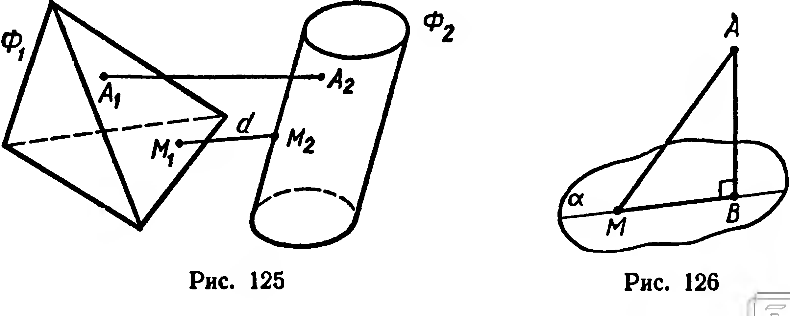
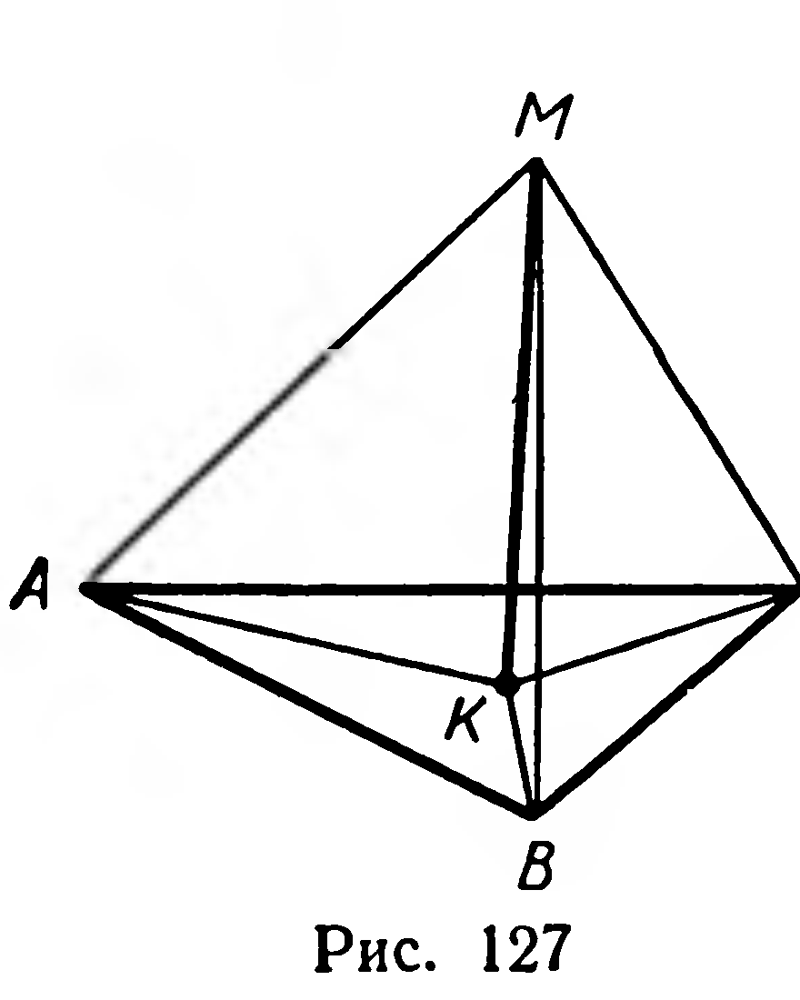

## 3.7. Расстояние от точки до плоскости

---
**стр. 79, продолжение**
---

## § 34. Расстояние от точки до плоскости

Распространим на пространство известное из планиметрии понятие расстояния между двумя фигурами.

Если среди расстояний между точками, одна из которых принадлежит фигуре $\Phi_1$, а другая — фигуре $\Phi_2$, существует наименьшее, то его называют расстоянием между фигурами $\Phi_1$ и $\Phi_2$ (рис. 125).

**20. Теорема.** *Расстояние от точки до плоскости равно расстоянию от этой точки до ее ортогональной проекции на данную плоскость.*

**Доказательство.** Пусть точка $A$ взята вне плоскости $\alpha$ (рис. 126). Построим точку $B$ — проекцию точки $A$ на эту плоскость. Выберем в плоскости $\alpha$ любую точку $M$, отличную от $B$, и проведем прямую $MB$. Тогда $[AB] \perp (MB)$. Применив известную из планиметрии теорему о расстоянии от точки до прямой, получим: $|AB| < |AM|$. Следовательно, $|AB|$ — расстояние от точки $A$ до плоскости $\alpha$.

---
**стр. 80**
---

Если точка $A$ принадлежит $\alpha$, то ее проекцией служит сама точка $A$. Теорема верна и в этом случае, так как расстояние от $A$ до $\alpha$ равно нулю и $|AA| = 0$.

## Задачи

**310°.** Прямая $a$ лежит в плоскости $\alpha$, точка $M$ не принадлежит этой плоскости. Сравните расстояние от $M$ до $\alpha$ с расстоянием от $M$ до $a$. В каком случае эти расстояния равны?

**311.** Найдите расстояние от вершины куба до плоскости противолежащей грани, если известно, что: 1) диагональ грани куба равна $m$; 2) диагональ куба равна $d$.

**312.** Докажите, что расстояние от середины отрезка до плоскости равно: 1) полусумме расстояний от концов отрезка до плоскости, если отрезок не пересекает плоскость; 2) модулю полуразности этих расстояний, если отрезок пересекает плоскость.

**313.** Сторона правильного треугольника равна $6$ см, точка $M$ отстоит от всех его вершин на $4$ см. Найти расстояние от $M$ до плоскости треугольника.

**Решение.** Пусть даны правильный треугольник $ABC$ и точка $M$, причем $|MA| = |MB| = |MC|$ (рис. 127). Проекцию $K$ точки $M$ на плоскость $ABC$ соединим с вершинами данного треугольника. Прямоугольные треугольники $MKA$, $MKB$, $MKC$ попарно конгруэнтны (по гипотенузе и катету). Поэтому $|KA| = |KB| = |KC|$. Итак, $K$ — центр окружности, описанной около треугольника $ABC$, $|KA|$ — радиус этой окружности. Требуется вычислить $|MK|$.

Пользуясь формулой $a_3 = R\sqrt{3}$, находим: $|KA| = \frac{|AB|}{\sqrt{3}} = 2\sqrt{3}$ см.

В прямоугольном треугольнике $AKM$ имеем $|MA| = 4$ см, тогда

$$|MK| = \sqrt{|MA|^2 - |KA|^2} = 2 \text{ см}.$$

**314.** 1) Катеты прямоугольного треугольника равны $a$ и $b$. Точка $M$ находится на расстоянии $h$ от плоскости треугольника и на одинаковом расстоянии от всех его вершин. Найдите это расстояние.

2) Точка $M$ находится на расстоянии $l$ от всех вершин треугольника $ABC$. Найдите расстояние от точки $M$ до плоскости треугольника, если $|BC| = a$ и $\widehat{BAC} = \alpha$.

**315.** Найдите множество всех точек, каждая из которых одинаково удалена от всех вершин: 1) прямоугольника; 2) равнобедренной трапеции; 3) ромба, не являющегося квадратом.

---
**стр. 81**
---

**316.** 1) Докажите, что расстояние между прямой и параллельной ей плоскостью равно расстоянию от произвольной точки прямой до данной плоскости.
2°) Чему равно расстояние между пересекающимися прямой и плоскостью?

**317.** Отрезок $AB$ длиной $a$ параллелен плоскости $\alpha$ и удален от нее на расстояние $b$. Наклонные $[AC]$ и $[BD]$, где $\{C, D\} \subset \alpha$, перпендикулярны $[AB]$. Найдите $|CD|$, если $|AC| = |BD| = c$.

**318.** 1) Докажите, что расстояние между двумя параллельными плоскостями равно расстоянию от произвольной точки одной плоскости до другой плоскости.
2°) Чему равно расстояние между двумя пересекающимися плоскостями?

**319°.** Найдите множество всех точек, удаленных от данной плоскости $\alpha$ на расстояние $l$.

**320°.** Найдите множество всех точек, каждая из которых удалена от данной плоскости на расстояние: 1) меньшее, чем $l$; 2) большее $l$.

**321.** Найдите множество всех точек, одинаково удаленных от двух данных различных параллельных плоскостей.

**322.** Даны две различные параллельные плоскости $\alpha$ и $\beta$. Укажите оси симметрий, отображающих $\alpha$ на $\beta$. Какой фигурой является объединение всех таких осей?

**323.** Отрезки $AB$ и $CD$, концы которых принадлежат различным параллельным плоскостям, проектируются на одну из них. Найдите расстояние между плоскостями, если известно, что:
1) $|AB| : |CD| = 10 : 17$ и длины проекций этих отрезков соответственно равны $12\ \text{см}$ и $3\ \text{дм}$;
2) $|AB| = a$, $|CD| = b$ и длины их проекций относятся как $m : n$;
3) $|AB| = a$, $|CD| = b$ и сумма длин их проекций равна $c$.
