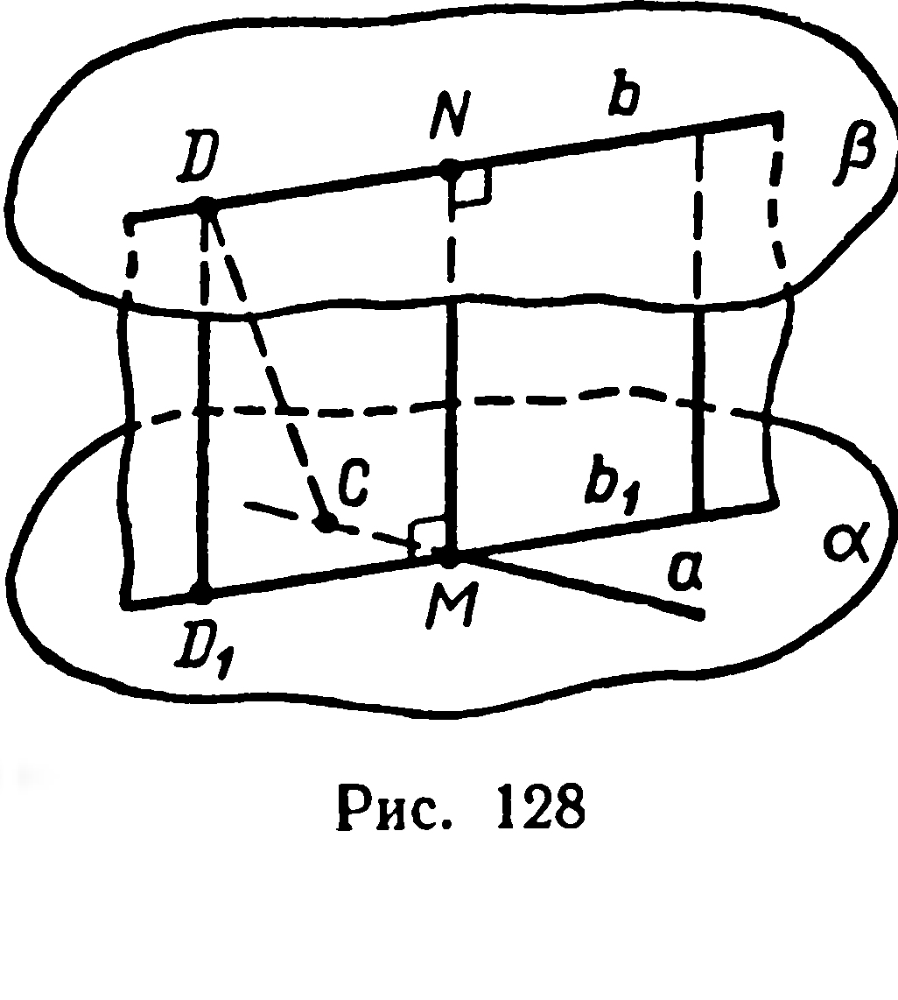
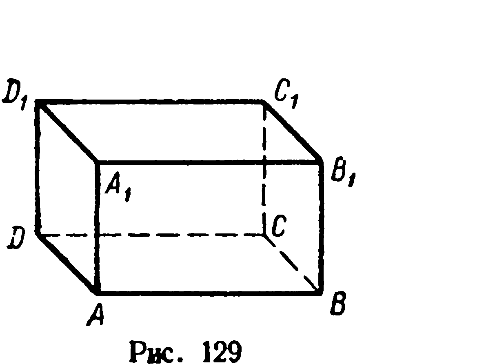
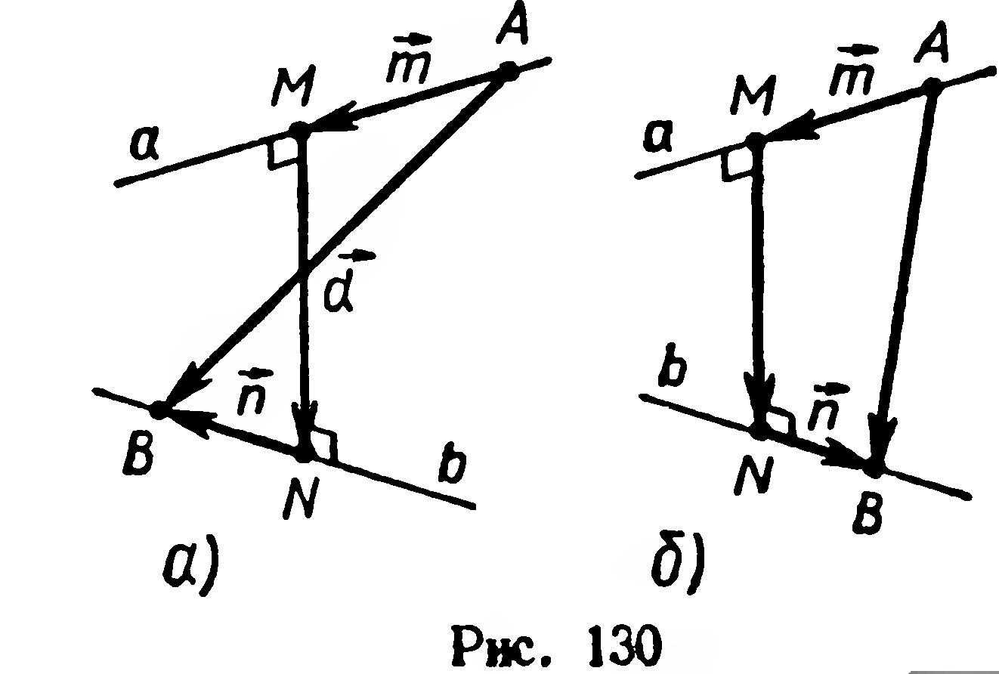

## 3.8. Общий перпендикуляр скрещивающихся прямых

---
**стр. 81**
---

**316.** 1) Докажите, что расстояние между прямой и параллельной ей плоскостью равно расстоянию от произвольной точки прямой до данной плоскости.
2°) Чему равно расстояние между пересекающимися прямой и плоскостью?

**317.** Отрезок $AB$ длиной $a$ параллелен плоскости $\alpha$ и удален от нее на расстояние $b$. Наклонные $[AC]$ и $[BD]$, где $\{C, D\} \subset \alpha$, перпендикулярны $[AB]$. Найдите $|CD|$, если $|AC| = |BD| = c$.

**318.** 1) Докажите, что расстояние между двумя параллельными плоскостями равно расстоянию от произвольной точки одной плоскости до другой плоскости.
2°) Чему равно расстояние между двумя пересекающимися плоскостями?

**319°.** Найдите множество всех точек, удаленных от данной плоскости $\alpha$ на расстояние $l$.

**320°.** Найдите множество всех точек, каждая из которых удалена от данной плоскости на расстояние: 1) меньшее, чем $l$; 2) большее $l$.

**321.** Найдите множество всех точек, одинаково удаленных от двух данных различных параллельных плоскостей.

**322.** Даны две различные параллельные плоскости $\alpha$ и $\beta$. Укажите оси симметрий, отображающих $\alpha$ на $\beta$. Какой фигурой является объединение всех таких осей?

**323.** Отрезки $AB$ и $CD$, концы которых принадлежат различным параллельным плоскостям, проектируются на одну из них. Найдите расстояние между плоскостями, если известно, что:
1) $|AB| : |CD| = 10 : 17$ и длины проекций этих отрезков соответственно равны $12\ \text{см}$ и $3\ \text{дм}$;
2) $|AB| = a$, $|CD| = b$ и длины их проекций относятся как $m : n$;
3) $|AB| = a$, $|CD| = b$ и сумма длин их проекций равна $c$.

## § 35. ОБЩИЙ ПЕРПЕНДИКУЛЯР СКРЕЩИВАЮЩИХСЯ ПРЯМЫХ

**Задача.** Даны скрещивающиеся прямые $a$ и $b$. Провести прямую, пересекающую обе данные прямые и перпендикулярную каждой из них.

**Решение.** Проведем через $a$ и $b$ (рис. 128) параллельные плоскости $\alpha$ и $\beta$ (§ 11, задача).

Проектируя ортогонально прямую $b$ на плоскость $\alpha$, получим прямую $b_1$, параллельную прямой $b$ (§ 11, теорема 7). Точку пересечения прямых $a$ и $b_1$ обозначим через $M$. Эта точка является проекцией некоторой точки $N$, принадлежащей прямой $b$; $(MN)$ — искомая прямая. Действительно, так как $(MN) \perp \alpha$, то $(MN) \perp \beta$ (§ 33, теорема 19), а тогда $(MN) \perp a$ и $(MN) \perp b$.

Отрезок, имеющий концы на двух скрещивающихся прямых и перпендикулярный к ним, называется **общим перпендикуляром скрещивающихся прямых**. Докажем, что длина $|MN|$ общего

---
**стр. 82**
---

перпендикуляра скрещивающихся прямых $a$ и $b$ (рис. 128) является расстоянием между этими прямыми. Достаточно доказать, что $|MN| < |CD|$, где $[CD]$ — любой другой отрезок, имеющий концы на данных прямых.

Рассмотрим проекцию $D_1$ точки $D$ на плоскость $\alpha$. Согласно теореме 20 $|DD_1|$ есть расстояние от $D$ до $\alpha$, поэтому $|DD_1| < |CD|$. Но $|DD_1| = |MN|$ (почему?), следовательно, $|MN| < |CD|$.

Заметим, что расстояние между двумя скрещивающимися прямыми равно расстоянию между параллельными плоскостями, содержащими данные прямые (рис. 128).

## Задачи

**324.** На изображении прямоугольного параллелепипеда $ABCDA_1B_1C_1D_1$ (рис. 129) укажите общий перпендикуляр прямых: 1) $A_1D_1$ и $BB_1$; 2) $DC$ и $B_1C_1$; 3) $CC_1$ и $AB$.

**325.** Одна из двух скрещивающихся прямых лежит в плоскости $\alpha$, другая — перпендикулярна $\alpha$. Как расположен общий перпендикуляр данных прямых?

**326.** 1) На изображении куба $ABCDA_1B_1C_1D_1$ постройте общий перпендикуляр прямых $AA_1$ и $BD$. 2) Найдите расстояние между этими прямыми, если ребро куба равно $a$.

**327.** 1) Дан куб $ABCDA_1B_1C_1D_1$, постройте общий перпендикуляр прямых $A_1D$ и $BC_1$. 2°) Найдите расстояние между этими прямыми, если площадь грани куба равна $2\ \text{см}^2$.

**328.** Каждое ребро тетраэдра $ABCD$ равно $a$. Найдите расстояние между $(AB)$ и $(CD)$.

**329.** Через середину общего перпендикуляра $[MN]$ двух скрещивающихся прямых проведена плоскость $\gamma$, перпендикулярная $(MN)$. Докажите, что $\gamma$ делит пополам любой отрезок, соединяющий точку одной прямой с точкой другой прямой.

