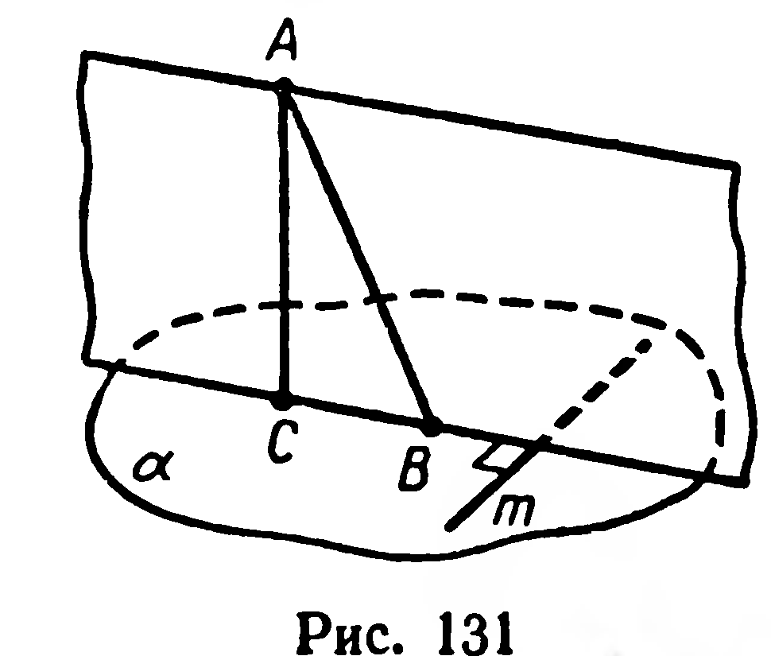
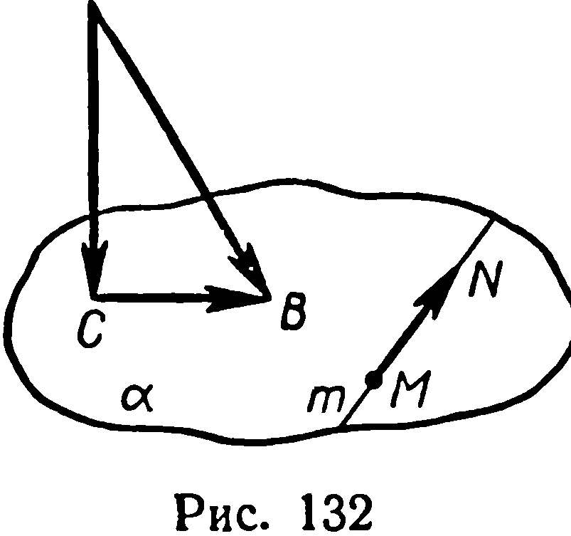
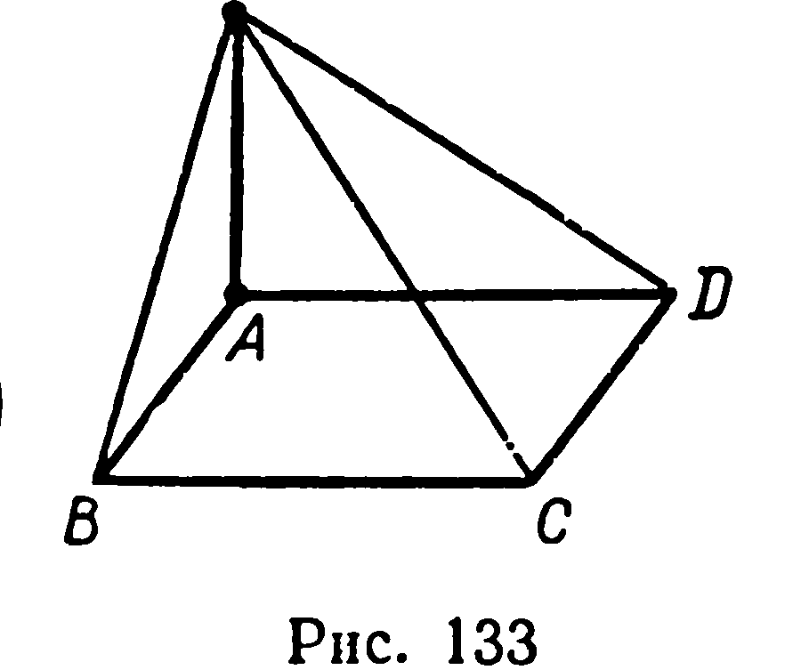
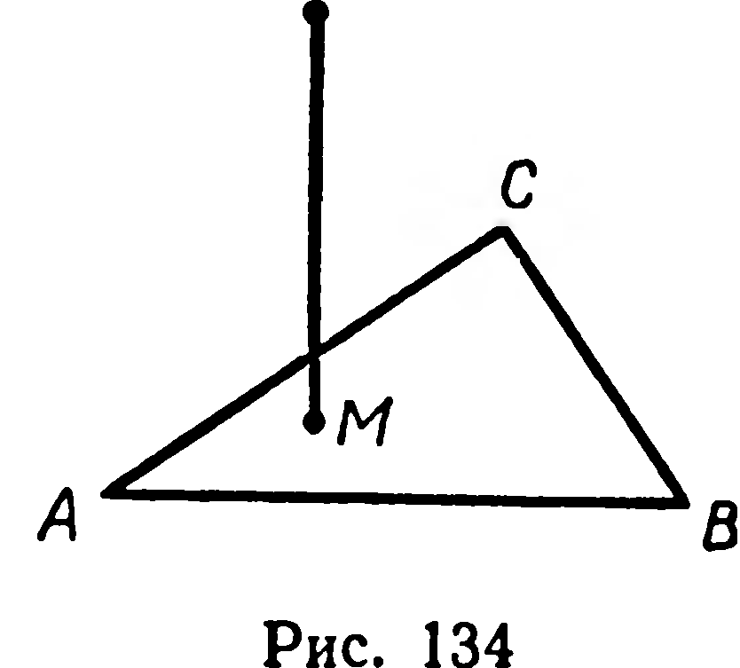

## 3.9. Теорема о трех перпендикулярах

---
**стр. 83**
---

**330\*.** Даны скрещивающиеся прямые $a$ и $b$, угол между которыми равен $\varphi$; длина их общего перпендикуляра $[MN]$ равна $d$ (рис. 130). На данных прямых взяты соответственно точки $A$ и $B$ так, что $|MA|=m$, $|NB|=n$. Найти $|AB|$.

Р е ш е н и е. Введём векторы $\vec m$, $\vec n$, $\vec d$, как указано на рисунке 130. По правилу многоугольника имеем:

$$\overrightarrow{AB}=\vec m+\vec d+\vec n.$$

Возведём в квадрат:

$$\overrightarrow{AB}^2=\vec m^2+\vec d^2+\vec n^2+2\vec m\cdot\vec d+2\vec m\cdot\vec n+2\vec d\cdot\vec n. \qquad (1)$$

Так как вектор $\vec d$ перпендикулярен векторам $\vec m$ и $\vec n$, то $\vec m\cdot\vec d=\vec d\cdot\vec n=0$.

Возможны два случая:

1) $(\widehat{\vec m,\vec n})=\varphi$ (рис. 130, $a$); 2) $(\widehat{\vec m,\vec n})=180^\circ-\varphi$ (рис. 130, $б$).

В первом случае $\vec m\cdot\vec n=mn\cos\varphi$, а во втором $\vec m\cdot\vec n=-mn\cos\varphi$. Подставив эти значения в (1) и извлекая корень, получим:

$$|AB|=\sqrt{m^2+n^2+d^2\pm 2mn\cos\varphi}.$$

## § 36. ТЕОРЕМА О ТРЕХ ПЕРПЕНДИКУЛЯРАХ

**21.** *Т е о р е м а.* *Для того чтобы прямая, лежащая в плоскости, была перпендикулярна наклонной, необходимо и достаточно, чтобы эта прямая была перпендикулярна проекции наклонной.*

Д о к а з а т е л ь с т в о. Рассмотрим прямые: $(AC)$ — перпендикуляр к плоскости $\alpha$, $(AB)$ — наклонная и $(CB)$ — её проекция на плоскость $\alpha$ (рис. 131).

*Достаточность.* Пусть прямая $m$, лежащая в плоскости $\alpha$, перпендикулярна $(CB)$. Из определения перпендикуляра к плоскости следует, что $(AC)\perp m$. Итак, прямая $m$ перпендикулярна прямым $CB$ и $AC$, лежащим в плоскости $ABC$.

Тогда $m\perp (ABC)$ (§ 28, теорема 14), откуда $m\perp (AB)$.

*Необходимость.* Пусть $m\subset\alpha$ и $m\perp (AB)$. Так как, кроме того, $(AC)\perp m$, то $m\perp (ABC)$, откуда $m\perp (CB)$. ■

### Задачи

**331.** Верны ли утверждения: 1) если прямая перпендикулярна проекции наклонной, то эта прямая перпендикулярна самой наклонной; 2) если прямая перпендикулярна наклонной и её проекции, то эта прямая лежит в плоскости проекций?

---
**стр. 84**
---

  

**332°.** Получится ли истинное высказывание, если в формулировке теоремы о трёх перпендикулярах заменить слова «лежащая в плоскости» словами «параллельная плоскости проекций»?

**333.** Докажите теорему о трёх перпендикулярах, пользуясь скалярным произведением векторов (рис. 132).

**334.** Прямая $a$ пересекает плоскость $\alpha$. В плоскости $\alpha$ через данную точку проведите прямую, перпендикулярную прямой $a$.

**335°.** Из вершины $A$ прямоугольника $ABCD$ (рис. 133) проведён перпендикуляр к его плоскости. Точка $M$ этого перпендикуляра соединена с точками $B$, $C$, $D$. 1) Докажите, что треугольники $MBC$ и $MDC$ прямоугольные. 2) Среди отрезков $MA$, $MB$, $MC$, $MD$ укажите отрезки с наибольшей и наименьшей длиной.

**336.** Треугольник $ABC$ — изображение правильного треугольника; отрезок $MN$ изображает перпендикуляр, проведённый из точки $N$ к плоскости треугольника (рис. 134). Постройте прямые, проходящие через точки $M$, $N$ и перпендикулярные к сторонам треугольника.

**337.** 1) Из вершины прямого угла прямоугольного треугольника с катетами $a$ и $b$ проведён перпендикуляр к плоскости треугольника. Длина перпендикуляра равна $h$. Найдите расстояние от его конца, не лежащего в плоскости треугольника, до гипотенузы.

2) Стороны треугольника равны 20 см, 65 см и 75 см. Из вершины большего угла треугольника проведён к его плоскости перпендикуляр длиной 60 см. Найдите расстояние от концов перпендикуляра до большей стороны треугольника.

**338.** 1) На плоскости $\alpha$ проведены две параллельные прямые, расстояние между которыми равно $m$. Точка $S$ находится на расстоянии $h$ от плоскости $\alpha$ и на одинаковом расстоянии от обеих прямых. Найдите это расстояние.

2) На плоскости $\alpha$ проведены параллельные прямые $a$ и $b$, расстояние между ними равно 44 см. Прямая $c$, параллельная данным прямым, удалена от плоскости $\alpha$ на 15 см, а от прямой $a$ — на 39 см. Найдите расстояние между прямыми $b$ и $c$.

**339.** Точка $M$ равноудалена от всех вершин правильного треугольника со стороной $a$ и удалена от плоскости треугольника на
