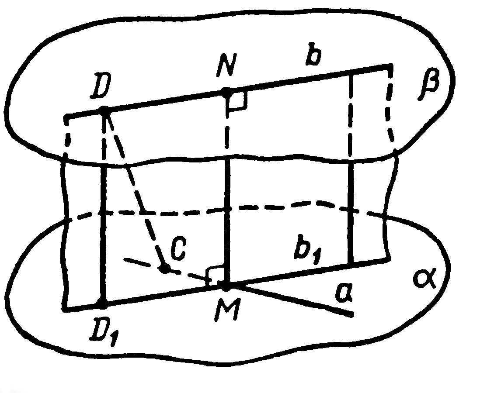
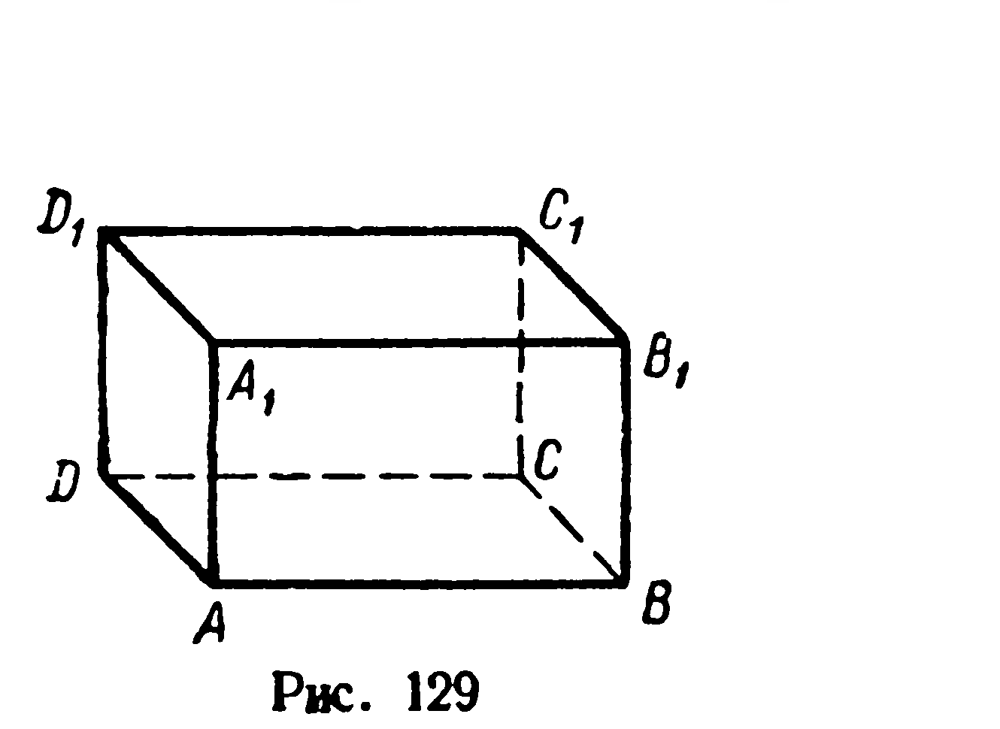
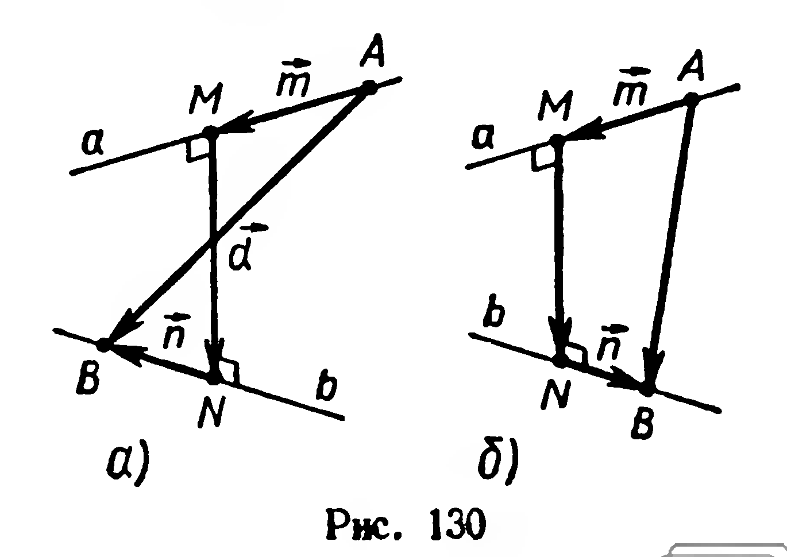
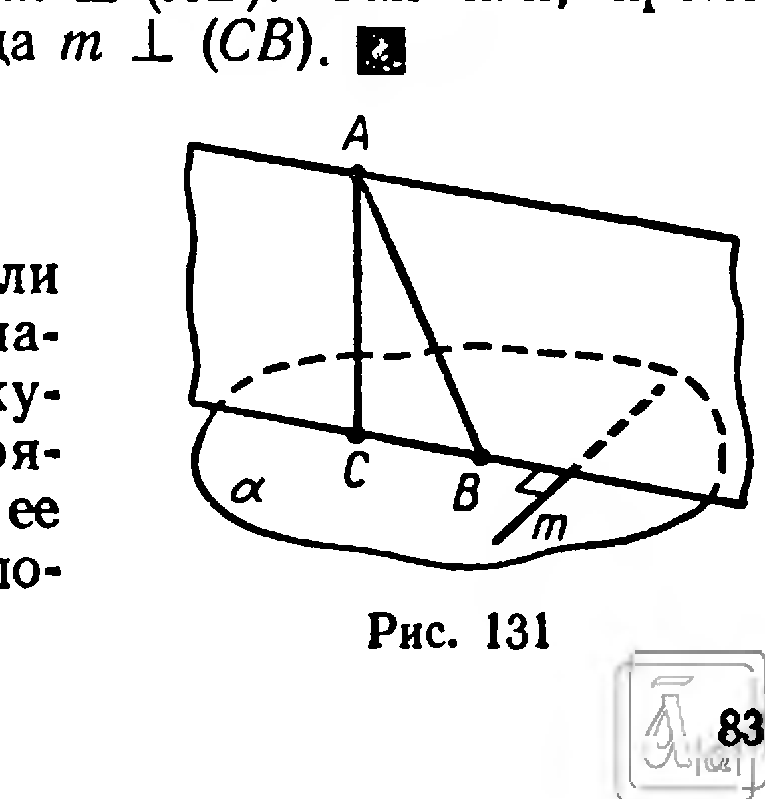
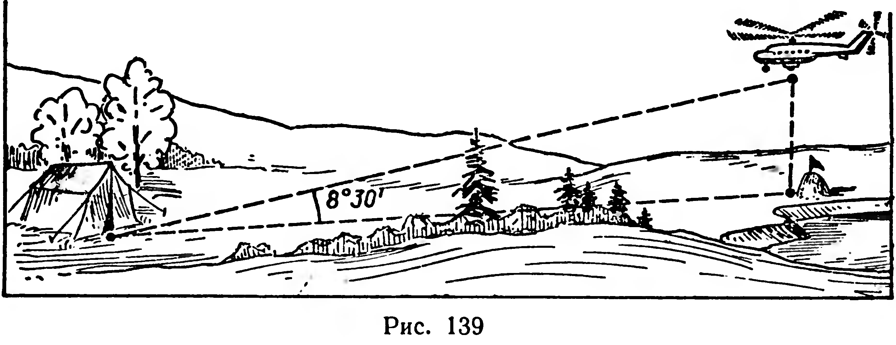
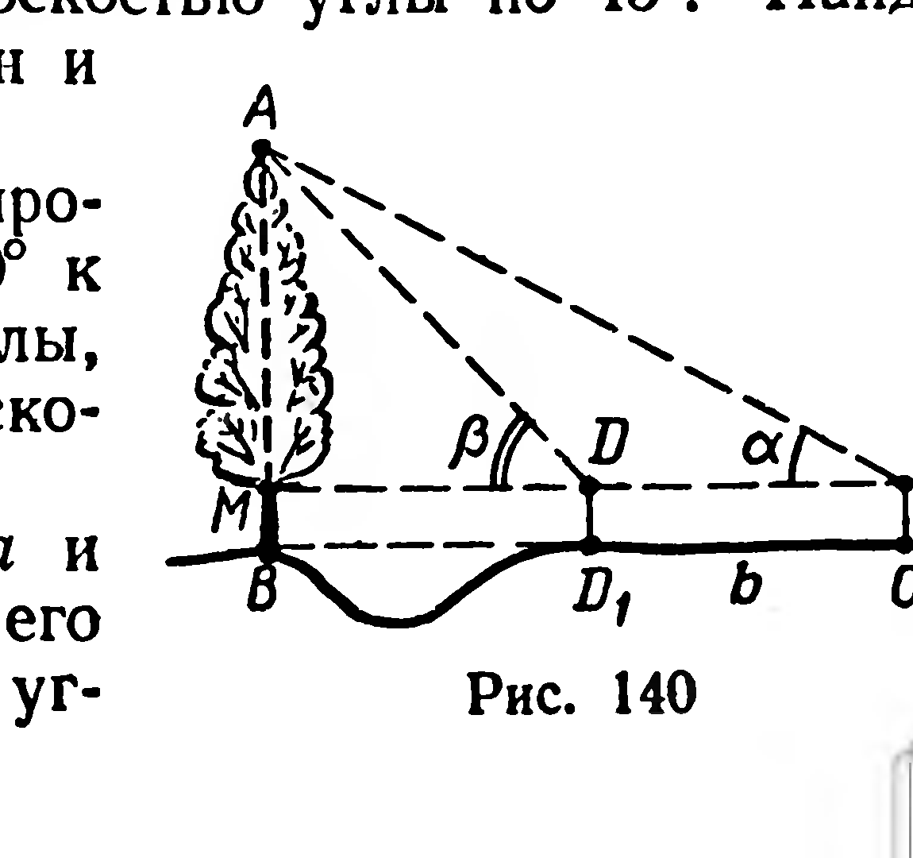

## 3.10. Угол между наклонной и плоскостью

---
**стр. 85**
---

перпендикуляра скрещивающихся прямых $a$ и $b$ (рис. 128) является расстоянием между этими прямыми. Достаточно доказать, что $|MN| < |CD|$, где $[CD]$ — любой другой отрезок, имеющий концы на данных прямых.

Рассмотрим проекцию $D_1$ точки $D$ на плоскость $\alpha$. Согласно теореме 20 $|DD_1|$ есть расстояние от $D$ до $\alpha$, поэтому $|DD_1| < |CD|$. Но $|DD_1| = |MN|$ (почему?), следовательно, $|MN| < |CD|$.

Заметим, что расстояние между двумя скрещивающимися прямыми равно расстоянию между параллельными плоскостями, содержащими данные прямые (рис. 128).

**Задачи**

324. На изображении прямоугольного параллелепипеда $ABCDA_1B_1C_1D_1$ (рис. 129) укажите общий перпендикуляр прямых: 1) $A_1D_1$ и $BB_1$; 2) $DC$ и $B_1C_1$; 3) $CC_1$ и $AB$.

325. Одна из двух скрещивающихся прямых лежит в плоскости $\alpha$, другая — перпендикулярна $\alpha$. Как расположен общий перпендикуляр данных прямых?

326. 1) На изображении куба $ABCDA_1B_1C_1D_1$ постройте общий перпендикуляр прямых $AA_1$ и $BD$. 2) Найдите расстояние между этими прямыми, если ребро куба равно $a$.

327. 1) Дан куб $ABCDA_1B_1C_1D_1$, постройте общий перпендикуляр прямых $A_1D$ и $BC_1$. 2°) Найдите расстояние между этими прямыми, если площадь грани куба равна $2$ см².

328. Каждое ребро тетраэдра $ABCD$ равно $a$. Найдите расстояние между $(AB)$ и $(CD)$.

329. Через середину общего перпендикуляра $[MN]$ двух скрещивающихся прямых проведена плоскость $\gamma$, перпендикулярная $(MN)$. Докажите, что $\gamma$ делит пополам любой отрезок, соединяющий точку одной прямой с точкой другой прямой.

 

---
**стр. 86**
---

$330^*$. Даны скрещивающиеся прямые $a$ и $b$, угол между которыми равен $\varphi$; длина их общего перпендикуляра $[MN]$ равна $d$ (рис. 130). На данных прямых взяты соответственно точки $A$ и $B$ так, что $|MA| = m$, $|NB| = n$. Найти $|AB|$.

Решение. Введем векторы $\vec{m}$, $\vec{n}$, $\vec{d}$, как указано на рисунке 130. По правилу многоугольника имеем:

$$\overrightarrow{AB} = \vec{m} + \vec{d} + \vec{n}.$$

Возведем в квадрат:

$$\overrightarrow{AB}^2 = \vec{m}^2 + \vec{d}^2 + \vec{n}^2 + 2\vec{m} \cdot \vec{d} + 2\vec{m} \cdot \vec{n} + 2\vec{d} \cdot \vec{n}. \quad (1)$$

Так как вектор $\vec{d}$ перпендикулярен векторам $\vec{m}$ и $\vec{n}$, то $\vec{m} \cdot \vec{d} = \vec{d} \cdot \vec{n} = 0$.

Возможны два случая:
1) $(\vec{m}, \vec{n}) = \varphi$ (рис. 130, а); 2) $(\vec{m}, \vec{n}) = 180° - \varphi$ (рис. 130, б).

В первом случае $\vec{m} \cdot \vec{n} = mn \cos \varphi$, а во втором $\vec{m} \cdot \vec{n} = -mn \cos \varphi$.
Подставив эти значения в (1) и извлекая корень, получим:

$$|AB| = \sqrt{m^2 + n^2 + d^2 \pm 2mn \cos \varphi}.$$

**§ 36. ТЕОРЕМА О ТРЕХ ПЕРПЕНДИКУЛЯРАХ**

21. Теорема. Для того чтобы прямая, лежащая в плоскости, была перпендикулярна наклонной, необходимо и достаточно, чтобы эта прямая была перпендикулярна проекции наклонной.

Доказательство. Рассмотрим прямые: $(AC)$ — перпендикуляр к плоскости $\alpha$, $(AB)$ — наклонная и $(CB)$ — ее проекция на плоскость $\alpha$ (рис. 131).

Достаточность. Пусть прямая $m$, лежащая в плоскости $\alpha$, перпендикулярна $(CB)$. Из определения перпендикуляра к плоскости следует, что $(AC) \perp m$. Итак, прямая $m$ перпендикулярна прямым $CB$ и $AC$, лежащим в плоскости $ABC$.

Тогда $m \perp (ABC)$ (§ 28, теорема 14), откуда $m \perp (AB)$.

Необходимость. Пусть $m \subset \alpha$ и $m \perp (AB)$. Так как, кроме того, $(AC) \perp m$, то $m \perp (ABC)$, откуда $m \perp (CB)$. ◻

**Задачи**

331. Верны ли утверждения: 1) если прямая перпендикулярна проекции наклонной, то эта прямая перпендикулярна самой наклонной; 2) если прямая перпендикулярна наклонной и ее проекции, то эта прямая лежит в плоскости проекций?

---
**стр. 87**
---

углы $ACM$ и $ADM$, получим: $\widehat{ACM} = \alpha$, $\widehat{ADM} = \beta$. Высоту $|CC_1|$ эклиметра обозначим через $h$.

Из треугольника $ACD$ по теореме синусов найдем $|AD|$:

$$\frac{|AD|}{\sin \alpha} = \frac{|CD|}{\sin \widehat{CAD}}.$$

Но $|CD| = b$, $\widehat{CAD} = \beta - \alpha$, тогда $|AD| = \frac{b \sin \alpha}{\sin (\beta - \alpha)}$.

Из прямоугольного треугольника $ADM$:

$$|AM| = |AD| \sin \beta.$$

Следовательно,

$$|AB| = \frac{b \sin \alpha \sin \beta}{\sin (\beta - \alpha)} + h.$$

Выполнив измерения на местности, найдите числовой результат.

**347.** 1) Из точки, отстоящей от плоскости на расстояние $h$, проведены две наклонные, образующие с плоскостью углы, равные $\varphi$, а между собой — прямой угол. Найдите расстояние между точками пересечения наклонных с плоскостью.

2) Прямая $AC$ наклонена к плоскости $\alpha$ под углом $\varphi$, прямая $AB$ — под углом $2\varphi$. Меньший из отрезков $AC$ и $AB$, где $\{C, B\} \subset \alpha$, равен $a$. Найдите $|BC|$, если известно, что проекции наклонных взаимно перпендикулярны.

**348.** Сторона правильного треугольника равна $12$ см. Точка $M$ выбрана так, что отрезки, соединяющие $M$ со всеми вершинами треугольника, образуют с его плоскостью углы по $45^\circ$. Найдите расстояние от точки $M$ до вершин и сторон треугольника.

**349.** Через сторону квадрата проведена плоскость под углом $30^\circ$ к диагонали квадрата. Найдите углы, под которыми наклонены к плоскости две стороны квадрата.

**350.** Дан ромб со стороной $a$ и острым углом $\varphi$. Через одну из его сторон проведена плоскость под уг-
