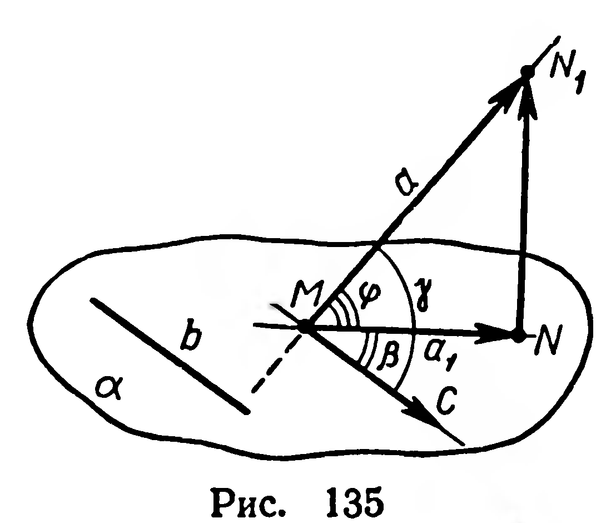
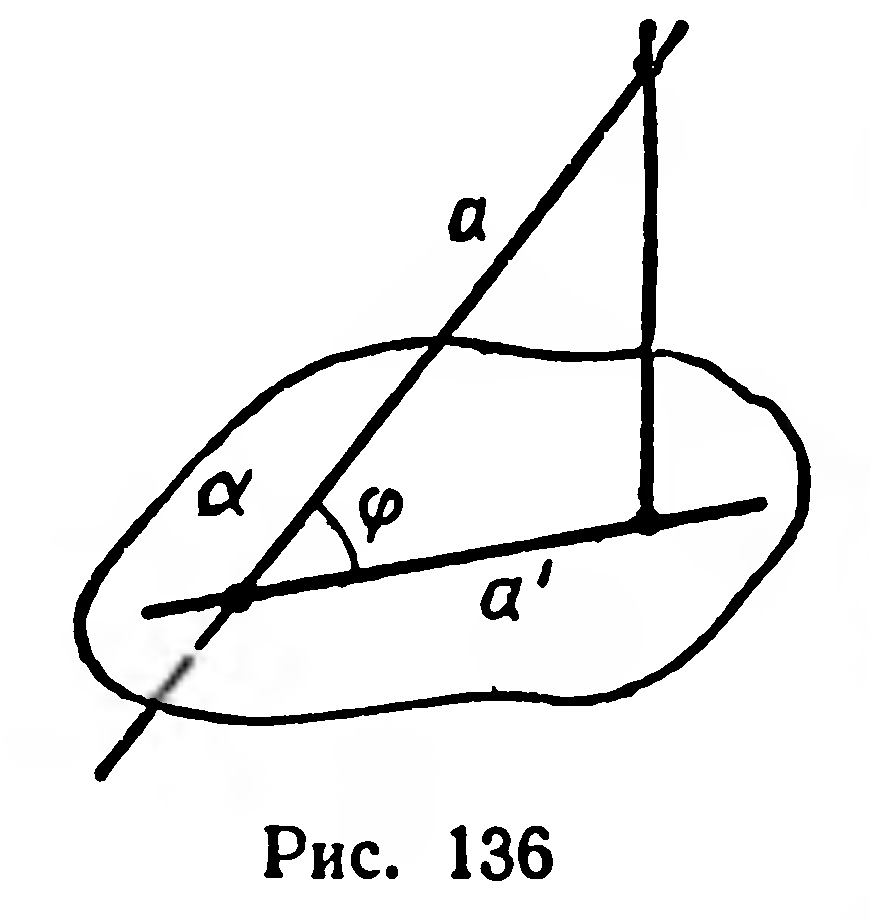
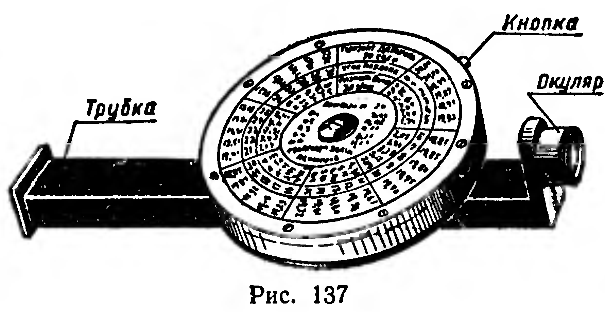
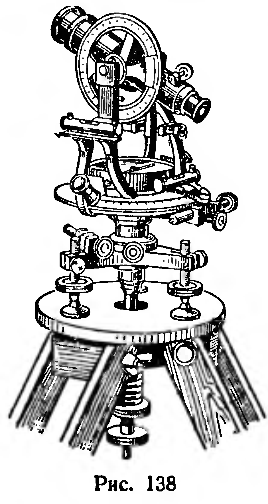
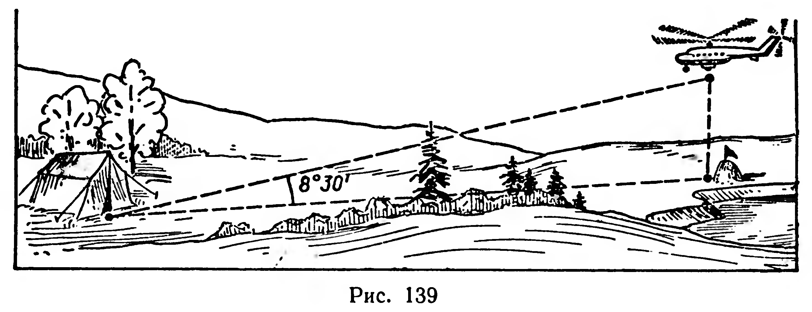
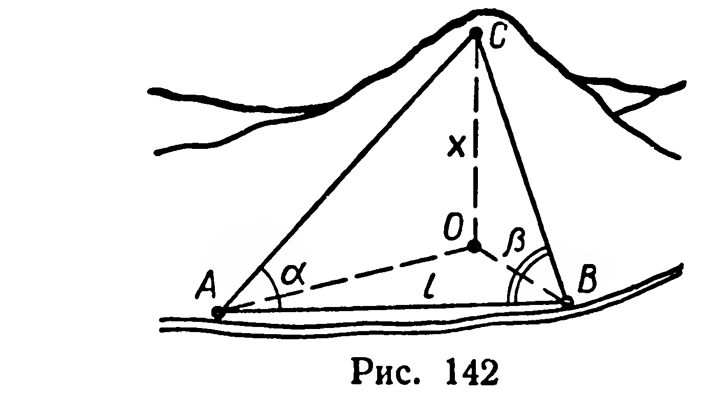

## 3.10. Угол между наклонной и плоскостью

---
**стр. 85, продолжение**
---

## § 37. УГОЛ МЕЖДУ НАКЛОННОЙ И ПЛОСКОСТЬЮ

Поставим задачу: сравнить угол между наклонной $a$ и ее проекцией $a_1$ на плоскость $\alpha$ (рис. 135) с углом между этой наклонной и произвольной прямой $b$, лежащей в плоскости $\alpha$.

Заметим сразу же, что если прямая $b$ параллельна прямой $a_1$, то $\widehat{(a,\ b)}=\widehat{(a,\ a_1)}$ (§ 24). Остается рассмотреть случай, когда $b$ и $a_1$ не параллельны.

Пусть $M$ — точка пересечения наклонной $a$ и плоскости $\alpha$ (рис. 135). Спроектируем отрезок $MN_1$ наклонной на эту плоскость, получим отрезок $MN$. Проведем $(MC)\parallel b$. Обозначим: $\widehat{N_1MN}=\varphi$, $\widehat{NMC}=\beta$, $\widehat{N_1MC}=\gamma$. Каждый из этих углов не больше $90^\circ$, причем угол $\widehat{N_1MN}$ не может быть прямым (почему?).

Формулу, связывающую величины $\varphi$, $\beta$, $\gamma$, выведем с помощью векторов.

$[NN_1]\perp[MC]$, поэтому $\overrightarrow{NN_1}\cdot\overrightarrow{MC}=0$. Так как $\overrightarrow{NN_1}=\overrightarrow{MN_1}-\overrightarrow{MN}$, то из последнего равенства получим:

$$(\overrightarrow{MN_1}-\overrightarrow{MN})\cdot\overrightarrow{MC}=0.$$

Тогда $\overrightarrow{MN_1}\cdot\overrightarrow{MC}=\overrightarrow{MN}\cdot\overrightarrow{MC}$ или

$$|MN_1|\cdot|MC|\cdot\cos\gamma=|MN|\cdot|MC|\cdot\cos\beta.$$

Отсюда $\cos\gamma=\dfrac{|MN|}{|MN_1|}\cos\beta$. Но $\dfrac{|MN|}{|MN_1|}=\cos\varphi$. Следовательно,

$$\cos\gamma=\cos\varphi\cdot\cos\beta.$$

Эта формула позволяет сравнить величины $\varphi$ и $\gamma$.

Действительно, так как $0<\cos\beta<1$, то $\cos\gamma<\cos\varphi$, откуда $\varphi<\gamma$. Приходим к выводу: угол между наклонной и ее проекцией на плоскость есть наименьший из углов, образованных наклонной со всеми прямыми, лежащими в этой плоскости.

---
**стр. 86**
---

**Определение.** Углом между наклонной и плоскостью называется угол между наклонной и ее проекцией на плоскость.

Обозначение угла между наклонной $a$ и плоскостью $\alpha$: $\widehat{(a,\ \alpha)}=\varphi$ (рис. 136).

Понятие угла между наклонной и плоскостью часто применяют при выполнении измерительных работ на местности. Для измерения угла наклона прямой к плоскости горизонта можно пользоваться эклиметром (рис. 137) или более совершенным прибором — теодолитом (рис. 138).

## Задачи

342. 1) Докажите, что две параллельные наклонные к плоскости образуют с ней равные углы.

2) Верно ли обратное утверждение?

343. В прямоугольном параллелепипеде $ABCDA_1B_1C_1D_1$ укажите углы наклона диагонали $BD_1$ к плоскостям граней, имеющих общую вершину $B$. Вычислите эти углы, если $|AB|=|BB_1|=a$, $|BC|=2a$.

344. Докажите, что стороны угла одинаково наклонены к плоскости, проходящей через биссектрису этого угла и не совпадающей с плоскостью данного угла.

345. На базе поисковой группы принята радиограмма, что вертолет находится над разыскиваемым объектом на высоте 600 м. Вертолет виден с базы под углом $8^\circ30'$ над плоскостью горизонта. Вычислите расстояние от базы до объекта (рис. 139).

346. Найти высоту $|AB|$ предмета, если точки $A$ и $B$ недоступны (рис. 140).

Решение. Провешиваем отрезок $C_1D_1$ так, чтобы прямая $C_1D_1$ проходила через точку $B$. Измеряем длину отрезка $C_1D_1$. Пусть $|C_1D_1|=b$. Измеряем эклиметром

---
**стр. 87**
---

углы $ACM$ и $ADM$, получим: $\widehat{ACM} = \alpha$, $\widehat{ADM} = \beta$. Высоту $|CC_1|$ эклиметра обозначим через $h$.

Из треугольника $ACD$ по теореме синусов найдем $|AD|$:

$$\frac{|AD|}{\sin \alpha} = \frac{|CD|}{\sin \widehat{CAD}}.$$

Но $|CD| = b$, $\widehat{CAD} = \beta - \alpha$, тогда $|AD| = \frac{b \sin \alpha}{\sin (\beta - \alpha)}$.

Из прямоугольного треугольника $ADM$:

$$|AM| = |AD| \sin \beta.$$

Следовательно,

$$|AB| = \frac{b \sin \alpha \sin \beta}{\sin (\beta - \alpha)} + h.$$

Выполнив измерения на местности, найдите числовой результат.

**347.** 1) Из точки, отстоящей от плоскости на расстояние $h$, проведены две наклонные, образующие с плоскостью углы, равные $\varphi$, а между собой — прямой угол. Найдите расстояние между точками пересечения наклонных с плоскостью.

2) Прямая $AC$ наклонена к плоскости $\alpha$ под углом $\varphi$, прямая $AB$ — под углом $2\varphi$. Меньший из отрезков $AC$ и $AB$, где $\{C, B\} \subset \alpha$, равен $a$. Найдите $|BC|$, если известно, что проекции наклонных взаимно перпендикулярны.

**348.** Сторона правильного треугольника равна $12$ см. Точка $M$ выбрана так, что отрезки, соединяющие $M$ со всеми вершинами треугольника, образуют с его плоскостью углы по $45^\circ$. Найдите расстояние от точки $M$ до вершин и сторон треугольника.

**349.** Через сторону квадрата проведена плоскость под углом $30^\circ$ к диагонали квадрата. Найдите углы, под которыми наклонены к плоскости две стороны квадрата.

**350.** Дан ромб со стороной $a$ и острым углом $\varphi$. Через одну из его сторон проведена плоскость под уг-

---
**стр. 88**
---

лом $\beta$ к другой стороне ромба. Найдите площадь проекции ромба на эту плоскость.

**351.** 1) Сквозь гору между точками $A$ и $B$ нужно проложить горизонтальный туннель (рис. 141). Из точки $C$, расположенной на высоте $h$ над туннелем, отрезок $AB$ виден под углом $\varphi$, а из точек $A$ и $B$ точка $C$ видна под углами $\alpha$ и $\beta$ над горизонтальной плоскостью. Найдите длину туннеля.

2) Горизонтальный участок $AB$ горной дороги имеет длину $l$ (рис. 142). Из точек $A$ и $B$ вершина $C$ горы видна под углами $\widehat{CAB} = \alpha$, $\widehat{CBA} = \beta$. Какой из углов, изображенных на рисунке, достаточно знать, чтобы вычислить высоту $x$ горы над дорогой? Обозначив этот угол через $\varphi$, найдите $x$.
