## 3.11. Двугранный угол. Измерение двугранных углов

---
**стр. 88**
---

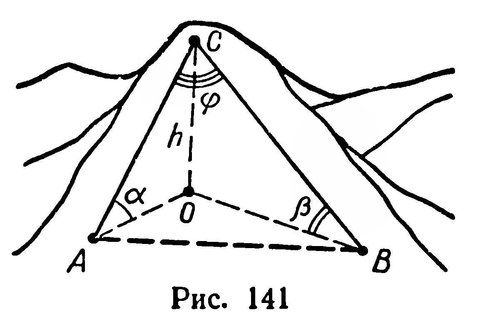

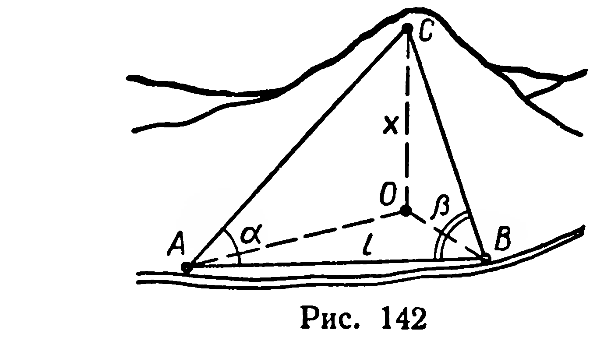

лом $\beta$ к другой стороне ромба. Найдите площадь проекции ромба на эту плоскость.

**351.** 1) Сквозь гору между точками $A$ и $B$ нужно проложить горизонтальный туннель (рис. 141). Из точки $C$, расположенной на высоте $h$ над туннелем, отрезок $AB$ виден под углом $\varphi$, а из точек $A$ и $B$ точка $C$ видна под углами $\alpha$ и $\beta$ над горизонтальной плоскостью. Найдите длину туннеля.

2) Горизонтальный участок $AB$ горной дороги имеет длину $l$ (рис. 142). Из точек $A$ и $B$ вершина $C$ горы видна под углами $\widehat{CAB} = \alpha$, $\widehat{CBA} = \beta$. Какой из углов, изображенных на рисунке, достаточно знать, чтобы вычислить высоту $x$ горы над дорогой? Обозначив этот угол через $\varphi$, найдите $x$.

**§ 38. ДВУГРАННЫЙ УГОЛ. ИЗМЕРЕНИЕ ДВУГРАННЫХ УГЛОВ**

1. Пусть даны две непараллельные плоскости $\alpha$ и $\beta$ (рис. 143). Плоскость $\alpha$ служит общей границей двух замкнутых полупространств $P_1$ и $P_2$, а плоскость $\beta$ — полупространств $Q_1$ и $Q_2$. Выберем по одному полупространству из каждой пары, например $P_1$ и $Q_2$ (рис. 143), рассмотрим их пересечение $P_1 \cap Q_2$.

**Определение 1.** Пересечение двух полупространств, границами которых служат непараллельные плоскости, называется двугранным углом.

Двугранный угол (рис. 144) является выпуклой фигурой. Каждый двугранный угол ограничен двумя полуплоскостями,

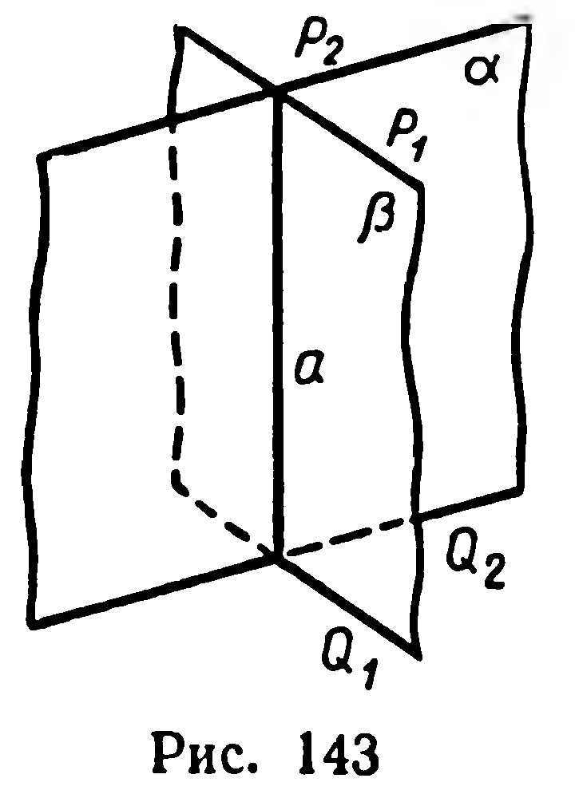

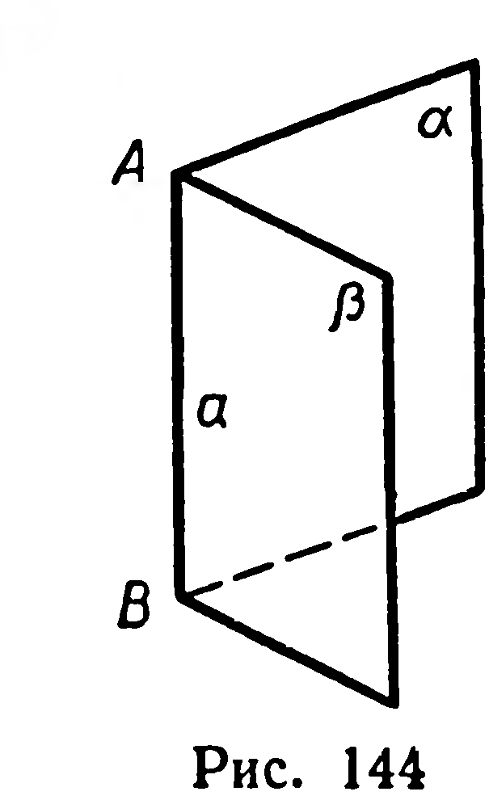

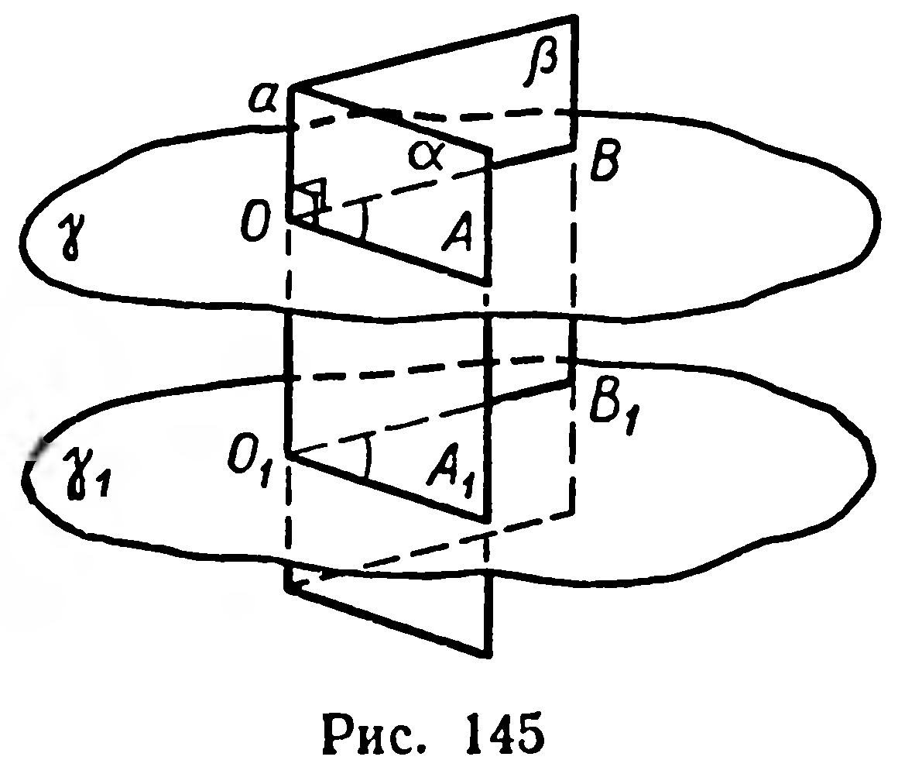

---
**стр. 89**
---

называемыми его **гранями**. Прямая, являющаяся общей границей граней, называется **ребром** двугранного угла. Все точки двугранного угла, не принадлежащие граням, образуют его **внутреннюю область**.

Двугранный угол обозначается с помощью значка $\angle$ и букв, указывающих его грани и ребро. При этом буква, обозначающая ребро, ставится между буквами, обозначающими грани. Например, угол, изображенный на рисунке 144, обозначается $\angle \alpha a \beta$. Применяется и краткое обозначение двугранного угла по его ребру, например $\angle a$, $\angle AB$.

2. Пусть имеем двугранный угол $\alpha a \beta$. Через произвольную точку $O$ ребра $a$ проведем плоскость $\gamma$, перпендикулярную $a$ (рис. 145). Получим угол $AOB$:
$$\gamma \cap \angle \alpha a \beta = \angle AOB.$$
Величина этого угла не зависит от выбора точки $O$ на ребре двугранного угла. Чтобы убедиться в этом, проведем через любую другую точку $O_1$ ребра $a$ плоскость $\gamma_1$, перпендикулярную $a$. Величина получившегося угла $A_1O_1B_1$ равна величине угла $AOB$, что следует из теоремы об углах с сонаправленными сторонами (§ 24).

О п р е д е л е н и е 2. Пересечение двугранного угла и плоскости, перпендикулярной к его ребру, называется **линейным углом**¹ двугранного угла.

Стороны линейного угла перпендикулярны ребру двугранного угла (§ 28, определение).

Можно доказать, что необходимым и достаточным условием конгруэнтности двух двугранных углов является равенство величин их линейных углов.

О п р е д е л е н и е 3. **Величиной** двугранного угла называется величина его **линейного угла**.

Линейный угол двугранного угла (рис. 145) меньше $180^\circ$. Поэтому величина двугранного угла заключена в промежутке $]0^\circ; 180^\circ[$. Величину двугранного угла $\alpha a \beta$ обозначают $\widehat{\alpha a \beta}$, например: $\widehat{\alpha a \beta} = 60^\circ$.

Двугранный угол называют прямым, острым или тупым в зависимости от того, будет ли линейный угол этого двугранного угла прямым, острым или тупым.

Две пересекающиеся плоскости определяют в пространстве четыре двугранных угла. Из рассмотрения их линейных углов (рис. 146) следует, что величины этих дву-

¹ Величину линейного угла для краткости также называют линейным углом.

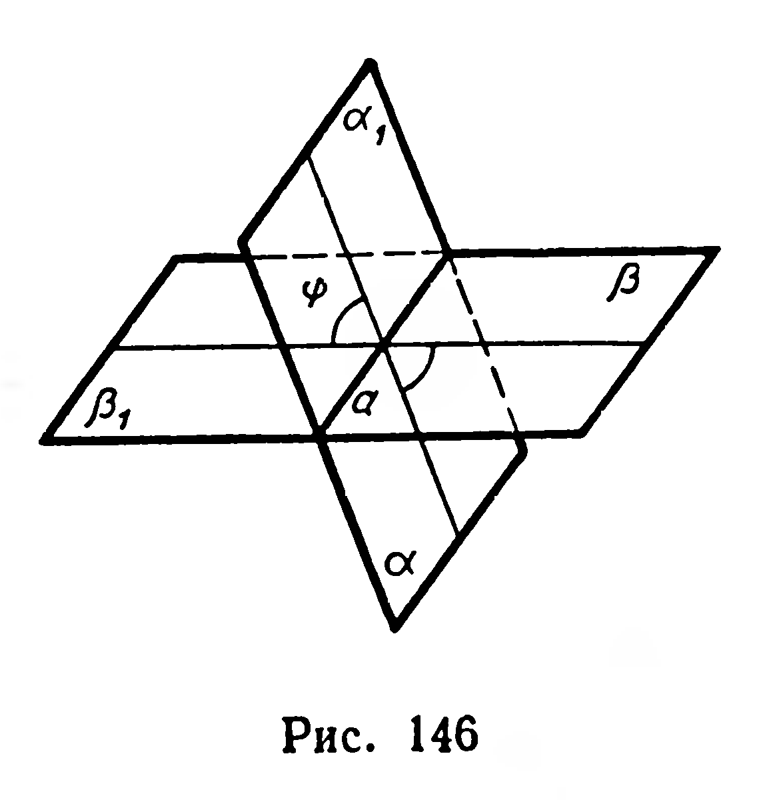

---
**стр. 90**
---

гранных углов попарно равны и сумма величин двух углов, имеющих общую грань, равна $180^\circ$.

Величину меньшего из двугранных углов, определяемых двумя пересекающимися плоскостями, назовем *углом между* этими *плоскостями*.

Если две плоскости параллельны, то угол между ними считается равным $0^\circ$.

Обозначение угла между плоскостями $\alpha$ и $\beta$:
$$(\widehat{\alpha, \beta}) = \varphi, \text{ где } 0^\circ \leqslant \varphi \leqslant 90^\circ.$$
Две плоскости называют взаимно **перпендикулярными**, если угол между ними равен $90^\circ$. В этом случае употребляют запись: $\alpha \perp \beta$.

**Задачи**

352°. Укажите модели двугранных углов на предметах окружающей обстановки.

353. Дан куб $ABCDA_1B_1C_1D_1$. Рассмотрите двугранный угол с ребром $AB$ и гранями, проходящими через точки $D_1$ и $D$ (рис. 147). Вычислите $D\hat{A}D_1$ и $D\hat{B}D_1$. Какой из этих углов служит линейным углом данного двугранного угла?

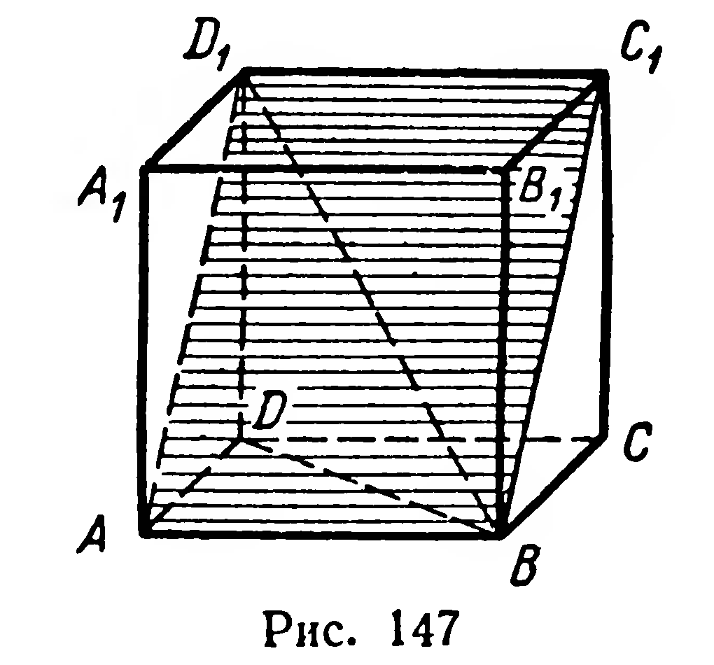

354°. 1) Можно ли считать линейным углом двугранного угла угол, стороны которого — два луча, проведенные в гранях двугранного угла из одной точки ребра?
2) Равен ли линейному углу двугранного угла угол между двумя лучами, перпендикулярными его ребру и лежащими в его гранях?

355°. Сторона $BC$ прямоугольника $ABCD$ служит стороной треугольника $BCF$ (рис. 148), причем вершина $F$ проектируется на $(DC)$. Назовите линейный угол двугранного угла $BC$.

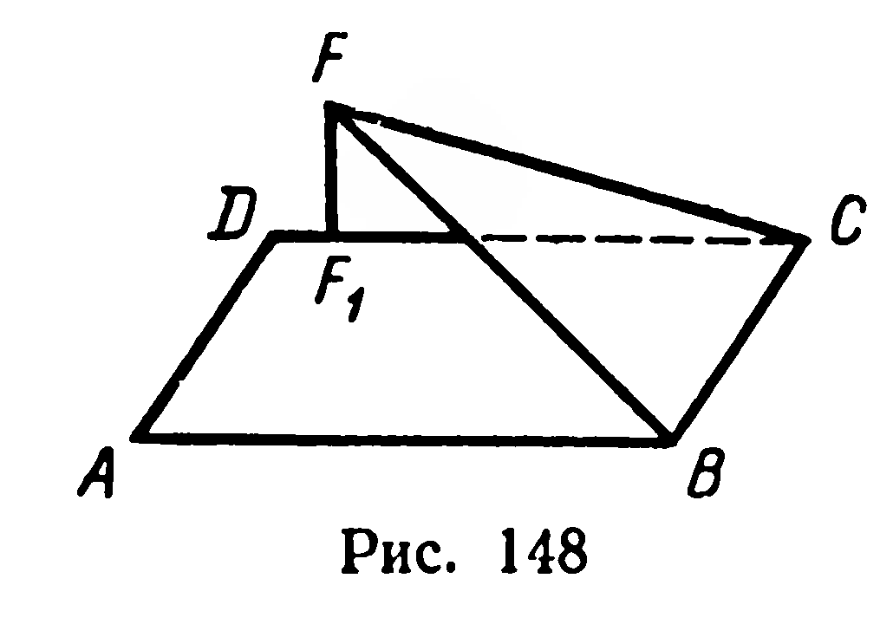

356. Дано изображение равнобедренной трапеции $ABCD$ и треугольника $ABM$ (рис. 149). Отрезок $MC$ изображает перпендикуляр, проведенный из точки $M$ к плоскости $ABC$. Постройте линейный угол двугранного угла $AB$ так, чтобы одна из его сторон проходила через точку $M$.

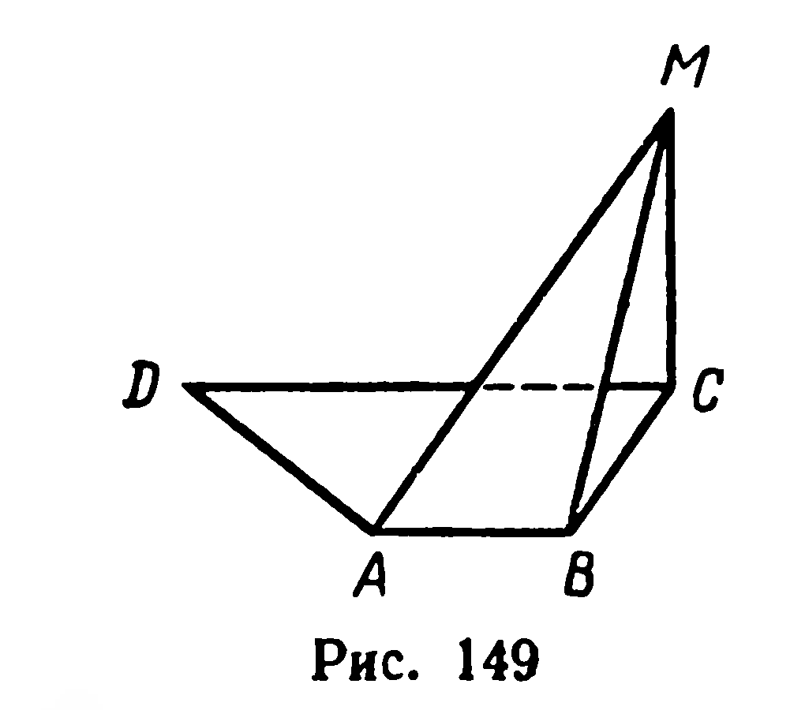

357. Найдите множество всех точек:
1) принадлежащих одной грани двугранного угла и удаленных от плоскости

---
**стр. 91**
---

--- стр. 91 ---

другой грани на расстояние $l$; 2) принадлежащих двугранному углу и удаленных от плоскости каждой грани на расстояние $l$.

**358.** 1) Вычислите угол заострения стамески по размерам, указанным на рисунке 150.

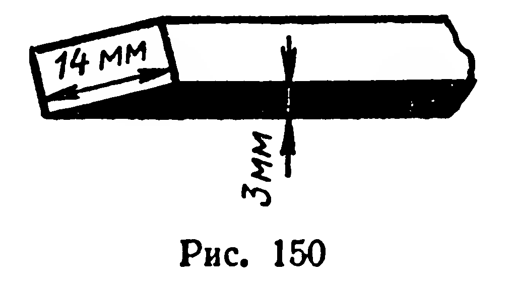

2) Из заготовки толщиной 2,0 мм нужно изготовить стамеску с углом заострения в $12^\circ$. На каком расстоянии от края заготовки должна начинаться сточенная часть?

**359.** 1) На грани двугранного угла величиной $45^\circ$ дана точка, удаленная от ребра на расстояние $a$. Найти расстояние от этой точки до другой грани.

Решение. Пусть $\widehat{\alpha m \beta} = 45^\circ$, $C \in \beta$ (рис. 151). Проведем $[CB] \perp \alpha$ и $[CD] \perp m$, где $B \in \alpha$, $D \in m$. По теореме о трех перпендикулярах отрезок $BD$ перпендикулярен ребру $m$. Тогда $\angle BDC$ — линейный угол данного двугранного угла.

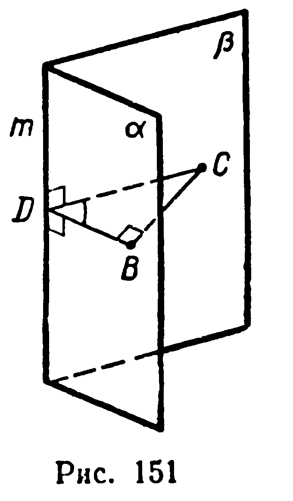

Имеем: $|CD| = a$, $\widehat{BDC} = 45^\circ$; требуется найти $|BC|$. Из прямоугольного треугольника $BCD$ получим:
$$|BC| = |CD| \cdot \sin \widehat{BDC} = a \sin 45^\circ = \frac{a\sqrt{2}}{2}.$$

2) Найдите величину двугранного угла, если расстояние от точки, взятой на одной грани, до ребра в три раза больше расстояния от данной точки до плоскости второй грани.

**360.** Внутри двугранного угла величиной $120^\circ$ дана точка $M$, удаленная от каждой грани на расстояние $a$. Найдите расстояние от этой точки до ребра двугранного угла.

**361.** 1) Грани одного двугранного угла соответственно параллельны граням другого. Какова зависимость между величинами этих углов?

2) На изображении параллелепипеда $ABCDA_1B_1C_1D_1$ (рис. 152) укажите несколько пар равных по величине двугранных углов.

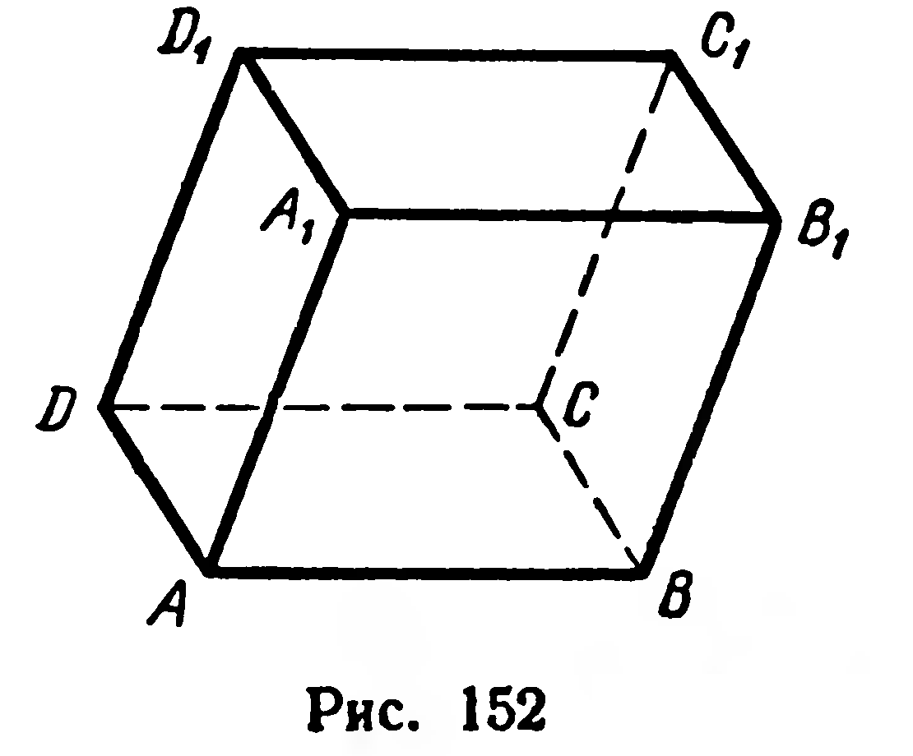

**362.** Эскалатор (движущаяся лестница) одной из станций Московского метрополитена в наклонной части имеет 170 ступенек. Ширина ступеньки 40 см, а высота 20 см. Вычислите: 1) глубину подземной станции; 2) длину спуска; 3) угол наклона лестницы к горизонтальной плоскости пола станции.

---
**стр. 92**
---

**363.** Вычислите толщину $m$ каменноугольного пласта, наклоненного под углом $\varphi = 34^\circ 40'$ к плоскости горизонта, если при вертикальном бурении установлено, что глубина пласта $b = 4{,}4$ м (рис. 153).

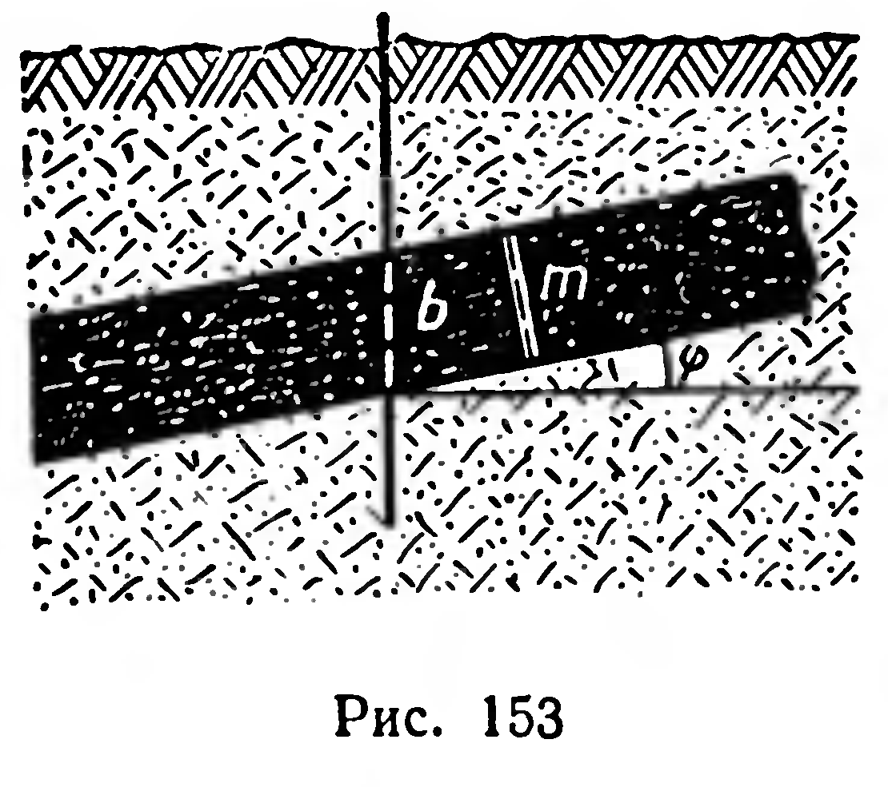

**364.** 1) Через катет $AC$ прямоугольного треугольника $ABC$ ($\widehat{C} = 90^\circ$) проведена плоскость $\alpha$, образующая с плоскостью треугольника угол $\varphi$. Найдите расстояние от вершины $B$ до плоскости $\alpha$, если $|AB| = c$, $|AC| = b$.

2) Катет равнобедренного прямоугольного треугольника наклонен к плоскости $\alpha$, проходящей через гипотенузу, под углом $30^\circ$. Докажите, что угол между плоскостью $\alpha$ и плоскостью треугольника равен $45^\circ$.

**365.** Через основание $BC$ равнобедренного треугольника $ABC$ проведена плоскость $\alpha$; расстояние от вершины $A$ до этой плоскости равно 4 см. Найдите угол между плоскостью $\alpha$ и плоскостью треугольника, если $|BC| = 12$ см, $|AB| = |AC| = 10$ см.

**366.** Дан треугольник $ABC$, в котором $|BC| = 36$ дм, $|AB| = 29$ дм, $|AC| = 25$ дм. Через сторону $BC$ проведена плоскость, образующая с плоскостью треугольника угол $\varphi$. Найдите расстояние от вершины $A$ до плоскости и углы наклона сторон $AC$ и $AB$ к этой плоскости.

**367.** 1) Концы отрезка $AB$ принадлежат граням двугранного угла, равного $\varphi$. Расстояния $|AA_1|$ и $|BB_1|$ от точек $A$ и $B$ до ребра соответственно равны $a$ и $b$, $|A_1B_1| = c$. Найти $|AB|$ (рис. 154).

Решение. Обозначим $\vec{A_1A} = \vec{a}$, $\vec{B_1B} = \vec{b}$, $\vec{A_1B_1} = \vec{c}$. По правилу многоугольника имеем: $\vec{AB} = -\vec{a} + \vec{c} + \vec{b}$. Возведя в квадрат, получим:
$$\overrightarrow{AB}^2 = (-\vec{a})^2 + \vec{c}^2 + \vec{b}^2 - 2\vec{a}\cdot\vec{c} - 2\vec{a}\cdot\vec{b} + 2\vec{b}\cdot\vec{c}.$$

Так как отрезки $A_1A$ и $B_1B$ перпендикулярны отрезку $A_1B_1$, то
$$\vec{a}\cdot\vec{c} = 0,\quad \vec{b}\cdot\vec{c} = 0$$
и
$$|AB|^2 = a^2 + b^2 + c^2 - 2\vec{a}\cdot\vec{b}. \quad (1)$$

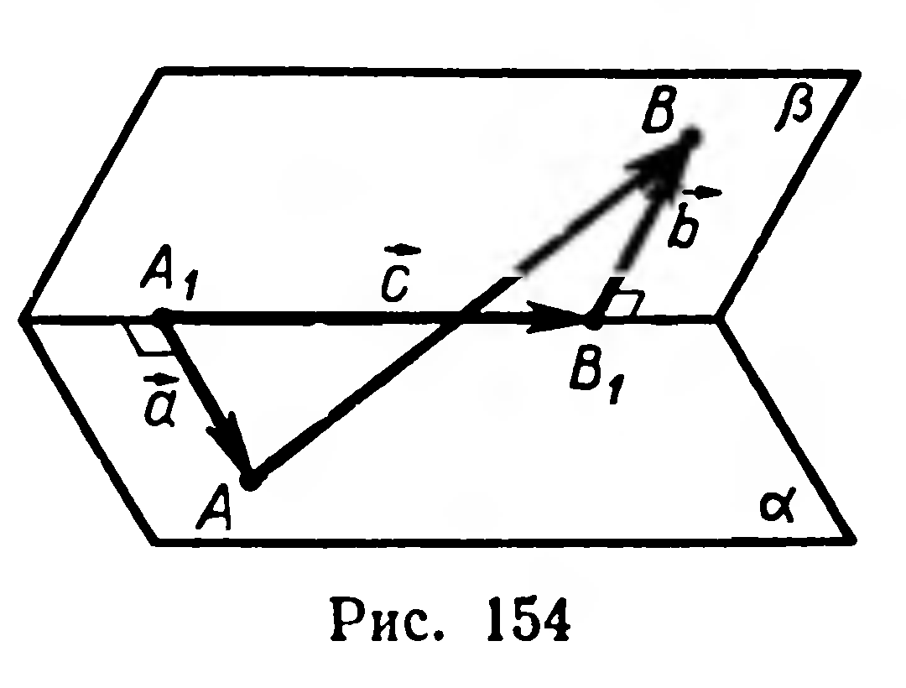

Векторы $\vec{a}$ и $\vec{b}$ сонаправлены сторонам линейного угла, поэтому $(\widehat{\vec{a}, \vec{b}}) = \varphi$.

Из равенства (1) следует:
$$|AB| = \sqrt{a^2 + b^2 + c^2 - 2ab\cos\varphi}.$$
