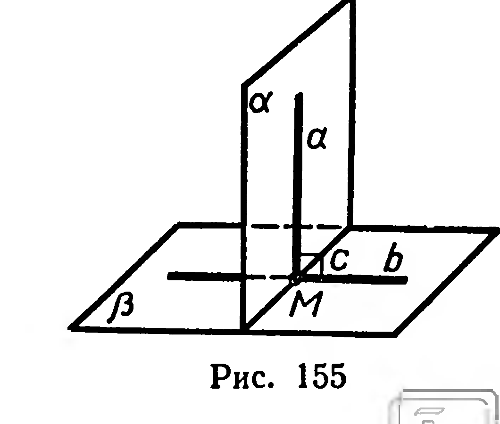
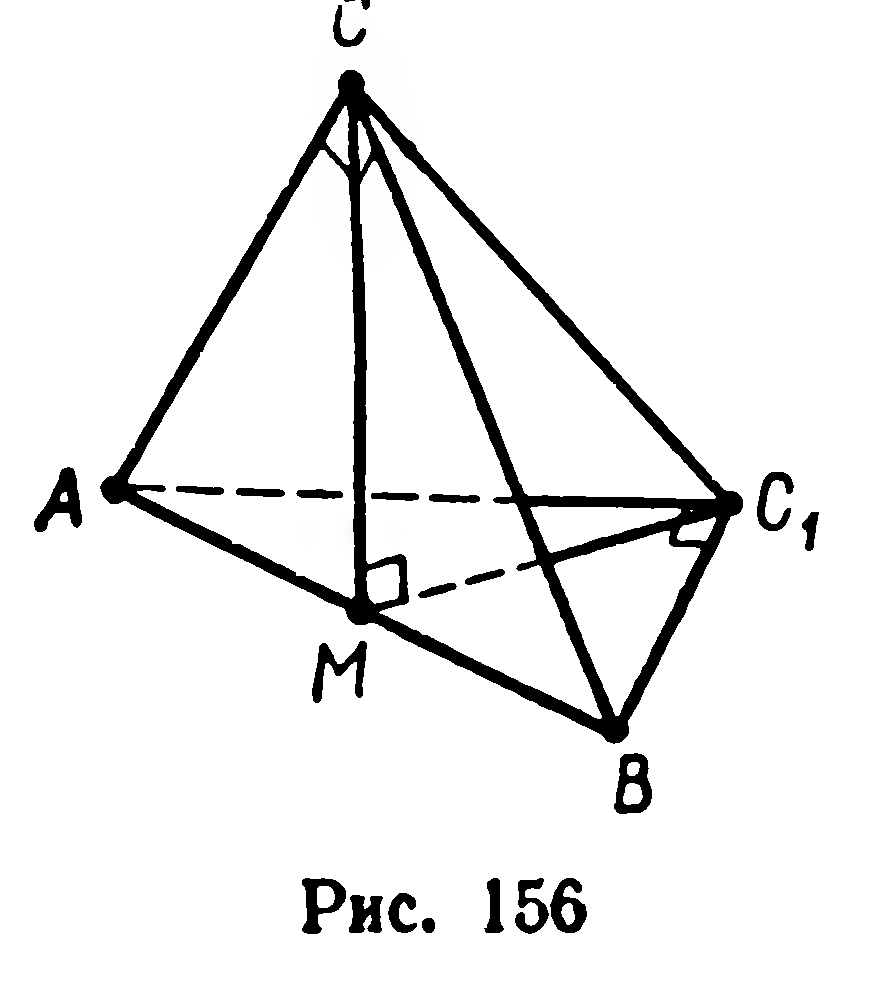

## 3.12. Признак перпендикулярности плоскостей

---
**стр. 93**
---

2) Концы отрезка $AB$, равного $10\text{ см}$, принадлежат граням двугранного угла. Расстояния $|AA_1|$ и $|BB_1|$ от концов данного отрезка до ребра двугранного угла равны соответственно $5\text{ см}$ и $6\text{ см}$; $|A_1B_1|=8\text{ см}$. Найдите величину двугранного угла.

368. 1) В тетраэдре $ABCD$ известны длины рёбер:
$|AB|=14\text{ см},\ |DC|=8\text{ см},\ |AC|=|BC|=|AD|=|BD|=9\text{ см}$.
Найдите величину двугранного угла при ребре $AB$.

2) В тетраэдре $ABCD$ грань $ACD$ — правильный треугольник со стороной $a$, грань $ABC$ — равнобедренный прямоугольный треугольник ($\widehat{ACB}=90^\circ$), длина ребра $BD$ равна $b$. Найдите величину двугранного угла при ребре $AC$.

## § 39. ПРИЗНАК ПЕРПЕНДИКУЛЯРНОСТИ ПЛОСКОСТЕЙ

22. **Теорема** (признак перпендикулярности плоскостей). *Если плоскость проходит через перпендикуляр к другой плоскости, то она перпендикулярна этой плоскости.*

Дано: $a\perp\beta,\ a\subset\alpha$.

Доказать: $\alpha\perp\beta$.

Доказательство. Пусть $a\cap\beta=M$, $\alpha\cap\beta=c$ (рис. 155). Через точку $M$ в плоскости $\beta$ проведём прямую $b$, перпендикулярную $c$; $\widehat{(a,b)}$ — линейный угол двугранного угла $\alpha c\beta$. Из условия $a\perp\beta$ следует, что $a\perp b$, тогда $\widehat{(a,b)}=90^\circ$, т. е. $\alpha\perp\beta$. ■

Доказанная теорема выражает достаточное условие перпендикулярности двух плоскостей. Необходимость этого условия вытекает из следующей теоремы.

23. **Теорема.** *Если две плоскости взаимно перпендикулярны, то прямая, проведённая в одной плоскости перпендикулярно линии пересечения плоскостей, перпендикулярна другой плоскости.*

Дано: $\alpha\perp\beta,\ a\subset\alpha,\ a\perp c$, где $c=\alpha\cap\beta$ (рис. 155).

Доказать: $a\perp\beta$.

Доказательство. Пусть $a\cap c=M$. В плоскости $\beta$ через точку $M$ проведём прямую $b$, перпендикулярную прямой $c$; $\angle(a,b)$ — линейный угол двугранного угла $\alpha c\beta$. Из условия $\alpha\perp\beta$ следует, что $\widehat{(a,\ b)}=90^\circ$, т. е. $a\perp b$. Итак, $a\perp c$ и $a\perp b$, вследствие чего $a\perp\beta$. ■

**Задачи**

369. Докажите перпендикулярность плоскостей двух смежных боковых граней прямоугольного параллелепипеда.

---
**стр. 94**
---

370. Проведите плоскость, перпендикулярную данной плоскости и проходящую через данную: 1) точку; 2) прямую.

371. Верно ли утверждение: если две плоскости взаимно перпендикулярны, то любая прямая, лежащая в одной плоскости, перпендикулярна любой прямой другой плоскости?

372. Докажите, что плоскость, перпендикулярная одной из двух параллельных плоскостей, перпендикулярна и другой.

373. Постройте сечение прямоугольного параллелепипеда $ABCDA_1B_1C_1D_1$ плоскостью, проходящей через середины рёбер $BC$ и $CD$ и перпендикулярной плоскости $ABCD$.

374. Дан куб $ABCDA_1B_1C_1D_1$. Из вершины $A_1$ проведите перпендикуляр $[A_1O]$ к плоскости сечения $ABC_1D_1$. Найдите длину этого перпендикуляра, если ребро куба равно $a$.

375. Два равнобедренных треугольника $ABC$ и $ABM$, имеющие общее основание $AB$, расположены в различных плоскостях. Докажите, что перпендикуляр, проведённый через точку $M$ к плоскости $ABC$, пересекает прямую $CD$, содержащую высоту треугольника $ABC$.

376. Параллельные прямые $a$ и $b$ лежат в плоскости $\alpha$; через каждую из этих прямых проведена плоскость, перпендикулярная $\alpha$. Каково взаимное расположение полученных плоскостей?

377°. Два прямоугольных равнобедренных треугольника имеют общую гипотенузу $AB$, равную $9\text{ см}$; плоскости треугольников взаимно перпендикулярны (рис. 156). Найдите расстояние между вершинами прямых углов.

378. Точка $M$ принадлежит одной из двух взаимно перпендикулярных плоскостей, точка $N$ — другой из них. Расстояния от данных точек до линии пересечения плоскостей: $|MM_1|=14\text{ см}$, $|NN_1|=7\text{ см}$. Найдите $|M_1N_1|$, если $|MN|=21\text{ см}$.

379. Макет прямоугольника $ABCD$ со сторонами $a$ и $b$ перегнут по диагонали $BD$ так, что плоскости треугольников $BAD$ и $BCD$ стали взаимно перпендикулярны. Найдите $|AC|$.

380. Две прямоугольные трапеции с углами $60^\circ$ лежат в перпендикулярных плоскостях и имеют общее большее основание. Большие боковые стороны трапеций равны $4\text{ см}$ и $8\text{ см}$. Найдите расстояние между вершинами прямых и между вершинами тупых углов трапеций, если известно, что вершины их острых углов совпадают.

381. Даны две различные параллельные прямые $a$ и $b$. Укажите оси симметрии, отображающих $a$ на $b$. Какой фигурой является объединение всех таких осей?

382. Укажите плоскости симметрии следующих фигур: 1) плоскости; 2) полуплоскости; 3) угла; 4) объединения двух пересекающихся прямых; 5) объединения двух параллельных прямых; 6) объединения двух параллельных плоскостей.
