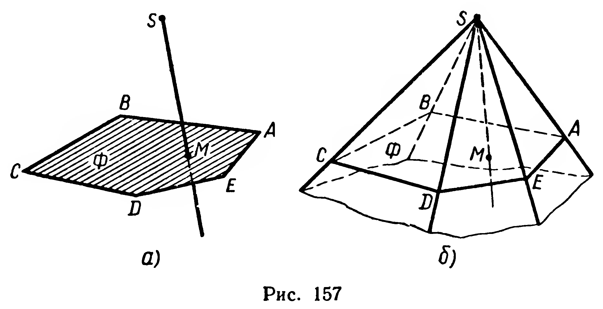
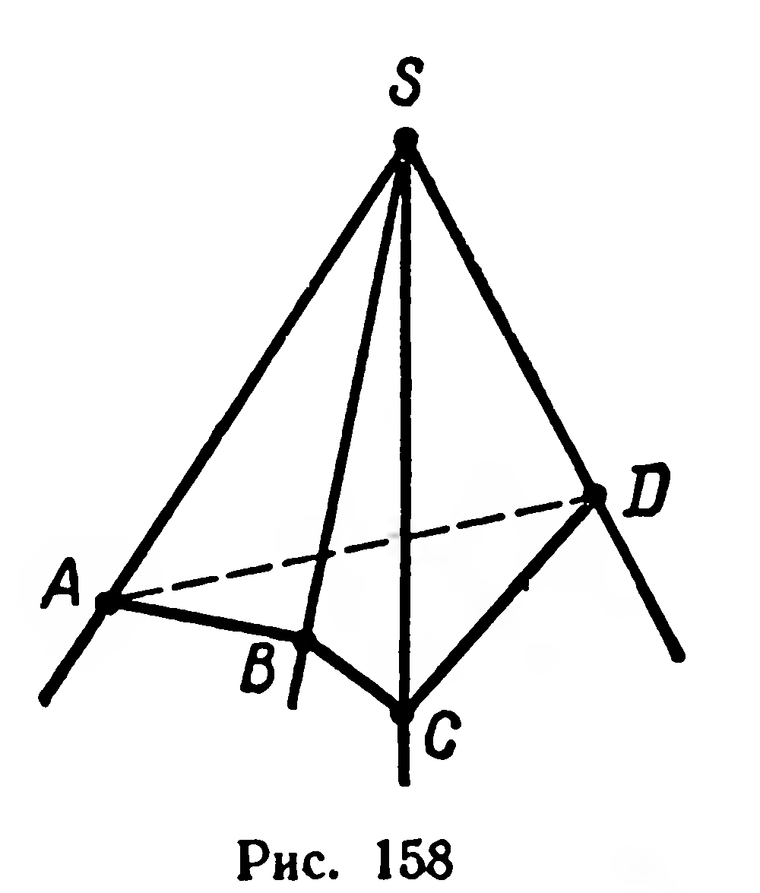

## 3.13. Многогранный угол. Трехгранный угол

---
**стр. 95**
---

## § 40. Многогранный угол. Трехгранный угол

Пусть даны многоугольник $\Phi = ABC\ldots$ и точка $S$, не принадлежащая его плоскости (рис. 157, а). Объединение всех лучей, имеющих общее начало $S$ и пересекающих данный многоугольник $\Phi$ (рис. 157, б), называется многогранным углом.

Точка $S$ называется **вершиной** многогранного угла, лучи $SA$, $SB$, $\ldots$ — его **ребрами**. Углы $ASB$, $BSC$, $\ldots$ называются **гранями** многогранного угла или его плоскими углами. Величина каждого из них принадлежит промежутку $]0^\circ,\; 180^\circ[$.

В зависимости от числа граней различают трехгранные, четырехгранные, пятигранные и т. д. углы. Многогранный угол обозначают с помощью букв, отмечая ими вершину и точку на каждом из ребер, причем на первом месте ставится буква, обозначающая вершину. Например, пятигранный угол, изображенный на рисунке 157, б, обозначают $SABCDE$.

Каждые две грани многогранного угла, имеющие общее ребро, определяют двугранный угол, например $\angle SA$, $\angle SB$ (рис. 157, б).

Множество всех точек многогранного угла, не принадлежащих граням, называют его **внутренней областью**. Если внутренняя область многогранного угла расположена по одну сторону от плоскости каждой из его граней, то такой многогранный угол является выпуклой фигурой. Невыпуклый многогранный угол изображен на рисунке 158.

Мы будем рассматривать только выпуклые многогранные углы, причем более подробно будем изучать трехгранные углы.
