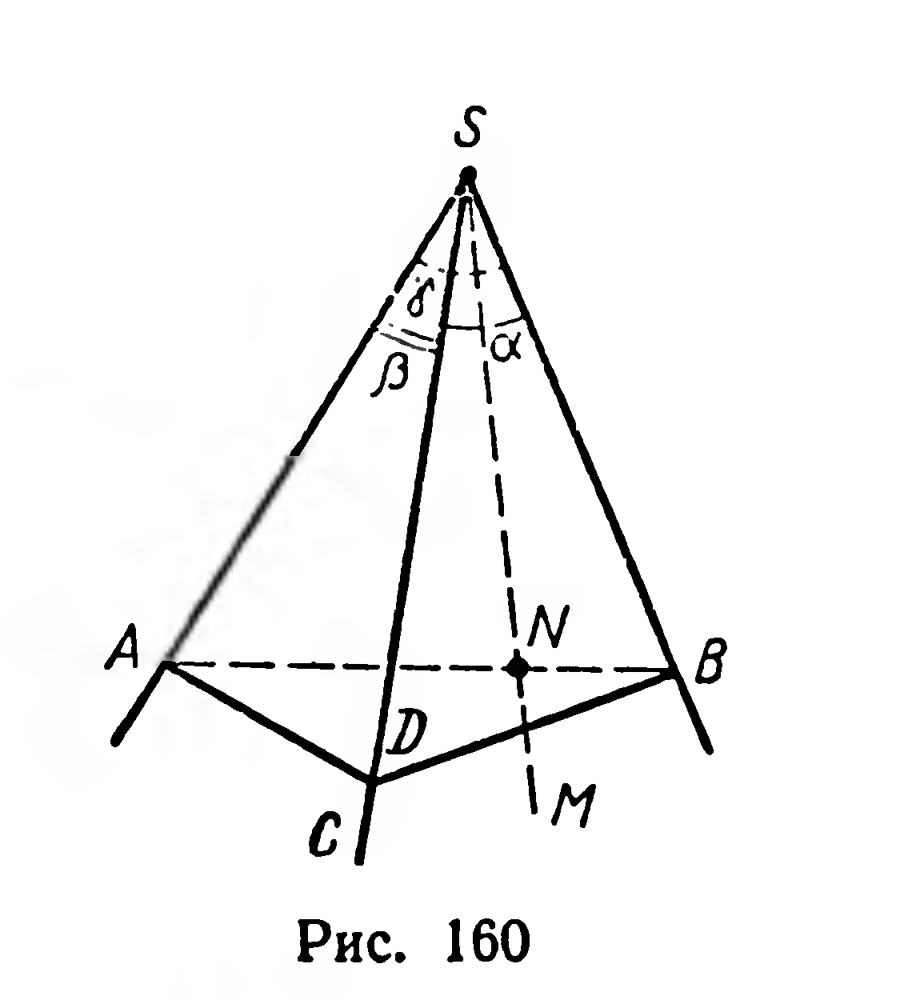
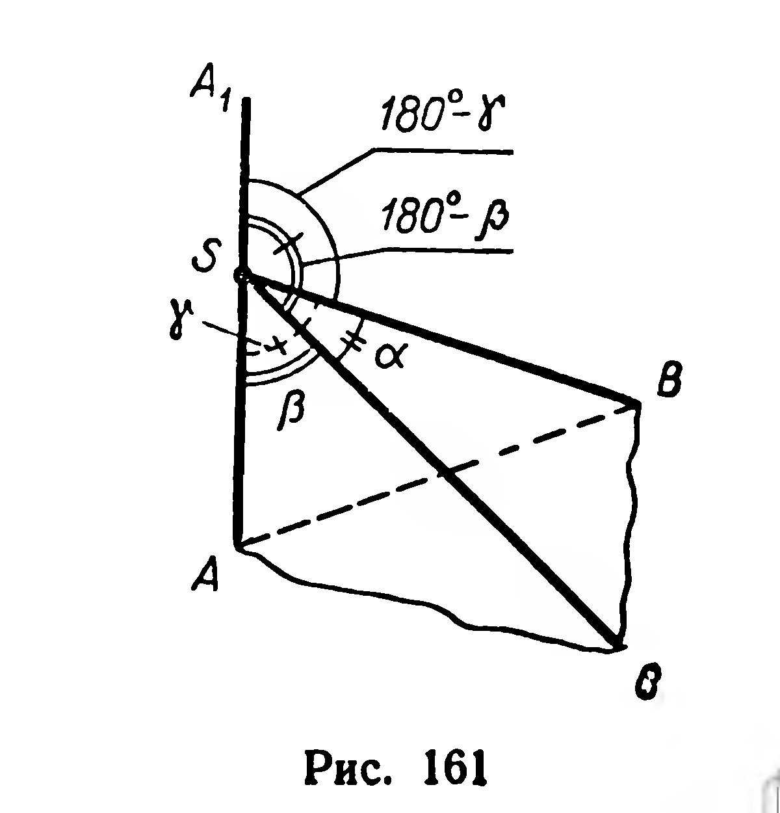

## 3.14. Свойства плоских углов трехгранного и многогранного углов

---
**стр. 96, продолжение**
---

## § 41. Свойства плоских углов трехгранного и многогранного углов

**24. Теорема.** *Величина каждого плоского угла трехгранного угла меньше суммы величин двух других его плоских углов.*

**Доказательство.** Величины плоских углов трехгранного угла $SABC$ обозначим $\alpha$, $\beta$, $\gamma$ (рис. 160). Пусть $\gamma$ — наибольший из этих углов. Достаточно доказать, что $\gamma < \alpha + \beta$.

---
**стр. 97**
---

Внутри угла $ASB$ проведем луч $SM$, образующий с лучом $SA$ угол величиной $\beta$. Проведем отрезок $AB$, он пересечет луч $SM$ в некоторой точке $N$. Отложим на луче $SC$ отрезок $SD$, конгруэнтный отрезку $SN$. Треугольники $ASD$ и $ASN$ конгруэнтны (по двум сторонам и углу, заключенному между ними). Из $\triangle ABD$ имеем:

$$|AD| + |DB| > |AB|.$$

Но

$$|AB| = |AN| + |NB| \text{ и } |AD| = |AN|,$$

поэтому из последнего неравенства следует, что $|DB| > |NB|$.

Применив к треугольникам $BSD$ и $BSN$ теорему косинусов, из неравенства $|DB|^2 > |NB|^2$ получим, что $\cos \alpha < \cos \widehat{NSB}$, откуда $\widehat{NSB} < \alpha$. Тогда

$$\widehat{ASN} + \widehat{NSB} < \alpha + \beta, \text{ или } \gamma < \alpha + \beta.$$ ■

**Следствие.** *Величина каждого плоского угла трехгранного угла больше разности величин двух других его плоских углов.*

Действительно, из неравенства $\gamma < \alpha + \beta$ следует: $\alpha > \gamma - \beta$.

**25. Теорема.** *В трехгранном угле сумма величин всех его плоских углов меньше $360^\circ$.*

**Доказательство.** Рассмотрим трехгранный угол $SABC$ с плоскими углами $\alpha$, $\beta$, $\gamma$ (рис. 161). Проведем луч $SA_1$, дополняющий луч $SA$ до прямой. Величины плоских углов трехгранного угла $SA_1BC$ равны: $\alpha$, $180^\circ - \beta$, $180^\circ - \gamma$. Применив к этому трехгранному углу теорему 24, получим: $\alpha < (180^\circ - \beta) + (180^\circ - \gamma)$, или $\alpha + \beta + \gamma < 360^\circ$. ■

Каждое из неравенств $|\beta - \gamma| < \alpha < \beta + \gamma$ и $\alpha+\beta+\gamma < 360^\circ$ выражает необходимое условие существования трехгранного угла с плоскими углами $\alpha$, $\beta$, $\gamma$. Оказывается, выполнение обоих этих

---
**стр. 98**
---

неравенств является и достаточным условием существования такого трехгранного угла. (См. «Приложения», с. 224.)

Свойства плоских углов выпуклого многогранного угла аналогичны свойствам трехгранного угла:

1. *Величина каждого плоского угла многогранного угла меньше суммы величин остальных его плоских углов.*
2. *В выпуклом многогранном угле сумма величин плоских углов меньше $360^\circ$.*

Эти свойства доказаны в «Приложениях», с. 225.

**Задачи**

391. Можно ли изготовить макет трехгранного угла с плоскими углами: 1) $100^\circ$, $120^\circ$, $10^\circ$; 2) $80^\circ$, $50^\circ$, $30^\circ$; 3) $125^\circ$, $120^\circ$, $115^\circ$?

392. 1) Два плоских угла трехгранного угла равны $70^\circ$ и $80^\circ$. В каких границах находится третий плоский угол?  
2) Тот же вопрос для углов $100^\circ$ и $90^\circ$.

393. Все плоские углы трехгранного угла прямые. Найдите величины двугранных углов этого трехгранного угла.

394. Докажите, что если сумма величин плоских углов трехгранного угла равна $180^\circ$, то все они острые.

395*. Треугольники $ABC$ и $ABD$ не лежат в одной плоскости. Докажите, что

$$\widehat{ACB} + \widehat{CBD} + \widehat{BDA} + \widehat{DAC} < 360^\circ.$$

396. В трехгранном угле два плоских угла равны по $45^\circ$; двугранный угол между ними прямой. Найдите третий плоский угол.

397. Все плоские углы трехгранного угла равны по $60^\circ$. На одном из ребер взята точка на расстоянии $a$ от вершины угла. Найдите расстояние от этой точки до плоскости противолежащей грани.

398. В трехгранном угле два плоских угла равны по $60^\circ$, третий равен $90^\circ$. Найдите угол наклона ребра, противолежащего прямому плоскому углу, к плоскости этого угла.

399*. Найдите множество всех точек трехгранного угла, каждая из которых одинаково удалена от всех его ребер.

400*. Докажите, что для любого трехгранного угла с плоскими углами $\alpha$, $\beta$ и $\gamma$ выполняется неравенство:

$$\cos \alpha + \cos \beta + \cos \gamma > -\frac{3}{2}.$$

401*. Докажите, что биссектрисы двух плоских углов трехгранного угла и биссектриса угла, смежного с третьим плоским углом, лежат в одной плоскости.

402. Существует ли многогранный угол, имеющий плоские углы: 1) $80^\circ$, $130^\circ$, $70^\circ$, $100^\circ$? 2) $10^\circ$, $20^\circ$, $40^\circ$, $80^\circ$, $160^\circ$?

---
**стр. 99**
---

**403.** В четырехгранном угле $SABCD$ все плоские углы, а также угол $ASC$ равны по $60^\circ$. Найдите величины его двугранных углов.

**404.** Докажите, что любой выпуклый четырехгранный угол можно пересечь плоскостью так, чтобы в сечении получился параллелограмм.
