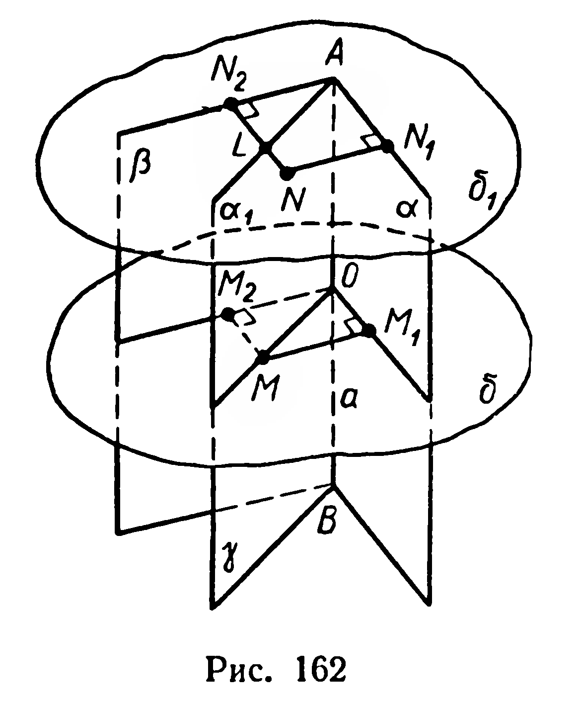

## 3.15. Задачи на повторение к главе III

---
**стр. 99**
---

**403.** В четырехгранном угле $SABCD$ все плоские углы, а также угол $ASC$ равны по $60^\circ$. Найдите величины его двугранных углов.

**404.** Докажите, что любой выпуклый четырехгранный угол можно пересечь плоскостью так, чтобы в сечении получился параллелограмм.

**Задачи на повторение к главе II**

**405.** Дан прямоугольный параллелепипед $ABCDA_1B_1C_1D_1$: $|AB| = |AA_1| = a$, $|BC| = a\sqrt{3}$. Постройте его сечение плоскостью, проходящей через точку пересечения прямых $BD$ и $AC$ и перпендикулярной к прямой $AC$. Вычислите площадь этого сечения.

**406.** Точка $D$ равноудалена от вершин правильного треугольника и не принадлежит его плоскости. Докажите, что прямая, проведенная через точку $D$ и центр треугольника, перпендикулярна его плоскости.

**407.** Дано: $a \parallel \alpha$, $b \perp \alpha$. Доказать: $a \perp b$.

**408.** Все вершины параллелограмма $ABCD$ расположены по одну сторону от плоскости $\alpha$. Расстояния от вершин до плоскости соответственно равны $a$, $b$, $c$, $d$. Докажите, что $a + c = b + d$.

**409.** Сторона правильного шестиугольника $ABCDEF$ равна $3$ см, перпендикуляр $[AM]$ к его плоскости равен $1$ см. Найдите расстояния от $M$ до каждой из вершин шестиугольника.

**410.** Стороны параллелограмма образуют угол $\varphi$, их длины равны $a$ и $b$. Из точки $O$ пересечения диагоналей проведен к плоскости параллелограмма перпендикуляр $[OM]$ длиной $d$. Найдите расстояния от $M$ до вершин параллелограмма.

**411.** Найдите множество всех точек, каждая из которых удалена от пересекающихся плоскостей $\alpha$ и $\beta$ соответственно на расстояния $a$ и $b$ ($a \neq 0$, $b \neq 0$).

**412.** Постройте общий перпендикуляр диагонали куба и ребра, не пересекающего эту диагональ.

**413.** Стороны основания прямоугольного параллелепипеда равны $a$ и $b$. Найдите расстояние между диагональю параллелепипеда и не пересекающим ее боковым ребром.

**414*.** Постройте сечение куба плоскостью, перпендикулярной к его диагонали и проходящей через середину диагонали.

**415.** Через вершину $A$ острого угла тупоугольного треугольника $ABC$ проведен перпендикуляр $[AK]$ к его плоскости. Точка $K$ соединена с вершинами $B$ и $C$. Докажите, что треугольник $BCK$ также тупоугольный.

**416.** В равнобедренной трапеции большее основание равно $a$, острый угол $60^\circ$, а диагональ перпендикулярна боковой стороне. Из точки $O$ пересечения диагоналей проведен перпендикуляр $[OM]$ к плоскости трапеции, имеющий длину $h$. Найдите расстояния от точки $M$ до сторон трапеции.

---
**стр. 100**
---

**417.** Из точек $A$ и $B$, одинаково удаленных от плоскости $\alpha$, проведены к ней конгруэнтные наклонные $[AA_1]$ и $[BB_1]$ ($A_1$ и $B_1$ принадлежат $\alpha$). Докажите, что эти наклонные образуют равные углы с плоскостью $\alpha$.

**418.** Достаточным, необходимым или необходимым и достаточным условием параллельности плоскостей $\alpha$ и $\beta$ является существование:
1) такой прямой $a$, что $\widehat{(a, \alpha)} = \widehat{(a, \beta)}$;
2) такой плоскости $\gamma$, что $\widehat{(\gamma, \alpha)} = \widehat{(\gamma, \beta)}$?

**419.** Из точки $M$, принадлежащей ребру двугранного угла $\alpha a \beta$, проведен в грани $\alpha$ луч $MN$, не перпендикулярный ребру. В грани $\beta$ проведите луч $ML$ так, чтобы $\widehat{NML} = 90^\circ$.

**420*.** Дан прямоугольник $ABCD$. Через сторону $AD$ проведена плоскость $\alpha$ так, что диагональ $BD$ составляет с этой плоскостью угол $30^\circ$. Найдите угол $\varphi$ между плоскостью прямоугольника и плоскостью $\alpha$, если $|AB| = a$, $|AD| = b$. При каком соотношении между $a$ и $b$ задача имеет решение?

**421.** 1) Через вершину квадрата проведена плоскость, параллельная противолежащей диагонали. Проекции диагоналей квадрата на эту плоскость относятся как $1 : 2$. Найдите угол между этой плоскостью и плоскостью квадрата.

2) Через вершину $C$ ромба $ABCD$ проведена плоскость $\alpha$, параллельная диагонали $BD$. Докажите, что угол между плоскостью ромба и плоскостью $\alpha$ равен углу наклона диагонали $AC$ к плоскости $\alpha$.

**422.** Полуплоскость, делящая двугранный угол на два равных по величине двугранных угла, называется его *биссектором*. Доказать, что множество всех точек двугранного угла, каждая из которых одинаково удалена от его граней, есть биссектор этого двугранного угла.

Р е ш е н и е. Пусть полуплоскость $\gamma$ — биссектор двугранного угла $\alpha a \beta$ (рис. 162).

а) Возьмем произвольную точку $M$ биссектора $\gamma$ ($M \notin a$), проведем $[MM_1] \perp \alpha$ и $[MM_2] \perp \beta$ (рис. 162). Через прямые $MM_1$ и $MM_2$ проведем плоскость $\delta$. Эта плоскость перпендикулярна ребру $a$ (так как $(MM_1) \perp a$ и $(MM_2) \perp a$), поэтому углы $M_1OM$ и $M_2OM$ — линейные углы двугранных углов $\gamma a \alpha$ и $\gamma a \beta$. Но эти двугранные углы равны по величине, поэтому $\widehat{M_1OM} = \widehat{M_2OM}$, т. е. $[OM)$ — биссектриса угла $M_1OM_2$. По свойству биссектрисы угла $|MM_1| = |MM_2|$.
