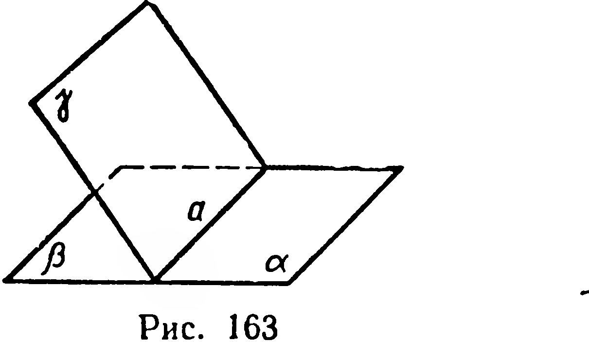
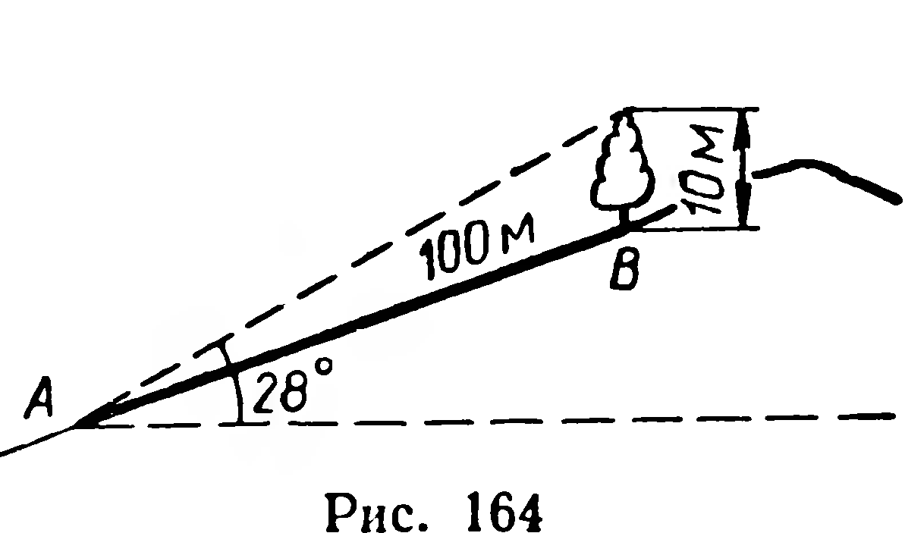
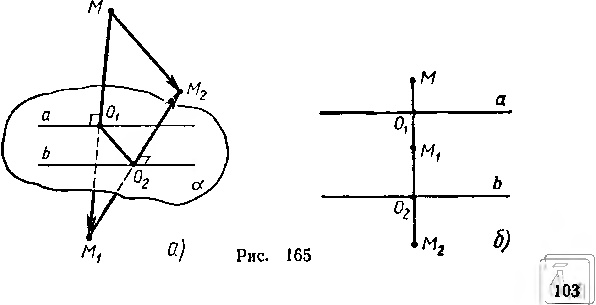

## 3.16. Задачи на повторение по курсу IX класса

---
**стр. 101**
---

б) Возьмем точку $N$ вне плоскости $\gamma$, но внутри угла $\alpha a \beta$.

Проведем $[NN_1] \perp \alpha$, $[NN_2] \perp \beta$, через $(NN_1)$ и $(NN_2)$ проведем плоскость $\delta_1$. Пересечения этой плоскости с полуплоскостями $\alpha$, $\beta$, $\gamma$ являются сторонами линейного угла $N_1AN_2$ и его биссектрисой $[LA)$. Так как точка $N$ лежит вне этой биссектрисы, то $|NN_1| \ne |NN_2|$.

423°. 1) Докажите, что плоскость, содержащая биссектор двугранного угла, является плоскостью симметрии этого двугранного угла.

2) Докажите, что двугранный угол имеет бесконечное множество плоскостей симметрии.

424°. Найдите множество всех точек, каждая из которых одинаково удалена от двух пересекающихся плоскостей.

425. 1) Какие плоскости симметрии имеет объединение двух пересекающихся плоскостей? 2) Какие оси симметрии имеет эта фигура?

426*. Через биссектрису $l$ линейного угла двугранного угла проведена плоскость, пересекающая грани двугранного угла по лучам $OA$ и $OB$. Докажите, что луч $l$ есть биссектриса угла $AOB$.

427. Грани $DAB$ и $CAB$ тетраэдра $ABCD$ взаимно перпендикулярны, высоты $DD_1$ и $CC_1$ этих граней равны по 2 м, ребро $DC$ равно 3 м. Найдите $|D_1C_1|$.

428. Даны смежные двугранные углы (рис. 163). Докажите, что их биссекторы взаимно перпендикулярны.

429. В трехгранном угле два острых плоских угла конгруэнтны. Докажите, что проекция их общего ребра на плоскость третьего плоского угла является его биссектрисой.

430. Докажите, что биссекторы двугранных углов трехгранного угла пересекаются по одной прямой.

**Задачи на повторение по курсу IX класса**

431. Проведите прямую, пересекающую две данные скрещивающиеся прямые и параллельную третьей данной прямой.

432. Даны плоскость, прямая и точка. Через данную точку проведите прямую, которая параллельна данной плоскости и пересекает данную прямую.

433*. Найдите объединение всех прямых, пересекающих две скрещивающиеся прямые.

434°. Даны плоскость $\alpha$ и прямая $m$, пересекающая $\alpha$. Найдите объединение всех прямых, каждая из которых пересекает $m$ и параллельна $\alpha$.

435. 1°) Найдите множество всех точек плоскости, удаленных от другой плоскости на расстояние $l$.

2) Даны плоскость $\alpha$ и отрезок $AB$. Найдите множество всех точек плоскости $\alpha$, каждая из которых одинаково удалена от $A$ и $B$.

---
**стр. 102**
---

436. Дано множество плоскостей, проходящих через одну прямую, и точка, не принадлежащая этой прямой. Найдите множество точек, являющихся основаниями перпендикуляров, проведенных из данной точки ко всем данным плоскостям.

437. Самолет летит горизонтально и прямолинейно со скоростью 400 км/ч. Наблюдатель, над которым он пролетел, измерил, что самолет в некоторый момент времени был виден под углом $65^\circ$ к плоскости горизонта, а через 30 секунд — под углом $39^\circ$ к этой плоскости. На какой высоте летит самолет?

438. Через данную точку проведите прямую, образующую с двумя данными плоскостями углы, равные по величине.

439. Непересекающиеся диагонали двух смежных боковых граней прямоугольного параллелепипеда наклонены к плоскости основания под углами $\alpha$ и $\beta$. Найдите угол между этими диагоналями.

440. Дана трапеция $ABCD$, в которой $\widehat{BAD} = 60^\circ$. Через большее основание $AD$ проведена плоскость под углом $45^\circ$ к боковой стороне $AB$. Найдите отношение площади данной трапеции к площади ее проекции на проведенную плоскость.

441. Одна из сторон проектируемого угла лежит в плоскости пресекций. <!-- вероятная опечатка оригинала: возможно, «проекций» --> Докажите: 1) проекция (ортогональная) прямого угла есть прямой угол; 2) проекция острого угла есть угол, величина которого меньше величины проектируемого угла; 3) проекция тупого угла есть угол, величина которого больше величины проектируемого угла.

442. Найдите множество всех точек, каждая из которых одинаково удалена от прямых, определяемых сторонами: 1) треугольника; 2) правильного $n$-угольника ($n > 3$); 3) параллелограмма, не являющегося ромбом.

443. Прямая пересекает грани двугранного угла в точках $A$ и $B$. Докажите, что она одинаково наклонена к плоскостям граней тогда и только тогда, когда точки $A$ и $B$ одинаково удалены от ребра данного угла.

444. Из точки, принадлежащей грани острого двугранного угла, проведены к ребру перпендикуляр и наклонная. Докажите, что угол, который образует перпендикуляр с плоскостью второй грани, больше, чем угол, образованный наклонной с этой плоскостью.

---
**стр. 103**
---

**445.** 1) Дерево высотой 10 м растет на склоне холма. Из точки, отстоящей от дерева на 100 м (по склону холма), вершина дерева видна под углом 28° к плоскости горизонта (рис. 164). Вычислите угол ската холма.

2) Угол ската горы равен 30°. Под каким углом $\varphi$ к подошве горы нужно проложить прямолинейную дорогу, чтобы угол ее уклона к плоскости горизонта был равен 15°?

**Примечание.** Иногда угол, являющийся линейным углом двугранного угла, называют *углом ската* или же углом наибольшего уклона.

**446.** Бочку с бензином массой 200 кг погружают на автомашину с помощью наклонной доски. Чему равна величина скатывающей силы, если угол ската равен 45°?

**447.** В тетраэдре $ABCD$ ребро $DC$ перпендикулярно плоскости $ABC$, ребро $BD$ составляет с плоскостью $ABC$ угол в 60°. Известно, что грань $ABC$ — правильный треугольник со стороной $a$. Найдите площадь грани $ABD$ и величину двугранного угла $AB$.

**448.** Найдите множество всех точек, каждая из которых одинаково удалена от трех данных параллельных прямых, не лежащих в одной плоскости.

**449.** Докажите, что если плоская фигура имеет ось симметрии, лежащую в плоскости фигуры, то она имеет плоскость симметрии, отличную от плоскости фигуры.

**450.** Вне плоскости $\alpha$ даны точки $A$ и $B$. Укажите в плоскости $\alpha$ точку $M$ так, чтобы сумма $|AM|+|MB|$ имела наименьшее значение.

**451.** Доказать, что композиция двух осевых симметрий с параллельными осями есть перенос.

**Решение.** Имеем $a \parallel b$ (рис. 165). Выберем произвольно точку $M$ пространства, пусть $S_a(M)=M_1$, $S_b(M_1)=M_2$. Тогда композиция $S_b \circ S_a$ отобразит точку $M$ на точку $M_2$. Рассмотрим два случая.

---
**стр. 104**
---

1) Пусть точка $M$ лежит вне плоскости $\alpha$, проходящей через $a$ и $b$ (рис. 165, а).

По правилу треугольника

$$\overrightarrow{MM_2} = \overrightarrow{MM_1} + \overrightarrow{M_1M_2}.$$

Обозначим середины отрезков $MM_1$ и $M_1M_2$ соответственно через $O_1$ и $O_2$, тогда

$$\overrightarrow{MM_2} = 2(\overrightarrow{O_1M_1} + \overrightarrow{M_1O_2}),\ \text{или}\ \overrightarrow{MM_2} = 2\overrightarrow{O_1O_2}.$$

Так как $(MM_1) \perp a$ и $(M_1M_2) \perp a$ (ведь $(M_1M_2) \perp b$, $a \parallel b$) то ось $a$ перпендикулярна и отрезку $O_1O_2$ (почему?); кроме того, $O_1 \in a$, $O_2 \in b$.

Отсюда вытекает, что $\overrightarrow{O_1O_2}$, а следовательно, и $\overrightarrow{MM_2}$ не зависит от выбора точки $M$.

2) Если точка $M$ принадлежит плоскости $\alpha$, то получим случай, рассмотренный в планиметрии (рис. 165, б). И в этом случае $\overrightarrow{MM_2} = 2\overrightarrow{O_1O_2}$.

Итак, $S_b \circ S_a = 2\overrightarrow{O_1O_2}$.

**452\*.** Докажите, что композиция двух симметрий относительно параллельных плоскостей есть перенос.

**453.** Лучи $a$, $b$, $c$, $d$ имеют общее начало. Докажите неравенство:

$$\cos(\widehat{a,b}) + \cos(\widehat{a,c}) + \cos(\widehat{a,d}) + \cos(\widehat{b,c}) + \cos(\widehat{b,d}) + \cos(\widehat{c,d}) \ge -2.$$

**454.** Плоские углы трехгранного угла равны 60°, 60° и 90°. Докажите, что плоскость, отсекающая от ребер три равных отрезка, перпендикулярна плоскости прямого угла.

**455\*.** В трехгранном угле с вершиной $S$ все плоские углы прямые, произвольная плоскость пересекает его ребра в точках $A$, $B$, $C$. Докажите, что перпендикуляр, проведенный из точки $S$ к плоскости сечения, проходит через точку пересечения высот треугольника $ABC$.

**456.** 1) Докажите, что пересечение плоскостей, каждая из которых проходит через ребро трехгранного угла и биссектрису противолежащей грани, есть прямая.

2) В плоскости каждой из граней трехгранного угла проведена прямая, перпендикулярная ребру, противолежащему этой грани. Докажите, что все три прямые параллельны некоторой плоскости.

**457.** Дан тетраэдр, противоположные ребра которого попарно перпендикулярны. Докажите, что плоские углы каждого трехгранного угла тетраэдра одноименны: все три либо острые, либо тупые, либо прямые.
