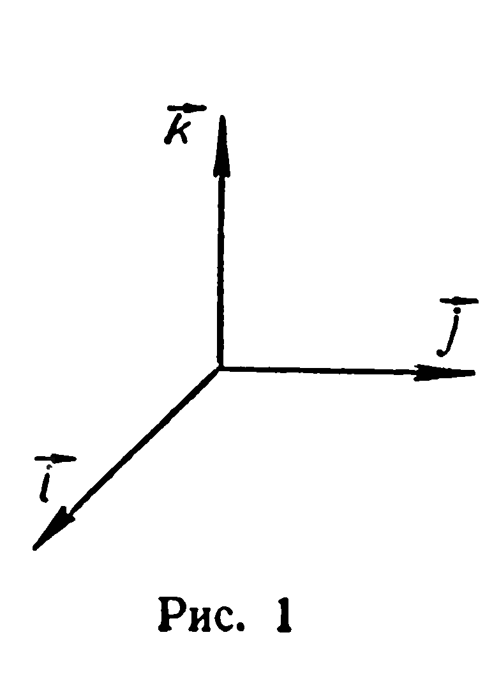
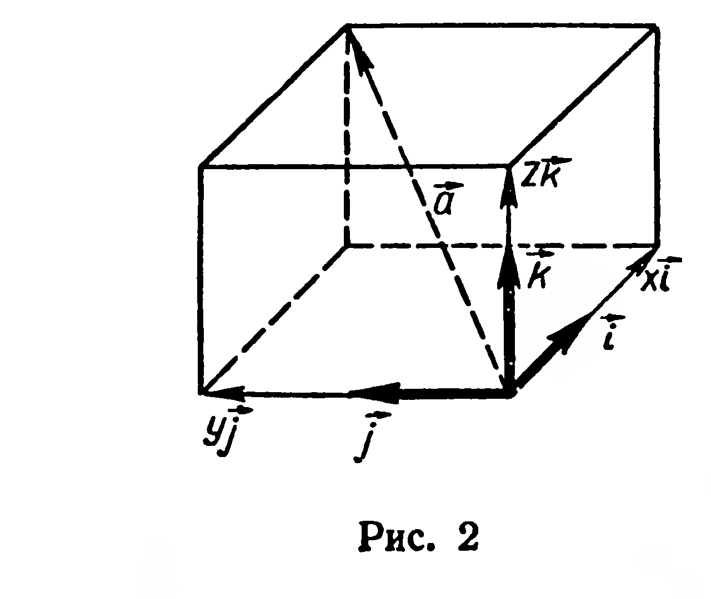

## 4.1. Координаты вектора. Правила действий над векторами, заданными своими координатами

---
**стр. 105**
---

**ГЛАВА IV**

**КООРДИНАТНЫЙ МЕТОД В ПРОСТРАНСТВЕ**

X класс

**§ 42. Координаты вектора. Правила действий над векторами, заданными своими координатами**

1. Пусть задана тройка $(\vec{i}; \vec{j}; \vec{k})$ попарно перпендикулярных единичных векторов (рис. 1). Такую тройку векторов будем называть **прямоугольным базисом**. Известно, что каждый вектор пространства можно разложить по векторам $\vec{i}, \vec{j}, \vec{k}$ (§ 23). Это означает, что для любого вектора $\vec{a}$ существует, и притом только одна, тройка чисел $(x; y; z)$ такая, что

$$\vec{a} = x\vec{i} + y\vec{j} + z\vec{k}. \qquad (1)$$

Справедливо и обратное утверждение: в заданном прямоугольном базисе $(\vec{i}; \vec{j}; \vec{k})$ каждая тройка чисел $(x; y; z)$ определяет единственный вектор. Числа $x, y, z$ называют **координатами вектора** $\vec{a}$ в базисе $(\vec{i}; \vec{j}; \vec{k})$.

Если все координаты вектора $\vec{a}$ отличны от нуля, то $\vec{a}$ можно изобразить с помощью диагонали прямоугольного параллелепипеда, числовые значения длин ребер которого равны $|x|, |y|, |z|$ (рис. 2).

При изложении материала этой главы равенство (1) будем записывать, указывая только координаты вектора:

$$\vec{a} = (x; y; z).$$

2. Рассмотрим правила действий над векторами, заданными своими координатами.

---
**стр. 106**
---

Пусть в базисе $(\vec{i}; \vec{j}; \vec{k})$ заданы векторы

$$\vec{a} = (x_1; y_1; z_1) \text{ и } \vec{b} = (x_2; y_2; z_2).$$

1. *Каждая координата суммы двух (или более) векторов равна сумме соответствующих координат слагаемых:*

$$\vec{a}+\vec{b} = (x_1+x_2; y_1+y_2; z_1+z_2).$$

2. *Каждая координата разности двух векторов равна разности соответствующих координат этих векторов:*

$$\vec{a}-\vec{b} = (x_1-x_2; y_1-y_2; z_1-z_2).$$

3. *Каждая координата произведения вектора на число равна произведению соответствующей координаты данного вектора на это число:*

$$p\vec{a} = (px_1; py_1; pz_1).$$

4. *Скалярное произведение двух векторов равно сумме произведений соответствующих координат этих векторов:*

$$\vec{a}\cdot\vec{b} = x_1x_2 + y_1y_2 + z_1z_2.$$

**Доказательство.** 1) Применяя законы сложения векторов и распределительный закон умножения вектора на число (§ 18, 20), получим:

$$\vec{a}+\vec{b} = (x_1\vec{i} + y_1\vec{j} + z_1\vec{k}) + (x_2\vec{i} + y_2\vec{j} + z_2\vec{k}) =$$
$$= (x_1+x_2)\vec{i} + (y_1+y_2)\vec{j} + (z_1+z_2)\vec{k} = (x_1+x_2; y_1+y_2; z_1+z_2). \blacksquare$$

Правила 2 и 3 доказываются аналогично.

4) При доказательстве четвертого правила, кроме законов сложения векторов и умножения вектора на число, используются законы скалярного умножения векторов (§ 26):

$$\vec{a}\cdot\vec{b} = (x_1\vec{i} + y_1\vec{j} + z_1\vec{k}) \cdot (x_2\vec{i} + y_2\vec{j} + z_2\vec{k}) =$$
$$= x_1x_2\vec{i}^2 + y_1x_2\vec{j}\cdot\vec{i} + z_1x_2\vec{k}\cdot\vec{i} + x_1y_2\vec{i}\cdot\vec{j} +$$
$$+ y_1y_2\vec{j}^2 + z_1y_2\vec{k}\cdot\vec{j} + x_1z_2\vec{i}\cdot\vec{k} + y_1z_2\vec{j}\cdot\vec{k} + z_1z_2\vec{k}^2.$$

По определению прямоугольного базиса и свойствам скалярного произведения (§ 25) получим:

$$\vec{i}\cdot\vec{j} = \vec{i}\cdot\vec{k} = \vec{j}\cdot\vec{k} = 0, \quad \vec{i}^2 = \vec{j}^2 = \vec{k}^2 = 1.$$

Следовательно, $\vec{a}\cdot\vec{b} = x_1x_2 + y_1y_2 + z_1z_2. \blacksquare$

---
**стр. 107**
---

## Задачи

**1.** Назовите координаты векторов: 1) $\vec{i} + 2\vec{j} - 3\vec{k}$; 2) $8\vec{i} + \vec{k}$; 3) $0,5\vec{j} - \sqrt{2}\vec{k}$; 4) $7\vec{j}$; 5) $\vec{i}$; 6) $\vec{0}$; 7) $8\vec{k} + \vec{i}$.

**2.** По координатам векторов $\vec{a} = (-2; 3; 0)$, $\vec{b} = (1; -1; 5)$, $\vec{c} = (7; 0; 4)$ найдите координаты вектора: 1) $\vec{a} + \vec{b}$; 2) $\vec{a} - \vec{c}$; 3) $\vec{a} - \vec{b} + \vec{c}$.

**3.** Даны векторы: $\vec{a} = (-3; -1; 2)$, $\vec{b} = (4; 0; 6)$, $\vec{c} = (5; -2; 7)$. Найдите координаты векторов: 1) $2\vec{a}$; 2) $-\frac{7}{6}\vec{b}$; 3) $-\vec{a} + 3\vec{c}$.

**4.** Пользуясь условием коллинеарности двух векторов (§ 20), выясните, коллинеарны ли векторы: 1) $\vec{a} = \left(\frac{3}{7}; \frac{1}{2}; -\frac{3}{4}\right)$ и $\vec{b} = \left(\frac{2}{7}; \frac{1}{3}; -\frac{1}{2}\right)$; 2) $\vec{c} = \left(-\frac{3}{2}; 6; \frac{4}{3}\right)$ и $\vec{d} = \left(\frac{9}{8}; -\frac{9}{2}; -1\right)$ ?

**5.** При каких значениях $x$ и $y$ векторы $\vec{a} = (x; -2; 5)$ и $\vec{b} = (1; y; -3)$ коллинеарны?

**6.** Найдите скалярное произведение векторов: 1) $\vec{a} = (-2; 3; 1)$ и $\vec{b} = (5; 7; -4)$; 2) $\vec{c} = \left(\frac{1}{2}; \frac{3}{5}; -\frac{5}{6}\right)$ и $\vec{d} = \left(-\frac{2}{3}; \frac{5}{6}; -\frac{1}{5}\right)$.

**7.** Перпендикулярны ли векторы: 1) $\vec{a} = (-2; 1; 3)$ и $\vec{b} = (6; -5; 7)$; 2) $\vec{c} = (6; 0; 12)$ и $\vec{d} = (-8; 13; 4)$?
