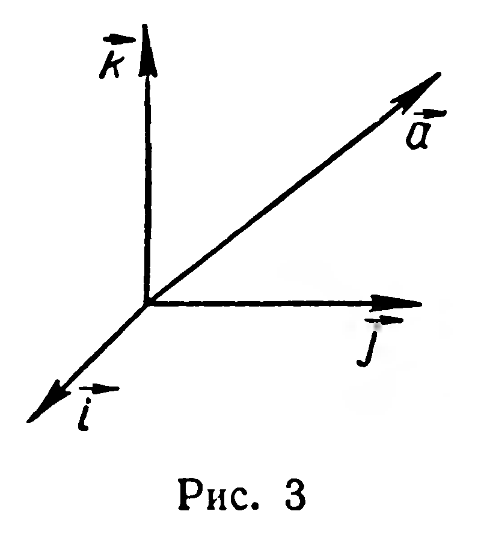
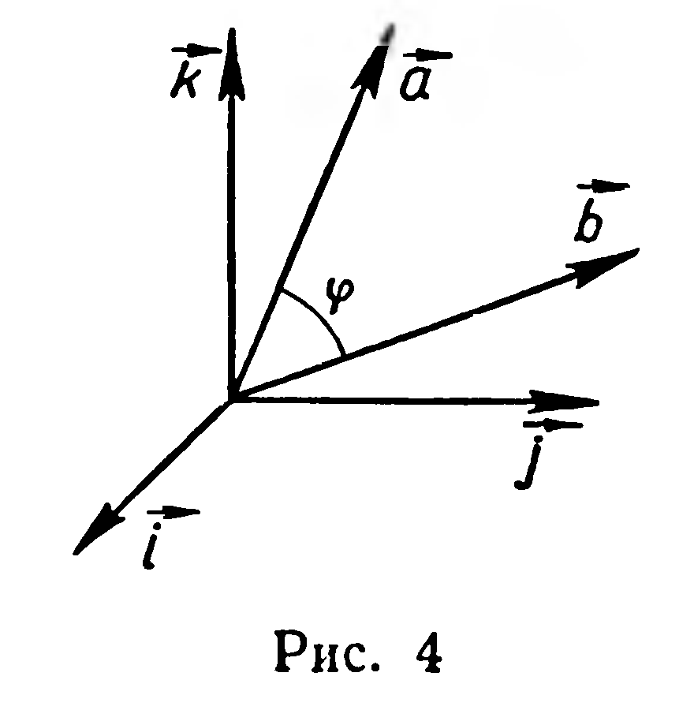
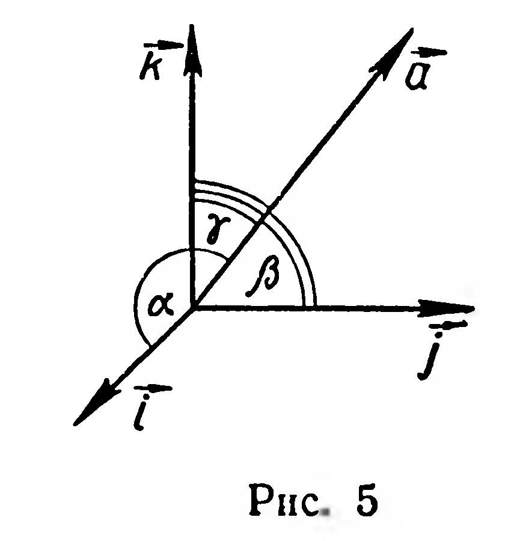

## 4.2. Вычисление длины вектора и угла между двумя векторами по их координатам

---
**стр. 107, продолжение**
---

## § 43. Вычисление длины вектора и угла между двумя векторами по их координатам

**Задача 1.** Найти длину вектора $\vec{a} = (x; y; z)$ (рис. 3).

**Решение.** Применив координатную формулу скалярного произведения (§ 42), получим: $\vec{a} \cdot \vec{a} = xx + yy + zz$ или $\vec{a}^2 = x^2 + y^2 + z^2$, отсюда $|\vec{a}| = \sqrt{x^2 + y^2 + z^2}$.

Итак, длина вектора равна корню квадратному из суммы квадратов его координат.

**Задача 2.** Найти угол $\varphi$ между ненулевыми векторами $\vec{a} = (x_1; y_1; z_1)$ и $\vec{b} = (x_2; y_2; z_2)$ (рис. 4).

**Решение.** Из определения скалярного произведения двух векторов следует, что $\cos \varphi = \frac{\vec{a} \cdot \vec{b}}{|\vec{a}| \cdot |\vec{b}|}$. Но $\vec{a} \cdot \vec{b} = x_1x_2 + y_1y_2 + z_1z_2$ (§ 42); $|\vec{a}| = \sqrt{x_1^2 + y_1^2 + z_1^2}$, $|\vec{b}| = \sqrt{x_2^2 + y_2^2 + z_2^2}$ (задача 1). Итак,

$$\cos \varphi = \frac{x_1x_2 + y_1y_2 + z_1z_2}{\sqrt{x_1^2 + y_1^2 + z_1^2} \cdot \sqrt{x_2^2 + y_2^2 + z_2^2}}.$$

---
**стр. 108**
---

## Задачи

**8.** Вычислите длины векторов: 1) $\vec{a} = \vec{i} - \vec{j} + \vec{k}$; 2) $\vec{b} = 2\vec{i} + \vec{j} - 3\vec{k}$; 3) $\vec{c} = \vec{j} - \vec{k}$; 4) $\vec{d} = -2\vec{j}$.

**9.** Длина вектора равна 3. Вычислите координаты вектора, если известно, что все они равны.

**10.** Вычислите длину вектора $\vec{a} + \vec{b}$, если: 1) $\vec{a} = (1; 2; -1)$, $\vec{b} = (3; 0; -2)$; 2) $\vec{a} = (1; -1; 3)$, $\vec{b} = (-1; 1; -3)$.

**11.** Вычислите длину вектора $2\vec{a} + 3\vec{b}$, если: 1) $\vec{a} = (1; 1; -1)$, $\vec{b} = (2; 0; 0)$; 2) $\vec{a} = (3; 1; 0)$, $\vec{b} = (0; 1; -1)$.

**12.** Найдите угол между векторами $\vec{a} = (-1; 2; -2)$ и $\vec{b} = (6; 3; -6)$.

**13.** Найдите косинус угла между векторами $\vec{a} - \vec{b}$ и $\vec{a} + \vec{b}$, если $\vec{a} = (1; 2; 1)$ и $\vec{b} = (2; -1; 0)$.

**14.** Вектор $\vec{a} = (p; q; r)$ образует с базисными векторами $\vec{i}$, $\vec{j}$, $\vec{k}$ углы $\alpha$, $\beta$, $\gamma$ соответственно (рис. 5).

1) Докажите, что единичный вектор, сонаправленный с вектором $\vec{a}$, имеет координаты $(\cos \alpha; \cos \beta; \cos \gamma)$.

2) Докажите равенство: $\cos^2 \alpha + \cos^2 \beta + \cos^2 \gamma = 1$.

3) Вычислите $\gamma$, если $\alpha = \beta = 60^\circ$.

**15.** Найдите косинусы углов, которые образует с базисными векторами вектор: 1) $\vec{a} = \vec{i} + \vec{j} + \vec{k}$; 2) $\vec{b} = -3\vec{j} - \vec{k}$; 3) $\vec{c} = -5\vec{i}$; 4) $\vec{d} = (0; 3; 4)$.
