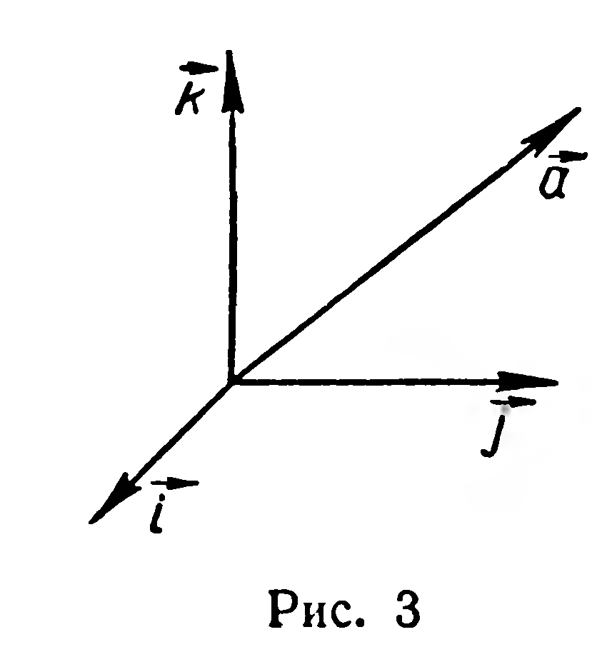
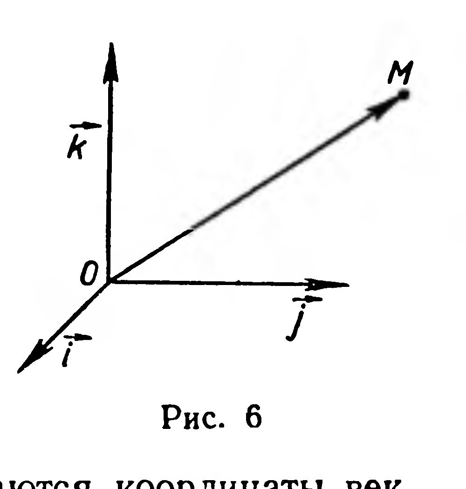
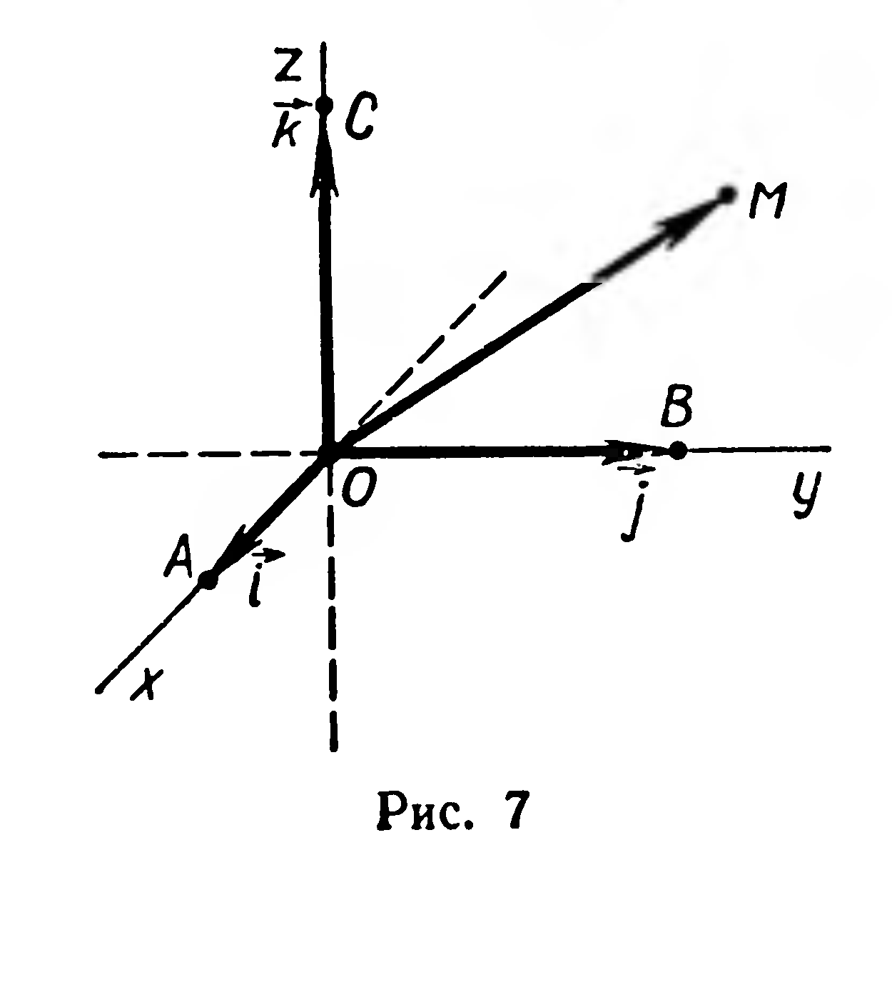
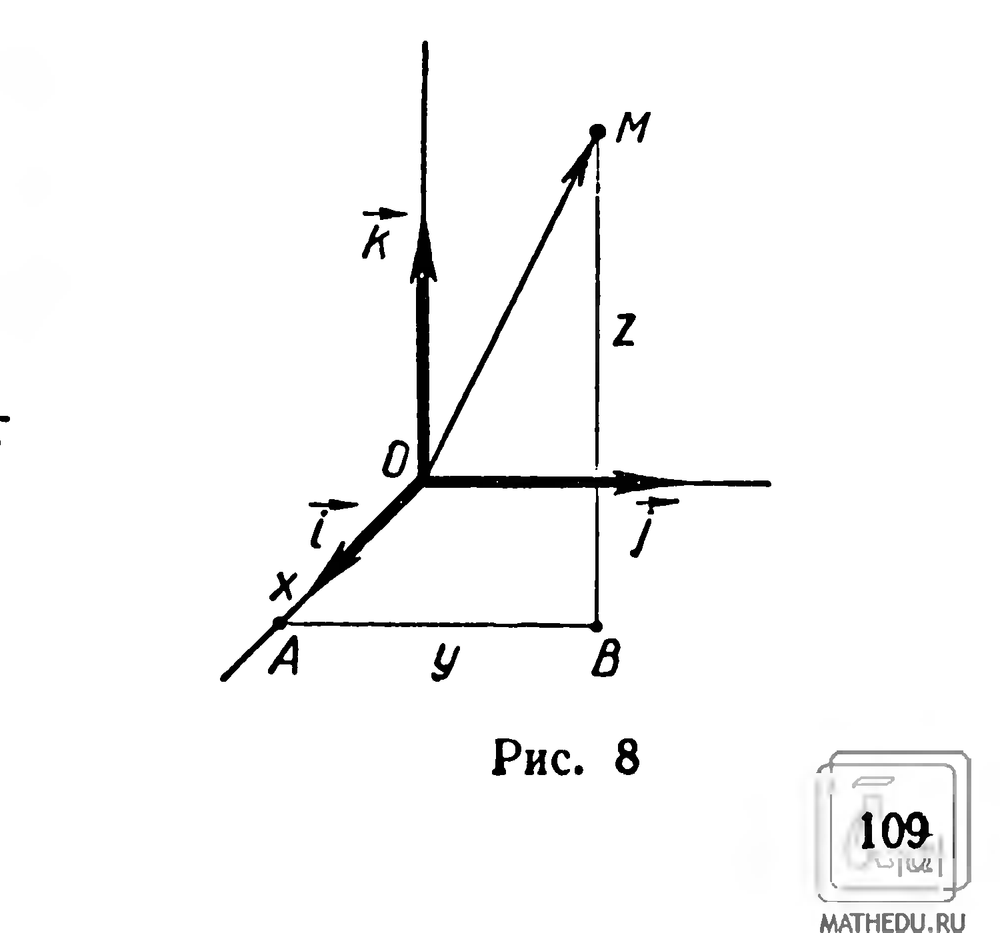

## 4.3. Прямоугольная система координат. Координаты точки

---
**стр. 108**
---

## Задачи

**8.** Вычислите длины векторов: 1) $\vec{a} = \vec{i} - \vec{j} + \vec{k}$; 2) $\vec{b} = 2\vec{i} + \vec{j} - 3\vec{k}$; 3) $\vec{c} = \vec{j} - \vec{k}$; 4) $\vec{d} = -2\vec{j}$.

**9.** Длина вектора равна 3. Вычислите координаты вектора, если известно, что все они равны.

**10.** Вычислите длину вектора $\vec{a} + \vec{b}$, если: 1) $\vec{a} = (1; 2; -1)$, $\vec{b} = (3; 0; -2)$; 2) $\vec{a} = (1; -1; 3)$, $\vec{b} = (-1; 1; -3)$.

**11.** Вычислите длину вектора $2\vec{a} + 3\vec{b}$, если: 1) $\vec{a} = (1; 1; -1)$, $\vec{b} = (2; 0; 0)$; 2) $\vec{a} = (3; 1; 0)$, $\vec{b} = (0; 1; -1)$.

**12.** Найдите угол между векторами $\vec{a} = (-1; 2; -2)$ и $\vec{b} = (6; 3; -6)$.

**13.** Найдите косинус угла между векторами $\vec{a} - \vec{b}$ и $\vec{a} + \vec{b}$, если $\vec{a} = (1; 2; 1)$ и $\vec{b} = (2; -1; 0)$.

**14.** Вектор $\vec{a} = (p; q; r)$ образует с базисными векторами $\vec{i}$, $\vec{j}$, $\vec{k}$ углы $\alpha$, $\beta$, $\gamma$ соответственно (рис. 5).

1) Докажите, что единичный вектор, сонаправленный с вектором $\vec{a}$, имеет координаты $(\cos \alpha; \cos \beta; \cos \gamma)$.

2) Докажите равенство: $\cos^2 \alpha + \cos^2 \beta + \cos^2 \gamma = 1$.

3) Вычислите $\gamma$, если $\alpha = \beta = 60^\circ$.

**15.** Найдите косинусы углов, которые образует с базисными векторами вектор: 1) $\vec{a} = \vec{i} + \vec{j} + \vec{k}$; 2) $\vec{b} = -3\vec{j} - \vec{k}$; 3) $\vec{c} = -5\vec{i}$; 4) $\vec{d} = (0; 3; 4)$.

## § 44. Прямоугольная система координат. Координаты точки

Пусть в пространстве задана точка $O$. Каждой точке $M$ поставим в соответствие вектор $\overrightarrow{OM}$; при этом различным точкам соответствуют неравные векторы. Кроме точки $O$, зададим прямоуголь-

---
**стр. 109**
---

ный базис $(\vec{i}; \vec{j}; \vec{k})$ (рис. 6). Каждый вектор имеет в этом базисе координаты:

$$\overrightarrow{OM} = (x; y; z).$$

Если заданы прямоугольный базис $(\vec{i}; \vec{j}; \vec{k})$ и точка $O$, то говорят, что задана прямоугольная система координат в пространстве. Точку $O$ называют началом координат, а векторы $\vec{i}, \vec{j}, \vec{k}$ — координатными векторами. Координатами точки $M$ в прямоугольной системе координат называются координаты вектора $\overrightarrow{OM}$ в базисе $(\vec{i}; \vec{j}; \vec{k})$.

Если $\overrightarrow{OM} = (x; y; z)$, то координаты точки $M$ записывают: $M(x; y; z)$. Число $x$ называют абсциссой, $y$ — ординатой, $z$ — аппликатой точки $M$.

Введем еще несколько часто употребляемых терминов. Оси, определяемые векторами $\overrightarrow{OA} = \vec{i}$, $\overrightarrow{OB} = \vec{j}$, $\overrightarrow{OC} = \vec{k}$, назовем координатными осями (рис. 7); плоскости, проходящие через каждые две координатные оси, — координатными плоскостями; пространство, в котором задана система координат, называют координатным пространством.

Задача 1. Дана прямоугольная система координат (рис. 8). Построить точку $M$ по ее координатам $(x; y; z)$.

Решение. Согласно определению координат точки задача сводится к построению направленного отрезка $OM$ (рис. 8), изображающего вектор $\overrightarrow{OM} = x\vec{i} + y\vec{j} + z\vec{k}$. Отложим последовательно векторы $\overrightarrow{OA} = x\vec{i}$, $\overrightarrow{AB} = y\vec{j}$ и $\overrightarrow{BM} = z\vec{k}$. Точка $M$ — искомая. Действительно, по правилу многоугольника $\overrightarrow{OM} = \overrightarrow{OA} + \overrightarrow{AB} + \overrightarrow{BM} = x\vec{i} + y\vec{j} + z\vec{k}$.

Задача 2. По координатам точек $A(x_1; y_1; z_1)$ и $B(x_2; y_2; z_2)$ найти координаты вектора $\overrightarrow{AB}$.

