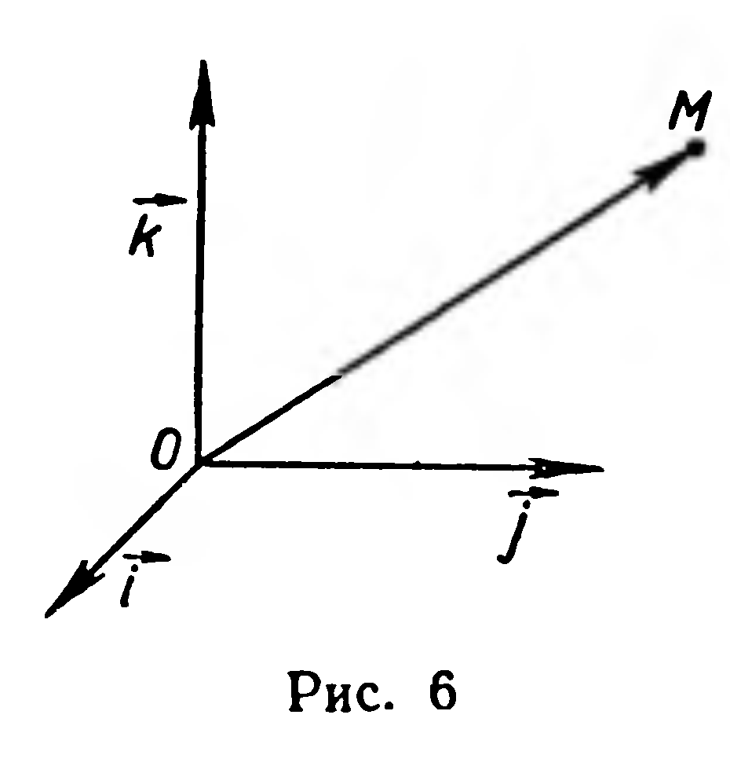
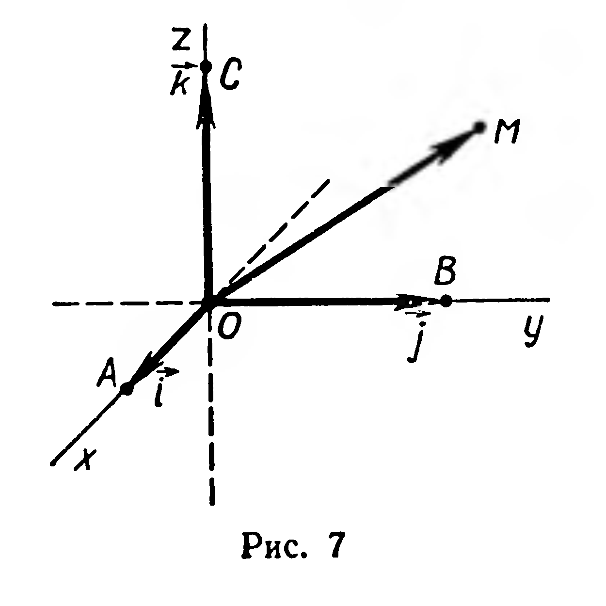
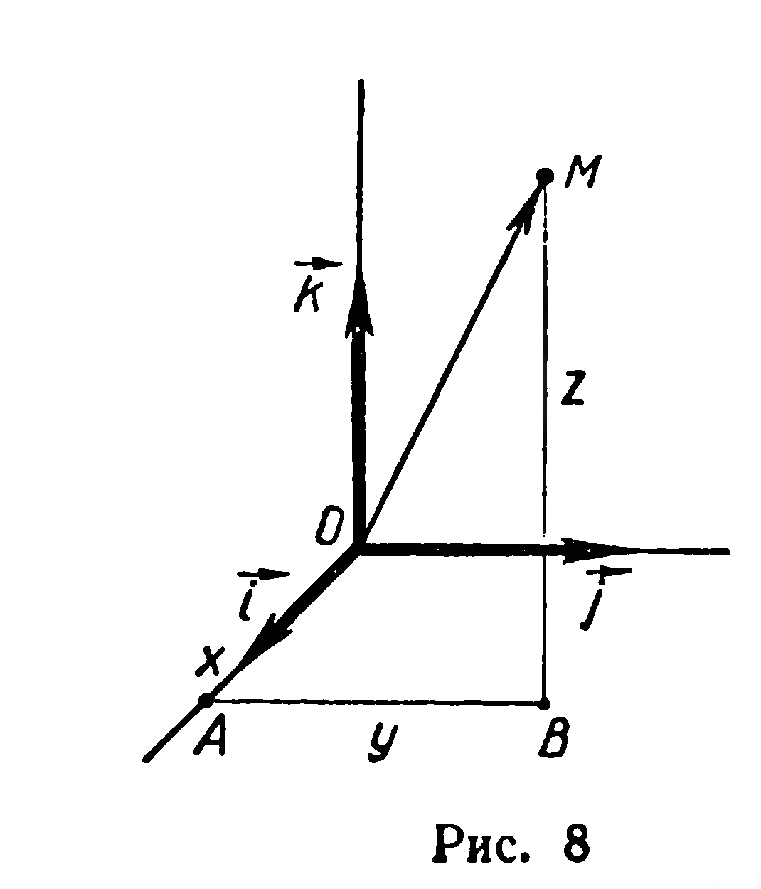

## 4.3. Прямоугольная система координат. Координаты точки

---
**стр. 108, продолжение**
---

## § 44. Прямоугольная система координат. Координаты точки

Пусть в пространстве задана точка $O$. Каждой точке $M$ поставим в соответствие вектор $\overrightarrow{OM}$; при этом различным точкам соответствуют неравные векторы. Кроме точки $O$, зададим прямоуголь-

---
**стр. 109**
---

ный базис $(\vec{i}; \vec{j}; \vec{k})$ (рис. 6). Каждый вектор имеет в этом базисе координаты:

$$\overrightarrow{OM} = (x; y; z).$$

Если заданы прямоугольный базис $(\vec{i}; \vec{j}; \vec{k})$ и точка $O$, то говорят, что задана прямоугольная система координат в пространстве. Точку $O$ называют началом координат, а векторы $\vec{i}, \vec{j}, \vec{k}$ — координатными векторами. Координатами точки $M$ в прямоугольной системе координат называются координаты вектора $\overrightarrow{OM}$ в базисе $(\vec{i}; \vec{j}; \vec{k})$.

Если $\overrightarrow{OM} = (x; y; z)$, то координаты точки $M$ записывают: $M(x; y; z)$. Число $x$ называют абсциссой, $y$ — ординатой, $z$ — аппликатой точки $M$.

Введем еще несколько часто употребляемых терминов. Оси, определяемые векторами $\overrightarrow{OA} = \vec{i}$, $\overrightarrow{OB} = \vec{j}$, $\overrightarrow{OC} = \vec{k}$, назовем координатными осями (рис. 7); плоскости, проходящие через каждые две координатные оси, — координатными плоскостями; пространство, в котором задана система координат, называют координатным пространством.

Задача 1. Дана прямоугольная система координат (рис. 8). Построить точку $M$ по ее координатам $(x; y; z)$.

Решение. Согласно определению координат точки задача сводится к построению направленного отрезка $OM$ (рис. 8), изображающего вектор $\overrightarrow{OM} = x\vec{i} + y\vec{j} + z\vec{k}$. Отложим последовательно векторы $\overrightarrow{OA} = x\vec{i}$, $\overrightarrow{AB} = y\vec{j}$ и $\overrightarrow{BM} = z\vec{k}$. Точка $M$ — искомая. Действительно, по правилу многоугольника $\overrightarrow{OM} = \overrightarrow{OA} + \overrightarrow{AB} + \overrightarrow{BM} = x\vec{i} + y\vec{j} + z\vec{k}$.

Задача 2. По координатам точек $A(x_1; y_1; z_1)$ и $B(x_2; y_2; z_2)$ найти координаты вектора $\overrightarrow{AB}$.

