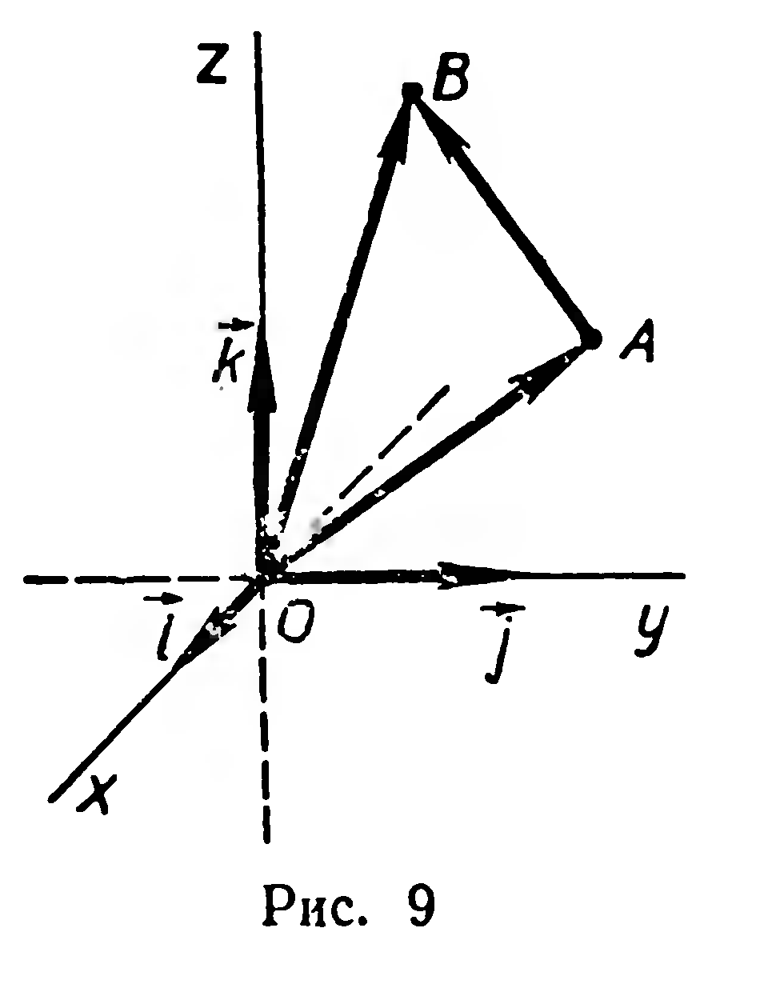
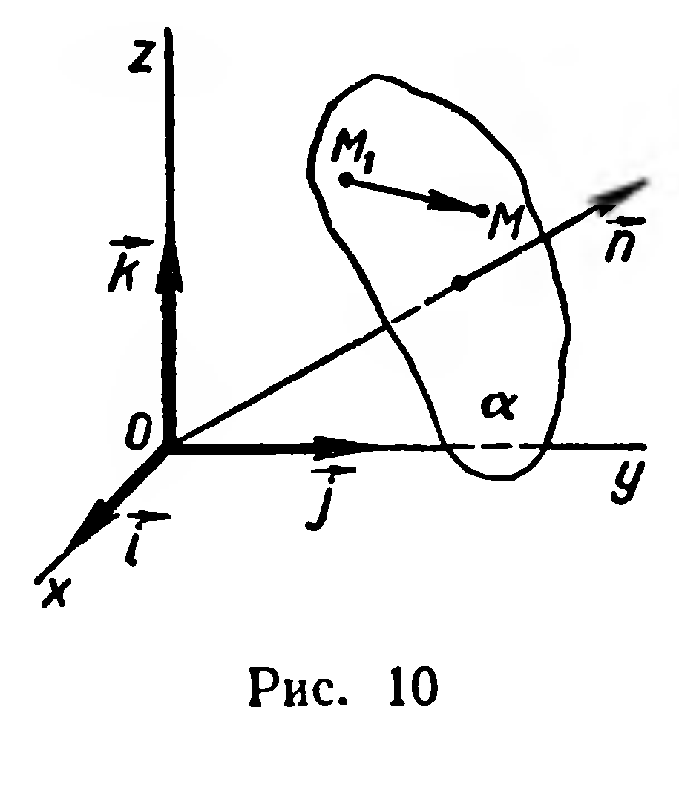
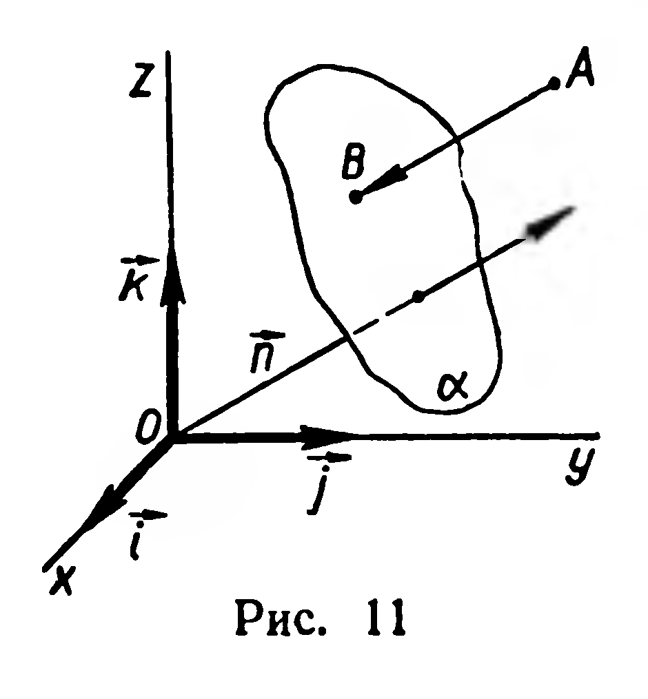

## 4.4. Уравнение плоскости

---
**стр. 110**
---

Решение. По формуле вычитания векторов (§ 19) $\overrightarrow{AB} = \overrightarrow{OB} - \overrightarrow{OA}$ (рис. 9). Согласно определению координат точки, $\overrightarrow{OB} = (x_2; y_2; z_2)$, $\overrightarrow{OA} = (x_1; y_1; z_1)$. Применяя правило вычитания векторов, заданных своими координатами (§ 42), получим:

$$\overrightarrow{AB} = (x_2 - x_1; y_2 - y_1; z_2 - z_1). \quad (1)$$

Задача 3. Найти расстояние между точками $A(x_1; y_1; z_1)$ и $B(x_2; y_2; z_2)$.

Решение. Достаточно найти длину вектора $\overrightarrow{AB}$ (рис. 9). Его координаты вычисляются по формуле (1). Применяя формулу для вычисления длины вектора (§ 43, задача 1), получим:

$$|AB| = \sqrt{(x_2 - x_1)^2 + (y_2 - y_1)^2 + (z_2 - z_1)^2}.$$

**Задачи**

16. Постройте точки по их координатам: 1) $A(2; 3; 1)$; 2) $B(1; -1; 2)$; 3) $D\left(-3; \frac{1}{2}; -1\right)$; 4) $E(0; 2; -3)$; 5) $G\left(0; 0; -\frac{3}{2}\right)$.

17. Найдите координаты вектора $\overrightarrow{PQ}$ по координатам точек $P$ и $Q$: 1) $P(2; -3; 0)$, $Q(-1; 2; -3)$; 2) $P\left(\frac{1}{2}; -\frac{4}{3}; \frac{5}{6}\right)$, $Q\left(-\frac{3}{5}; 0; \frac{2}{3}\right)$.

18. Точка $B$ является ортогональной проекцией точки $A(2; -3; 1)$ на координатную плоскость $Oyz$. Вычислите $|\overrightarrow{OB}|$.

19. Вычислите координаты точки, принадлежащей координатной оси $Oy$ и одинаково удаленной от точек $A(2; -1; 1)$ и $B(0; 1; 3)$.

20. Треугольник задан координатами своих вершин: $A(3; -2; 1)$, $B(3; 1; 5)$, $C(4; 0; 3)$. Вычислите: 1) длины медиан $AA_1$ и $BB_1$; 2) расстояние от начала координат до точки пересечения медиан треугольника $ABC$; 3) величины углов этого треугольника.

21. Вычислите длины диагоналей параллелограмма $ABCD$, если известны координаты точек: $A(1; -3; 0)$, $B(-2; 4; 1)$, $C(-3; 1; 1)$.

22*. Докажите, что точки $A(2; 4; -4)$, $B(1; 1; -3)$, $C(-2; 0; 5)$, $D(-1; 3; 4)$ являются вершинами параллелограмма, и вычислите величину угла между его диагоналями.

§ 45. УРАВНЕНИЕ ПЛОСКОСТИ

Введение прямоугольной системы координат в пространстве позволяет решать геометрические задачи методами, известными из курса алгебры. Рассмотрим уравнение с тремя переменными:

$$P(x, y, z) = 0.$$

---
**стр. 111**
---

---

---

Предположим, что множество его решений не пусто. Каждое решение есть тройка чисел $(x;\; y;\; z)$. В координатном пространстве этой тройке чисел соответствует точка $M\,(x;\; y;\; z)$.

Множество всех точек пространства, координаты которых являются решениями уравнения $P\,(x,\,y,\,z)=0$, есть некоторая фигура $\Phi$. Говорят, что это уравнение задает фигуру $\Phi$, или что оно является уравнением фигуры $\Phi$.

**1. Задача.** Составить уравнение плоскости $\alpha$, которая проходит через точку $M_1\,(x_1;\; y_1;\; z_1)$ и перпендикулярна¹ ненулевому вектору $\vec{n}=(a;\; b;\; c)$.

**Решение.** Для любой точки $M\,(x;\; y;\; z)$ плоскости $\alpha$ $(M\neq M_1)$ вектор $\overrightarrow{M_1M}$ перпендикулярен вектору $\vec{n}$ (рис. 10). Поэтому

$$\vec{n}\cdot\overrightarrow{M_1M}=0.\qquad(1)$$

Это равенство выполняется и в том случае, если $M=M_1$. Учитывая, что $\overrightarrow{M_1M}=(x-x_1;\; y-y_1;\; z-z_1)$ (§ 44, задача 2) и $\vec{n}=(a;\; b;\; c)$, из равенства (1) получим (§ 42):

$$a\,(x-x_1)+b\,(y-y_1)+c\,(z-z_1)=0.\qquad(2)$$

Координаты любой точки $N$, не принадлежащей $\alpha$, уравнению (2) не удовлетворяют, так как $\vec{n}\cdot\overrightarrow{M_1N}\neq0$.

Итак, каждую плоскость можно задать линейным уравнением с тремя переменными, имеющим по крайней мере один ненулевой коэффициент при переменных².

**2.** Убедимся теперь, что всякое уравнение первой степени с тремя переменными задает в координатном пространстве некоторую плоскость.

Рассмотрим произвольное уравнение первой степени:

$$ax+by+cz+d=0.\qquad(3)$$

Такое уравнение имеет бесконечное множество решений. Пусть $(x_1;\; y_1;\; z_1)$ — какое-нибудь его решение, тогда выполняется равенство:

$$ax_1+by_1+cz_1+d=0.\qquad(4)$$

¹ Будем говорить, что вектор $\overrightarrow{AA_1}$ перпендикулярен плоскости $\alpha$, если прямая $AA_1$ перпендикулярна этой плоскости.

² Такое уравнение будем называть в дальнейшем уравнением первой степени.

---
**стр. 112**
---

Вычитая из уравнения (3) равенство (4), получим уравнение, равносильное (3):

$$a\,(x-x_1)+b\,(y-y_1)+c\,(z-z_1)=0.\qquad(5)$$

Но уравнение (5) есть уравнение плоскости, проходящей через точку $M_1\,(x_1;\; y_1;\; z_1)$ и перпендикулярной вектору $\vec{n}=(a;\; b;\; c)$. Такая плоскость единственна (§ 29). ■

Итак, имеет место следующая теорема:

**26. Теорема.** Всякое уравнение первой степени $ax+by+cz+d=0$ задает в координатном пространстве единственную плоскость, которая перпендикулярна вектору с координатами $(a;\; b;\; c)$.

Зная координаты вектора $\vec{n}=(a;\; b;\; c)$, можно решить вопрос о расположении плоскости $ax+by+cz+d=0$ относительно координатных осей. Например, если $c\neq0$, $a=b=0$, то $\vec{n}=(0;\;0;\;c)$, т. е. $\vec{n}=c\vec{k}$. Следовательно, уравнение $cz+d=0$ задает плоскость, перпендикулярную оси аппликат.

**Задачи**

**23.** Даны точки $A\,(3;\;2;\;5)$, $B\,(-1;\;-2;\;2)$, $C\,(7;\;0;\;-9)$, $D\!\left(\frac{3}{4};\;\frac{5}{6};\;6\right)$. Укажите, какие из них принадлежат плоскости $2x-3y+z-5=0$.

**24.** Постройте линии пересечения координатных плоскостей с плоскостью: 1) $2x+3y-z-6=0$; 2) $3x-4y+2z-12=0$.

**25.** Составьте уравнение плоскости, если известно, что точка $N\,(3;\;5;\;2)$ является основанием перпендикуляра, проведенного из начала координат к этой плоскости.

**26.** Составьте уравнение плоскости, если известно, что она проходит через начало координат и перпендикулярна вектору $\vec{n}=(-6;\;3;\;6)$.

**27.** Составьте уравнение плоскости, проходящей через точку $A\,(2;\;3;\;-1)$ и перпендикулярной прямой, которой принадлежат точки: 1) $B\,(1;\;0;\;-1)$ и $C\,(-3;\;1;\;-2)$; 2) $D\,(-1;\;0;\;0)$ и $E\,(0;\;1;\;-3)$.

**28.** Вычислить расстояние от точки $A(1;\;2;\;-7)$ до плоскости, заданной уравнением $12x+4y+3z-4=0$.

**Решение.** Пусть $|AB|$ — расстояние от точки $A$ до данной плоскости $\alpha$ (рис. 11). Тогда вектор $\overrightarrow{AB}$ коллинеарен вектору $\vec{n}=(12;\;4;\;3)$, поэтому при некотором $p$ имеем: $\overrightarrow{AB}=p\vec{n}$. Обозначим через $(x_1;\;y_1;\;z_1)$ координаты точки $B$, тогда $\overrightarrow{AB}=\overrightarrow{OB}-\overrightarrow{OA}=$
