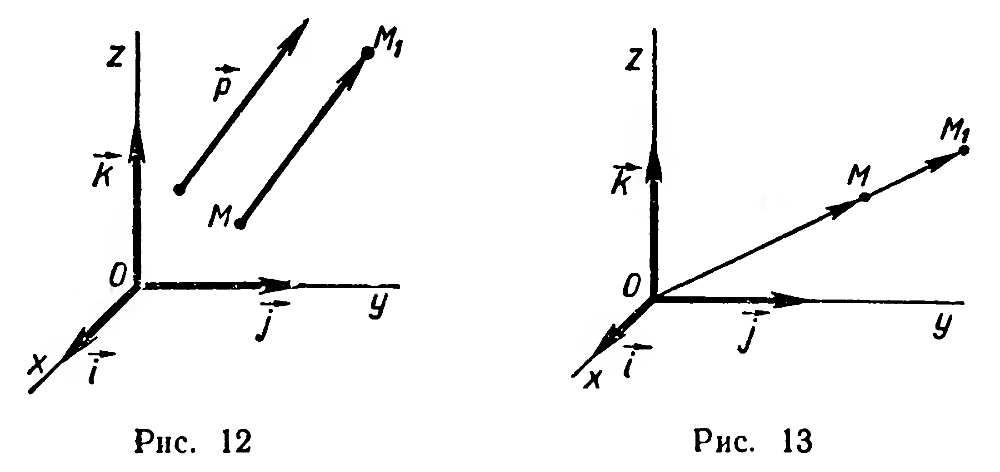
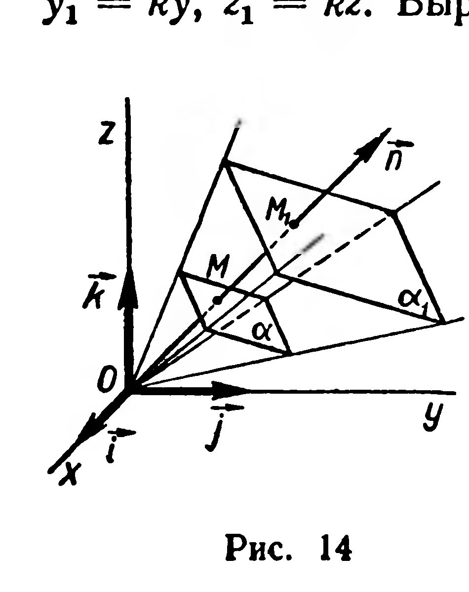

## 4.5. Координатные формулы преобразований. Гомотетия

---
**стр. 113, продолжение**
---

## § 46. Координатные формулы преобразований. Гомотетия

1. Пусть заданы прямоугольная система координат и преобразование $f$ пространства. Можно поставить задачу: вывести формулы, которые позволили бы по координатам произвольной точки $M$ вычислить координаты ее образа $f(M)$. Такие формулы называют *координатными формулами преобразования $f$*.

Задача 1. Найти координатные формулы параллельного переноса (вектора) $\vec{p} = (a; b; c)$.

Решение. Рассмотрим произвольную точку $M(x; y; z)$ и ее образ $M_1(x_1; y_1; z_1)$ (рис. 12). Из условия $\vec{p}(M) = M_1$ вытекает, что $\overrightarrow{MM_1} = \vec{p}$. Переходя в этом равенстве к координатам (§ 44, задача 2), получим: $x_1 - x = a$, $y_1 - y = b$, $z_1 - z = c$. Отсюда

$$x_1 = a + x,\quad y_1 = b + y,\quad z_1 = c + z.$$

2. Гомотетия пространства определяется так же, как и гомотетия плоскости.

Определение. Гомотетией с центром $O$ и коэффициентом $k \neq 0$ называется преобразование пространства, при котором образом произвольной точки $M$ является такая точка $M_1$, что $\overrightarrow{OM_1} = k\overrightarrow{OM}$.

---
**стр. 114**
---

Задача 2. Найти координатные формулы гомотетии с центром в начале координат и коэффициентом $k$.

Решение. Рассмотрим произвольную точку $M(x; y; z)$ и ее образ $M_1(x_1; y_1; z_1)$ при гомотетии $H_o^k$ (рис. 13). По определению гомотетии $\overrightarrow{OM_1} = k\overrightarrow{OM}$. Переходя в этом равенстве к координатам, получим:

$$x_1 = kx,\quad y_1 = ky,\quad z_1 = kz.$$

Все свойства гомотетии, изученные в планиметрии, распространяются на пространство (доказательства аналогичны). Поэтому ограничимся рассмотрением только одного нового свойства.

**27. Теорема.** *При гомотетии плоскость отображается на параллельную ей плоскость.*

Доказательство. Рассмотрим гомотетию $H_o^k$ и плоскость $\alpha$. Прямоугольную систему координат выберем так, чтобы ее начало совпадало с центром гомотетии (рис. 14). Плоскость $\alpha$ имеет уравнение

$$ax + by + cz + d = 0. \tag{1}$$

Чтобы найти уравнение образа плоскости $\alpha$, воспользуемся координатными формулами гомотетии (задача 2). Имеем: $x_1 = kx$, $y_1 = ky$, $z_1 = kz$. Выразив из этих формул $x$, $y$, $z$ и подставив их значения в уравнение $(1)$, получим уравнение:

$$\frac{a}{k}x_1 + \frac{b}{k}y_1 + \frac{c}{k}z_1 + d = 0.$$

Переходя к привычным для нас обозначениям переменных, получим окончательно:

$$ax + by + cz + kd = 0. \tag{2}$$

Итак, уравнением образа плоскости $\alpha$ является уравнение первой степени.

---
**стр. 115**
---

Следовательно, образом плоскости $\alpha$ при гомотетии $H_o^k$ является плоскость $\alpha_1$ с уравнением (2).

Плоскости $\alpha$ и $\alpha_1$ параллельны, так как каждая из них перпендикулярна вектору $\vec n = (a;\ b;\ c)$. ■

**Задачи**

**34.** Составьте уравнение образа плоскости $3x - y + 8z - 17 = 0$: 1) при переносе $\vec p = (-1;\ 5;\ 3)$; 2) при гомотетии $H_o^{-\frac{3}{2}}$.

**35.** Найдите координатные формулы: 1) центральной симметрии с центром $O\ (0;\ 0;\ 0)$; 2) симметрии относительно плоскости $z = 0$; 3) симметрии относительно оси аппликат.

**36\*.** Пользуясь решением предыдущей задачи, составьте уравнение образа плоскости $7x - 2y - 5z - 1 = 0$: 1) при симметрии $Z_o$; 2) при симметрии относительно плоскости $z = 0$; 3) при симметрии относительно оси аппликат.

**37.** 1) Какие точки, прямые и плоскости при гомотетии отображаются на себя? 2) Какие гомотетии являются перемещениями?

**38.** Дано изображение тетраэдра и точки $O$. Постройте образ этого тетраэдра при гомотетии $H_o^k$, если: 1) $k = -2$; 2) $k = 0{,}5$. В обоих случаях найдите отношение площадей поверхностей данного и построенного тетраэдров.

**39.** 1) Принимая за центр гомотетии $H_o^k$ одну из вершин параллелепипеда, постройте его образ при $k = \frac{1}{3}$. 2) Найдите отношение площадей поверхностей параллелепипеда и его образа.
