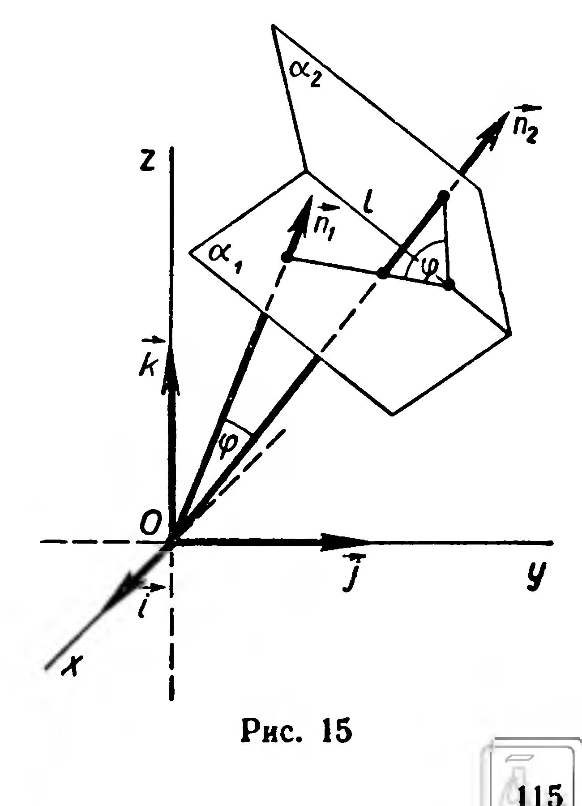

## 4.6. Задачи на повторение к главе IV

---
**стр. 115**
---

Следовательно, образом плоскости $\alpha$ при гомотетии $H_o^k$ является плоскость $\alpha_1$ с уравнением (2).

Плоскости $\alpha$ и $\alpha_1$ параллельны, так как каждая из них перпендикулярна вектору $\vec n = (a;\ b;\ c)$. ■

**Задачи**

**34.** Составьте уравнение образа плоскости $3x - y + 8z - 17 = 0$: 1) при переносе $\vec p = (-1;\ 5;\ 3)$; 2) при гомотетии $H_o^{-\frac{3}{2}}$.

**35.** Найдите координатные формулы: 1) центральной симметрии с центром $O\ (0;\ 0;\ 0)$; 2) симметрии относительно плоскости $z = 0$; 3) симметрии относительно оси аппликат.

**36\*.** Пользуясь решением предыдущей задачи, составьте уравнение образа плоскости $7x - 2y - 5z - 1 = 0$: 1) при симметрии $Z_o$; 2) при симметрии относительно плоскости $z = 0$; 3) при симметрии относительно оси аппликат.

**37.** 1) Какие точки, прямые и плоскости при гомотетии отображаются на себя? 2) Какие гомотетии являются перемещениями?

**38.** Дано изображение тетраэдра и точки $O$. Постройте образ этого тетраэдра при гомотетии $H_o^k$, если: 1) $k = -2$; 2) $k = 0{,}5$. В обоих случаях найдите отношение площадей поверхностей данного и построенного тетраэдров.

**39.** 1) Принимая за центр гомотетии $H_o^k$ одну из вершин параллелепипеда, постройте его образ при $k = \frac{1}{3}$. 2) Найдите отношение площадей поверхностей параллелепипеда и его образа.

**Задачи на повторение к главе IV**

**40.** Вычислите координаты единичного вектора $\vec a$, если известно, что он перпендикулярен векторам $\vec b = (1;\ 1;\ 0)$ и $\vec c = (0;\ 1;\ 1)$.

**41.** Прямая задана точками $A\ (6;\ 0;\ 2)$ и $B\ (1;\ -3;\ 4)$. Найдите значения $x$ и $y$, при которых точка $M\ (x;\ y;\ 8)$ принадлежит $(AB)$.

**42.** Найдите координаты точки пересечения плоскости $2x - y + z - 3 = 0$ и прямой, проходящей через данные точки $A\ (-1;\ 0;\ 2)$ и $B\ (3;\ 1;\ 2)$.

**43\*.** Найдите угол между плоскостями: 1) $2x + 3y + 6z - 5 = 0$ и $4x + 4y + 2z - 7 = 0$;

---
**стр. 116**
---

2) $2x - y + 2z - 7 = 0$ и $4x - 3y + 5 = 0$; 3) $x + 5y - 4z + 1 = 0$ и $x + y - z - 10 = 0$.

**Решение:** 1) Рассмотрим векторы $\vec n_1 = (2;\ 3;\ 6)$ и $\vec n_2 = (4;\ 4;\ 2)$, перпендикулярные к данным плоскостям $\alpha_1$ и $\alpha_2$ (рис. 15). Угол между векторами $\vec n_1$ и $\vec n_2$ равен углу между плоскостями $\alpha_1$ и $\alpha_2$ или дополняет его до $180^\circ$ (рис. 15). Следовательно, задача сводится к нахождению угла $\varphi$ между векторами $\vec n_1$ и $\vec n_2$.

Применяя определение скалярного произведения, получим:

$$\cos \varphi = \frac{\vec n_1 \cdot \vec n_2}{|\vec n_1| \cdot |\vec n_2|} = \frac{2 \cdot 4 + 3 \cdot 4 + 6 \cdot 2}{\sqrt{2^2+3^2+6^2} \cdot \sqrt{4^2+4^2+2^2}} = \frac{16}{21}.$$

Тогда $\cos (\widehat{\alpha_1, \alpha_2}) = |\cos \varphi|$, $\varphi \approx 40^\circ 22'$.

**44.** 1) Найдите косинусы углов между плоскостью $2x - 6y + 3z - 5 = 0$ и координатными плоскостями.

2) Вычислите углы между координатными осями и плоскостью $x + 8y + 4z - 2 = 0$.

**45.** Прямая задана точками $A\ (1;\ -1;\ 1)$ и $B\ (-3;\ 2;\ 1)$. Найдите угол между прямой $AB$ и плоскостью:

1) $6x + 2y - 3z - 7 = 0$; 2) $5x - y + 8z = 0$.

**46\*.** Найти множество всех точек $P$ пространства, для которых $|PA|^2 + |PC|^2 = |PB|^2 + |PD|^2$, где $A$, $B$, $C$, $D$ — данные точки, причем $|AB| \neq |DC|$.

**Решение.** Обозначим координаты данных точек: $A\ (x_1;\ y_1;\ z_1)$, $B\ (x_2;\ y_2;\ z_2)$, $C\ (x_3;\ y_3;\ z_3)$, $D\ (x_4;\ y_4;\ z_4)$; координаты произвольной точки искомого множества обозначим $(x;\ y;\ z)$. Имеем:

$$(x-x_1)^2 + (y-y_1)^2 + (z-z_1)^2 + (x-x_3)^2 + (y-y_3)^2 + (z-z_3)^2 =$$
$$= (x-x_2)^2 + (y-y_2)^2 + (z-z_2)^2 + (x-x_4)^2 + (y-y_4)^2 + (z-z_4)^2.$$

Выполнив упрощения, получим:

$$2(x_2-x_1+x_4-x_3)x + 2(y_2-y_1+y_4-y_3)y + 2(z_2-z_1+z_4-z_3)z +$$
$$+ (x_1^2-x_2^2+x_3^2-x_4^2) + (y_1^2-y_2^2+y_3^2-y_4^2) + (z_1^2-z_2^2+z_3^2-z_4^2) = 0. \tag{1}$$

Замечаем, что в уравнении (1) коэффициенты при переменных являются координатами вектора $\overrightarrow{OB} - \overrightarrow{OA} + \overrightarrow{OD} - \overrightarrow{OC} = \overrightarrow{AB} - \overrightarrow{DC}$.

По условию задачи $\overrightarrow{AB} - \overrightarrow{DC} \neq \vec 0$, поэтому хотя бы один из коэффициентов при переменных в уравнении (1) отличен от нуля. Следовательно, уравнение (1) есть уравнение плоскости, перпендикулярной к вектору $\overrightarrow{AB} - \overrightarrow{DC}$.

**47.** Докажите, что при гомотетии каждый угол отображается на конгруэнтный ему угол.

**48.** Найдите координатные формулы гомотетии с центром $S\ (a;\ b;\ c)$ и коэффициентом $k$.
